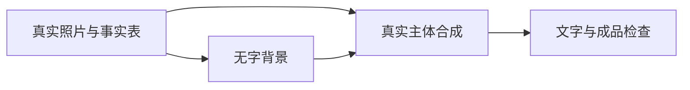

# 电商AI作图出图完整攻略：主图、详情页、A+图、API版、工具版、网站版与跨境平台实战指南｜2026年10月通用版

> 适用对象：电商AI作图小白、国内电商运营、跨境卖家、Amazon/Shopee卖家、Shopify独立站团队、设计师、老板。<br> 覆盖场景：白底图、主图、详情页、A+图、场景图、模特图、Banner、批量SKU素材、图片质检。<br> 本版不展开：上架系统、视频制作、客服系统、数据分析系统、成人用品、Etsy、TikTok Shop。<br> 核心原则：真实产品图做基础，AI负责效率和场景，人工负责真实性和合规。

快速导航：按你的角色和任务跳章节

| 你是谁 | 你要做什么 | 直接跳到 |
| --- | --- | --- |
| 完全小白 | 第一次用AI做电商图 | [一、小白先看](https://wangge-dev.github.io/ai-visual-creation-handbook/#一小白先看电商ai作图从哪里开始) → [十四、案例](https://wangge-dev.github.io/ai-visual-creation-handbook/#十五从一张产品图到完整详情页案例) |
| 国内运营 | 做淘宝/京东/拼多多主图+详情页 | [二、按资料选流程](https://wangge-dev.github.io/ai-visual-creation-handbook/#二你现在手上有什么资料就按什么流程做) → [十一、合规](https://wangge-dev.github.io/ai-visual-creation-handbook/#十一国内电商平台ai图合规边界) → [十三、SOP](https://wangge-dev.github.io/ai-visual-creation-handbook/#十三标准电商ai作图sop) |
| Amazon卖家 | 做主图+A+图 | [十二、跨境方案](https://wangge-dev.github.io/ai-visual-creation-handbook/#十二跨境平台方案amazonshopeeshopify) → [十六、A+图方案](https://wangge-dev.github.io/ai-visual-creation-handbook/#十六amazon-a图ai辅助方案) |
| Shopee卖家 | 做促销图+详情图 | [十二、跨境方案](https://wangge-dev.github.io/ai-visual-creation-handbook/#十二跨境平台方案amazonshopeeshopify) → [十八、提示词模板](https://wangge-dev.github.io/ai-visual-creation-handbook/#十八电商ai作图提示词模板库) |
| Shopify独立站 | 做品牌视觉+Banner | [十二、跨境方案](https://wangge-dev.github.io/ai-visual-creation-handbook/#十二跨境平台方案amazonshopeeshopify) → [十四、案例](https://wangge-dev.github.io/ai-visual-creation-handbook/#十五从一张产品图到完整详情页案例) |
| 服装卖家 | 做模特图/试穿图 | [十七、虚拟试穿](https://wangge-dev.github.io/ai-visual-creation-handbook/#十七ai虚拟试穿与服装电商) → [十八、提示词模板](https://wangge-dev.github.io/ai-visual-creation-handbook/#十八电商ai作图提示词模板库) |
| 设计师 | 进阶工作流/批量出图 | [十、ComfyUI](https://wangge-dev.github.io/ai-visual-creation-handbook/#十comfyui电商工作流专区) → [九、GitHub资源](https://wangge-dev.github.io/ai-visual-creation-handbook/#九github提示词库与开源资源) |
| 老板/团队负责人 | 搭SOP/管团队 | [十三、SOP](https://wangge-dev.github.io/ai-visual-creation-handbook/#十三标准电商ai作图sop) → [二十、团队路线](https://wangge-dev.github.io/ai-visual-creation-handbook/#二十新手与团队上手路线) |
| 有开发能力 | 接API批量出图 | [五、API说明](https://wangge-dev.github.io/ai-visual-creation-handbook/#五apiapi-key订阅会员和额度说明) → [六、Codex/Agent](https://wangge-dev.github.io/ai-visual-creation-handbook/#六codexagent在电商作图里到底负责什么) |

---

## 目录

1. [小白先看：电商AI作图从哪里开始](https://wangge-dev.github.io/ai-visual-creation-handbook/#%E4%B8%80%E5%B0%8F%E7%99%BD%E5%85%88%E7%9C%8B%E7%94%B5%E5%95%86ai%E4%BD%9C%E5%9B%BE%E4%BB%8E%E5%93%AA%E9%87%8C%E5%BC%80%E5%A7%8B)
2. [你现在手上有什么资料，就按什么流程做](https://wangge-dev.github.io/ai-visual-creation-handbook/#%E4%BA%8C%E4%BD%A0%E7%8E%B0%E5%9C%A8%E6%89%8B%E4%B8%8A%E6%9C%89%E4%BB%80%E4%B9%88%E8%B5%84%E6%96%99%E5%B0%B1%E6%8C%89%E4%BB%80%E4%B9%88%E6%B5%81%E7%A8%8B%E5%81%9A)
3. [AI能做哪些电商图](https://wangge-dev.github.io/ai-visual-creation-handbook/#%E4%B8%89ai%E8%83%BD%E5%81%9A%E5%93%AA%E4%BA%9B%E7%94%B5%E5%95%86%E5%9B%BE)
4. [三种路线：网站版、工具版、API版](https://wangge-dev.github.io/ai-visual-creation-handbook/#%E5%9B%9B%E4%B8%89%E7%A7%8D%E8%B7%AF%E7%BA%BF%E7%BD%91%E7%AB%99%E7%89%88%E5%B7%A5%E5%85%B7%E7%89%88api%E7%89%88)
5. [API、API Key、订阅会员和额度说明](https://wangge-dev.github.io/ai-visual-creation-handbook/#%E4%BA%94apiapi-key%E8%AE%A2%E9%98%85%E4%BC%9A%E5%91%98%E5%92%8C%E9%A2%9D%E5%BA%A6%E8%AF%B4%E6%98%8E)
6. [Codex/Agent在电商作图里到底负责什么](https://wangge-dev.github.io/ai-visual-creation-handbook/#%E5%85%ADcodexagent%E5%9C%A8%E7%94%B5%E5%95%86%E4%BD%9C%E5%9B%BE%E9%87%8C%E5%88%B0%E5%BA%95%E8%B4%9F%E8%B4%A3%E4%BB%80%E4%B9%88)
7. [主流模型与工具选择](https://wangge-dev.github.io/ai-visual-creation-handbook/#%E4%B8%83%E4%B8%BB%E6%B5%81%E6%A8%A1%E5%9E%8B%E4%B8%8E%E5%B7%A5%E5%85%B7%E9%80%89%E6%8B%A9)
8. [AI电商作图专题平台](https://wangge-dev.github.io/ai-visual-creation-handbook/#%E5%85%ABai%E7%94%B5%E5%95%86%E4%BD%9C%E5%9B%BE%E4%B8%93%E9%A2%98%E5%B9%B3%E5%8F%B0)
9. [GitHub提示词库与开源资源](https://wangge-dev.github.io/ai-visual-creation-handbook/#%E4%B9%9Dgithub%E6%8F%90%E7%A4%BA%E8%AF%8D%E5%BA%93%E4%B8%8E%E5%BC%80%E6%BA%90%E8%B5%84%E6%BA%90)
10. [ComfyUI电商工作流专区](https://wangge-dev.github.io/ai-visual-creation-handbook/#%E5%8D%81comfyui%E7%94%B5%E5%95%86%E5%B7%A5%E4%BD%9C%E6%B5%81%E4%B8%93%E5%8C%BA)
11. [国内电商平台AI图合规边界](https://wangge-dev.github.io/ai-visual-creation-handbook/#%E5%8D%81%E4%B8%80%E5%9B%BD%E5%86%85%E7%94%B5%E5%95%86%E5%B9%B3%E5%8F%B0ai%E5%9B%BE%E5%90%88%E8%A7%84%E8%BE%B9%E7%95%8C)
12. [跨境平台方案：Amazon、Shopee、Shopify](https://wangge-dev.github.io/ai-visual-creation-handbook/#%E5%8D%81%E4%BA%8C%E8%B7%A8%E5%A2%83%E5%B9%B3%E5%8F%B0%E6%96%B9%E6%A1%88amazonshopeeshopify)
13. [标准电商AI作图SOP](https://wangge-dev.github.io/ai-visual-creation-handbook/#%E5%8D%81%E4%B8%89%E6%A0%87%E5%87%86%E7%94%B5%E5%95%86ai%E4%BD%9C%E5%9B%BEsop)
14. [各平台图片规格速查表](https://wangge-dev.github.io/ai-visual-creation-handbook/#%E5%8D%81%E5%9B%9B%E5%90%84%E5%B9%B3%E5%8F%B0%E5%9B%BE%E7%89%87%E8%A7%84%E6%A0%BC%E9%80%9F%E6%9F%A5%E8%A1%A8)
15. [从一张产品图到完整详情页案例](https://wangge-dev.github.io/ai-visual-creation-handbook/#%E5%8D%81%E4%BA%94%E4%BB%8E%E4%B8%80%E5%BC%A0%E4%BA%A7%E5%93%81%E5%9B%BE%E5%88%B0%E5%AE%8C%E6%95%B4%E8%AF%A6%E6%83%85%E9%A1%B5%E6%A1%88%E4%BE%8B)
16. [Amazon A+图AI辅助方案](https://wangge-dev.github.io/ai-visual-creation-handbook/#%E5%8D%81%E5%85%ADamazon-a%E5%9B%BEai%E8%BE%85%E5%8A%A9%E6%96%B9%E6%A1%88)
17. [AI虚拟试穿与服装电商](https://wangge-dev.github.io/ai-visual-creation-handbook/#%E5%8D%81%E4%B8%83ai%E8%99%9A%E6%8B%9F%E8%AF%95%E7%A9%BF%E4%B8%8E%E6%9C%8D%E8%A3%85%E7%94%B5%E5%95%86)
18. [电商AI作图提示词模板库](https://wangge-dev.github.io/ai-visual-creation-handbook/#%E5%8D%81%E5%85%AB%E7%94%B5%E5%95%86ai%E4%BD%9C%E5%9B%BE%E6%8F%90%E7%A4%BA%E8%AF%8D%E6%A8%A1%E6%9D%BF%E5%BA%93)
19. [质检清单与常见问题](https://wangge-dev.github.io/ai-visual-creation-handbook/#%E5%8D%81%E4%B9%9D%E8%B4%A8%E6%A3%80%E6%B8%85%E5%8D%95%E4%B8%8E%E5%B8%B8%E8%A7%81%E9%97%AE%E9%A2%98)
20. [新手与团队上手路线](https://wangge-dev.github.io/ai-visual-creation-handbook/#%E4%BA%8C%E5%8D%81%E6%96%B0%E6%89%8B%E4%B8%8E%E5%9B%A2%E9%98%9F%E4%B8%8A%E6%89%8B%E8%B7%AF%E7%BA%BF)

---

## 一、小白先看：电商AI作图从哪里开始

很多电商小白卡住，不是因为AI工具不够多，而是因为不知道第一步该做什么。

如果你是新手，不要一开始研究API、ComfyUI、模型参数、工作流节点。先跑通一张图。

但在跑通之前，有几件前置事项必须先准备好。否则你打开工具也不知道该上传什么、输入什么。

### 0. 开始之前：你需要准备什么

#### 0.1 先搞清楚：AI作图在你的流程里负责什么

AI不是万能美工。在电商作图流程中，AI通常负责：

```text
✅ 换背景、生成场景
✅ 统一光影和色调
✅ 扩图、裁切适配多尺寸
✅ 批量生成候选图
✅ 辅助卖点视觉化
```

AI不擅长或不能直接做的：

```text
❌ 凭空生成一个逼真的正式产品主图（必须基于真实产品图）
❌ 生成准确的中文长文（文字必须后期排版）
❌ 生成真实认证标识、检测数据
❌ 替代人工判断产品是否失真、是否合规
```

理解了这个边界，后面才知道哪些环节用AI、哪些环节必须人工。

#### 0.2 资料准备：你需要提前整理这些东西

在打开任何AI作图工具之前，先准备好以下资料。没有这些，你连提示词都写不出来。

| 资料 | 说明 | 必须/可选 |
| --- | --- | --- |
| 产品实拍图/白底图 | 至少1张清晰的产品照片，白底最佳，手机拍也行但要清晰 | 必须 |
| 产品名称和基础信息 | 名称、颜色、材质、尺寸、重量 | 必须 |
| 核心卖点3-5条 | 用文字列出你最想表达的卖点，如"无线充电""食品级材质" | 必须 |
| 目标平台 | 淘宝/Amazon/Shopee/Shopify等，不同平台图片规范和风格不同 | 必须 |
| 目标人群 | 如"25-35岁上班族""健身人群""宝妈"，影响场景和风格选择 | 建议有 |
| 竞品参考图 | 3-5张竞品链接或截图，参考构图和风格（不是照搬） | 建议有 |
| 品牌风格关键词 | 如"简约""清新""科技感""高端"，用于统一视觉方向 | 建议有 |
| logo源文件 | 如果需要后期加logo，准备PNG透明底或矢量文件 | 可选 |
| 平台图片规范 | 目标平台对主图、详情页的尺寸和要求（后面章节有整理） | 可选 |

建议用一个简单的文档或表格整理好，后面写提示词、出图、质检都要反复对照。

#### 0.3 账号准备：这些工具先注册好

不用一次全注册。按你的需求选2-3个就够起步。

| 用途 | 推荐工具 | 是否免费 | 注册方式 |
| --- | --- | --- | --- |
| 写提示词/提炼卖点 | ChatGPT / 豆包 / Kimi / 通义千问 | 有免费额度 | 官网注册，手机号即可 |
| AI生图（中文友好） | 即梦AI / 豆包 / 通义万相 / 可灵AI | 有免费额度 | 官网/App注册 |
| AI生图（跨境/英文） | ChatGPT（GPT Image 2.5）/ Krea / Midjourney | ChatGPT有免费额度，其余付费 | 官网注册，部分需梯子 |
| 抠图/换背景 | Pic Copilot / remove.bg / 美图设计室 | 有免费功能 | 官网注册 |
| 排版/加文字/详情页 | Canva / 创客贴 / 美图设计室 | 有免费模板 | 官网注册 |
| 电商专用AI商拍 | WeShop唯象 / 达笔 / AI商拍DesignKit | 部分免费试用 | 官网注册 |

注册建议：

```text
1. 先用免费额度测试，不要一上来就买会员
2. 用同一个邮箱注册，方便管理
3. 跨境工具如果需要梯子，提前确认网络环境稳定
4. 注册完不要急着研究功能，先跳到"最短路径"跑通一张图再说
```

#### 0.4 设备和环境要求

网站版AI作图对设备要求不高，但以下几点注意：

```text
✅ 一台能流畅浏览网页的电脑（不需要高配显卡）
✅ 稳定的网络（AI生图需要上传下载，断网会中断）
✅ 建议用Chrome或Edge浏览器（兼容性最好）
✅ 显示器尽量用sRGB色域，避免色差导致产品颜色偏差
✅ 准备一个文件夹，按SKU建子文件夹，存放产品图、生成图、终稿
```

如果你后续要用ComfyUI等本地工具，才需要考虑显卡（建议8GB显存以上）。起步阶段用网站版完全够用。

#### 0.5 确认你的第一个目标

在开始之前，想清楚你这次要做什么。不要一上来就想"做一套完整的详情页"。

建议第一个目标定为：

```text
用1个产品，生成3张图：
  1张白底/干净背景图
  1张场景图
  1张加了卖点文字的成品图

目标不是完美，是跑通流程。
```

跑通之后，你就知道：提示词怎么写、AI哪里容易出错、后期要补什么、质检看什么。这比看10篇教程都有用。

#### 0.6 资料准备清单（可复制）

复制下面这个清单，每次做新产品图时对照填写：

```text
【产品AI作图资料卡】
产品名称：
产品颜色：
产品材质：
产品尺寸/重量：
核心卖点（3-5条）：
  1.
  2.
  3.
目标平台：
目标人群：
品牌风格关键词：
竞品参考（链接或截图）：
产品图存放路径：
是否需要logo：是/否
禁止夸大的内容：
```

填完这张卡，你就可以进入下面的正式流程了。

### 0.7 产品拍摄基础指南（手机就够）

AI作图的质量上限，很大程度取决于你上传的产品图质量。输入糊，输出也糊。这一节教你用手机拍出适合AI处理的产品图。

#### 拍摄环境

```text
✅ 光线：优先自然光（靠窗位置），避免直射阳光造成硬阴影
✅ 背景：纯白墙/白纸/白布，或干净的纯色背景
✅ 桌面：平整、干净、无反光材质（避免玻璃桌面）
✅ 避免混合光源（同时开日光灯+阳光会导致色温混乱）
```

#### 拍摄角度建议

| 角度 | 适合品类 | 说明 |
| --- | --- | --- |
| 正面平拍 | 包装类、平面产品 | 镜头与产品正面平行，展示包装正面 |
| 45度俯拍 | 大多数产品 | 最通用的电商角度，立体感好 |
| 正俯拍（平铺） | 服装、食品、套装 | 从上往下拍，适合展示全貌 |
| 侧面 | 瓶罐、杯壶 | 展示产品轮廓和厚度 |
| 多角度组合 | 高客单价产品 | 拍4-6个角度，方便AI生成不同视角 |

#### 拍摄要点

```text
1. 擦干净产品（指纹、灰尘在高清下很明显）
2. 手机开启HDR，关闭美颜/滤镜
3. 对焦到产品主体，手动点击屏幕对焦
4. 保持镜头稳定（双手持机或用支架）
5. 拍完立即检查：边缘是否清晰、颜色是否接近实物、logo是否可读
6. 同一产品拍3-5张不同角度，选最好的1-2张作为主参考图
```

#### 不同品类的拍摄技巧

| 品类 | 拍摄要点 | 常见坑 |
| --- | --- | --- |
| 反光产品（金属、玻璃） | 用柔光布/白纸挡一下直射光，避免强反光 | 反光过曝→AI无法还原材质 |
| 黑色/深色产品 | 需要更多光线，注意边缘轮廓 | 暗部细节丢失→AI补出来的细节是假的 |
| 透明产品（瓶子、杯子） | 背景放一张白纸增加轮廓感 | 透明物体抠图困难 |
| 服装/布艺 | 熨平褶皱，平铺或挂拍 | 褶皱严重→AI生成的模特图也会歪 |
| 小件产品（耳环、戒指） | 用微距模式或靠近拍摄，放硬币做比例参考 | 太小看不清细节 |
| 食品 | 新鲜食材做点缀，拍完尽快（食物会塌） | 颜色偏差→看起来不新鲜 |

#### 拍完自检清单

```text
[ ] 产品边缘是否清晰（没有模糊/重影）
[ ] 颜色是否接近实物（和实物放在一起对比）
[ ] logo和包装文字是否可读
[ ] 背景是否干净（越干净，AI换背景越准）
[ ] 产品是否完整（没有被裁掉边角）
[ ] 图片分辨率是否够大（建议至少2000x2000px）
[ ] 没有强烈反光或过曝区域
```

拍好这一步，后面AI出图的成功率会大幅提升。如果产品图本身模糊、变形、颜色偏差严重，再好的AI工具也救不回来。

---

### 1. 最短路径

```text
真实产品图 → 抠图/白底图 → AI换背景/生成场景图 → Canva/创客贴加文字 → 人工质检 → 导出平台尺寸
```

### 2. 小白第一张图怎么做

#### 第一步：准备一张真实产品图

优先级：

```text
清晰白底图 > 影棚产品图 > 手机拍摄清晰图 > 竞品参考图 > 只有文字卖点
```

注意：正式上架图尽量基于真实产品图，不建议纯靠文字让AI“凭空画一个商品”。

#### 第二步：先做干净产品图

推荐工具：

- Pic Copilot
- 美图设计室
- 创客贴
- Canva
- remove.bg 类抠图工具

目标：

```text
产品边缘干净，背景简洁，颜色接近实物，logo和包装文字清晰。
```

#### 第三步：生成3张场景图

一开始不要生成几十张。先生成3张：

```text
1张白底/浅色背景
1张生活方式场景图
1张高端质感图
```

#### 第四步：用Canva/创客贴加文字

不要让AI直接生成中文标题、卖点、参数表。中文容易乱码，建议后期排版。

#### 第五步：人工检查

重点检查：

```text
产品形状有没有变
颜色有没有偏
logo有没有错
包装文字有没有乱
材质有没有被AI美化过头
是否暗示了不存在的功能
```

#### 第六步：导出尺寸

常见尺寸：

```text
1:1 主图
3:4 竖图
4:5 移动端/社媒图
16:9 Banner
详情页长图
Amazon A+模块图
```

### 3. 小白最低成本工具组合

| 需求 | 低成本组合 |
| --- | --- |
| 写提示词/提炼卖点 | ChatGPT、豆包、通义、Kimi等文本工具 |
| 抠图/换背景 | Pic Copilot、美图设计室、创客贴、Canva |
| 中文场景图 | 即梦AI、豆包、通义万相 |
| 排版详情页 | Canva、创客贴、美图设计室 |
| 跨境品牌图 | ChatGPT图像能力、Krea、Canva |
| A+图草图 | ChatGPT图像能力、Canva、PS |

### 4. 小白不要一开始做什么

```text
不要一开始上API。
不要一开始装复杂本地工作流。
不要纯文字生成正式产品主图。
不要让AI直接生成中文详情页长文。
不要照搬竞品图。
不要跳过人工质检。
```

---

## 二、你现在手上有什么资料，就按什么流程做

### 1. 有清晰产品白底图

这是最理想的情况。

流程：

```text
白底图 → 换背景 → 场景图 → 卖点图 → 详情页排版 → 质检
```

推荐工具：Pic Copilot、美图设计室、即梦、豆包、通义万相、Canva。

重点：保持产品主体不变，只改背景、光线和场景。

### 2. 有手机随手拍产品图

流程：

```text
手机图 → 裁切矫正 → 抠图 → 清洁背景 → 调整亮度色彩 → AI生成场景图
```

注意：手机图如果模糊、反光严重、角度变形，AI后续也很难稳定。

### 3. 有竞品参考图

竞品图只能参考：

- 构图；
- 卖点表达；
- 颜色风格；
- 场景方向；
- 页面结构。

不能做：

```text
直接复制竞品图
照搬竞品文案
复刻对方模特/场景/品牌元素
把竞品图当成自己的产品图上传生成
```

正确流程：

```text
竞品图 → 提炼风格和结构 → 用自己产品图重新生成 → 后期排版自己的卖点
```

### 4. 只有产品卖点，没有图片

可以先做视觉方案，但不能直接当正式上架图。

流程：

```text
产品卖点 → 详情页结构 → 画面脚本 → 等真实产品图到位 → 再生成正式图片
```

适合提前准备：

- 详情页结构；
- 主图卖点；
- 场景方向；
- 拍摄清单；
- 提示词模板。

### 5. 有一批SKU

不要每个SKU重新想。先做模板。

流程：

```text
选3个代表SKU → 跑通风格 → 固定提示词 → 批量替换产品图 → 统一质检
```

重点：统一背景、光线、构图、命名规则。

### 6. 做Amazon

```text
主图：真实白底图优先，AI只做轻修。
副图/A+图：AI可以做场景和品牌氛围。
```

### 7. 做Shopee

```text
主图可更促销化，但产品必须清楚。
多语言文字后期添加，避免AI乱码。
```

### 8. 做Shopify独立站

```text
先定品牌视觉，再做产品图。
重点是统一色调、光线、构图和页面氛围。
```

---

## 三、AI能做哪些电商图

| 图片类型 | AI适合度 | 建议 |
| --- | --- | --- |
| 白底主图 | 高 | 用真实图抠图和清洁背景，不建议纯AI重画产品 |
| 场景图 | 高 | 最适合AI发挥，上传产品图后换场景 |
| 详情页配图 | 高 | AI出图，Canva/PS/创客贴排版文字 |
| Amazon A+图 | 中高 | AI做氛围和模块配图，参数和声明人工确认 |
| Banner海报 | 高 | AI做背景和主视觉，文字后期添加 |
| 服装模特图 | 中高 | 必须检查版型、颜色、尺寸和模特姿势 |
| 尺寸图 | 中 | AI做干净产品图，尺寸线和数字人工加 |
| 对比图 | 中 | AI做视觉底图，对比数据人工确认 |
| 包装文字图 | 低 | 不建议让AI重画包装文字 |

### 核心原则

```text
主图越接近平台审核核心位置，越要真实保守。
详情页、A+图、Banner可以更有场景和品牌感。
```

### AI最适合做的事

- 换背景；
- 生成场景；
- 统一光影；
- 扩图；
- 生成详情页视觉草图；
- 生成Banner背景；
- 批量生成候选图；
- 辅助卖点视觉化。

### AI不适合直接做的事

- 凭空生成正式主图产品；
- 生成准确中文长文；
- 生成真实认证标识；
- 编造检测数据；
- 替代人工判断平台合规；
- 替代人工审核。

---

## 四、三种路线：网站版、工具版、API版

[跟做练习：十一种作图操作与十个提示词动作](https://wangge-dev.github.io/ai-visual-creation-handbook/#补充-method-lab) · [术语解释](https://wangge-dev.github.io/ai-visual-creation-handbook/#补充-glossary)

### 1. 网站版：小白优先

适合：运营、老板、小团队、没有技术背景的人。

流程：

```text
打开网站 → 上传产品图 → 选择模板或输入提示词 → 生成 → 下载 → 后期排版
```

优点：上手快。<br> 缺点：批量能力和风格控制有限。

### 2. 工具版：设计师和进阶团队

适合：设计师、素材团队、需要固定风格和批量处理的人。

常见工具：

- ComfyUI；
- Photoshop + Firefly；
- Stable Diffusion / Flux工作流；
- 批量裁切、压缩、重命名工具；
- Codex/Agent辅助整理提示词和素材。

优点：控制力强。<br> 缺点：学习成本更高。

### 3. API版：有技术能力再上

适合：SKU多、有开发人员、需要接商品库或素材库的团队。

流程：

```text
商品资料 → 产品图 → 调用图像API → 生成候选图 → 裁切 → 人工审核 → 素材归档
```

优点：适合批量。<br> 缺点：需要开发，费用独立计算。

### 4. 怎么选

| 你的情况 | 建议路线 |
| --- | --- |
| 完全小白 | 网站版 |
| 每周做少量图 | 网站版 + Canva |
| 有设计师 | 网站版 + PS/ComfyUI |
| SKU很多 | 工具版或API版 |
| 做Amazon主图 | 真实图 + 轻修 |
| 做A+图/独立站 | AI场景图 + 人工排版 |
| 想低成本试错 | 先用免费额度和网站版 |

---

## 五、API、API Key、订阅会员和额度说明

很多小白会误会：开了会员就能免费用API。通常不是。

### 1. 几个概念

| 概念 | 解释 | 小白注意 |
| --- | --- | --- |
| 免费版 | 平台给的体验额度 | 适合测试，不适合稳定生产 |
| 账号订阅/会员 | 网页或App里的付费权益 | 不等于API免费 |
| 积分包 | 按生成次数或算力扣费 | 注意高清、重绘、放大也可能扣费 |
| API Key | 程序调用接口的钥匙 | 不要泄露，不要写在公开网页里 |
| 官方API | 模型官方接口 | 稳定性相对更好，通常按量计费 |
| 第三方聚合/API中转 | 一个接口接多个模型 | 成本、稳定性、合规和数据安全要评估 |

### 2. 订阅会员和API的区别

| 项目 | 订阅会员 | API |
| --- | --- | --- |
| 使用方式 | 网页/App手动使用 | 程序调用 |
| 面向对象 | 普通用户 | 开发者/系统团队 |
| 计费 | 月费/会员/积分 | 按调用量、图片数、模型规格计费 |
| 批量能力 | 有限制 | 更适合批量 |
| 是否需要开发 | 不需要 | 通常需要 |
| 常见误区 | 会员等于API免费 | 实际通常另算钱 |

### 3. 小白建议

```text
先别买API。
先用网站版跑通一个产品。
确认一套产品大概要生成多少张图、返工几次、哪些图能用。
再评估API成本。
```

### 4. API安全提醒

```text
不要把API Key发到微信群。
不要交给不可信外包。
不要写进前端代码。
设置用量上限。
保留提示词、模型、生成时间和图片记录。
```

### 5. API成本参考：OpenRouter实测数据

2026年9月，OpenRouter用相同提示词实测了20个图像生成模型的成本，单张图价格从 **$0.006 到 $0.134**，相差22倍。

这对需要批量出图的团队很有参考价值：

| 成本区间 | 适合场景 | 代表模型 |
| --- | --- | --- |
| $0.006-$0.02/张 | 大批量试错、候选图生成 | 开源模型（Qwen-Image-2.1、SD4等） |
| $0.03-$0.06/张 | 日常生产、中等批量 | Nano Banana 2.1、Flux 3 Image |
| $0.08-$0.13/张 | 高品质需求、关键产品图 | GPT Image 2.5、Midjourney |

建议：

```text
1. 先用低成本模型跑通流程、验证提示词
2. 确认可用后，再用高成本模型出正式图
3. 批量SKU建议用开源模型本地部署，成本可控
4. OpenRouter提供统一接口调用多个模型，方便对比测试
```

---

## 六、Codex/Agent在电商作图里到底负责什么

群里常见问题是：“怎么用Codex做主图和A+详情图？”

先讲清楚：**Codex不是传统生图网站。**它更像一个能帮你整理资料、写提示词、处理文件、设计流程、调用工具的工作助手。

### 1. Codex适合做什么

- 提炼产品卖点；
- 生成主图提示词；
- 生成详情页结构；
- 生成Amazon A+图模块方案；
- 按SKU批量生成提示词；
- 整理图片命名规则；
- 生成批量裁切、压缩、重命名脚本；
- 协助接图像API；
- 生成质检清单；
- 把竞品图拆解成构图和卖点参考。

### 2. Codex不等于什么

```text
不等于一键生图网站。
不等于电商平台后台。
不等于上架工具。
不等于保证转化的工具。
不等于替代人工审核的工具。
```

### 3. Codex + 生图工具的正确组合

```text
产品资料表 → Codex提炼卖点 → Codex生成提示词 → 生图网站/API出图 → Canva/PS排版 → Codex生成质检表 → 人工审核
```

### 4. 一个实用例子

你可以让Codex先做这个：

```text
请根据下面产品资料，帮我生成：
1. 5条电商卖点；
2. 3个主图方向；
3. 5张详情页配图提示词；
4. 1套Amazon A+模块结构；
5. 上架前图片质检清单。

产品资料：
[粘贴产品名称、材质、颜色、尺寸、卖点、目标平台]
```

然后把生成的提示词拿到ChatGPT图像能力、即梦、豆包、通义万相、Pic Copilot、Krea、Canva等工具里出图。

---

## 七、主流模型与工具选择

### 1. 模型选择

| 模型/路线 | 适合场景 | 注意点 |
| --- | --- | --- |
| GPT Image 2.5 (Flare/Sunburst) | 对话式改图、4K输出、草图工具、多轮编辑、虚拟试穿 | DALL-E已退役，完全替代为GPT Image 2.5 |
| Nano Banana 2.1 | 产品图编辑、多参考图一致性（最多14张）、文字渲染准确率94%、4K输出 | API降价50%，支持宽全景 |
| Flux 3 Image | JSON边界框布局、像素级精准编辑、4K输出、最多10个参考图合成、多轮编辑不动其他像素 | 适合需要精准控制的电商场景 |
| Midjourney V8.2 | 高级海报、品牌氛围、Edit Model、Draft Mode（24张候选图/次） | 精准产品还原仍需谨慎 |
| Stable Diffusion 4 | 开源、12B参数、4096像素输出、社区许可 | 适合本地部署和自定义工作流 |
| Ideogram 4.5 | 精准编辑、重复编辑不偏移、文字渲染锐利 | 适合需要多次迭代的产品图 |
| 可灵3.0 (Kling) | 电商Agent模式、一键产品图组+短视频、主体参考、4K直出 | 国内电商首选之一 |
| 通义万相 Wan 2.7 | 中文语义、国内审美、Wan 3.0视频支持文档输入 | 产品细节仍需参考图约束 |
| 即梦AI (Jimeng) | 中文场景图、扩图、图像编辑、视频生成 | 字节系生态 |
| Qwen-Image-2.1（通义千问） | 7B开源、Arena双榜开源第一、原生透明图像、10张参考图、统一生成+编辑 | 开源本地部署、需要透明背景的产品图 |
| Qwen-Image-3.0（通义千问） | 通义千问最新图像模型（7月发布） | 阿里系生态用户 |
| 腾讯混元 Hy Image 3.5 | 文生图+图生图、5张参考图、多轮编辑、2K输出、设计师盲测胜率+30% | 腾讯生态用户 |
| Microsoft MAI-Image-2.6 | 微软最强图像模型，有Flash版本（低延迟高吞吐） | Azure生态、企业级批量生成 |
| Meta Muse Image | Meta图像生成模型 | Meta生态用户 |
| 蚂蚁 Ming-Image-0.1-Design | 6B开源、文字→UI/海报/信息图、自动拆图层（2-9层RGBA） | 电商海报、详情页设计自动化 |

> DALL-E 3 API已于2026年5月12日退役，DALL-E GPT于2026年8月30日退役。原DALL-E用户请迁移至GPT Image 2.5。

### 2. 网站版工具

> 网址可能随平台改版调整；使用前以平台官网当前入口和服务条款为准。

| 工具 | 官网/入口 | 最适合 | 不适合 | 适合人群 |
| --- | --- | --- | --- | --- |
| ChatGPT / GPT Image 2.5 | [chatgpt.com](https://chatgpt.com/) | 对话式改图、4K输出、草图工具、虚拟试穿、多轮编辑 | 大批量低成本流水线 | 运营、老板、设计师 |
| 即梦AI | [jimeng.jianying.com](https://jimeng.jianying.com/) | 中文场景图、扩图、图像编辑 | 严格产品结构还原 | 国内运营 |
| 豆包 | [doubao.com](https://www.doubao.com/) | 快速灵感、中文对话修图 | 高强度批量生产 | 小白、运营 |
| 通义万相 | [tongyi.aliyun.com/wanxiang](https://tongyi.aliyun.com/wanxiang/videoCreation) | 中文文生图/图生图 | 完整详情页排版 | 淘系/中文用户 |
| Canva | [canva.cn](https://www.canva.cn/) | 详情页、Banner、社媒排版 | 精准产品重绘 | 运营、设计助理 |
| Liblib | [liblib.art](https://www.liblib.art/) | 模型、工作流、创意图 | 完全小白一步成图 | 设计师、进阶用户 |
| 达笔 | [dabids.cn](https://dabids.cn/) | 电商设计、商品图、营销图 | 深度系统集成 | 国内电商团队 |
| Pic Copilot | [piccopilot.com/zh](https://www.piccopilot.com/zh) | 商品换背景、主图、AI模特 | 极复杂创意控制 | 小白、跨境卖家 |
| 美图设计室 | [designkit.cn](https://www.designkit.cn/) | 商拍、批量商品图、营销设计 | 高度自定义工作流 | 运营/设计团队 |
| 创客贴 | [chuangkit.com](https://www.chuangkit.com/index.html) | 抠图、排版、海报、详情页 | 精准模型控制 | 国内电商运营 |
| Krea | [krea.ai](https://www.krea.ai/) | 多模型创意、高清放大、品牌视觉 | 纯中文小白可能有门槛 | 独立站/设计师 |
| TapNow | [app.tapnow.ai](https://app.tapnow.ai/) | 多模型聚合、工作流创作 | 只想一键白底图 | 进阶团队 |
| Google Pics | [pics.new](https://pics.new/) | 局部对象编辑、图内文字修改翻译、多人协作 | 复杂创意控制 | 跨境团队、设计师 |
| Grok Imagine | [x.com/i/grok](https://x.com/i/grok) | xAI图像生成、X平台集成 | 中文场景 | 海外社媒运营 |

### 3. 其他常用入口补充

| 类型 | 工具/平台 | 官网/入口 | 适合用途 |
| --- | --- | --- | --- |
| 图像API | OpenAI Images API | [platform.openai.com/docs/guides/images](https://platform.openai.com/docs/guides/images) | 开发者接入图像生成/编辑能力 |
| 图像模型入口 | Google Gemini | [gemini.google.com](https://gemini.google.com/) | 使用Google系图像能力的网页入口 |
| 图像开发入口 | Google AI Studio | [aistudio.google.com](https://aistudio.google.com/) | 测试Google系模型/API能力 |
| 高级审美图 | Midjourney | [midjourney.com](https://www.midjourney.com/) | 品牌海报、创意氛围图、风格参考 |
| Adobe编辑 | Adobe Firefly | [firefly.adobe.com](https://firefly.adobe.com/) | PS生态、扩图、局部编辑、商用设计 |
| 开源工作流 | ComfyUI | [github.com/comfyanonymous/ComfyUI](https://github.com/comfyanonymous/ComfyUI) | 本地/云端节点式批量作图工作流 |
| 开源模型 | Black Forest Labs / Flux | [blackforestlabs.ai](https://blackforestlabs.ai/) | Flux模型信息和生态入口 |
| 抠图工具 | remove.bg | [remove.bg](https://www.remove.bg/) | 快速抠图、透明背景 |
| 设计排版 | Canva国际版 | [canva.com](https://www.canva.com/) | 跨境团队、英文素材、海外模板 |

### 4. 低成本玩家怎么选

| 预算 | 建议组合 |
| --- | --- |
| 0预算试错 | 国产AI免费额度 + Pic Copilot/Canva免费功能 |
| 低预算 | 一个常用生图会员 + Canva/创客贴会员 |
| 中预算 | Krea/TapNow/Midjourney/美图设计室等组合 |
| 团队预算 | 网站版验证 + 工具版固定流程 + API处理高频SKU |

### 5. 不同目标的推荐组合

#### 国内小团队

```text
Pic Copilot/美图设计室 → 主图和换背景
即梦/豆包/通义万相 → 场景图和创意图
Canva/创客贴 → 详情页排版
```

#### Amazon卖家

```text
真实产品图 → 白底主图轻修
ChatGPT/Krea/Canva → A+图视觉和品牌模块
PS/人工审核 → 确保产品真实和规范
```

#### Shopify独立站

```text
GPT Image 2.5/Nano Banana 2.1/Krea → 品牌生活方式图
Canva/PS → Banner和产品页排版
统一品牌词库 → 保持视觉一致
```

---

## 八、AI电商作图专题平台

除了通用AI作图工具，市面上已经出现一批专门服务电商的垂直作图平台。这些平台通常提供：一键换背景、AI模特、产品场景图批量生成、电商模板等针对性功能。

### 1. 国内电商专题平台

| 平台 | 官网 | 核心功能 | 适合谁 |
| --- | --- | --- | --- |
| WeShop唯象 | weshop.com | AI商拍，无需模特/影棚，上传产品图即可生成模特图和场景图 | 服装、配饰卖家 |
| 知衣科技FD+ | zhiyitech.cn | AI服装设计+商拍全链路，从设计稿到产品图 | 服装品牌/设计师 |
| AI商拍DesignKit | designkit.cn/aicp | AI商品图生成，批量换背景 | 国内电商运营 |
| 堆友AI | duiyou.com | 电商AI设计，丰富模板 | 国内运营/设计 |
| 美梦AI | - | 电商主图生成 | 小团队 |

### 2. 跨境电商专题平台

| 平台 | 官网 | 核心功能 | 适合谁 |
| --- | --- | --- | --- |
| Photta | photta.app | AI产品摄影，5种风格预设 | 跨境卖家 |
| 1min.ai | 1min.ai | 免费AI电商图生成器 | 低预算卖家 |
| Claid.ai | claid.ai | AI生活方式图生成，时尚内容制作 | 品牌团队 |
| Auratuner | auratuner.com | AI产品背景替换，漂移检测 | 进阶用户 |
| Skild Art | - | 跨境电商AI视觉平台，1000+场景风格 | 跨境团队 |

### 3. 怎么选

```text
小白/小团队：先用WeShop/Pic Copilot做基础产品图，再用通用工具做创意图
跨境团队：Photta/1min.ai快速出图 + Canva排版
品牌团队：Claid.ai + Krea + 品牌视觉规范
```

---

## 九、GitHub提示词库与开源资源

GitHub上有大量社区维护的电商AI作图提示词库和开源工具，可以大幅提升效率。

### 1. 提示词库精选

| 仓库 | 说明 | 链接 |
| --- | --- | --- |
| awesome-ai-product-photography-prompts | 电商产品摄影提示词精选集，含工作流和广告创意模板 | github.com/cliprise/awesome-ai-product-photography-prompts |
| awesome-ai-image-generator-prompts | 1000+提示词，16种语言，含产品摄影分类 | github.com/cliprise/awesome-ai-image-generator-prompts |
| aidianshanggongju | AI电商生图提示词大全，一键从产品图生成 | github.com/newaiproxy/aidianshanggongju |
| gpt-image-2-prompts | GPT Image 2/2.5提示词合集 | github.com/Ryan-yang125/gpt-image-2-prompts |
| nanobanana-trending-prompts | Nano Banana Pro热门提示词 | github.com/jau123/nanobanana-trending-prompts |
| AI Image Prompt Engineering Cheat Sheet | 跨模型提示词参考（2026年2月更新） | gist.github.com/horushe93/046d7e9882ecdf13335ff2108e89e135 |

### 2. 电商开源工具

| 仓库 | 说明 | 链接 |
| --- | --- | --- |
| Fashion-AI | 电商AI生图爆款流水线：平铺图→模特图，使用embedding API | github.com/liangdabiao/Fashion-AI |
| product-poster-ai | 电商商品AI海报生成：产品属性识别+AI提示词生成，支持参考图 | github.com/chaochaoji/product-poster-ai |
| ecommerce-image-suite | 电商套图生成助手：完整电商图组生成+卖点分析 | github.com/wzj177/ecommerce-image-suite |
| banana-mall (MxPage) | 开源AI电商详情页生成器：上传产品参考图，自动分析卖点 | github.com/ziguishian/banana-mall |
| Photoshoot | 零提示词AI产品照生成器：提取参考模板，100%产品细节保留 | github.com/ruanyf/weekly/issues/9559 |
| Lovimg | AI图像提示词库，带预览图，可搜索 | github.com/ruanyf/weekly/issues/10066 |

### 3. 使用建议

```text
先Star收藏，按自己品类筛选提示词
下载后根据自己产品修改变量（颜色、场景、材质）
开源工具注意查看License，确认商用许可
提示词库是起点，不是终点——需要根据实际出图效果持续调优
```

---

## 十、ComfyUI电商工作流专区

ComfyUI是进阶用户和设计师的首选节点式工作流工具。以下是目前社区中已验证的电商相关工作流。

### 1. 现成电商工作流模板

| 工作流 | 说明 | 来源 |
| --- | --- | --- |
| 虚拟试穿4合1 | 人物+服装平铺→Nano Banana Pro试穿效果 | comfy.org官方模板 |
| 完美换装4K | AI换装+服装转移，自动/手动蒙版，4K支持 | LiblibAI |
| 电商服装换装+产品换背景 | 一站式服装自定义换装和产品背景替换 | RunningHub |
| 一键换装 | 零成本模特方案 | RunningHub AI |
| 电商产品精修+模特换装+换背景 | 三合一工作流 | B站教程 |
| Flux一键换装 | 基于Flux的电商必备换装流程 | 知乎 |

### 2. 核心技术组件

| 技术 | 用途 | 电商场景 |
| --- | --- | --- |
| ControlNet | 精确控制姿势、布局、轮廓 | 模特姿势控制、产品轮廓约束 |
| IP-Adapter | 喂入参考照片保持一致外观 | 产品一致性、品牌风格统一 |
| Multi-LoRA | 叠加多个LoRA实现复杂场景 | 产品+场景+风格组合 |
| Nano Banana 2.1 Subject Consistency | 最多14张参考图保持一致性 | 多角度产品图、系列产品 |

### 3. 本地部署建议

```text
ComfyUI + Flux本地部署需要至少8GB显存的GPU
云端方案：RunningHub、LiblibAI提供在线ComfyUI工作流运行
新手建议先用云端模板跑通，再考虑本地部署
本地部署教程参考：tech-insider.org/comfyui-tutorial-flux-1-local-setup-2026/
```

---

## 十一、国内电商平台AI图合规边界

覆盖：淘宝、天猫、京东、拼多多、抖音电商、小红书电商。

### 1. 会不会因为AI图被处罚？

更准确的说法是：平台关注的通常不是“是不是AI生成”，而是：

```text
是否虚假宣传
是否商品不一致
是否误导消费者
是否侵权
是否低质/违规营销
是否使用未授权品牌元素或认证标识
```

所以不要把AI图理解成天然违规，也不要把AI当成免责工具。

### 2. 风险最高的AI图

| 风险 | 例子 |
| --- | --- |
| 产品被改形 | 杯子多了按钮，耳机多了接口 |
| 颜色被美化 | 实物灰白，AI做成珠光白 |
| 材质被升级 | 塑料变玻璃，PU变真皮 |
| 功效夸大 | 普通清洁用品做成“瞬间除菌99.99%” |
| 虚假认证 | 生成未授权检测标、奖章、平台标识 |
| 包装文字乱码 | 品牌名、规格、成分被AI改错 |
| 尺寸误导 | 小件商品被放得像大件 |
| 侵权风险 | 生成相似明星、品牌、IP元素 |

### 3. 主图安全做法

```text
产品主体真实。
背景简洁。
促销文字后期添加。
不要过度特效。
不要暗示不存在的配件。
```

### 4. 详情页安全做法

```text
AI做场景和视觉。
参数、材质、尺寸、检测数据必须人工填写。
对比图不能捏造竞品数据。
效果图避免绝对化表达。
```

### 5. 人工审核清单

```text
[ ] 产品主体是否与实物一致
[ ] 颜色是否准确
[ ] 材质是否真实
[ ] logo和包装文字是否正确
[ ] 是否出现未授权品牌/IP
[ ] 是否出现虚假认证或奖项
[ ] 功能表现是否有依据
[ ] 尺寸比例是否误导
[ ] 中文文字是否后期排版且清晰
[ ] 是否符合目标平台图片规范
```

---

## 十二、跨境平台方案：Amazon、Shopee、Shopify

2026-10-15补充：[新增TikTok Shop US实拍图组教程](https://wangge-dev.github.io/ai-visual-creation-handbook/#补充-tiktok-shop)。下文保留原稿叙述，规格以当前目标站点和模块为准。

### 1. Amazon

#### 主图原则

Amazon主图要保守：

- 真实产品；
- 纯白背景；
- 产品完整清晰；
- 不加促销文字、徽章、夸张图标；
- 不放容易误导的道具；
- 长边建议至少1000px以上，方便缩放查看。

#### AI适合做什么

适合：

- 白底清洁；
- 去灰、去脏、轻微修瑕；
- 副图生活方式场景；
- A+品牌图；
- 功能模块配图。

不建议：

- 纯AI生成主图产品；
- 加入不存在的配件；
- 生成虚假认证、奖项、测试数据；
- 把材质做得比实物高级。

### 2. Shopee

Shopee更偏转化和促销，但产品仍要清楚真实。

适合AI做：

- 促销背景；
- 场景副图；
- 节日活动图；
- 多语言卖点图的背景；
- 商品详情图。

注意：

```text
多语言文字后期添加。
不要让促销元素盖住产品。
不要夸大发货物内容。
不同站点规则要单独核对。
```

### 3. Shopify独立站

Shopify重点是品牌一致性。

适合AI做：

- 首页Banner；
- 产品页生活方式图；
- 品牌故事图；
- 类目页头图；
- 邮件营销图；
- 广告落地图。

视觉原则：

```text
统一色调 + 统一光线 + 统一构图 + 统一字体 + 统一场景风格
```

推荐流程：

```text
确定品牌关键词 → 生成品牌场景图 → Canva/PS排版 → 导出桌面端和移动端尺寸 → 压缩图片 → 上传站点
```

---

## 十三、标准电商AI作图SOP

### 1. 输入资料

```text
产品名称
产品白底图/实拍图
颜色
材质
尺寸
核心卖点3-5条
目标平台
目标人群
价格带
竞品参考图
品牌风格关键词
禁止夸大的内容
```

### 2. 输出素材

| 素材 | 用途 |
| --- | --- |
| 白底图 | 平台主图、SKU展示 |
| 主图 | 搜索和列表转化 |
| 场景图 | 展示使用环境 |
| 细节图 | 展示材质、结构、工艺 |
| 卖点图 | 解释核心功能 |
| 尺寸图 | 降低尺寸误解 |
| 对比图 | 表达差异，但不能虚假比较 |
| 详情页长图 | 国内平台详情页 |
| A+图 | Amazon品牌内容 |
| 独立站Banner | 首页、产品页、广告落地页 |
| Shopee促销图 | 活动和列表转化 |

### 3. 标准流程

```text
资料准备
↓
确定平台策略
↓
选择工具
↓
生成提示词
↓
生成候选图
↓
筛选可用图
↓
后期排版文字
↓
多尺寸导出
↓
人工质检
↓
素材归档
```

### 4. 图片命名规则

```text
SKU_平台_图片类型_序号_日期
例：HB001_Amazon_Aplus_03_202607
```

---

## 十四、各平台图片规格速查表

2026-10-15补充：[规格更新：Shopee SG建议与各站点核对边界](https://wangge-dev.github.io/ai-visual-creation-handbook/#补充-shopee-localization)。下文保留原稿叙述，规格以当前目标站点和模块为准。

做完了图，上传之前必须确认尺寸和格式。不同平台要求不同，这里整理了主流平台的核心规格。上传前对照一次，避免被压缩、裁切或拒审。

### 1. 国内电商平台

| 平台 | 图片类型 | 尺寸（px） | 格式/大小 | 要点 |
| --- | --- | --- | --- | --- |
| 淘宝/天猫 | 主图 | 800×800 以上，建议1200×1200 | JPG/PNG，≤3MB | 白底图更容易被搜索推荐 |
| 详情页 | 宽750，高度不限（单张建议≤1500） | JPG，单张≤500KB | 长图需分切，总高度不超过实际限制 |  |
| SKU图 | 800×800 | JPG/PNG | 颜色/规格差异要清晰可辨 |  |
| 京东 | 主图 | 800×800 以上，建议1200×1200 | JPG/PNG，≤5MB | 白底图优先，第一张必须白底 |
| 详情页 | 宽750 | JPG，单张≤1MB | 图片总数建议不超过30张 |  |
| 主图视频 | 与主图同比例 | MP4，≤20MB，≤60秒 | 非必须但有权重加成 |  |
| 拼多多 | 主图 | 750×750 以上 | JPG，≤1MB | 第一张白底，不加促销文字 |
| 详情页 | 宽750 | JPG | 简洁为主，移动端优先 |  |
| 抖音电商 | 主图 | 600×600 以上，建议800×800 | JPG/PNG | 第一张白底，风格偏年轻化 |
| 详情页 | 宽750 | JPG | 短视频+图片混合效果更好 |  |
| 小红书 | 商品图 | 1080×1440（3:4）或 1080×1080 | JPG/PNG | 竖图效果更好，生活方式感 |
| 种草图 | 1080×1440 | JPG/PNG | 真实感 > 精致感，避免过度AI痕迹 |  |

### 2. 跨境电商平台

| 平台 | 图片类型 | 尺寸（px） | 格式/大小 | 要点 |
| --- | --- | --- | --- | --- |
| Amazon | 主图 | 至少1000×1000（长边），建议2000×2000 | JPEG/PNG/TIFF/GIF，≤10MB | 纯白背景(RGB 255,255,255)，产品占画面85%以上，无文字/徽章/水印 |
| 副图 | 同主图 | 同上 | 可做场景图、信息图、尺寸图、对比图 |  |
| A+图 | 按模块：标准970×600，精品970×300等 | JPEG/PNG，≤300KB/张 | 需通过Brand Registry，模块尺寸严格 |  |
| Shopee | 主图 | 800×800 以上，建议1000×1000 | JPG/PNG，≤2MB | 不同站点要求略有差异，第一张不加文字 |
| 详情页 | 宽750-1000 | JPG | 支持视频，图文混排 |  |
| Shopify | 产品图 | 建议2048×2048（主题不同有差异） | JPG/PNG/WebP，≤20MB | 比例统一（建议1:1或3:4），同系列产品风格统一 |
| Banner | 按主题，常见1920×600 或 1920×800 | JPG/PNG/WebP | 需同时准备桌面端和移动端尺寸 |  |

### 3. 图片压缩与优化

图片太大→页面加载慢→跳出率高→影响排名。上传前必须压缩。

| 工具 | 类型 | 特点 | 链接 |
| --- | --- | --- | --- |
| TinyPNG / TinyJPG | 在线免费 | 智能压缩，视觉几乎无损，支持批量 | tinypng.com |
| Squoosh | 在线免费（Google出品） | 可实时对比压缩前后效果，支持WebP/AVIF | squoosh.app |
| ImageOptim | Mac本地免费 | 批量压缩，自动去除EXIF等冗余数据 | imageoptim.com |
| Caesium | Windows本地免费 | 批量压缩，支持预览对比 | saerasoft.com/caesium |

#### 压缩建议

```text
主图：保持高质量，压缩到500KB-1MB即可
详情页：每张控制在200-500KB
Banner：控制在300KB以内
格式选择：
  - 通用场景用JPG（兼容性最好）
  - 需要透明背景用PNG
  - 独立站优先用WebP（体积比JPG小30%，但部分平台不支持）
  - 不要上传原始PSD/TIFF到平台
压缩后务必检查：产品颜色是否偏移、边缘是否出现马赛克、文字是否模糊
```

---

## 十五、从一张产品图到完整详情页案例

案例产品：便携榨汁杯。

### 1. 原始资料

```text
产品：便携榨汁杯
颜色：奶油白、薄荷绿
材质：食品级杯体、不锈钢刀头
卖点：便携、无线充电、一杯一榨、易清洗、安全锁设计
目标平台：国内电商 + Shopify独立站
目标人群：上班族、健身人群、学生、轻食用户
风格：清新、健康、干净、生活方式
```

### 2. 详情页结构

```text
第1屏：主视觉海报
第2屏：核心卖点总览
第3屏：使用场景
第4屏：刀头/杯体细节
第5屏：便携尺寸说明
第6屏：清洗步骤
第7屏：安全锁设计
第8屏：颜色选择
第9屏：规格参数
第10屏：品牌/售后信息
```

### 3. 主视觉图提示词

```text
上传参考图，保持便携榨汁杯的外观、颜色、尺寸比例和logo完全一致。
将产品放置在明亮清新的厨房台面上，旁边有新鲜草莓、香蕉、蓝莓和一杯刚榨好的果昔。
整体为奶油白和薄荷绿色调，干净健康的生活方式氛围，柔和自然光，商业产品摄影，高清真实。
不要改变产品结构，不要生成文字、数字、图标或水印。
```

### 4. 卖点总览图提示词

```text
保持参考图中的便携榨汁杯完全一致，产品居中展示，背景为清新浅绿色渐变，周围留出足够空白用于后期添加卖点文字和图标。
画面干净、明亮、轻量化，适合电商详情页第二屏，专业产品摄影。
不要生成任何文字、数字或图标。
```

### 5. 使用场景图提示词

```text
保持参考图中的便携榨汁杯外观完全一致，将产品放在办公室桌面上，旁边有笔记本电脑、瑜伽水杯和水果便当。
画面传达上班族健康轻食场景，明亮自然光，真实生活方式摄影，浅景深背景。
不要改变产品颜色和结构，不要生成文字。
```

### 6. 细节图提示词

```text
基于参考图生成便携榨汁杯的局部特写，重点展示杯体材质、杯盖、防滑底座和刀头区域。
使用微距产品摄影风格，干净白色背景，柔和影棚光，细节清晰锐利，真实材质。
不要夸大刀头数量，不要添加不存在的零件，不要生成文字。
```

### 7. 尺寸图提示词

```text
保持参考图产品外观一致，产品正面垂直摆放在纯白背景中，左右和上下保留空白区域用于后期添加尺寸标注。
商业目录产品图，影棚灯光，清晰边缘，无文字，无尺寸线，无图标。
```

### 8. AI出图后：后期精修流程

AI出的图几乎都需要二次处理。这一步很多教程不讲，但实际工作中必不可少。

#### 用什么工具精修

| 工具 | 费用 | 适合 |
| --- | --- | --- |
| Photopea（photopea.com） | 免费（浏览器在线） | 不会PS的小白首选，功能接近PS |
| Photoshop | 付费 | 设计师标配 |
| Canva | 免费/付费 | 加文字、排版、简单编辑 |
| 美图设计室 | 免费/付费 | 快速修补、AI消除、人像美化 |

#### 精修要做什么

```text
1. 边缘修补：AI换背景后产品边缘可能有毛边/残影，用橡皮擦或蒙版修补
2. 色差校正：对比实物照片，用色阶/曲线调整到接近实物颜色
3. Logo贴回：如果AI把logo画错了，用原图logo覆盖上去
4. 局部修复：AI生成的多余元素、奇怪的阴影、不自然的光影，用仿制图章/修复画笔去掉
5. 锐化：AI出的图有时会偏软，适度锐化让细节更清晰
6. 加文字/卖点：用Canva/Photopea/PS添加中文标题、卖点、参数（不要让AI直接生成中文）
7. 裁切适配：按目标平台尺寸裁切（参考第十四章规格表）
```

精修不需要很复杂，核心目标是：确保产品看起来和实物一致，文字清晰准确。

### 9. 后期排版建议

- 每屏只讲一个重点；
- 中文卖点后期添加；
- 参数来自真实资料；
- 不要写无法证明的极限词；
- 颜色、容量、功率、续航等必须人工确认。

### 10. 质检清单

```text
[ ] 杯体形状是否与实物一致
[ ] 刀头数量是否真实
[ ] 颜色是否准确
[ ] 是否出现不存在的按钮/配件
[ ] 尺寸参数是否人工填写
[ ] 中文是否清晰无乱码
[ ] 是否符合目标平台图片尺寸
```

---

## 十六、Amazon A+图AI辅助方案

2026-10-15补充：[A+模块尺寸核查、四模块跟做与上传排错](https://wangge-dev.github.io/ai-visual-creation-handbook/#补充-amazon-a-plus)。下文保留原稿叙述，规格以当前目标站点和模块为准。

### 1. A+图和普通详情页的区别

普通详情页更偏转化说明，A+图更偏品牌化、模块化和可信表达。

常见模块：

- 品牌故事；
- 产品使用场景；
- 核心卖点；
- 细节展示；
- 对比表；
- 系列产品推荐。

### 2. AI适合做的部分

```text
品牌氛围背景
生活方式场景图
模块配图
产品使用环境
干净高级的Banner图
对比模块视觉底图
```

### 3. 必须人工确认的部分

```text
产品真实性
功能声明
认证资质
尺寸参数
适用范围
对比数据
品牌授权
模块尺寸
```

### 4. A+品牌故事图提示词

```text
保持参考图中的产品外观完全一致，生成一张适合Amazon A+页面的品牌故事横幅图。
场景为明亮现代的家庭厨房，产品自然摆放在台面上，背景有柔和虚化的家庭生活元素。
画面高级、干净、可信，突出健康、便捷、日常使用氛围。
横向构图，左侧保留空白用于后期添加品牌文案，不要生成文字或logo，不要改变产品结构。
```

### 5. A+卖点模块提示词

```text
保持参考图产品完全一致，生成一张Amazon A+卖点模块配图。
产品以45度角展示，背景为简洁浅色影棚环境，周围用真实水果和干净台面表达健康饮品场景。
画面右侧保留空白用于后期添加卖点文案，高清商业摄影，真实自然，不要生成文字、箭头、图标。
```

### 6. A+质检清单

```text
[ ] A+图片尺寸是否符合后台模块要求
[ ] 是否出现未经证实的认证/奖项
[ ] 是否夸大产品功效
[ ] 是否出现不随商品出售的配件导致误导
[ ] 产品颜色、结构、比例是否准确
[ ] 文字是否后期排版且清晰
[ ] 移动端预览是否正常
```

---

## 十七、AI虚拟试穿与服装电商

2026年10月1日，ChatGPT正式上线虚拟试穿功能，基于GPT Image 2.5。这是服装电商的重大变化。

### 1. 虚拟试穿是什么

用户上传自拍照，AI生成穿着目标商品的预览图。目前支持：

- 服装试穿；
- 配饰试戴；
- 商品列表页直接显示"Try on"按钮。

已接入品牌：Gap、Old Navy、Banana Republic等（2026年10月陆续上线）

### 2. 对电商卖家的影响

| 方面 | 影响 |
| --- | --- |
| 主图 | 虚拟试穿图可作为副图/场景图，主图仍建议真实产品图 |
| 详情页 | 可增加"模特上身效果"模块，降低退货率 |
| 退货率 | 消费者预览后购买，预期更准确 |
| 成本 | 大幅降低模特拍摄成本 |

### 3. 服装电商AI作图流程（2026年10月版）

```text
平铺图/挂拍图 → AI模特试穿（ComfyUI/ChatGPT/WeShop）→ 多角度生成 → 场景图 → 细节图 → 后期排版 → 质检
```

### 4. 虚拟试穿注意事项

```text
产品颜色、版型、面料纹理必须与实物一致
不要过度修饰模特身材比例
不要生成暴露或低俗姿势
试穿图仍需人工检查产品还原度
不同体型/肤色的模特展示更有说服力
虚拟试穿目前对宽松款式效果较好，紧身/复杂结构需谨慎
```

### 5. 推荐工具组合

| 方案 | 工具 | 适合 |
| --- | --- | --- |
| 零成本 | ChatGPT虚拟试穿 + Canva排版 | 小卖家 |
| 进阶 | WeShop + ComfyUI虚拟试穿工作流 | 服装团队 |
| 专业 | ComfyUI + IP-Adapter + ControlNet + 本地Flux | 设计团队 |
| API | Claid.ai / 1min.ai虚拟试穿API | 批量SKU |

---

## 十八、电商AI作图提示词模板库

[跟做练习：十一种作图操作与十个提示词动作](https://wangge-dev.github.io/ai-visual-creation-handbook/#补充-method-lab) · [术语解释](https://wangge-dev.github.io/ai-visual-creation-handbook/#补充-glossary)

### 1. 通用公式

```text
参考图约束 + 产品主体 + 场景/背景 + 光线 + 构图 + 风格 + 平台用途 + 禁止事项
```

通用模板：

```text
上传参考图，保持产品的形状、颜色、材质、logo、包装文字和尺寸比例完全一致。
将产品放置在[场景]中，背景为[背景描述]，使用[光线]，采用[视角/构图]。
整体风格为[风格]，适合[平台/用途]，高清商业产品摄影。
不要改变产品结构，不要添加不存在的配件，不要生成文字、水印、logo或图标。
```

英文版：

```text
Use the uploaded reference image and keep the product shape, color, material, logo, packaging text, and proportions exactly the same.
Place the product in [scene], with [background], [lighting], and [camera angle/composition].
Use a [style] look for [platform/use case], high-resolution commercial product photography.
Do not change the product structure. Do not add non-existent accessories. Do not generate text, watermark, logo, or icons.
```

### 2. 白底主图

完整提示词已整合到[对应任务模板](https://wangge-dev.github.io/ai-visual-creation-handbook/#template-P10)，包含输入、具体指令与交付检查。

### 3. 高端质感场景图

完整提示词已整合到[对应任务模板](https://wangge-dev.github.io/ai-visual-creation-handbook/#template-G01)，包含输入、具体指令与交付检查。

### 4. 生活方式图

完整提示词已整合到[对应任务模板](https://wangge-dev.github.io/ai-visual-creation-handbook/#template-G02)，包含输入、具体指令与交付检查。

### 5. 科技感图

完整提示词已整合到[对应任务模板](https://wangge-dev.github.io/ai-visual-creation-handbook/#template-G06)，包含输入、具体指令与交付检查。

### 6. 食品图

完整提示词已整合到[对应任务模板](https://wangge-dev.github.io/ai-visual-creation-handbook/#template-G03)，包含输入、具体指令与交付检查。

### 7. 家居图

完整提示词已整合到[对应任务模板](https://wangge-dev.github.io/ai-visual-creation-handbook/#template-G04)，包含输入、具体指令与交付检查。

### 8. 美妆图

完整提示词已整合到[对应任务模板](https://wangge-dev.github.io/ai-visual-creation-handbook/#template-G05)，包含输入、具体指令与交付检查。

### 9. 3C数码图

完整提示词已整合到[对应任务模板](https://wangge-dev.github.io/ai-visual-creation-handbook/#template-G06)，包含输入、具体指令与交付检查。

### 10. 服装模特图

完整提示词已整合到[对应任务模板](https://wangge-dev.github.io/ai-visual-creation-handbook/#template-G07)，包含输入、具体指令与交付检查。

### 11. 详情页首屏图

完整提示词已整合到[对应任务模板](https://wangge-dev.github.io/ai-visual-creation-handbook/#template-G08)，包含输入、具体指令与交付检查。

### 12. 尺寸图

完整提示词已整合到[对应任务模板](https://wangge-dev.github.io/ai-visual-creation-handbook/#template-P18)，包含输入、具体指令与交付检查。

### 13. Shopify独立站Banner

完整提示词已整合到[对应任务模板](https://wangge-dev.github.io/ai-visual-creation-handbook/#template-P14)，包含输入、具体指令与交付检查。

### 14. Shopee促销图

完整提示词已整合到[对应任务模板](https://wangge-dev.github.io/ai-visual-creation-handbook/#template-P15)，包含输入、具体指令与交付检查。

### 15. 虚拟试穿图（服装电商）

完整提示词已整合到[对应任务模板](https://wangge-dev.github.io/ai-visual-creation-handbook/#template-G07)，包含输入、具体指令与交付检查。

### 16. 针对不同模型的优化建议

```text
GPT Image 2.5：支持草图工具，可先画产品轮廓草图再让AI生成场景
Nano Banana 2.1：支持最多14张参考图，适合多角度产品一致性
Flux 3 Image：支持JSON边界框指定产品位置，最多10个参考图合成，适合精确构图控制
可灵3.0：电商Agent模式可一键生成产品图组
Qwen-Image-2.1：开源第一，原生支持透明图像生成，适合需要透明背景的产品图
腾讯混元 Hy Image 3.5：5张参考图，多轮编辑，设计师盲测胜率提升30%
蚂蚁 Ming-Image-0.1-Design：自动生成UI/海报/信息图，可拆分为可编辑图层
```

### 17. 通用负面提示词

```text
模糊，低画质，产品变形，颜色错误，材质错误，logo错误，包装文字乱码，额外配件，水印，文字，图标，虚假认证，夸张功效，过度饱和，卡通风格，插画风格，不真实阴影，畸形手指，低俗姿势
```

### 18. 提示词迭代诊断法

AI出了图不满意，不要盲目改提示词。先判断问题出在哪，再针对性调整。

| 问题现象 | 可能原因 | 调整方向 |
| --- | --- | --- |
| 产品形状/结构变了 | 参考图约束不够，或AI"自由发挥" | ① 提示词加"保持产品完全一致" ② 换用图生图而非纯文生图 ③ 换用支持参考图的模型（Nano Banana 2.1、Flux 3） |
| 颜色偏差大 | 参考图色温不准，或提示词没指定颜色 | ① 提示词写明具体颜色 ② 检查原图是否有色偏 ③ 后期用PS/Photopea校色 |
| 背景/场景不对 | 提示词描述太模糊 | ① 场景描述更具体（"浅色大理石台面"而非"好看的背景"）② 上传场景参考图 ③ 用换背景工具而非重新生成 |
| 光影不自然 | 光线描述冲突，或产品与场景光源不匹配 | ① 统一光线方向描述 ② 用"柔和自然光""影棚漫射光"等安全词 ③ 后期修补光影 |
| 画面太像AI/太假 | 风格词太"梦幻" | ① 加"真实摄影""自然光""不过度修饰" ② 少用"超现实""赛博""极致反射" ③ 换用写实能力更强的模型 |
| logo/文字画错 | AI不擅长精确文字 | ① 不要让AI生成文字 ② 后期用原图logo覆盖 ③ 用Canva/PS重新排版文字 |
| 边缘有残影/毛边 | 抠图不干净或换背景融合不好 | ① 上传前先把产品图抠干净 ② 换用更好的抠图工具 ③ 后期用橡皮擦修补边缘 |
| 多张图风格不统一 | 每次提示词不一致 | ① 固定一套品牌视觉词库 ② 使用相同的光线/风格/构图关键词 ③ 用Nano Banana 2.1的多参考图功能 |
| 分辨率不够/模糊 | 输出分辨率设置太低 | ① 选择高分辨率输出 ② 用放大工具（Krea upscale、Topaz）③ 重新生成时选择更大尺寸 |

核心原则：一次只改一个变量。不要同时改提示词+换模型+换参考图，否则你不知道是哪个改动起了作用。

---

## 十九、质检清单与常见问题

### 1. 产品形状被AI改掉怎么办？

原因：纯文生图或参考图约束不够。

解决：

```text
使用图生图/换背景。
提示词明确“保持产品完全一致”。
主图尽量用真实图轻修。
```

### 2. Logo和包装文字错了怎么办？

解决：不要让AI重画包装正面文字。需要时用原图局部贴回，或后期重新排版。

### 3. 中文乱码怎么办？

不要让AI生成中文详情页文字。AI只生成图片，文字用Canva、创客贴、PS后期添加。

### 4. 颜色不准怎么办？

- 使用真实产品图作为参考；
- 提示词写明颜色；
- 后期按实物校色；
- SKU颜色图必须人工检查。

### 5. 图太像AI怎么办？

提示词加入：

```text
真实生活方式摄影，自然光，真实阴影，不过度修饰，轻微背景虚化，真实材质
```

少用：

```text
梦幻，超现实，极致反射，过度光效，赛博，强烈霓虹
```

### 6. 平台会不会封链接？

不要简单理解成“AI图会封链接”。更常见风险是：商品与图片不一致、虚假宣传、侵权、违规营销。只要AI图导致消费者误解，就可能产生审核或投诉风险。

### 7. AI图能不能商用？

看工具和模型条款。注意：

```text
会员可商用 ≠ 所有素材都没风险。
模板、字体、模型、参考图、品牌元素可能有不同授权。
跨境团队建议保留生成记录和授权截图。
```

### 8. 批量出图风格不统一怎么办？

建立品牌视觉词库：

```text
品牌色：奶油白、薄荷绿、浅木色
光线：柔和自然光
背景：现代厨房、干净台面、浅色家居
构图：产品居中或右侧，左侧留白
风格：健康、清新、真实、轻生活
禁用：霓虹、暗黑、赛博、夸张反射、复杂背景
```

### 9. 最终质检总表

```text
[ ] 产品主体是否和实物一致
[ ] 颜色是否准确
[ ] 材质是否真实
[ ] logo和包装文字是否正确
[ ] 是否出现不存在的配件
[ ] 是否有水印或乱码
[ ] 是否出现未授权品牌/IP/人物
[ ] 是否夸大功效
[ ] 尺寸比例是否误导
[ ] 文字是否后期排版且清晰
[ ] 图片尺寸是否符合平台要求
[ ] 文件命名是否规范
```

---

## 二十、新手与团队上手路线

### 1. 零基础路线

```text
第1步：找一张真实产品图
第2步：用Pic Copilot/美图设计室/创客贴做干净白底图
第3步：用即梦/豆包/通义/ChatGPT生成3张场景图
第4步：用Canva/创客贴加卖点文字
第5步：人工检查产品真实性
第6步：导出平台尺寸
第7步：保存提示词，下次复用
```

### 2. 运营团队路线

```text
产品资料表标准化
↓
每个类目固定3套主图风格
↓
每个产品输出8-12张候选图
↓
详情页结构模板化
↓
设计师做最终排版和精修
↓
运营做平台合规检查
```

### 3. 设计师进阶路线

```text
用GPT Image 2.5/Nano Banana 2.1/Krea做创意探索
↓
用ComfyUI/Flux做稳定风格
↓
用PS完成最终质感和文字排版
↓
沉淀品牌视觉模板
```

### 4. API路线

```text
先用网站版验证效果
↓
整理提示词模板和质检规则
↓
小批量测试API成本
↓
接商品资料表和素材库
↓
设置用量上限和人工审核节点
↓
逐步扩大SKU范围
```

### 5. 团队标准化清单

```text
[ ] 是否有产品资料表模板
[ ] 是否有平台图片规范表
[ ] 是否有品牌视觉词库
[ ] 是否有提示词模板库
[ ] 是否有图片命名规则
[ ] 是否有人工质检流程
[ ] 是否记录模型、工具、提示词和生成日期
[ ] 是否区分主图、详情页、A+图、Banner素材
[ ] 是否明确哪些内容不能由AI编造
```

---

## 结语

电商AI作图不要从“学最多工具”开始，而要从“跑通一张能用的图”开始。

最稳的路径是：

```text
真实产品图做基础，AI负责场景和效率，人工负责真实性和合规。
```

对小白，先用网站版；对设计团队，再上工具版；对SKU多、平台多、语言多的团队，最后再考虑API版。先把主图、详情页、A+图这三件事做稳，比追求复杂系统更实际。

---

# 按用途找完整提示词

选择任务，替换商品事实与素材，再复制完整指令。共28项；原稿同类模板与新增任务词已合并。方法建议和文章写作词不计入作图模板数量。

## 通用作图

### 商品场景：高端台面与真实合成

**适用：**支持参考图的图像编辑工具；准确商品与文字在图层软件中合成。

**准备：**真实商品主视图、细节图、商品事实和目标画幅；标注商品/布局/风格参考角色。

**交付：**一张无字底图、保留项检查、需要人工合成的项目。

**填写示例：**收纳盒在浅色台面；左侧留标题区

状态：完整模板，尚未执行图像任务；请替换为真实素材后使用。

```text
上传参考图，保持产品完全一致。将产品放置在浅色大理石台面上，背景为柔和渐变的高级影棚环境，周围少量点缀同色系装饰物。
柔和漫射光，45度斜侧视角，浅景深，高端商业广告摄影，真实质感，适合电商详情页首屏。
不要生成文字，不要改变产品结构。

先核对商品原图是否提供。未提供时列缺失素材，不生成可上架的虚构商品。
目标画幅：[实际像素与比例]；参考图角色：[图1商品、图2细节、图3只参考环境]。上述示例只示范填写，必须替换为自己的商品事实。
先做一张候选。保持轮廓、部件数量、比例与真实颜色；不能可靠保持时只生成空背景，原商品用图层合成。
对照原图检查材质、Logo、标签与发货内容；失败时指出区域，只修背景或局部。
输出实际尺寸和格式；没有生成图像时写明只完成方案。
```

### 生活方式：产品与使用环境

**适用：**支持参考图的图像编辑工具；准确商品与文字在图层软件中合成。

**准备：**真实商品主视图、细节图、商品事实和目标画幅；标注商品/布局/风格参考角色。

**交付：**一张无字底图、保留项检查、需要人工合成的项目。

**填写示例：**台灯放书桌；文具不随货

状态：完整模板，尚未执行图像任务；请替换为真实素材后使用。

```text
保持参考图中的产品完全一致，将产品放在真实家庭生活场景中，画面自然、干净、有日常使用感。
柔和自然光，轻微背景虚化，真实生活方式摄影，适合详情页和独立站产品页。
不要改变产品颜色和尺寸比例，不要生成文字。

先核对商品原图是否提供。未提供时列缺失素材，不生成可上架的虚构商品。
目标画幅：[实际像素与比例]；参考图角色：[图1商品、图2细节、图3只参考环境]。上述示例只示范填写，必须替换为自己的商品事实。
先做一张候选。保持轮廓、部件数量、比例与真实颜色；不能可靠保持时只生成空背景，原商品用图层合成。
对照原图检查材质、Logo、标签与发货内容；失败时指出区域，只修背景或局部。
输出实际尺寸和格式；没有生成图像时写明只完成方案。
```

### 详情页首屏：商品主体与文案留白

**适用：**支持参考图的图像编辑工具；准确商品与文字在图层软件中合成。

**准备：**真实商品主视图、细节图、商品事实和目标画幅；标注商品/布局/风格参考角色。

**交付：**一张无字底图、保留项检查、需要人工合成的项目。

**填写示例：**收纳盒首屏；右侧30%留文字区

状态：完整模板，尚未执行图像任务；请替换为真实素材后使用。

```text
保持参考图产品完全一致，生成适合电商详情页首屏的主视觉图。
产品占画面主体，背景体现[目标场景]，整体风格[品牌风格]，左侧/右侧保留空白用于后期添加标题和卖点。
高清商业摄影，不要生成文字、数字、图标或水印。

先核对商品原图是否提供。未提供时列缺失素材，不生成可上架的虚构商品。
目标画幅：[实际像素与比例]；参考图角色：[图1商品、图2细节、图3只参考环境]。上述示例只示范填写，必须替换为自己的商品事实。
先做一张候选。保持轮廓、部件数量、比例与真实颜色；不能可靠保持时只生成空背景，原商品用图层合成。
对照原图检查材质、Logo、标签与发货内容；失败时指出区域，只修背景或局部。
输出实际尺寸和格式；没有生成图像时写明只完成方案。
```

## 品类作图

### 食品与包装：真实份量和配料

**适用：**支持参考图的图像编辑工具；准确商品与文字在图层软件中合成。

**准备：**真实商品主视图、细节图、商品事实和目标画幅；标注商品/布局/风格参考角色。

**交付：**一张无字底图、保留项检查、需要人工合成的项目。

**填写示例：**谷物包装；只摆配料表已有原料

状态：完整模板，尚未执行图像任务；请替换为真实素材后使用。

```text
保持参考图中的食品包装完全一致，将产品放置在自然木质桌面上，周围搭配真实食材和干净餐具。
温暖自然光，美食摄影风格，真实可口，浅景深，适合电商详情页和社媒种草图。
不要夸大份量，不要改变包装文字，不要生成额外品牌logo。

先核对商品原图是否提供。未提供时列缺失素材，不生成可上架的虚构商品。
目标画幅：[实际像素与比例]；参考图角色：[图1商品、图2细节、图3只参考环境]。上述示例只示范填写，必须替换为自己的商品事实。
先做一张候选。保持轮廓、部件数量、比例与真实颜色；不能可靠保持时只生成空背景，原商品用图层合成。
对照原图检查材质、Logo、标签与发货内容；失败时指出区域，只修背景或局部。
输出实际尺寸和格式；没有生成图像时写明只完成方案。
```

### 家居：空间比例与落地关系

**适用：**支持参考图的图像编辑工具；准确商品与文字在图层软件中合成。

**准备：**真实商品主视图、细节图、商品事实和目标画幅；标注商品/布局/风格参考角色。

**交付：**一张无字底图、保留项检查、需要人工合成的项目。

**填写示例：**收纳盒放桌面；不改变外部比例

状态：完整模板，尚未执行图像任务；请替换为真实素材后使用。

```text
保持参考图中的家居产品完全一致，将产品放置在现代简约家居空间中，背景干净，有柔和日光和温馨生活氛围。
真实室内摄影，比例准确，材质自然，适合详情页场景展示。
不要改变产品尺寸比例，不要生成文字。

先核对商品原图是否提供。未提供时列缺失素材，不生成可上架的虚构商品。
目标画幅：[实际像素与比例]；参考图角色：[图1商品、图2细节、图3只参考环境]。上述示例只示范填写，必须替换为自己的商品事实。
先做一张候选。保持轮廓、部件数量、比例与真实颜色；不能可靠保持时只生成空背景，原商品用图层合成。
对照原图检查材质、Logo、标签与发货内容；失败时指出区域，只修背景或局部。
输出实际尺寸和格式；没有生成图像时写明只完成方案。
```

### 美妆：包装还原与克制质感

**适用：**支持参考图的图像编辑工具；准确商品与文字在图层软件中合成。

**准备：**真实商品主视图、细节图、商品事实和目标画幅；标注商品/布局/风格参考角色。

**交付：**一张无字底图、保留项检查、需要人工合成的项目。

**填写示例：**精华瓶；原标签不得重绘

状态：完整模板，尚未执行图像任务；请替换为真实素材后使用。

```text
保持参考图中的美妆产品包装、瓶型、颜色和logo完全一致。将产品放在浅色大理石台面上，周围有水滴、绿叶或同色系丝绸点缀。
柔和高光，干净高级，美妆商业摄影，高清细节。
不要改变包装文字，不要生成虚假功效图标，不要添加未授权标识。

先核对商品原图是否提供。未提供时列缺失素材，不生成可上架的虚构商品。
目标画幅：[实际像素与比例]；参考图角色：[图1商品、图2细节、图3只参考环境]。上述示例只示范填写，必须替换为自己的商品事实。
先做一张候选。保持轮廓、部件数量、比例与真实颜色；不能可靠保持时只生成空背景，原商品用图层合成。
对照原图检查材质、Logo、标签与发货内容；失败时指出区域，只修背景或局部。
输出实际尺寸和格式；没有生成图像时写明只完成方案。
```

### 3C与科技视觉：接口和屏幕真实

**适用：**支持参考图的图像编辑工具；准确商品与文字在图层软件中合成。

**准备：**真实商品主视图、细节图、商品事实和目标画幅；标注商品/布局/风格参考角色。

**交付：**一张无字底图、保留项检查、需要人工合成的项目。

**填写示例：**充电器；只展示实拍接口

状态：完整模板，尚未执行图像任务；请替换为真实素材后使用。

```text
保持参考图中的数码产品完全一致，将产品放在简洁影棚环境中，背景为深灰或蓝黑渐变，加入轻微轮廓光和真实反射。
专业3C产品摄影，细节锐利，质感真实，适合主图副图和详情页。
不要生成不存在的接口、屏幕内容、按钮或配件。

先核对商品原图是否提供。未提供时列缺失素材，不生成可上架的虚构商品。
目标画幅：[实际像素与比例]；参考图角色：[图1商品、图2细节、图3只参考环境]。上述示例只示范填写，必须替换为自己的商品事实。
先做一张候选。保持轮廓、部件数量、比例与真实颜色；不能可靠保持时只生成空背景，原商品用图层合成。
对照原图检查材质、Logo、标签与发货内容；失败时指出区域，只修背景或局部。
输出实际尺寸和格式；没有生成图像时写明只完成方案。
```

### 服装与虚拟试穿：版型纹理检查

**适用：**支持参考图的图像编辑工具；准确商品与文字在图层软件中合成。

**准备：**真实商品主视图、细节图、商品事实和目标画幅；标注商品/布局/风格参考角色。

**交付：**一张无字底图、保留项检查、需要人工合成的项目。

**填写示例：**成人外套；保持衣长和口袋

状态：完整模板，尚未执行图像任务；请替换为真实素材后使用。

```text
上传服装参考图，保持服装款式、颜色、版型、面料纹理和细节完全一致。
一位自然健康的成年模特穿着该服装，站在简洁明亮的室内/街拍场景中，自然站姿，全身展示，时尚电商摄影风格。
不要改变服装设计，不要过度修饰身体比例，不要生成暴露或低俗姿势，不要生成文字。

先核对商品原图是否提供。未提供时列缺失素材，不生成可上架的虚构商品。
目标画幅：[实际像素与比例]；参考图角色：[图1商品、图2细节、图3只参考环境]。上述示例只示范填写，必须替换为自己的商品事实。
先做一张候选。保持轮廓、部件数量、比例与真实颜色；不能可靠保持时只生成空背景，原商品用图层合成。
对照原图检查材质、Logo、标签与发货内容；失败时指出区域，只修背景或局部。
输出实际尺寸和格式；没有生成图像时写明只完成方案。
```

## 跨境平台

### Amazon普通商品白底主图

**适用：**按任务选择参考图编辑、文字或图层工具；仅执行已具备能力的环节。

**准备：**下方任务词中的事实、素材和渠道字段；练习值替换成已核实记录。

**交付：**按任务词交付；图像与仅有规划分别报告。

状态：完整模板，尚未执行图像任务；请替换为真实素材后使用。

```text
请用我上传的真实商品照片制作一张Amazon US普通收纳盒白底主图。
以下DN01／DeskNest是虚构练习数据，不代表实际品牌或商品；正式任务必须换成已核实的商品记录。
练习事实：带盖桌面收纳盒；白色ABS；外尺寸长220×宽150×高120 mm；可拆隔板1个。
发货内容：盒体1、盖子1、隔板1。文具等场景道具不随商品发货。
容积、耐温、承重、防水、食品接触、认证和回收属性均未知，不补相关声明。
图片输入如有：图1是真实商品外观依据；图2是实际细节；图3仅参考背景和构图，不使用其商品、Logo或参数。
未附实拍时先给素材清单和可执行方案；不要臆画正式商品或未拍摄结构。

画面：完整真实商品居中；纯白背景RGB(255,255,255)；没有额外文字、宣传标签、图框或场景道具。真实商品自身的标识不擅改。
盒体、盖子、隔板的位置与数量以实拍和发货清单为准，不复制出多件商品；整体外观、开口、边缘和色彩保持依据。
练习目标画布2000×2000 px、1:1，属于本次设计目标；实际导出需满足当前类目与站点要求。
步骤：先识别主体与配件，再抠图／蒙版，放入白底，调整大小与接触阴影，最后对照原图。
主体占幅参考Amazon公开指导并用实际规则复核，四边不裁掉真实结构；不以错误拉伸凑占幅。
如果当前工具会重绘商品，只准备白底与合成方案，后续用真实商品层完成，不生成看似相同的替代主体。
不要增加笔、纸夹、额外包装或未发货赠品。
本次范围按上述任务执行；没有图像能力时只交方案并写明状态。
实际执行时保留真实商品层与准确文字，逐项核对形状、颜色、盖子、隔板、配件、单位和文字。
目标尺寸与工具实际输出分别报告；不把画质形容词、计划路径或未创建的PSD当作已交付结果。
最终列：已完成、需要补的素材、无法确认的项目、实际存在的文件与下一步。
```

### Amazon副图分工与逐张制作指令

**适用：**按任务选择参考图编辑、文字或图层工具；仅执行已具备能力的环节。

**准备：**下方任务词中的事实、素材和渠道字段；练习值替换成已核实记录。

**交付：**按任务词交付；图像与仅有规划分别报告。

状态：完整模板，尚未执行图像任务；请替换为真实素材后使用。

```text
请为Amazon US商品页规划5张副图，并给每张完整可执行的制作指令。本次先交规划，不一次生成5张。
以下DN01／DeskNest是虚构练习数据，不代表实际品牌或商品；正式任务必须换成已核实的商品记录。
练习事实：带盖桌面收纳盒；白色ABS；外尺寸长220×宽150×高120 mm；可拆隔板1个。
发货内容：盒体1、盖子1、隔板1。文具等场景道具不随商品发货。
容积、耐温、承重、防水、食品接触、认证和回收属性均未知，不补相关声明。
图片输入如有：图1是真实商品外观依据；图2是实际细节；图3仅参考背景和构图，不使用其商品、Logo或参数。
未附实拍时先给素材清单和可执行方案；不要臆画正式商品或未拍摄结构。

5个任务分别是：书桌使用场景；开盖与可拆隔板；外尺寸；发货内容；使用步骤。
每张都输出：解决的买家问题、实际素材、构图、准确英文短标签、完整制作任务词、后期排版位置、检查项与未确认内容。
场景：白天书桌、柔和侧光、真实主体，文具仅作获准环境道具；明确不要让道具进入发货清单。
结构：必须依据开盖和隔板实拍，缺图列补拍，不画出未知内结构。
尺寸：L220×W150×H120 mm，保留外尺寸标签，不猜容积或内尺寸。
配件：Box ×1, lid ×1, divider ×1；图像与清单逐项对应。
使用：只使用已确认的打开、放置文具、合盖步骤；没有实际动作依据时列待确认。
每张练习母版1:1，准确文字独立可编辑排版。场景、结构与尺寸分别制作，不能用一张拼贴代替5项任务。
本次范围按上述任务执行；没有图像能力时只交方案并写明状态。
实际执行时保留真实商品层与准确文字，逐项核对形状、颜色、盖子、隔板、配件、单位和文字。
目标尺寸与工具实际输出分别报告；不把画质形容词、计划路径或未创建的PSD当作已交付结果。
最终列：已完成、需要补的素材、无法确认的项目、实际存在的文件与下一步。
```

### Amazon A+模块简报与图文交付

**适用：**按任务选择参考图编辑、文字或图层工具；仅执行已具备能力的环节。

**准备：**下方任务词中的事实、素材和渠道字段；练习值替换成已核实记录。

**交付：**按任务词交付；图像与仅有规划分别报告。

状态：完整模板，尚未执行图像任务；请替换为真实素材后使用。

```text
请为Amazon US商品制作A+模块内容方案。本次以当前账户实际可用的模块为准，不假设Premium能力。
以下DN01／DeskNest是虚构练习数据，不代表实际品牌或商品；正式任务必须换成已核实的商品记录。
练习事实：带盖桌面收纳盒；白色ABS；外尺寸长220×宽150×高120 mm；可拆隔板1个。
发货内容：盒体1、盖子1、隔板1。文具等场景道具不随商品发货。
容积、耐温、承重、防水、食品接触、认证和回收属性均未知，不补相关声明。
图片输入如有：图1是真实商品外观依据；图2是实际细节；图3仅参考背景和构图，不使用其商品、Logo或参数。
未附实拍时先给素材清单和可执行方案；不要臆画正式商品或未拍摄结构。

输入还包括我提供的模块名称、图片槽位尺寸和文字字段；未提供的项目写待填，先交内容规划。
内容单元：商品与使用场景；开盖／隔板；真实外尺寸；操作步骤；发货内容。按照实际模块合并或拆开，不强凑固定模块数。
每个模块输出：模块用途、买家问题、所需素材、图片简报、准确英文标题与正文、原生文字字段、导出要求、核对项。
较长说明优先用支持的文字字段；不得把长文直接嵌入一张缩小后读不清的图。
没有其他型号和参数时，不制作虚假对比表；没有品牌历史时，不编造品牌故事。
准确文字中可以描述“removable divider”，但不出现waterproof、food-safe等未知声明。
最后给桌面／手机预览检查清单：裁切、字号、顺序、参数、配件、模块尺寸和文字准确性。
未实际进入编辑器时，只写模块内容方案完成，不写上线或审核通过。
本次范围按上述任务执行；没有图像能力时只交方案并写明状态。
实际执行时保留真实商品层与准确文字，逐项核对形状、颜色、盖子、隔板、配件、单位和文字。
目标尺寸与工具实际输出分别报告；不把画质形容词、计划路径或未创建的PSD当作已交付结果。
最终列：已完成、需要补的素材、无法确认的项目、实际存在的文件与下一步。
```

### Shopify产品媒体顺序与alt text

**适用：**按任务选择参考图编辑、文字或图层工具；仅执行已具备能力的环节。

**准备：**下方任务词中的事实、素材和渠道字段；练习值替换成已核实记录。

**交付：**按任务词交付；图像与仅有规划分别报告。

状态：完整模板，尚未执行图像任务；请替换为真实素材后使用。

```text
请整理一套Shopify英文产品媒体方案，目标是让顾客从图片准确理解商品。
以下DN01／DeskNest是虚构练习数据，不代表实际品牌或商品；正式任务必须换成已核实的商品记录。
练习事实：带盖桌面收纳盒；白色ABS；外尺寸长220×宽150×高120 mm；可拆隔板1个。
发货内容：盒体1、盖子1、隔板1。文具等场景道具不随商品发货。
容积、耐温、承重、防水、食品接触、认证和回收属性均未知，不补相关声明。
图片输入如有：图1是真实商品外观依据；图2是实际细节；图3仅参考背景和构图，不使用其商品、Logo或参数。
未附实拍时先给素材清单和可执行方案；不要臆画正式商品或未拍摄结构。

计划顺序：整体识别、开盖结构、书桌场景、外尺寸、发货内容、使用步骤；可根据实际素材调整，不为凑张数生成假结构。
每张输出：媒体位置、素材来源、构图、准确短文案、完整单图制作指令、英文alt text、检查与待补项。
商品／集合图片与主题横幅的规格分开，引用当前对应官方说明。2048×2048可作方图练习母版，不当所有区块统一尺寸。
准确长说明放产品文本或主题原生字段；图片标签短而清楚，手机缩小后可读。
alt text描述实际画面，简洁且不堆关键词；没有实际结果时把候选alt text标为草稿，生成后按图核对。
变体照片绑定实际SKU，不能将白色版本改成未提供的颜色。
最后给产品页／集合页／手机的预览清单，尤其首图缩略、裁切、媒体顺序、放大和变体切换。
没有进入实际商店时，不报告主题预览或上传已完成。
本次范围按上述任务执行；没有图像能力时只交方案并写明状态。
实际执行时保留真实商品层与准确文字，逐项核对形状、颜色、盖子、隔板、配件、单位和文字。
目标尺寸与工具实际输出分别报告；不把画质形容词、计划路径或未创建的PSD当作已交付结果。
最终列：已完成、需要补的素材、无法确认的项目、实际存在的文件与下一步。
```

### Shopify桌面与手机横幅

**适用：**按任务选择参考图编辑、文字或图层工具；仅执行已具备能力的环节。

**准备：**下方任务词中的事实、素材和渠道字段；练习值替换成已核实记录。

**交付：**按任务词交付；图像与仅有规划分别报告。

状态：完整模板，尚未执行图像任务；请替换为真实素材后使用。

```text
请为Shopify首页横幅准备桌面和手机两份构图。本次底图不生成文字或按钮，准确文案另排。
以下DN01／DeskNest是虚构练习数据，不代表实际品牌或商品；正式任务必须换成已核实的商品记录。
练习事实：带盖桌面收纳盒；白色ABS；外尺寸长220×宽150×高120 mm；可拆隔板1个。
发货内容：盒体1、盖子1、隔板1。文具等场景道具不随商品发货。
容积、耐温、承重、防水、食品接触、认证和回收属性均未知，不补相关声明。
图片输入如有：图1是真实商品外观依据；图2是实际细节；图3仅参考背景和构图，不使用其商品、Logo或参数。
未附实拍时先给素材清单和可执行方案；不要臆画正式商品或未拍摄结构。

练习桌面稿2400×1200 px：商品放右侧，左侧给标题与按钮留白；手机稿1200×1600 px：商品在中下部，上方保留短标题区。这是本次设计目标，不是Shopify统一规定。
标题草稿为“Make room for everyday essentials”，不加性能、销量或优惠数字。
背景：浅色书桌，柔和自然侧光，商品与桌面接触关系真实；道具少且不暗示发货赠品。
先交两个布局说明并先完成桌面的一张底图；手机稿重新排构图，不只把桌面中心裁切成竖图。
商品结构、颜色、盖子和隔板保持真实依据；底图与准确文字分层。
核对具体主题是否支持分别上传两种素材、焦点与原生按钮；未知项保留待核，不能承诺已经配置主题。
若工具实际输出不是目标像素，报告实际值与后期重排／裁切方案，不假称像素已经满足。
本次范围按上述任务执行；没有图像能力时只交方案并写明状态。
实际执行时保留真实商品层与准确文字，逐项核对形状、颜色、盖子、隔板、配件、单位和文字。
目标尺寸与工具实际输出分别报告；不把画质形容词、计划路径或未创建的PSD当作已交付结果。
最终列：已完成、需要补的素材、无法确认的项目、实际存在的文件与下一步。
```

### Shopee SG封面与规格套图

**适用：**按任务选择参考图编辑、文字或图层工具；仅执行已具备能力的环节。

**准备：**下方任务词中的事实、素材和渠道字段；练习值替换成已核实记录。

**交付：**按任务词交付；图像与仅有规划分别报告。

状态：完整模板，尚未执行图像任务；请替换为真实素材后使用。

```text
请为Shopee SG英文商品页准备封面和规格套图方案。本次先出逐张任务，不自行提交生成。
以下DN01／DeskNest是虚构练习数据，不代表实际品牌或商品；正式任务必须换成已核实的商品记录。
练习事实：带盖桌面收纳盒；白色ABS；外尺寸长220×宽150×高120 mm；可拆隔板1个。
发货内容：盒体1、盖子1、隔板1。文具等场景道具不随商品发货。
容积、耐温、承重、防水、食品接触、认证和回收属性均未知，不补相关声明。
图片输入如有：图1是真实商品外观依据；图2是实际细节；图3仅参考背景和构图，不使用其商品、Logo或参数。
未附实拍时先给素材清单和可执行方案；不要臆画正式商品或未拍摄结构。

市场是新加坡SG，语言en-SG；其他市场不套用本次规格或表达。
任务：白底真实封面、开盖与隔板、外尺寸、发货清单、书桌场景；实际上传数量和文件参数以当前后台为准。
封面：清楚展示实际商品，干净背景，不加无依据促销标识，不把文具道具当附送品。
短标签草稿：“Desk organizer with lid”“Removable divider”“External size”“What’s included”；准确文字用可编辑层排版。
每张输出：素材、构图、完整任务词、准确文案、后期步骤、实际参数待填字段、检查项。
规格图保留L220×W150×H120 mm与外尺寸；配件图保持盒体1、盖子1、隔板1。
练习母版2000方图；Shopee SG公开页面的图片建议与当前上传硬限制分别记录，不能扩展成全市场规则。
如果有变体，必须对应独立实拍和事实记录；缺素材不自行改色造SKU。
本次范围按上述任务执行；没有图像能力时只交方案并写明状态。
实际执行时保留真实商品层与准确文字，逐项核对形状、颜色、盖子、隔板、配件、单位和文字。
目标尺寸与工具实际输出分别报告；不把画质形容词、计划路径或未创建的PSD当作已交付结果。
最终列：已完成、需要补的素材、无法确认的项目、实际存在的文件与下一步。
```

### TikTok Shop US：实拍商品图片整理

**适用：**实拍与图层修图；商品图和内容封面分别处理。

**准备：**实拍正面/侧面/背面、发货清单、US后台要求。

**交付：**商品图组、逐张问题与导出清单。

状态：完整模板，尚未执行图像任务；请替换为真实素材后使用。

```text
请整理我的TikTok Shop US商品实拍图组。
商品：[品名/SKU/颜色]；发货内容：[逐项填写]；图1正面、图2侧面、图3背面；未提供角度不要补画。
先核对当前US商品图片政策与后台要求。主图使用真实正面照片和纯白背景；保留实物原有标识，不额外叠加Logo、促销文字、边框或水印。
正式商品图使用真实照片，不用数字渲染代替实物照片。修图只校正曝光、裁切与背景，保护结构、颜色与边缘。
至少600×600像素是本次查到的US政策下限；练习可用1200×1200画布，必须报告实际导出像素；不要把800×800写成全球硬性规格。
不同图片呈现不同角度和细节，最多9张；缺素材就列补拍项。视频封面是另一任务。
逐张输出文件名、角度、像素、格式、大小、问题和补拍项；导出成功不等于审核通过。
```

## 跨境交付与本地化

### 跨境商品简报与渠道任务表

**适用：**按任务选择参考图编辑、文字或图层工具；仅执行已具备能力的环节。

**准备：**下方任务词中的事实、素材和渠道字段；练习值替换成已核实记录。

**交付：**按任务词交付；图像与仅有规划分别报告。

状态：完整模板，尚未执行图像任务；请替换为真实素材后使用。

```text
请把商品事实和素材整理成跨境视觉制作简报，本次只做规划。
以下DN01／DeskNest是虚构练习数据，不代表实际品牌或商品；正式任务必须换成已核实的商品记录。
练习事实：带盖桌面收纳盒；白色ABS；外尺寸长220×宽150×高120 mm；可拆隔板1个。
发货内容：盒体1、盖子1、隔板1。文具等场景道具不随商品发货。
容积、耐温、承重、防水、食品接触、认证和回收属性均未知，不补相关声明。
图片输入如有：图1是真实商品外观依据；图2是实际细节；图3仅参考背景和构图，不使用其商品、Logo或参数。
未附实拍时先给素材清单和可执行方案；不要臆画正式商品或未拍摄结构。

目标：Amazon US英文商品页（主图、副图、A+）；Shopify英文产品页与首页横幅；Shopee SG英文封面与规格图。
处理步骤：
1. 建立事实表，每项写已确认／未知与依据，商品属性和创作文案分开。
2. 建素材表，标明每张图承担外观、细节、布局还是风格角色，以及缺少的照片。
3. 建渠道矩阵：市场、语言、图片位置、买家问题、画面简报、准确文字、素材、导出要求、规则来源与核对日期。
4. 给每个位置独立分工，主图展示商品，副图解释结构，A+按当前模块，Shopify按主题，Shopee按市场。
5. 平台参数未核对时写待填；2000方图等可以作为制作建议，不能写成所有平台硬规定。
6. 选一张真实主体母版作为首项任务，说明完成后如何扩展，不直接批量生成整套。

输出：事实表、素材表、渠道任务表、首项完整制作指令、待补素材和未核要求。本次范围按上述任务执行；没有图像能力时只交方案并写明状态。
实际执行时保留真实商品层与准确文字，逐项核对形状、颜色、盖子、隔板、配件、单位和文字。
目标尺寸与工具实际输出分别报告；不把画质形容词、计划路径或未创建的PSD当作已交付结果。
最终列：已完成、需要补的素材、无法确认的项目、实际存在的文件与下一步。
```

### 英文本地化：准确文案与回译

**适用：**按任务选择参考图编辑、文字或图层工具；仅执行已具备能力的环节。

**准备：**下方任务词中的事实、素材和渠道字段；练习值替换成已核实记录。

**交付：**按任务词交付；图像与仅有规划分别报告。

状态：完整模板，尚未执行图像任务；请替换为真实素材后使用。

```text
请把以下商品信息改写为适用于英文商品页面的准确短文案，本次不生成图片。
以下DN01／DeskNest是虚构练习数据，不代表实际品牌或商品；正式任务必须换成已核实的商品记录。
练习事实：带盖桌面收纳盒；白色ABS；外尺寸长220×宽150×高120 mm；可拆隔板1个。
发货内容：盒体1、盖子1、隔板1。文具等场景道具不随商品发货。
容积、耐温、承重、防水、食品接触、认证和回收属性均未知，不补相关声明。
图片输入如有：图1是真实商品外观依据；图2是实际细节；图3仅参考背景和构图，不使用其商品、Logo或参数。
未附实拍时先给素材清单和可执行方案；不要臆画正式商品或未拍摄结构。

目标：Amazon US副图、Shopify商品说明、Shopee SG规格图，三种位置分别输出；Amazon主图不叠营销文字。
中文获准内容：带盖桌面收纳盒；一个可拆隔板；书桌收纳文具；外尺寸220×150×120 mm；盒体1、盖子1、隔板1。
处理：先做中文事实→英文术语表，再写逐位置短标签与一句说明，最后提供回译及每项事实依据。
不得把“收纳文具”改成防尘、防水、节省某个百分比空间；不能把ABS翻译成食品级塑料。
发货与道具分开，单位和数量不能改；尺寸始终明确L／W／H，非裸数字。
每条输出英文、中文回译、用途、依据、建议排版位置及未确定词。建议文字简短，较长说明进入网页文字字段。
语言自然度和商业使用仍需目标语言复核，不自动声称翻译已审定或平台合规通过。
本次范围按上述任务执行；没有图像能力时只交方案并写明状态。
实际执行时保留真实商品层与准确文字，逐项核对形状、颜色、盖子、隔板、配件、单位和文字。
目标尺寸与工具实际输出分别报告；不把画质形容词、计划路径或未创建的PSD当作已交付结果。
最终列：已完成、需要补的素材、无法确认的项目、实际存在的文件与下一步。
```

### 日文本地化：术语、换行与事实复核

**适用：**按任务选择参考图编辑、文字或图层工具；仅执行已具备能力的环节。

**准备：**下方任务词中的事实、素材和渠道字段；练习值替换成已核实记录。

**交付：**按任务词交付；图像与仅有规划分别报告。

状态：完整模板，尚未执行图像任务；请替换为真实素材后使用。

```text
请把商品事实整理成日文图片标签和商品说明草稿，本次不生成图像。
以下DN01／DeskNest是虚构练习数据，不代表实际品牌或商品；正式任务必须换成已核实的商品记录。
练习事实：带盖桌面收纳盒；白色ABS；外尺寸长220×宽150×高120 mm；可拆隔板1个。
发货内容：盒体1、盖子1、隔板1。文具等场景道具不随商品发货。
容积、耐温、承重、防水、食品接触、认证和回收属性均未知，不补相关声明。
图片输入如有：图1是真实商品外观依据；图2是实际细节；图3仅参考背景和构图，不使用其商品、Logo或参数。
未附实拍时先给素材清单和可执行方案；不要臆画正式商品或未拍摄结构。

目标是日本市场商品副图和详情文字；没有指定具体平台时，平台参数写待核。
获准术语示范：ふた付きデスク収納ボックス；取り外し可能な仕切り；外寸：長さ220 × 幅150 × 高さ120 mm；本体1点、ふた1点、仕切り1点。
请核对这些术语与本次实际商品是否吻合，再给3个短标签和一段简短说明；不要添加耐熱、防水、食品用等未知事实。
分别输出：中文母表、日文草稿、中文回译、数值／单位／配件对照、可能歧义和适合手机的换行建议。
长宽高标签不交换；原包装文字不擅改成不存在的日文包装版本。
文字后期排版保留可编辑层，不使用整图模型反复改写小字；生成后的日文逐字对照确认。
草稿未由熟悉目标语言与类目的人复核时，标为待复核，不写已经审定。
本次范围按上述任务执行；没有图像能力时只交方案并写明状态。
实际执行时保留真实商品层与准确文字，逐项核对形状、颜色、盖子、隔板、配件、单位和文字。
目标尺寸与工具实际输出分别报告；不把画质形容词、计划路径或未创建的PSD当作已交付结果。
最终列：已完成、需要补的素材、无法确认的项目、实际存在的文件与下一步。
```

### 尺寸图：毫米英寸换算与准确标注

**适用：**按任务选择参考图编辑、文字或图层工具；仅执行已具备能力的环节。

**准备：**下方任务词中的事实、素材和渠道字段；练习值替换成已核实记录。

**交付：**按任务词交付；图像与仅有规划分别报告。

状态：完整模板，尚未执行图像任务；请替换为真实素材后使用。

```text
请根据尺寸记录制作外尺寸图的文案与排版计划，本次先完成计算和标注，不猜结构。
以下DN01／DeskNest是虚构练习数据，不代表实际品牌或商品；正式任务必须换成已核实的商品记录。
练习事实：带盖桌面收纳盒；白色ABS；外尺寸长220×宽150×高120 mm；可拆隔板1个。
发货内容：盒体1、盖子1、隔板1。文具等场景道具不随商品发货。
容积、耐温、承重、防水、食品接触、认证和回收属性均未知，不补相关声明。
图片输入如有：图1是真实商品外观依据；图2是实际细节；图3仅参考背景和构图，不使用其商品、Logo或参数。
未附实拍时先给素材清单和可执行方案；不要臆画正式商品或未拍摄结构。

数据：外部长L=220 mm、宽W=150 mm、高H=120 mm；没有内尺寸、容积和公差记录。
按1 in = 25.4 mm换算，保留原值和公式；英寸标注保留两位小数并写approx.或“约”。
输出应核算为：L约8.66 in、W约5.91 in、H约4.72 in；请逐项计算，而不是照抄结果。
制作时以实拍为底，箭头和尺寸文字单独可编辑；选能读懂长宽高的角度，不生成未提供的背面或内部图。
如果透视难以标示三轴，允许拆成两张已有角度图，不用拉伸商品凑图。
最终输出：计算表、单位说明、外尺寸准确双单位文字、箭头位置、完整单图任务词、检查项。
换算是数学处理，不等于重新测量；没有品牌尺码表时，不推导服装S/M/L或鞋码。
本次范围按上述任务执行；没有图像能力时只交方案并写明状态。
实际执行时保留真实商品层与准确文字，逐项核对形状、颜色、盖子、隔板、配件、单位和文字。
目标尺寸与工具实际输出分别报告；不把画质形容词、计划路径或未创建的PSD当作已交付结果。
最终列：已完成、需要补的素材、无法确认的项目、实际存在的文件与下一步。
```

### 跨境SKU任务清单与批量复用

**适用：**按任务选择参考图编辑、文字或图层工具；仅执行已具备能力的环节。

**准备：**下方任务词中的事实、素材和渠道字段；练习值替换成已核实记录。

**交付：**按任务词交付；图像与仅有规划分别报告。

状态：完整模板，尚未执行图像任务；请替换为真实素材后使用。

```text
请制作跨境SKU批量任务清单，本次只做计划和逐项指令，不提交图像生成。
以下DN01／DeskNest是虚构练习数据，不代表实际品牌或商品；正式任务必须换成已核实的商品记录。
练习事实：带盖桌面收纳盒；白色ABS；外尺寸长220×宽150×高120 mm；可拆隔板1个。
发货内容：盒体1、盖子1、隔板1。文具等场景道具不随商品发货。
容积、耐温、承重、防水、食品接触、认证和回收属性均未知，不补相关声明。
图片输入如有：图1是真实商品外观依据；图2是实际细节；图3仅参考背景和构图，不使用其商品、Logo或参数。
未附实拍时先给素材清单和可执行方案；不要臆画正式商品或未拍摄结构。

增加一个独立虚构练习SKU DN01-G：灰色，与DN01-W白色具有相同练习外尺寸和结构；正式执行时两者各有自己的真实照片，不靠染色伪造。
目标组合：Amazon US主图及尺寸副图；Shopify英文产品首图；Shopee SG封面。每个SKU分别生成对应任务记录。
清单字段：task_id、sku、market、language、position、source_asset、事实记录、完整任务词、目标尺寸、准确文案版本、status、实际结果、返工说明。
共用视觉段固定：真实主体、干净背景、清晰外观与准确文字；变量段仅使用当前SKU照片、颜色、市场位置和文案。
先选DN01-W的一张主图完成检查，再扩展；主图与广告或详情的文字规则不得混用。
中断时先查原task_id与结果状态，不默认任务没执行而重复提交。
每一项都给可独立复制的任务词；计划路径标“计划”，不存在文件不能写已交付。
本次范围按上述任务执行；没有图像能力时只交方案并写明状态。
实际执行时保留真实商品层与准确文字，逐项核对形状、颜色、盖子、隔板、配件、单位和文字。
目标尺寸与工具实际输出分别报告；不把画质形容词、计划路径或未创建的PSD当作已交付结果。
最终列：已完成、需要补的素材、无法确认的项目、实际存在的文件与下一步。
```

### 跨境图片交付检查与定向返工

**适用：**按任务选择参考图编辑、文字或图层工具；仅执行已具备能力的环节。

**准备：**下方任务词中的事实、素材和渠道字段；练习值替换成已核实记录。

**交付：**按任务词交付；图像与仅有规划分别报告。

状态：完整模板，尚未执行图像任务；请替换为真实素材后使用。

```text
请对跨境图片包进行逐项检查，输出具体问题与定向返工指令，本次不自行重生成整套。
以下DN01／DeskNest是虚构练习数据，不代表实际品牌或商品；正式任务必须换成已核实的商品记录。
练习事实：带盖桌面收纳盒；白色ABS；外尺寸长220×宽150×高120 mm；可拆隔板1个。
发货内容：盒体1、盖子1、隔板1。文具等场景道具不随商品发货。
容积、耐温、承重、防水、食品接触、认证和回收属性均未知，不补相关声明。
图片输入如有：图1是真实商品外观依据；图2是实际细节；图3仅参考背景和构图，不使用其商品、Logo或参数。
未附实拍时先给素材清单和可执行方案；不要臆画正式商品或未拍摄结构。

输入另有：我提供的结果图、文件清单、市场／图片位置、当前规则记录、审定文案和实际源文件。
检查商品：形状、颜色、盖子、隔板、外尺寸、包装与配件数量是否和真实依据一致。
检查内容：单位、英文／日文、L/W/H、发货内容与道具关系；删除未知性能、认证、销量或促销声明。
检查渠道：主图／副图／A+／横幅是否分工正确；有当前站点出处才作规则判断，没有则列待核。
检查文件：实际像素、比例、格式、可打开、命名和媒体顺序；只有看到并打开源文件，才判断文字或图层是否可编辑。
输出表：文件／任务ID、问题位置、依据、影响、具体修改指令、需要补的素材、复查项。
译文错只改文字层，裁切错重排对应版式，商品结构错回到真实照片合成；不要用重做全套替代定位问题。
没有结果图或没有实际后台预览时明确未验证，不把计划、脚本PASS或本地缩略图当平台审核通过。
本次范围按上述任务执行；没有图像能力时只交方案并写明状态。
实际执行时保留真实商品层与准确文字，逐项核对形状、颜色、盖子、隔板、配件、单位和文字。
目标尺寸与工具实际输出分别报告；不把画质形容词、计划路径或未创建的PSD当作已交付结果。
最终列：已完成、需要补的素材、无法确认的项目、实际存在的文件与下一步。
```

## 其他创作与修图

### 品牌主视觉KV

**适用：**按任务选择参考图编辑、文字或图层工具；仅执行已具备能力的环节。

**准备：**下方任务词中的事实、素材和渠道字段；练习值替换成已核实记录。

**交付：**按任务词交付；图像与仅有规划分别报告。

状态：完整模板，尚未执行图像任务；请替换为真实素材后使用。

```text
请为[品牌／活动名称]设计一张[用途]主视觉。
品牌简报：[受众、主题、视觉方向、应传达的信息]。
品牌素材：[Logo、品牌色、字体或写暂未提供]。
准确文字：
- 标题：[填写]
- 副标题：[填写或无]
- 其他信息：[填写或无]
画布比例／尺寸：[填写]。

视觉要求：用[配色]、[光线／材质]和[主要图形／场景]表现主题，形成清楚的标题、主体与留白层级。
Logo有原件则使用原件；未提供Logo时用可编辑品牌文字占位，不冒充既有品牌标志。
只使用简报里的事实，不生成认证、销量、奖项、时间或地点。
文案逐字使用，不添加未经要求的口号或英文。

先完成一张主视觉，不自动扩成多张海报。
需要继续修改文字时，提供无文字底图和文字位置／字号建议；如工具确有图层导出能力，再输出可编辑文件。
不要承诺普通图像生成可以直接得到矢量Logo、可编辑字体或印刷刀模。
生成后检查文字、Logo、层级和裁切；实际印刷前另按印厂要求处理尺寸、出血与色彩。
```

### 内容封面与知识卡片

**适用：**按任务选择参考图编辑、文字或图层工具；仅执行已具备能力的环节。

**准备：**下方任务词中的事实、素材和渠道字段；练习值替换成已核实记录。

**交付：**按任务词交付；图像与仅有规划分别报告。

状态：完整模板，尚未执行图像任务；请替换为真实素材后使用。

```text
请依据下面提供的内容，设计一张[封面／知识卡片]。
原文或已确认要点：[贴入内容]。
准确主标题：[填写]。
补充文字：[填写，或写无]。
渠道与使用位置：[填写]。
比例／尺寸：[填写实际任务要求]。
视觉方向：[填写配色、插图风格、字体倾向]。

只表现原文中确实存在的信息，不新增人数、百分比、排名、效果承诺或“实测”等标签。
安排标题、核心图形和留白，缩小到手机宽度仍应能读懂主题。
插图可以表现概念，但不要绘制看似真实的产品界面、报告截图或实验结果来冒充证据。
准确文字只出现一次，不生成同义标题或多余英文。

本次先输出一张图。复杂文字不能可靠排入时，输出底图并给出独立文字排版方案，不牺牲内容准确性。
如果需要做系列，在此张方向确认后沿用色板、字体与版式，再为每页安排不同的信息；不要重复同一页凑数量。
最后检查标题与内容是否一致、字是否完整、主体是否会被目标位置裁切。
```

### 信息图／教学图

**适用：**按任务选择参考图编辑、文字或图层工具；仅执行已具备能力的环节。

**准备：**下方任务词中的事实、素材和渠道字段；练习值替换成已核实记录。

**交付：**按任务词交付；图像与仅有规划分别报告。

状态：完整模板，尚未执行图像任务；请替换为真实素材后使用。

```text
请把我提供的[内容／流程／数据]整理成一张面向[读者]的[信息图／流程图／教学图]。
材料：[贴入正文或表格]。
要回答的问题：[填写]。
必须保留的节点和文字：[填写]。
已确认的关系：[填写；未确认的关系写待确认]。
比例／尺寸：[填写]。

先列节点、关系和原文依据，检查有没有缺信息。
原文只有并列关系时不要改画成因果；没有数字不画比例、统计图或性能曲线。
给出清楚的视觉层级、阅读方向、节点布局与准确文字。

若任务有真实数据，请优先用能够按数据绘制的工具生成图表；AI只负责布局和非数据装饰，不随意画柱高、坐标或数值。
若当前能创建SVG、Mermaid或可编辑演示文件，请使用实际可用工具创建，并说明文件类型。
若只能生成图片，请给出文字与结构稿，明确图片稿不等于可编辑PPT或可复算统计图。

输出后逐项核对节点、箭头、文字和数据；未知项保留为待确认，不用“看起来合理”的内容填满画面。
```

### 人物／IP系列的一张图

**适用：**按任务选择参考图编辑、文字或图层工具；仅执行已具备能力的环节。

**准备：**下方任务词中的事实、素材和渠道字段；练习值替换成已核实记录。

**交付：**按任务词交付；图像与仅有规划分别报告。

状态：完整模板，尚未执行图像任务；请替换为真实素材后使用。

```text
请完成一张[人物／IP角色]的[姿势／场景]图。
任务类型：[原创角色设计／基于我提供的参考延续]。
设定或参考图：[贴入设定，说明每张图的身份]。
固定特征：[脸形／发型／服装／配色／饰物／比例等]。
允许改变：[姿势、表情、场景或具体区域]。
比例与风格：[填写]。

若是原创设计，可在明确设定范围内创作；若是参考延续，则保留看得见的固定特征，不任意更换服装、饰物或角色身份。
本次只画指定的一张，不自动生成多宫格。
看不到背面或隐藏区域时，说明新增部分属于概念设计；不要把它当真实人物／服装／商品的已知细节。
如任务是服装展示，服装款式与结构来自实际素材，不生成不存在的配件或花纹。

先使用工具支持的参考方式生成，再检查面部、服装、配色、肢体和饰物。
出现明显身份漂移时，指出差异并优先局部修改，不声称提示词已保证百分之百一致。
若以后扩展系列，保存此张和固定设定，下一张只改变已约定的条件。
```

### 只改一处的局部修图

**适用：**按任务选择参考图编辑、文字或图层工具；仅执行已具备能力的环节。

**准备：**下方任务词中的事实、素材和渠道字段；练习值替换成已核实记录。

**交付：**按任务词交付；图像与仅有规划分别报告。

状态：完整模板，尚未执行图像任务；请替换为真实素材后使用。

```text
请修改我上传的原图，只处理[蒙版／标注位置或明确区域描述]。
要改成：[具体替换或修复内容]。
需要保留：[对象身份、形状、颜色、文字、构图、光线及其他区域]。

使用当前工具实际支持的选区／蒙版／局部编辑功能。
保持区域边缘、透视、光线和接触阴影自然，不重新设计整张图。
如果修改文字，旧文字为[填写]，新文字必须为[准确字符串]；区域放不下时给排版调整建议，不偷偷改字。

如果工具只能重生成整图，请说明非修改区可能变化，并提供适合后期合成的局部素材或操作方案，不能报告像素完全不变。
对已出现的文字、Logo或真实对象逐项比较；发现其他区域变化要指出。
保存一个新版本，不覆盖原件。输出实际支持的格式，并说明修改了哪里、还有哪里需人工检查。
```

### 从素材到短片分镜

**适用：**按任务选择参考图编辑、文字或图层工具；仅执行已具备能力的环节。

**准备：**下方任务词中的事实、素材和渠道字段；练习值替换成已核实记录。

**交付：**按任务词交付；图像与仅有规划分别报告。

状态：完整模板，尚未执行图像任务；请替换为真实素材后使用。

```text
请基于我提供的素材规划一个[用途]短片。
输入：[实际视频／图片／文案]，分别说明是什么。
核心信息：[贴入已确认内容]。
目标时长与比例：[填写]。
工具／型号：[填写实际会使用的工具；未知则写未知]。

如果提供视频且你确实能读取，按实际时间定位镜头，并区分画面可见、声音声明和你的解释。
如果只有图片，不声称已逐帧拆解；从这些素材规划新的镜头。

按“镜号、时长、使用素材、首帧、主体动作、镜头运动、结束画面、文字／声音、失败风险”给出分镜。
一个短镜头先安排一个主要动作，镜头运动与主体动作分开写；不强制固定25宫格或任意拉长广告。
真实产品的功能、结构、数量和外观只能来自提供的事实；虚构创意部分明确标示。
人物、服装、商品和场景连续性逐镜核对。

为每个镜头给可复制的关键帧生图词和简洁运镜词；模型参数放适配说明，不照抄旧型号限制到所有工具。
工具不支持首尾帧时给单图动态或后期转场路径，保留方法区别。
本次输出脚本与提示词，不报告已经生成视频。后续成片需要检查变形、连续性、字幕、声音与节奏。
```

### 画布组织与可编辑交付

**适用：**按任务选择参考图编辑、文字或图层工具；仅执行已具备能力的环节。

**准备：**下方任务词中的事实、素材和渠道字段；练习值替换成已核实记录。

**交付：**按任务词交付；图像与仅有规划分别报告。

状态：完整模板，尚未执行图像任务；请替换为真实素材后使用。

```text
请帮我组织[创作任务]的画布与文件。
目标交付：[列出图片、尺寸、文案、编辑源文件或工作流]。
已提供素材：[逐项标注对象、布局／风格参考、Logo、文字和数据]。
可用工具：[填写当前实际已连接的工具；没有连接则写没有]。

先将内容分成：事实与原件、参考、任务与文案、创作分支、待修改、最终交付六个区。
每张参考图说明只借什么，不把参考对象属性混进事实。
按交付物安排步骤：规划、创作、局部修改、文字排版、尺寸适配、导出与检查。

有可用接口时，仅使用真实存在的操作；没有接口时输出画布任务书或适用脚本，不报告已操作软件。
图像生成、背景移除、图层组装和文件导出分别记录。PSD／PPTX等编辑文件要由支持的工具创建，不把平面图片更名冒充。
无法恢复平面图里的原字体／矢量时，如实说明；文字必要时重新建立可编辑层。
保留原件和版本，交付前重新打开实际文件，核对尺寸、图层、文字、顺序与素材身份。
批量任务先做一件确认，再按对象／语言／尺寸矩阵复用，记录缺素材与失败项目。
```

原稿15节文章写作与维护提示词（完整保留）

# 电商AI作图攻略完整提示词包｜2026年10月通用版

> 用途：用于生成、迭代和维护《电商AI作图出图完整攻略》。<br> 范围：主图、详情页、A+图、场景图、Banner、API/工具/网站路线、国内与跨境平台。<br> 不包含：上架系统、视频制作、客服系统、数据分析系统、成人用品、Etsy、TikTok Shop。

---

## 1. 总控提示词

```text
请基于原始《电商AI作图出图完整攻略》和最新群聊需求洞察，重写一份面向实战型电商读者的《电商AI作图出图完整攻略：主图、详情页、A+图、API版、工具版、网站版与跨境平台实战指南｜2026年10月通用版》。

目标读者：
- 国内电商运营
- 跨境电商卖家
- Shopify独立站团队
- Amazon/Shopee卖家
- 电商设计师
- 对AI作图完全不熟的小白

必须回答的问题：
1. 小白用AI做电商图到底从哪里开始？
2. AI能不能做主图、详情页、Amazon A+图？
3. 国内平台会不会处罚AI图？
4. 跨境电商用什么工具更合适？
5. Codex/Agent在电商作图里到底能做什么？
6. API、API Key、账号订阅、额度、会员分别是什么意思？
7. 一张产品图如何变成一套详情页素材？
8. 如何避免AI图产品失真、虚假宣传和平台风险？

硬性要求：
- 删除成人用品/NSFW内容。
- 删除Etsy和TikTok Shop。
- 删除上架系统、视频制作、客服系统、数据分析系统、电商全链路系统路线图。
- 不要把文档写成工具百科，要写成小白能照着做的实战SOP。
- 优先参考2026年5月之后的工具和模型信息；平台基础规范可使用长期有效官方规则。
- 所有提示词必须可直接复制使用。
- 输出中文Markdown。
```

---

## 2. 小白入口提示词

```text
请写一章“小白先看：电商AI作图从哪里开始”。

要求：
1. 面向完全不会AI作图的电商运营和老板。
2. 不讲模型原理，不讲复杂工作流。
3. 用最短路径教用户从一张真实产品图开始做第一张电商图。
4. 必须给出低成本工具组合。
5. 必须说明：先跑通一张图，再考虑批量/API/工作流。

章节结构：
- 先别学一堆工具，先跑通一张图
- 第一步：准备真实产品图
- 第二步：做白底图或干净产品图
- 第三步：生成3张场景图
- 第四步：用Canva/创客贴加文字
- 第五步：人工检查产品是否失真
- 第六步：导出平台尺寸
- 小白最低成本工具组合
- 小白不要一开始做什么
```

---

## 3. 按输入资料选择流程提示词

```text
请写一章“你现在手上有什么资料，就按什么流程做”。

请按以下情况分别给流程：
1. 有清晰产品白底图
2. 有手机随手拍产品图
3. 有竞品参考图
4. 只有产品卖点，没有产品图片
5. 有一批SKU
6. 做Amazon主图/A+图
7. 做Shopee促销图
8. 做Shopify独立站品牌图

每种情况请写：
- 先做什么
- 用什么工具
- 不要做什么
- 出图重点
- 质检重点

要求：
- 强调竞品图只能参考构图和风格，不能照搬。
- 强调正式上架必须以真实产品图为基础。
```

---

## 4. Codex/Agent定位提示词

```text
请写一章“Codex/Agent在电商作图里到底负责什么”。

必须讲清楚：
1. Codex不是传统生图网站。
2. Codex适合辅助电商素材生产流程，而不是单独负责生成最终图片。
3. 真正生图通常需要ChatGPT图像能力、即梦、豆包、通义万相、Canva、Liblib、达笔、Pic Copilot、Krea、TapNow、ComfyUI或图像API。

请分别写：
Codex适合做：
- 提炼产品卖点
- 生成主图/详情页/A+图提示词
- 按SKU批量生成提示词
- 设计详情页结构
- 整理素材命名规则
- 批量裁切、压缩、重命名脚本
- 调用图像API的流程设计
- 生成质检清单

Codex不等于：
- 一键生图网站
- 电商平台后台
- 上架工具
- 保证转化的工具
- 替代人工审核的工具

最后给一个“Codex + 生图网站”的组合流程。
```

---

## 5. API与订阅说明提示词

```text
请写一章“API、API Key、账号订阅、会员额度到底是什么”。

目标读者是小白，必须讲清楚：
1. 开了ChatGPT会员或某个AI网站会员，不等于可以免费用API。
2. 网页端订阅和API通常是两套计费。
3. API Key是给程序调用的钥匙，不要随便发给别人。
4. API适合批量处理，不适合小白一开始就上。
5. 免费额度适合测试，不适合稳定生产。
6. 中转站有成本优势，也有稳定性、合规、数据安全和封号风险。

请用表格对比：
- 免费版
- 账号订阅/会员
- 积分包
- API官方接口
- 第三方聚合/API中转

请给出小白决策建议。
```

---

## 6. 工具选择提示词

```text
请写一章“电商AI作图工具怎么选”。

按三类写：
1. 网站版：适合小白和运营
2. 工具版：适合设计师和进阶团队
3. API版：适合有技术能力和大量SKU的团队

必须覆盖：
- ChatGPT / GPT Image 2.5
- Nano Banana 2.1
- Flux 3 Image
- Midjourney V8.2
- Stable Diffusion 4
- Ideogram 4.5
- 可灵3.0 (Kling)
- 通义万相 Wan 2.7
- 即梦AI (Jimeng)
- 即梦AI
- 豆包
- 通义万相
- Canva
- Liblib
- 达笔
- Pic Copilot
- 美图设计室
- 创客贴
- Krea
- TapNow
- ComfyUI
- Photoshop + Firefly
- Codex/Agent

每个工具说明：
- 最适合做什么图
- 不适合做什么
- 适合小白还是进阶用户
- 是否适合中文
- 是否适合跨境
- 是否适合批量
- 费用/额度注意点

不要写上架系统、客服系统、数据分析系统。
```

---

## 7. 国内平台合规提示词

```text
请写一章“国内电商平台用AI图会不会被处罚”。

覆盖：淘宝、天猫、京东、拼多多、抖音电商、小红书电商。

请谨慎回答：
- 不要编造平台政策。
- 如果平台没有明确禁止AI图，要说明核心风险通常不是“AI生成”，而是虚假宣传、商品不一致、侵权、低质素材和违规营销。

必须写：
1. 哪些AI图风险高
2. 主图怎么用更安全
3. 详情页怎么用更安全
4. 种草图怎么用更安全
5. 人工审核清单
6. 封链接/处罚风险怎么理解

要求：
- 语言务实，不制造恐慌。
- 强调产品真实性。
```

---

## 8. 跨境平台提示词

```text
请写一章“跨境电商AI作图方案”。

只覆盖：
1. Amazon
2. Shopee
3. Shopify独立站

不要写Etsy和TikTok Shop。

每个平台请写：
- 主图原则
- 场景图原则
- 详情页/A+图/独立站Banner怎么做
- AI图适合做什么
- AI图不适合做什么
- 推荐工具组合
- 上架前质检清单

重点回答：
- Amazon主图为什么要保守？
- Amazon A+图哪些部分可以用AI辅助？
- Shopee促销图如何做但不误导？
- Shopify如何用AI保持品牌视觉统一？
```

---

## 9. 电商图生成SOP提示词

```text
请设计一套标准“电商AI作图SOP”。

输入资料：
- 产品白底图
- 产品实拍图
- 产品卖点
- 目标平台
- 目标人群
- 品牌风格
- 价格带
- 竞品参考图

输出素材：
- 白底图
- 主图
- 场景图
- 细节图
- 卖点图
- 尺寸图
- 对比图
- 详情页长图
- Amazon A+图
- Shopify独立站Banner
- Shopee促销图

流程必须包括：
资料准备 → 工具选择 → 提示词生成 → 出图 → 后期排版 → 多尺寸适配 → 人工质检 → 素材归档

不要写上架系统。
```

---

## 10. 完整案例提示词

```text
请写一个“从一张产品图生成完整详情页”的实战案例。

案例产品选择通用品类：便携榨汁杯、蓝牙耳机、宠物梳、香薰机、收纳盒任选其一。

必须包含：
1. 原始资料
2. 卖点提炼
3. 详情页结构
4. 主图提示词
5. 场景图提示词
6. 卖点图提示词
7. 细节图提示词
8. 尺寸图思路
9. 对比图思路
10. 后期排版建议
11. 上架前质检清单

要求：
- 小白能照着做。
- 所有文字后期排版，不让AI直接生成中文长文。
- 不包含敏感品类。
```

---

## 11. 提示词模板库提示词

```text
请生成一套电商AI作图提示词模板库。

分类：
1. 白底主图
2. 产品场景图
3. 高端质感图
4. 生活方式图
5. 科技感图
6. 食品图
7. 家居图
8. 美妆图
9. 3C数码图
10. 服装模特图
11. 鞋包配饰图
12. 详情页首屏图
13. 卖点图
14. 细节图
15. 尺寸图
16. 对比图
17. Amazon A+图
18. Shopify独立站Banner
19. Shopee促销图
20. 通用负面提示词

每个模板包含：
- 中文提示词
- 英文提示词，如篇幅太长可重点模板提供英文版
- 可替换变量
- 适用工具
- 注意事项

不要包含成人用品、Etsy、TikTok Shop、上架系统、视频制作。
```

---

## 12. GitHub提示词库提示词

```text
请整理一份"GitHub电商AI作图提示词库与开源工具指南"。

必须覆盖：
1. 社区维护的提示词库精选（至少5个仓库）
2. 电商开源工具精选（至少5个仓库）
3. 使用建议：如何筛选、修改变量、检查License

要求：
- 每个仓库说明用途和链接
- 强调提示词库是起点不是终点
- 提醒检查商用许可
```

---

## 13. ComfyUI工作流提示词

```text
请写一章"ComfyUI电商工作流专区"。

必须覆盖：
1. 现成电商工作流模板（虚拟试穿、换装、换背景等）
2. 核心技术组件（ControlNet、IP-Adapter、Multi-LoRA等）
3. 本地部署建议（显存要求、云端方案、新手建议）

要求：
- 列出社区已验证的电商工作流
- 说明每个技术组件的电商应用场景
- 给出本地部署和云端方案的对比
```

---

## 14. 虚拟试穿提示词

```text
请写一章"AI虚拟试穿与服装电商"。

背景：2026年10月1日，ChatGPT正式上线虚拟试穿功能，基于GPT Image 2.5。

必须覆盖：
1. 虚拟试穿是什么（功能说明、已接入品牌）
2. 对电商卖家的影响（主图、详情页、退货率、成本）
3. 服装电商AI作图流程（2026年10月版）
4. 虚拟试穿注意事项（产品还原、模特多样性、合规）
5. 推荐工具组合（零成本/进阶/专业/API方案）

要求：
- 强调产品颜色、版型、面料必须与实物一致
- 提醒不同体型/肤色的模特展示
- 说明宽松款式vs紧身/复杂结构的效果差异
```

---

## 15. 最终整合提示词

```text
请将以上内容整合成一份完整Markdown文档。

标题：
《电商AI作图出图完整攻略：主图、详情页、A+图、API版、工具版、网站版与跨境平台实战指南｜2026年10月通用版》

文档必须包含：
1. 小白先看：从哪里开始
2. 按输入资料选择流程
3. AI能做哪些电商图
4. 网站版、工具版、API版三种路线
5. API/账号订阅/会员/额度说明
6. Codex/Agent在电商作图里的定位
7. 主流模型和工具选择
8. AI电商作图专题平台
9. GitHub提示词库与开源资源
10. ComfyUI电商工作流专区
11. 国内电商平台AI图合规边界
12. 跨境平台：Amazon、Shopee、Shopify
13. 标准电商图生成SOP
14. 从一张产品图到完整详情页案例
15. Amazon A+图AI辅助方案
16. AI虚拟试穿与服装电商
17. 提示词模板库
18. 质检清单与常见问题
19. 新手与团队上手路线

必须删除或不展开：
- 成人用品/NSFW
- Etsy
- TikTok Shop
- 上架系统
- 视频制作
- 客服系统
- 数据分析系统
- 电商全链路系统路线图

风格要求：
- 实战、清晰、适合小白。
- 不堆概念。
- 不承诺AI图一定通过平台审核。
- 强调真实产品图、人工质检和平台规则。
```

---

## 网站、图层、节点与API，按当前任务选择路线

原稿把制作分为网站版、工具版和API版。这一章保留分工，去掉计费内容和未经核实的模型排名。先看你手上有什么素材、要交什么文件，再选需要的工具，不用一开始把所有软件都装上。

### 一张图，先走网站与图层路线

有真实产品照片，要做场景副图，就用支持参考图的设计画布生成环境，再在PS/Photopea放回真实商品与准确文字。得到图片原文件、可编辑源文件和预览。这条路线的逐步操作、提示词与返工见[第一张图](https://wangge-dev.github.io/ai-visual-creation-handbook/#%E8%A1%A5%E5%85%85-first-image)。

Lovart从项目与素材开始，TapNow按图像节点接参考和任务。实际功能以当前界面为准，参考文件的身份和用途先说清楚。[Lovart项目文档](https://www.lovart.ai/docs/getting-started/design-your-first-project)、[TapNow图像文档](https://docs.tapnow.ai/en/docs/canvas/generate-and-edit-images)。

### 主图、参数与Logo，图层软件先接管

白底主图不一定需要生图，真实商品抠图、轻修、等比缩放和规范导出即可。尺寸、发货数量、Logo与准确文本优先保留可编辑层，方便多语言与SKU版本。操作见[Amazon主图](https://wangge-dev.github.io/ai-visual-creation-handbook/#%E8%A1%A5%E5%85%85-amazon-listing)和[套图](https://wangge-dev.github.io/ai-visual-creation-handbook/#%E8%A1%A5%E5%85%85-image-set)。

Photopea可在浏览器打开图像并保存PSD或导出JPG/PNG；PS与Krita按实际软件能力完成蒙版与排版。[Photopea打开与保存](https://www.photopea.com/learn/opening-saving)。保存PSD后重新打开检查，文件后缀不能证明文字和图层可编辑。

### 重复同一处理，再考虑节点

需要对多张图重复背景编辑时，可以用ComfyUI工作流保留模型、输入、蒙版、提示词与输出路径。先跑官方基础示例理解节点，再改为自己的任务；缺模型或节点先解决环境，不能靠一条提示词补齐。[ComfyUI基础inpaint](https://docs.comfy.org/tutorials/basic/inpaint)。

节点路线的蒙版、采样和保存步骤见[三类画布](https://wangge-dev.github.io/ai-visual-creation-handbook/#%E8%A1%A5%E5%85%85-canvases)。本项目没有实际运行节点，不把社区README的效果视为本项目已验证结果。

### 商品库与大量任务，API负责连接而非审核

API路线将商品事实、素材索引和任务表交给已选图像接口，再接收任务结果、下载原图、合成与核对。具体代码必须对应接口当前官方字段、身份配置和错误方式，不能把一个模型的参数套给另一个模型。

```text
商品事实与素材索引
  → 一行一项的任务表
  → 已配置的图像生成或编辑接口
  → 保存任务ID与状态
  → 下载原结果
  → 真实主体合成与准确文字
  → 逐图核对与交付清单
```

网络失败先判断请求是否已经提交，保留原任务ID；有结果但下载失败重试原下载。返回成功只说明接口过程，不证明商品、文字、SKU与渠道要求正确。文件与状态方法见[批量任务](https://wangge-dev.github.io/ai-visual-creation-handbook/#%E8%A1%A5%E5%85%85-batch)。本章没有调用接口、安装工具或建立生成服务。

### 下一步直接做一个任务

| 当前情况 | 下一篇 |
| --- | --- |
| 只有随手拍，需要第一张场景图 | [第一张图](https://wangge-dev.github.io/ai-visual-creation-handbook/#%E8%A1%A5%E5%85%85-first-image) |
| 已有清晰照片，需要六张商品图 | [完整套图](https://wangge-dev.github.io/ai-visual-creation-handbook/#%E8%A1%A5%E5%85%85-image-set) |
| 需要十屏详情页 | [逐屏详情页](https://wangge-dev.github.io/ai-visual-creation-handbook/#%E8%A1%A5%E5%85%85-detail-page) |
| 需要多个渠道与语言 | [跨境制作路径](https://wangge-dev.github.io/ai-visual-creation-handbook/#%E8%A1%A5%E5%85%85-cross-border) |
| 需要复用节点与图层 | [三类画布](https://wangge-dev.github.io/ai-visual-creation-handbook/#%E8%A1%A5%E5%85%85-canvases) |

## 第一张可用图，从产品照片做到带文字的成品

这篇带你完成一张厨房场景商品图，并保留可修改的文字层。准备一张自己的产品实拍，用支持上传参考图的画布生成背景，再用Photopea或PS把真实产品和文字合成进去。生成出来的候选图、可编辑源文件和最终JPG是三个不同产物，要分别保存。

沿用原稿的便携榨汁杯练习。奶油白和薄荷绿是示例颜色，你实际上传哪个SKU，就只做哪个颜色。本页没有提供实拍和实测成品，下面的文案与布局用于演示操作；功率、容量、充电方式和安全功能要用自己的资料填写。

### 1. 先拍一张能用的照片

把杯子放在浅色无纹理纸或桌面上，靠窗拍摄，光从侧前方进来。关掉美颜和滤镜，擦掉杯身指纹，镜头与商品保持正常距离，再裁掉多余背景。不要用超广角贴近拍，它会把杯口和底座拍成不同大小。正面或略带侧面的照片更适合作为第一张合成素材。

打开照片放到100%检查。杯口、杯盖、按钮和底座边缘能看清，反光没有把标识烧成白块，颜色与实物接近，就可继续。只有糊图时先补拍，提示词无法恢复看不见的真实结构。

为照片取名 `JB01_white_front.jpg`，另外保留原始照片。再写四行资料。

```text
商品：便携榨汁杯，SKU JB01-white（示例名称）
本次素材：JB01_white_front.jpg，商品外观和颜色仅以该照片为准
本次用途：商品页场景副图，厨房台面，后期加一句准确标题
不添加：未核实的容量、功率、充电方式、认证和配件
```

### 2. 先做背景，再决定是否采用整图生成

以TapNow当前官方文档中的画布为操作例子。新建项目，在Add菜单建立图像节点，把产品照片作为参考输入；填写参考图用途、构图和光线，再选择画幅、模型和结果数量。先做一个方向，完成后打开全尺寸查看。[TapNow图像操作文档](https://docs.tapnow.ai/en/docs/canvas/generate-and-edit-images)。

第一遍可以尝试保留参考商品的整图生成。

```text
制作一张便携榨汁杯的厨房场景副图。上传的JB01_white_front.jpg是唯一商品外观依据，保留杯盖、杯体、按钮、底座、标识位置和奶油白颜色，不改变比例，不增加部件。
场景是明亮厨房的浅木台面，柔和自然光从左前方照入，背景略虚化。产品在画面右侧，左侧约三分之一保持简洁，留给后期标题。草莓和香蕉只作背景道具，不遮住商品，不暗示随商品发货。
生成一张方形图片。不要文字、数字、图标、水印和认证标识。不要打开杯盖，不生成看不见的刀头，不改变产品颜色。
```

如果按钮变多、杯盖变形或包装文字被重画，停止在这张图上反复修商品。改成生成空背景，商品用原照片合成。

```text
生成一张方形商业摄影背景，只要场景，不出现榨汁杯或其他电器。明亮厨房，浅木台面，左前方自然窗光，背景墙为奶油白。右侧留出平整无遮挡的台面，供后期放入真实商品；左侧上方留白，供标题排版。少量草莓和香蕉放在远处，不占用右侧商品区域。不生成文字、标识、杯子、瓶子或虚构产品。
```

下载原图，保存成 `JB01_scene_background_v01.png`。不要把画布截图当原文件。可见结果应当是一张有空台面、有明确光向、没有假商品的背景。

### 3. 在Photopea里放回真实商品

1. 打开[Photopea](https://www.photopea.com/)，用File → Open打开背景。拖入产品照片到正在编辑的画面里，形成单独图层。
2. 给商品层命名 `PRODUCT_REAL`。选取商品，给选区添加图层蒙版，隐藏原照片背景。放大到100%修杯盖和底座边缘；操作的是蒙版，商品原像素保留。
3. 选商品层，用Edit → Free Transform调整大小和位置，保持长宽比例。商品底座落在台面上，避免悬空；画面透视不匹配时换背景，别把杯子拉扁来迁就台面。
4. 在商品层下面新增 `SHADOW`。用柔边低透明度黑色画笔画一块接触阴影，底座附近较紧，远处较淡。光从左侧来，阴影相应向右后方延伸。

第一次使用蒙版时，选中商品层，从Layer → Raster Mask → Add添加蒙版。商品图层旁会出现新的缩略图，点击蒙版缩略图再用画笔处理。黑色隐藏原拍摄背景，白色恢复误隐藏的商品；先处理大片背景，再放大处理边缘。画完切回商品缩略图移动主体，避免误把蒙版单独移动。

拖入图像、蒙版和变换的界面说明可见[打开与保存](https://www.photopea.com/learn/opening-saving)、[蒙版](https://www.photopea.com/learn/masks)、[自由变换](https://www.photopea.com/learn/free-transform)。透明杯体不能按不透明白盒处理，抠图后若出现黑边或失去透光，要保留合适的原背景局部或重新拍摄。

### 4. 加一句能读清的标题

选择文字工具，在左上留白拖出文本框，输入示例标题“把水果饮品带进日常”。这句话不声明未确认的性能；正式使用前确认商品适用性。标题和产品分层，副标题最多一行，颜色从产品或品牌已有颜色里选。

本练习可以用1600×1600像素工作画布，标题约90像素作为起始值。这是排版建议。把预览缩到约375像素宽，再看标题是否能读、商品是否清楚；太小就缩短标题和删文字，别继续加装饰。[Photopea文字工具](https://www.photopea.com/learn/text)。

### 5. 保存后重新打开

File → Save as PSD保存 `JB01_scene_v01.psd`，再用File → Export As → JPG导出预览。重新打开PSD，确认文字仍能编辑、商品蒙版存在；重新打开JPG，确认边缘、标题和颜色。Photoshop对应步骤也是商品层、蒙版、阴影层、文字层，具体入口参见[合成图像](https://helpx.adobe.com/photoshop/desktop/crop-resize-transform/transform-manipulate-reshape/combine-images-in-photoshop.html)。

| 看到的问题 | 本次该改哪一步 |
| --- | --- |
| 商品悬空 | 第3步把底座放回台面，重做接触阴影 |
| 杯子变宽 | 回原商品层，恢复等比变换 |
| 标识糊了 | 用实拍商品层，取消对商品的生成或过度锐化 |
| 标题被水果挡住 | 只调整背景道具或标题区，不重新画商品 |
| 手机预览字太小 | 缩短标题，扩大文字，移走次要说明 |

接着做[一套商品图](https://wangge-dev.github.io/ai-visual-creation-handbook/#%E8%A1%A5%E5%85%85-image-set)。需要改写同类场景时查[P01完整模板](https://wangge-dev.github.io/ai-visual-creation-handbook/#%E8%A1%A5%E5%85%85-P01)；本页的两条提示词已经可以直接复制，不必先跳到模板页才能开始。

## 参考图与文件角色，上传之前先分清

同一任务里可以同时上传产品图、构图图和风格图。先给它们分工，模型才知道哪个负责商品身份，哪个只借灯光。完成这节，你会有一份参考文件索引和一段可放在每次任务开头的说明。

### 1. 给文件命名并检查可用范围

| 文件 | 负责什么 | 不从它推测什么 |
| --- | --- | --- |
| product-front.jpg | 实际商品外观、部件、颜色 | 背面、尺寸、认证 |
| product-detail.jpg | 可见的局部结构 | 未拍到的内部结构 |
| layout-reference.jpg | 主体位置和留白方向 | 竞品包装、文字、标识 |
| lighting-reference.jpg | 光向与背景气氛 | 对方商品和材质 |
| approved-copy.txt | 准确标题、参数、说明 | 模型自行改写的数字 |

例如做榨汁杯厨房场景，产品照片决定杯盖和按钮，厨房图只负责台面和光线。竞品参考仅用于分析，独特图案和包装不直接移植。只有一张商品照片时，先保持相同角度，别要求“背面也完全一致”。

### 2. 复制这段参考图说明

```text
本任务参考文件分工如下。
product-front.jpg是唯一商品身份依据，保留外观、部件、颜色、标识位置和相对比例。
layout-reference.jpg只借用主体位置与留白，不能复制其中的产品、包装、文字或标识。
lighting-reference.jpg只参考光线方向与背景气氛，不改变商品实际材质和颜色。
approved-copy.txt是后期文字依据，数值与单位不得改写。本轮不生成文字，输出无字底图。
照片无法证明的结构和参数不推测；需要新的真实角度时列出补拍项。
```

在支持节点连接的画布中分别接入文件，或上传后在描述里逐个点名。如果工具支持图片标记，直接框出需要保留的商品和允许替换的背景。TapNow官方文档也要求说明各参考的用途；图片编辑可通过Redraw或Annotate指定区域。[官方操作说明](https://docs.tapnow.ai/en/docs/canvas/generate-and-edit-images)。

### 3. 看输出有没有混用角色

出现竞品Logo、商品变成参考图里的另一个型号、光影参考把白色商品染成金属色，就回到角色说明处理。先删掉不必要的参考，再尝试一个明确任务；无法保住商品时，只生成背景，把原商品层合成回去。修改词写在[P06](https://wangge-dev.github.io/ai-visual-creation-handbook/#%E8%A1%A5%E5%85%85-P06)中，操作示例见[第一张图](https://wangge-dev.github.io/ai-visual-creation-handbook/#%E8%A1%A5%E5%85%85-first-image)。

## 完整提示词怎么写，从模糊要求改到可操作任务

提示词应当让工具知道要改哪个文件、改哪里、最后交什么。先写商品身份和任务，再写构图与光线。多个用途拆开写，白底主图、场景副图、尺寸排版不能同时挤在一条“帮我做高级详情页”里。

### 1. 先把一句模糊要求补成六项

“做一张高级的榨汁杯图”缺少素材、用途、构图和限制。按下面六项补全。

| 项目 | 本次填写 |
| --- | --- |
| 输入 | JB01-white正面实拍，是唯一商品外观依据 |
| 任务 | 厨房场景副图，不是主图或参数图 |
| 保留 | 杯盖、按钮、底座、标识、颜色与比例 |
| 改动 | 背景与合理接触阴影 |
| 表达 | 左前方自然光，右侧商品，左上留白 |
| 输出 | 一张无字方图，下载原文件 |

### 2. 完整词可以这样写

```text
根据上传的JB01-white正面实拍，制作一张厨房场景商品副图。真实产品照片是唯一外观依据，保留杯盖、杯体、按钮、底座、标识位置、颜色和比例，只调整背景与合理的接触阴影。
场景是明亮厨房浅木台面，柔和自然光从左前方照入。商品在右侧，左上留简洁空间用于后期标题，少量水果在远处，不遮商品，不暗示随商品发货。真实产品摄影，材质不过度修饰。
输出一张方形无字底图，不生成文字、数字、徽章、图标、虚构配件、内部结构和水印。若无法保持商品外观，改为只生成空台面背景，并说明需要把原商品层合成回去。
```

### 3. 三类提示词要交给不同环节

规划词给文字助手，输出职责表、拍摄清单和准确文案。生图词给支持参考图的图像工具，输出候选图片。局部修图词给有选区或蒙版的编辑工具，明确修改区域。把参数表交给普通文生图模型，并不会得到可编辑文字层。

例如尺寸图先让文字助手整理数值、单位与线条位置，再在PS/Photopea排版；需要背景留白时只让图像工具做无字底图。模型支持文字生成时仍可尝试短标题，但商品参数、警示和多语言准确文本要逐字复核。

### 4. 一次只改一个可见问题

```text
以这张已经通过商品核对的图为输入，只调整左上背景，把水果移出标题留白区。保持商品像素、尺寸、角度、颜色、光向和接触阴影。不要重新设计全图，不改文字和商品结构。
```

若编辑工具没有局部区域控制，不能保证只改一处，回图层文件移动背景或裁切。记录本次问题、改动词和结果，避免每次都重写风格导致整套漂移。完整变体模板可查[P01](https://wangge-dev.github.io/ai-visual-creation-handbook/#%E8%A1%A5%E5%85%85-P01)和[P06](https://wangge-dev.github.io/ai-visual-creation-handbook/#%E8%A1%A5%E5%85%85-P06)，连续操作看[套图教程](https://wangge-dev.github.io/ai-visual-creation-handbook/#%E8%A1%A5%E5%85%85-image-set)。

## 商品事实与素材简报，做完才能开始套图

本节做出三份可直接使用的东西，一张商品事实表、一份照片索引和一张图片任务表。它们分别回答商品是什么、哪张图能证明、每张成品图要讲什么。后面的[套图教程](https://wangge-dev.github.io/ai-visual-creation-handbook/#%E8%A1%A5%E5%85%85-image-set)沿用原稿的便携榨汁杯，跨境专项则使用明确标为虚构的DN01收纳盒练习。

### 把“产品介绍”改成能核对的事实

拿商品说明书、规格表、实拍和实际发货清单逐项填写。卖点“易清洗”还不够，补充哪些部件能拆、哪部分可以水洗、操作依据在哪里。没有依据的“食品级”“无线充电”“安全锁”先留空，原稿出现过这些词也不能直接拿给自己的商品使用。

```text
SKU：JB01-white（练习ID）
产品：便携榨汁杯
商品颜色：以本SKU实拍为准
杯体、盖子、底座、按钮外观：见front和side照片
尺寸/容量/功率/充电方式：填写真实规格及来源，缺失留空
实际发货：逐项写商品、配件、数量；拍一张平铺照片
适用场景：经确认可使用的厨房/办公室等
使用与清洗：按说明书写动作，标出不能冲洗的部位
可使用的文字：产品名、已证实的功能和参数
本次不写：没有证明的认证、效率、健康功效与比较结论
```

### 按图片职责补拍

| 文件名示例 | 怎样拍 | 用在哪里 |
| --- | --- | --- |
| JB01_white_front.jpg | 完整正面，杯盖和底座不截断 | 白底图、场景合成 |
| JB01_white_side.jpg | 侧面光线均匀，避免广角 | 比例与结构核对 |
| JB01_white_lid.jpg | 杯盖局部有足够清晰度 | 真实细节展示 |
| JB01_white_parts.jpg | 实际发货物平铺 | 配件图 |
| JB01_white_dimensions.csv | 测量值、单位、测量对象、来源 | 尺寸图 |
| JB01_white_steps_01.jpg | 说明书允许的实际动作 | 使用步骤图 |

不要把一张正面图扩成背面、刀头和内部结构照片。原图不能证明的区域，任务表写“补拍”，先制作已有素材支持的图片。

### 让助手整理分工，别让它补事实

上传真实规格与照片索引后，可复制下面的整理提示词给文字助手。它的产物是表格和文案草稿，不是商品照片。

```text
根据我上传的商品资料，整理JB01的视觉制作简报。分别输出商品事实表、照片索引、六张商品图任务表。
事实表保留数值、单位和资料出处；图片只能作为可见外观依据。资料没有写的容量、材质等级、充电方式、安全结构、认证，写“未提供”，不要按同类产品推测。
任务表每张写用途、买家问题、所需照片、构图、准确文案、不得出现的内容。每张只解释一个主要问题。缺照片的任务标为待补拍，提供已有素材可做的替代任务。
竞品图只分析信息顺序和构图，不复制其文字、标识和独特包装。输出供我逐项核对的表格，不直接生图。
```

### 看一条卖点有没有写实

“随手清洗，告别烦恼”无法判断结构和方法。若说明书确认杯体可拆、底座不能入水，可改成“杯体拆下单独清洗”，配一张真实拆开后的照片，并把不能水洗的底座说明放在同屏。画面、短文案和操作要求对应同一个事实，读者才能照着做。

事实表确认后，再安排[六张套图](https://wangge-dev.github.io/ai-visual-creation-handbook/#%E8%A1%A5%E5%85%85-image-set)。有多个颜色时先各拍一张同角度商品照片，后续换商品层，不能把白色图片一键染成绿色就当作真实SKU。

## 从一张产品图做出六张商品图

这一篇把原稿的便携榨汁杯案例展开成实际制作顺序。你会得到白底商品图、厨房场景图、真实细节图、尺寸图、使用图和发货图，并保留独立图片与可编辑排版文件。这里的“1＋5”是练习分工，发布时按渠道和实际商品增删。

先完成[商品简报](https://wangge-dev.github.io/ai-visual-creation-handbook/#%E8%A1%A5%E5%85%85-product-brief)。至少有清晰正面照片，想展示杯盖、刀头或拆洗结构，还要提供对应实拍。原稿中的食品级、无线充电和安全锁没有跟随具体商品证明，本练习不把这些词直接写进成品。没有照片的角度不靠AI补成事实。

### 1. 先把六张图的任务定下来

| 顺序与文件名 | 买家想知道什么 | 画面和文字分别怎么做 |
| --- | --- | --- |
| 01-main | 买的商品长什么样 | 真实完整主体，干净底色；跨境主图另核规则 |
| 02-kitchen | 放在哪、怎么融入日常 | 厨房背景＋真实商品；一句场景标题 |
| 03-detail | 关键部位是什么样 | 对应局部实拍，标注实际部件 |
| 04-size | 放不放得下 | 正面/侧面实拍＋真实尺寸和测量线 |
| 05-use | 怎样开始使用 | 说明书允许的动作＋逐步实拍 |
| 06-in-box | 到手包含什么 | 商品与配件平铺，逐项写数量 |

新建六个工作文件。练习以1600×1600像素方图为母版；正式输出按渠道要求。共同使用奶油白背景、深灰文字、一个产品已有强调色，同一字体，同一标题位置。固定这些排版元素之后，每张图可以有不同构图，避免六张都像同一海报。

### 2. 第一张白底图，先做好真实主体

打开Photopea或PS，新建方形白色画布，拖入正面实拍，把商品等比放大。为商品添加蒙版，隐藏拍摄背景。100%看杯盖、杯身边缘和底座；把图层名改为 `PRODUCT_REAL`，下面放 `BACKGROUND` 和轻微 `SHADOW`。

透明杯体、细网纹和高反光金属不能用一键抠图后的结果直接交付。若边缘残灰，回蒙版处理；若内部透光变黑，保留原照片中合理的透光区域，或补拍白底。不要用生成工具重新做杯盖或内部结构。

这一张可以不调用生图。你应得到一张与原实拍外观相同、完整、清晰的商品图。后面的场景图都复用这个真实主体层。[Photopea蒙版操作](https://www.photopea.com/learn/masks)，[PS主体选择](https://helpx.adobe.com/photoshop/desktop/make-selections/automatic-color-based-selections/detect-subject-using-select-subject.html)。

### 3. 第二张厨房场景，提示词就在本页

在支持参考图的图像画布里上传商品图，说明它只负责商品外观。选择方形画幅，先生成一个方向；全尺寸查看后再下载。TapNow可从Add菜单建立图像节点，并把参考图接入；Lovart可上传素材后用任务描述开始项目。[TapNow操作说明](https://docs.tapnow.ai/en/docs/canvas/generate-and-edit-images)、[Lovart项目说明](https://www.lovart.ai/docs/getting-started/design-your-first-project)。

```text
为上传的便携榨汁杯制作厨房场景副图。产品照片是唯一外观依据，保持杯盖、杯体、按钮、底座、标识位置和颜色，保持原照片中的相对比例。
明亮厨房，浅木台面，奶油白背景墙，柔和窗光从左前方照入，真实商业产品摄影。商品在右侧偏下，底座稳稳放在台面上；左上留出简洁区域用于后期标题。草莓和香蕉少量放在远处，不遮挡商品，不增加发货配件。
方形构图，不生成文字、数字、图标、认证或水印。不打开杯盖，不添加刀头，不改变材质，不制造过强反光。
```

模型把商品改掉时，用下面这条只做空背景，然后把第一张的 `PRODUCT_REAL` 放上去。调整背景透视和商品位置，阴影方向跟窗光一致。

```text
只生成厨房台面背景，不生成产品。方形画面，浅木台面，奶油白墙面，左前方柔和自然光，远处少量草莓和香蕉。右侧留一片平整无遮挡的台面用于放入真实商品，左上留白用于标题。不要杯子、瓶子、电器、文字、数字、图标、标识和水印。
```

在文字层写示例标题“厨房里的水果饮品时刻”。产品与道具分开存层，标题不覆盖杯盖。缩到手机宽度看一眼，商品比水果更显眼、文字能读、底座没有悬空，这张才进入整套。

### 4. 第三张细节图，用对应实拍裁切

选择杯盖、杯口或按钮的真实局部照片，裁掉无关背景，每张只讲一个部位。原稿的“微距生成细节”要改为实拍优先，生成的纹理和刀头数量不能成为证据。

如果背景很脏，只编辑背景区域。下面的提示词适用于有局部编辑或蒙版工具的画布，上传局部实拍后圈背景，商品不在编辑区域里。

```text
这是便携榨汁杯的真实杯盖局部照片。只处理我标记的背景，替换为干净奶油白影棚背景，延续原照片的光线。保留杯盖边缘、接缝、按钮、文字和材质原像素，不改变任何结构，不增加内部零件。不要扩展成背面视角，不生成说明文字和图标。
```

后期标注只使用可见且已确认的部件名。想写“安全锁”但只有外壳照片时，先补说明书与对应实拍；不能在按钮旁加一个盾牌图标就当作已证明安全设计。

### 5. 第四张尺寸图，把真实数值单独排版

在白底母版上复制真实主体，缩小到画面中间，留四周空白。用形状工具画长宽高指引线，用文字工具填规格表里的数值和单位。示例不预填容量、高度和重量，正式商品用自己的测量记录。

```text
整理我提供的榨汁杯尺寸记录，输出尺寸图排版清单。分别列整体高度、最大外径、重量和容量；只保留资料里明确给出的项目，缺失项不要推测。
每个数值写测量对象和单位。告诉我该用正面、侧面还是顶部实拍，指引线从哪里到哪里。容量和外尺寸分开表述，不用外尺寸计算容积。输出准确文字供图层排版，不生成数字图片。
```

一张侧面照片不能准确表示所有三维方向。高度线放在正面或侧面；直径线需要有对应视角和测量依据。商品底图没有变，参数线和数字仍可编辑，是这一张的可见结果。

### 6. 第五张使用图，先确认动作顺序

从真实说明书写出3步以内的关键动作。先拍动作，再排小图，避免从“装入水果”直接跳到“已经打好”，缺少实际开机方法。清洗图单独制作时必须明确哪些部件不能入水。

```text
根据我上传的说明书整理便携榨汁杯使用图。只输出拍摄与排版计划，不编造动作。提取使用前检查、装入食材、启动及完成后的操作，保留说明书中的必要安全条件。
把流程缩成最多三组，每组给短标题、需要拍摄的动作、必须出现在画面的部位。遇到材料比例、启动方式或清洗限制没有依据时写待补充。不要生成手部动作、刀头结构或不在说明书中的功能。
```

三组动作图按阅读顺序排列，编号和文字在图层里做。手指有没有遮住关键操作位置、动作是否符合说明书，比画面是否“高级”更值得检查。

### 7. 第六张发货图，商品和道具不能混

把实际发货商品与配件平铺拍摄，数量全部看得见。在母版里排列真实商品和配件照片，再写“包装内含”与数量。场景水果、电脑、外购水杯不进入这张图。没有认证原件时，最后一张用发货与使用说明，不能生成“认证信任图”。

```text
为我提供的实际发货清单整理配件图文案。每项只写名称、数量、对应照片文件名；清单没有的东西不要添加。场景道具独立列为不随商品发货。
给出方形画面中的排列顺序，主体最大，配件分组，避免文字覆盖产品。不要生成配件图片、认证徽章、质检报告和物流承诺。输出可核对的文字表与图层命名。
```

### 8. 做一次整套检查，再导出

把六张预览同时打开或放到画布里，每张缩到约375像素宽。检查颜色是否跳变，标题位置是否一致，是否有两张在重复讲同一句话，商品是否越来越像另一个型号。返工时改具体层和具体步骤，别整套重新生成。

| 返工症状 | 具体处理 |
| --- | --- |
| 厨房图把按钮换了 | 第3步切换空背景，放回真实主体 |
| 细节图像塑料玩具 | 第4步换局部实拍，取消纹理生成 |
| 尺寸字在手机上太小 | 第5步删次要参数，放大数字和单位 |
| 使用图出现不真实动作 | 第6步回说明书与动作实拍 |
| 发货图多了充电器 | 第7步对照清单删除，别把道具算配件 |

先保存PSD，再分别导出 `JB01_white_01-main_zh_v01.jpg` 到 `06-in-box`。记录实际宽高、格式和文件体积，重新打开全部文件。需要Amazon版本时继续[主图与副图教程](https://wangge-dev.github.io/ai-visual-creation-handbook/#%E8%A1%A5%E5%85%85-amazon-listing)，不能把带标题的场景图直接当Amazon主图。

这篇完成的是操作教程和可复制任务词，尚未以真实商品执行生成或交付PSD。原稿的完整详情页延伸见[十屏详情页教程](https://wangge-dev.github.io/ai-visual-creation-handbook/#%E8%A1%A5%E5%85%85-detail-page)。

## 便携榨汁杯详情页，逐屏制作再拼接

沿用原稿的便携榨汁杯案例，把六张商品图扩展成详情页。做完应有逐屏文案、10个可单独导出的模块、整页预览和可编辑排版源文件。原稿的场景提示词保留，产品规格、无线充电、安全锁和食品接触声明改为有真实依据才展示。

先准备[商品简报](https://wangge-dev.github.io/ai-visual-creation-handbook/#%E8%A1%A5%E5%85%85-product-brief)与[套图母版](https://wangge-dev.github.io/ai-visual-creation-handbook/#%E8%A1%A5%E5%85%85-image-set)。产品照片、局部照片、使用说明、颜色实拍、规格与售后资料分别存放。详情页先确定各屏回答的问题，再作图，这样能发现哪些屏缺证据。

### 1. 给十屏写好文案和素材任务

| 屏 | 读者问题 | 图片怎么来 | 文案怎么写 |
| --- | --- | --- | --- |
| 01主视觉 | 这是什么、适合什么日常 | 厨房背景＋真实商品 | 产品名与一句场景价值 |
| 02卖点总览 | 最值得看哪几件事 | 真实商品＋三块留白 | 三条已核实卖点 |
| 03使用场景 | 家里、办公室怎么放 | 一个具体场景一张图 | 场景名，不虚构性能 |
| 04结构细节 | 杯盖、按钮、杯体是什么样 | 局部实拍 | 实际部件名称 |
| 05尺寸 | 放不放得下、带不带得走 | 正面/侧面实拍＋标注 | 真实外尺寸、重量 |
| 06使用 | 怎么启动和结束 | 真实动作照片 | 说明书步骤 |
| 07清洗/注意 | 哪些能洗、哪些不能洗 | 拆卸实拍或说明图 | 必要条件和限制 |
| 08颜色 | 两个颜色到底差在哪 | 同光线同角度SKU实拍 | 对应变体名称 |
| 09规格/发货 | 参数和配件是多少 | 表格＋真实平铺 | 有来源的数值与数量 |
| 10售后 | 怎么联系、能得到什么服务 | 准确文字为主 | 已确认的售后条款 |

先在文档里填全这张表。没有安全结构证明就把原稿的“安全锁设计”屏改为已知使用注意；没有售后政策就不编承诺。多屏缺素材时先发布有依据的模块，别靠背景海报凑长页。

### 2. 首屏主视觉，留出标题区

在图像画布上传真实商品图，选择竖向画幅，输入下面的任务词。首屏的职责是让读者认出商品，果昔和水果只做场景道具。

```text
上传照片中的便携榨汁杯是唯一商品依据，保留外观、颜色、按钮、杯盖、底座和标识。制作详情页首屏背景，产品放在明亮厨房浅木台面上，窗光从左前方进入，奶油白与少量浅绿色，真实生活方式摄影。
产品位于画面中下部，顶部约四分之一简洁留白，供后期排产品名和一句标题。远处少量草莓与香蕉，不遮商品，不表示随商品发货。不生成任何文字、数字、图标、认证或水印，不改变商品结构。
```

商品发生变化就只生成背景，在PS/Photopea放回真实主体。标题和副标题用文字层做。把首屏缩成手机宽度看，第一眼能辨认杯子，第二眼能读到产品名，就够进入下一屏。

### 3. 第二屏卖点总览，别把参数塞在背景里

先从事实表挑3条最相关的卖点，每条用“事实＋读者能理解的用途”写短句。便携不是一个自动成立的功能，需要尺寸与重量支持；易清洗要有拆洗方式支持。

```text
生成便携榨汁杯详情页卖点总览的无字底图。真实商品外观以上传照片为准，商品放在画面中间偏下，背景奶油白，少量浅绿色，柔和影棚光。
上方留标题空间，商品左右各留简洁空白，便于后期放三条已核实卖点。不要文字、数字、箭头、图标、夸张能量光效或认证标记，不添加不存在的零件和配件。
```

得到底图后，把三条卖点排成独立文本组。图标若使用，必须对应事实，不能用闪电图标暗示未核实的充电性能。手机上若三块文字拥挤，拆为两屏，比缩小字号更合适。

### 4. 第三屏做办公室场景

沿用同一产品和光线，避免厨房图是奶油白，办公室图变成纯白或绿色。选择实际适用的使用环境，不能通过画面暗示产品能够在不允许的场合工作。

```text
保持上传实拍中的便携榨汁杯外观、颜色、标识和比例。制作办公室桌面生活方式副图，浅木桌面，笔记本电脑在远处虚化，少量水果放在边缘，产品为主角。窗光从左侧照入，干净自然，不使用强烈霓虹或镜面反射。
留一处空白用于后期写场景标题，不生成文字、数字或图标，不增加产品功能，不添加不随商品出售的配件展示组合。
```

图中电脑应小于商品的视觉重点，道具不能遮杯盖。若商品悬空，修接触阴影；若视角不合，换背景或对应角度实拍，不能扭曲商品形状。

### 5. 第四到九屏，真实资料接管

结构屏用局部实拍裁切。尺寸屏用测量值和矢量线。使用与清洗屏按说明书拍动作。颜色屏用同光线同角度实拍并排。规格屏在文字层或表格里输入，不让整图模型猜数字。

```text
依据我提供的商品事实表、说明书、颜色照片和配件清单，输出便携榨汁杯详情页04至09屏的排版文案。
每屏写标题、最多三条短说明、需要使用的照片文件名、图层顺序。尺寸数值保留原单位和来源；颜色名称与SKU对应；使用和清洗必须符合说明书。缺失资料标待补，禁止推测功率、容量、刀头数量、充电方式、安全功能和认证。
输出一张逐屏表，另列尚缺的照片和参数。不生成商品图片，不以AI纹理替代实拍细节。
```

### 6. 在图层软件完成排版

本练习可用750像素宽的工作模块，模块高度按内容确定；这是设计起点，正式上传按平台当前要求。每个模块分别建商品、背景、文案、标注组，标题字体和边距一致。Photopea使用文字工具拖文本框，避免把一段话写成超长单行；准确文字保留文字层。[文字操作](https://www.photopea.com/learn/text)。

首屏可以更高，规格屏可短一些。不要机械地让十屏等高。图片上留白太多时裁掉无用区域，但不裁掉商品、数字和必要安全说明。完成一个模块后先导出，确认手机可读再复制排版样式到其他模块。

### 7. 拼接与返工

把模块按01到10排列成整页预览，同时保留分屏文件。连续看整页，出现三屏都在讲“便携”就合并或替换为真实信息；某屏全是水果而商品很小，就重新构图。导出后查看屏与屏的接缝、字体大小、颜色、数值和安全说明。

| 具体问题 | 修法 |
| --- | --- |
| 三屏文案重复 | 回第1步分配不同买家问题 |
| 产品在各屏颜色不同 | 换回同一真实商品层，统一背景色 |
| 手机参数字太小 | 拆规格组，删次要说明，放大数值 |
| 拼接有大段白缝 | 检查各模块底部留白，不靠负行距压缩 |
| 安全说明被裁掉 | 扩充模块高度，重新导出 |

交付时同时给分屏图、整页图、准确文案和PSD状态。平台上传与手机实际页面还要另检查。本项目本页未生图或实操排版。Amazon A+需要重新选择后台模块，接着读[A+模块制作](https://wangge-dev.github.io/ai-visual-creation-handbook/#%E8%A1%A5%E5%85%85-amazon-a-plus)，不能把这张长图直接套进去。

## 跨境出图，先选任务再进入逐步教程

这页负责导航与共同练习资料。实际制作步骤、可复制提示词、排版与返工在下面各篇展开。先做一个渠道的一款商品，走完真实主体、图片与文字、导出和检查，再扩到其他市场。

| 要交付什么 | 从哪里跟做 |
| --- | --- |
| 一张图还没有做过 | [第一张图](https://wangge-dev.github.io/ai-visual-creation-handbook/#%E8%A1%A5%E5%85%85-first-image)，先走上传、背景与图层 |
| 主图与一套商品图 | [六张套图](https://wangge-dev.github.io/ai-visual-creation-handbook/#%E8%A1%A5%E5%85%85-image-set)，逐图处理素材与信息 |
| Amazon商品页 | [主图/副图](https://wangge-dev.github.io/ai-visual-creation-handbook/#%E8%A1%A5%E5%85%85-amazon-listing) → [A+](https://wangge-dev.github.io/ai-visual-creation-handbook/#%E8%A1%A5%E5%85%85-amazon-a-plus) |
| Shopify产品页 | [媒体与变体](https://wangge-dev.github.io/ai-visual-creation-handbook/#%E8%A1%A5%E5%85%85-shopify-product) → [两端横幅](https://wangge-dev.github.io/ai-visual-creation-handbook/#%E8%A1%A5%E5%85%85-shopify-hero) |
| Shopee SG | [封面、规格、变体](https://wangge-dev.github.io/ai-visual-creation-handbook/#%E8%A1%A5%E5%85%85-shopee-localization) |
| 其他语言与多款商品 | [本地化](https://wangge-dev.github.io/ai-visual-creation-handbook/#%E8%A1%A5%E5%85%85-localization) → [SKU交付](https://wangge-dev.github.io/ai-visual-creation-handbook/#%E8%A1%A5%E5%85%85-cross-border-sku-delivery) |

一套跨境图片先固定商品事实，再按市场、图片位置和语言安排表达。Amazon主图负责真实识别，副图和A+负责解释；Shopify还要适配主题裁切，Shopee需要按市场整理封面、规格与变体。先完成一条商品链路，再扩大SKU。

### 这次练习准备什么

以下所有DN01、DN02名称和参数均为虚构练习数据，用来示范怎么填写任务；正式商品须替换为自己的真实记录。练习未附商品照片，也未执行生图。

| 字段 | DN01练习数据 |
| --- | --- |
| 商品 | 带盖桌面收纳盒，虚构练习名DeskNest |
| 外尺寸 | 长220 × 宽150 × 高120 mm |
| 颜色与材质 | 白色；ABS，练习设定 |
| 已知结构 | 一个可拆隔板、一个盖子 |
| 发货内容 | 盒体1、盖子1、隔板1；不包括场景道具 |
| 获准场景 | 书桌收纳文具 |
| 未知项 | 容积、耐温、承重、防水、食品接触、认证、回收属性均未知 |
| 实拍需求 | 正面、顶部、开盖、隔板、侧面；未提供的角度不凭空补 |

把真实素材按“对象照片、风格参考、准确文案、尺寸记录”四类整理。参考图只借用背景或布局；商品照片承担外观依据，规格来自记录。复制[P09跨境简报](https://wangge-dev.github.io/ai-visual-creation-handbook/#%E8%A1%A5%E5%85%85-P09)，先生成渠道任务表。

### 第1步：建立渠道矩阵

| 任务 | 母版职责 | 后续动作 |
| --- | --- | --- |
| Amazon US主图 | 只展示实际发货商品 | 检查类目规则、白底、占幅与实际像素 |
| Amazon US副图 | 场景、结构、尺寸、配件、使用 | 每张只解决一个买家问题 |
| Amazon A+ | 按实际模块组织图像与文字 | 用模块提示确定尺寸，手机预览 |
| Shopify商品媒体 | 多角度与细节解释 | 排顺序、写alt text、看主题裁切 |
| Shopify首页横幅 | 主题表达与商品引导 | 桌面和手机分别重排构图 |
| Shopee SG | 清晰封面、规格与变体 | 按当地后台检查上传参数 |

这张表是练习任务分配，不规定每个渠道必须上传固定张数。[平台资料卡](https://wangge-dev.github.io/ai-visual-creation-handbook/#%E8%B5%84%E6%BA%90%E8%B5%84%E6%96%99%E5%BA%93)集中保留官方来源与适用范围；1024、2048等数字要区分官方建议、当前限制和练习母版。

### 第2步：先做一张真实主体母版

选清晰正面或45度实拍，在图层软件抠出主体。原照片、蒙版和商品层保留，记录允许修改的是背景、接触阴影和文案层。没有实拍时可以继续准备简报与版式，不把概念图写成正式商品图。

先按[Amazon主图教程](https://wangge-dev.github.io/ai-visual-creation-handbook/#%E8%A1%A5%E5%85%85-amazon-listing)完成白底任务，再用同一真实主体建立场景图。模型容易改商品时，只生成背景，在PS／Krita里合成真实主体。检查商品颜色、盖子、隔板与数量后，再扩展其他图。

### 第3步：按位置组织信息

副图不要每张重复同一句卖点。DN01可分成桌面场景、开盖结构、外尺寸、发货内容和使用顺序；“耐高温”“大容量”等未知事实不填。使用[P11副图分工](https://wangge-dev.github.io/ai-visual-creation-handbook/#%E8%A1%A5%E5%85%85-P11)获得逐张构图和完整任务词。

[A+教程](https://wangge-dev.github.io/ai-visual-creation-handbook/#%E8%A1%A5%E5%85%85-amazon-a-plus)把结构、规格和使用拆模块；[Shopify产品页](https://wangge-dev.github.io/ai-visual-creation-handbook/#%E8%A1%A5%E5%85%85-shopify-product)把相同事实整理成媒体序列；[Shopee教程](https://wangge-dev.github.io/ai-visual-creation-handbook/#%E8%A1%A5%E5%85%85-shopee-localization)明确市场与变体。准确文字优先用可编辑图层，不反复让整图模型改小字。

### 第4步：本地化、SKU与交付

先做好一份事实母表，再制作英文或日文版本。场景和表达可调整，商品尺寸、配件和功能不能随市场变化。使用[本地化与单位教程](https://wangge-dev.github.io/ai-visual-creation-handbook/#%E8%A1%A5%E5%85%85-localization)，再按[SKU交付教程](https://wangge-dev.github.io/ai-visual-creation-handbook/#%E8%A1%A5%E5%85%85-cross-border-sku-delivery)建立文件清单。

最终交付包含：任务表、准确文案、图片、源文件状态、实际像素、检查结果和未完成项。网页上传成功、文字准确、源文件可编辑分别检查。完整流程还可以放进[三类画布](https://wangge-dev.github.io/ai-visual-creation-handbook/#%E8%A1%A5%E5%85%85-cross-border-canvas)。

### 完成时实际核对什么

一张图能对照真实商品核验；对应渠道位置明确；准确文字与单位无误；文件能打开且裁切适用。规划、生成、合成、源文件与后台上传各自记录完成状态。这份导航与教程文稿不表示真实商品案例已经完成。

## Amazon主图与副图，从实拍做到可交付文件

本篇带你完成一张白底主图和五张各有职责的副图。沿用跨境模板里的DN01收纳盒练习，白色ABS、外尺寸220×150×120mm、盒体1、盖子1、可拆隔板1。这些是虚构填写数据，正式使用前换成你的真实商品、实拍、尺寸和清单；此处没有生成结果，也没有Amazon上传实测。

### 1. 新建任务，先确定站点和图片位置

在任务表写“Amazon US、商品类目、主图或副图、SKU”。读取当前类目图片要求，再确定导出参数。Amazon公开摄影指南给出纯白底、完整真实商品和占幅指导；主图的广告字、场景道具与促销标签应移除。服装等特殊类目另核对应要求。[Amazon摄影指南](https://sell.amazon.com/blog/product-photos)。

本练习选2000×2000像素方形母版，作为制作建议。不是所有模型都直接输出该像素，下载后检查实际结果，需要时在图层软件裁切或缩放。放大不会把模糊的标签还原成真实信息。

准备正面、开盖、隔板、配件平铺照片和尺寸记录。把它们对应到下面的文件计划。

| 文件 | 展示内容 | 制作来源 |
| --- | --- | --- |
| 01-main | 本SKU完整商品 | 正面真实主体＋纯白底 |
| 02-desk | 桌面使用场景 | 桌面背景＋真实主体 |
| 03-divider | 开盖与隔板 | 结构实拍，不补内部细节 |
| 04-size | 外尺寸 | 实拍＋矢量线＋准确数字 |
| 05-in-box | 发货内容 | 实际商品、盖子、隔板平铺 |
| 06-use | 放入、收纳、合盖 | 对应动作实拍＋短标题 |

### 2. 白底主图，在PS或Photopea操作

1. 新建2000×2000白色画布，RGB模式，背景填 `#FFFFFF`。
2. 导入正面照片为独立商品层，选主体，添加蒙版，处理边缘。主体原像素保留，蒙版只隐藏拍摄背景。[PS选择主体](https://helpx.adobe.com/photoshop/desktop/make-selections/automatic-color-based-selections/detect-subject-using-select-subject.html)。
3. 等比缩放，让商品完整、清楚、四边不截断。按实际类目要求检查占幅；公开指南的85%指导可用于构图参考，不能替代当前后台标准。
4. 去掉文具、宣传贴纸、Logo装饰层、图标和标题。商品本身的真实印刷保留。用吸管检查背景角落，避免导出的是浅灰纹理底。
5. 100%查看白色商品边缘，有残灰就改蒙版，有缺口就恢复蒙版；不要直接刷白把商品边缘吃掉。

若希望用图像工具清理背景，输入下面的任务词。工具无法保持商品像素时回图层母版处理。

```text
输入是本SKU真实正面商品照片。用于Amazon商品主图，只把拍摄背景清理成纯白RGB255/255/255，保留商品原有形状、颜色、标识、盖子和可见结构。商品完整清楚，不裁切，不添加任何零件。
不生成标题、促销字、徽章、认证、道具或水印，不把白色ABS改成金属或陶瓷。不推测隐藏结构。若只能重绘商品而不能保留真实主体，请只输出背景处理建议，商品由原照片合成。
```

### 3. 场景副图，先解释用途

DN01的用途是书桌收纳文具，桌面、笔和本子只作场景背景。生成工具负责环境，盒子保不住就用真实商品层合成。不要让几支笔与收纳盒并排成“套装发货”画面。

```text
制作桌面收纳盒的场景副图。真实商品照片是唯一外观依据，保留白色盒体、盖子、比例和标识。明亮书桌，浅木台面，左前方柔和自然光，少量文具在背景，商品为视觉中心。
画面左上留简洁区域用于后期标题，不生成文字、数字、认证或水印，不改变商品材质，不添加新隔板，不画未提供的背面。场景道具不作为商品发货内容展示。如果无法保持商品身份，只生成没有盒子的空桌面背景。
```

合成后在独立文字层写练习标题 `A place for everyday stationery`。它描述用途，不暗示容量、承重或安全等级。缩成手机宽度，商品比装饰更显眼、标题能读，才保留这张。

### 4. 结构、尺寸与发货图分开做

结构图直接用开盖实拍。若一个隔板在照片中可拆，就用对应照片说明，不让模型凭空把内部分成六格。练习可用标题 `Removable divider`，正式文案需要真实结构依据。

尺寸图以外尺寸为准，排 `220 × 150 × 120 mm`；US版本需要英寸时，同时保留厘米或毫米，明确L×W×H与外尺寸。不要把透视角度的斜边当长度，使用能清楚看出测量方向的照片。[尺寸与本地化操作](https://wangge-dev.github.io/ai-visual-creation-handbook/#补充-localization)。

发货图用真实平铺，标题 `What's in the box`，列表 `1 box body / 1 lid / 1 divider`。文具不出现或写明不包含。没有官方认证与报告就不做认证图。

### 5. 使用图按实际动作排三组

第一组打开盒盖，第二组放入与商品用途一致的文具，第三组合盖。动作图用实拍或经逐项核对的结果，手和盒子的接触关系不能错。没有动作照片时，这张先用产品结构说明替代，别编一个“自动开盖”功能。

```text
根据本商品的真实使用说明和动作照片整理三组副图文案。每组输出准确短标题、对应照片、阅读顺序和必须看清的操作部位。只保留资料支持的打开、放入、合盖动作，缺失步骤标待补拍。不要生成产品结构、手部动作或未经确认的功能。文案供后期文字层排版。
```

### 6. 导出、排顺序与返工

每张保留PSD或等效源文件，另导出JPG。练习命名 `DN01_white_amazon-us_01-main_en_v01.jpg`，依次到06。重新打开检查像素、边缘、颜色和文字，按计划排序；实际上传后再看商品页缩略图、放大图、变体与手机裁切。

| 发现的问题 | 回到哪里改 |
| --- | --- |
| 主图背景发灰 | 第2步填纯白并检查导出 |
| 主图多了文具 | 第2步移除道具层，核发货清单 |
| 场景图变成另一个盒型 | 第3步只生成背景，放回真实主体 |
| 结构图多出隔板 | 第4步用开盖实拍重新排版 |
| 文字太长读不清 | 删次要句，拆两张副图，保持准确参数 |
| 变体白图对应灰色SKU | 修媒体对应和文件名，不能只换名字 |

完成后进入[A+模块](https://wangge-dev.github.io/ai-visual-creation-handbook/#补充-amazon-a-plus)。通用白底任务模板见[P10](https://wangge-dev.github.io/ai-visual-creation-handbook/#补充-P10)，副图职责模板见[P11](https://wangge-dev.github.io/ai-visual-creation-handbook/#补充-P11)，本篇已给直接可复制的制作词。

### 主图交付前的10项检查

这里采用Amazon公开摄影指导，具体类目仍以Seller Central为准。来源：[商品摄影官方指导](https://sell.amazon.com/blog/product-photos)，核对2026-10-15。以下是人工检查动作，不是平台审核通过证明。

| 检查项 | 具体怎么查 |
| --- | --- |
| 1 商品身份 | 原实拍与导出图并排，核对型号、颜色和变体 |
| 2 发货数量 | 数清盒体、盖子、配件；道具与多件陈列不能误导 |
| 3 完整外形 | 放大检查边角、接口、缝线；蒙版没削掉产品 |
| 4 背景 | 取样检查纯白背景RGB 255/255/255；不要把白色商品高光也抹掉 |
| 5 主体占比 | 对照指导中约85%或以上的占画面要求；不裁掉商品凑比例 |
| 6 附加图文 | 清除额外促销语、水印、徽章、边框；真实包装原有文字保留 |
| 7 真实照片 | 正式主图用实物照片；AI只用于允许范围内的辅助编辑 |
| 8 像素与格式 | 看实际导出属性；本教程可用2000方图工作稿，不能据此推导所有类目硬性规格 |
| 9 色彩与锐度 | RGB/sRGB导出，放大检查边缘；不过度锐化、漂白或改变材质 |
| 10 类目和后台反馈 | 记录站点、类目、规则入口与导出版本，逐项处理实际错误通知 |

示例返工：白色盒盖在白底上消失，先回原图恢复盖沿的灰阶层次，再修蒙版；不能给盖子画黑边。产品占比不足时先等比放大产品层；原片细节已不足就重拍，不用放大工具补造商标。

## Amazon A+，从模块草图做到配图与准确文字

本节完成一份模块表、两张无字背景/配图、结构与规格资料、逐模块文案和导出清单。沿用DN01收纳盒练习，数据是虚构填写示范。A+的图片和文本槽由当前账户可用模块决定，先选模块，再制作图片；不要把国内十屏长图缩成一张A+。

### 1. 在后台记录所选模块

打开当前账户的A+内容编辑入口，先确认自己能使用的内容类型和模块。给每个模块记录名称、图片槽位、实际像素要求、文本字段、可选手机素材和预览方式。不要统一填成旧文章常见的970像素宽。

练习先安排四块。实际模块名称不同，可按同样职责映射到当前编辑器。

| 模块职责 | 输入 | 图像与文本如何分工 |
| --- | --- | --- |
| 场景开头 | 书桌背景＋真实盒子 | 配图表达用途，标题写在文本槽 |
| 结构说明 | 开盖和隔板实拍 | 图看结构，短句写可拆隔板 |
| 尺寸与发货 | 尺寸表、清单 | 准确数字与数量，不让模型画 |
| 使用说明 | 真实动作照片 | 分步骤排，不虚构功能 |

品牌故事有真实品牌材料才加入。练习名DeskNest没有创始人经历，不能补一个“十年匠心团队”。A+内容形式与预览方法参考[官方设计指南](https://sell.amazon.com/blog/a-plus-content-design-guide)，提交限制按当前后台说明。

### 2. 做场景横图

以已经核对的真实商品层为主体。先生成空桌面环境，下载后按所选模块裁切。左边是否留白取决于文本叠加方式；模块有独立文本槽时，图片里无需塞长文。

```text
生成一张用于桌面收纳盒A+场景模块的无字横向背景，不生成收纳盒。明亮家庭书桌，浅木台面，奶油白墙面，窗光从左前方进入，背景少量笔记本和文具轻微虚化。
右侧台面平整无遮挡，供合成真实收纳盒，画面边缘避免放关键道具，预留不同模块裁切空间。不要人物、商品替代物、文字、数字、图标、认证、奖项、品牌标识和水印。
```

把真实盒子放进背景，底部加合理接触阴影。练习标题 `Keep everyday stationery in one place`，正文 `A lidded box with a removable divider for desk organization.`，它只描述练习已知的结构和用途。正式素材替换后逐项核对。

### 3. 做结构模块

开盖照、隔板照分别排，标识“盒体”“盖子”“隔板”。没有透视一致的照片时用独立小图，别硬拼成虚构爆炸图。可以让助手输出排版计划。

```text
根据真实开盖照、隔板照和结构说明，整理A+结构模块。每张照片仅说明它能证明的内容。给出短标题、最多两句正文、照片位置和准确标注词。
只写一个可拆隔板与一个盖子，不推测密封、防水、耐温、食品接触或承重。不要生成内部结构或认证图标。输出可编辑文本与排版顺序，图片由实拍提供。
```

### 4. 参数与比较表用数据做

DN01练习参数 `External dimensions: 220 × 150 × 120 mm (L × W × H)`。发货列表与副图保持一致。系列对比需要每个真实SKU的记录，同一行比较同一属性；只有一个SKU时不编另两款，也不凭空写“行业更强”。

选择后台文本/表格字段可放的内容，复杂参数拆行。数字、单位、符号和小数位分别检查。图里已烘焙的英文文字难以本地化，尽量把说明放在模块文本字段。

### 5. 逐模块导出和预览

在PS/Photopea为每个图片槽建相应尺寸的文件，保留真实商品与背景层，导出后记录宽高、体积和文件名。上传时按模块表一一对应，填入准确文字，再看桌面与手机预览。检查窄屏是否裁掉商品，结构标签是否仍可读，以及同一信息有没有在三块重复。

| 预览问题 | 修改方法 |
| --- | --- |
| 手机裁掉盒盖 | 移商品到安全区域，重排该模块 |
| 小字密集 | 移至文本槽或拆成两个模块 |
| 场景图有“配件全送”的感觉 | 减少道具，改发货说明 |
| 英寸和毫米不一致 | 回事实表重算，统一整套数据 |
| 模块上传失败 | 对照该槽格式、实际尺寸与体积处理 |

交付模块表、图片、准确文本、源文件状态和后台预览记录。当前没有后台预览记录，教程不宣称提交成功。完整规划模板见[P12](https://wangge-dev.github.io/ai-visual-creation-handbook/#补充-P12)，通用详情页思路见[逐屏教程](https://wangge-dev.github.io/ai-visual-creation-handbook/#补充-detail-page)。

### 模块尺寸怎么查，怎样做成可交付文件

下表核对于2026-10-15。尺寸来自Amazon公开的Standard模块PDF及2023-05-30版Premium手册；旧官方手册是制图参考，不能代替你账户里的当前槽位。先在A+编辑器添加模块，把实际要求抄到任务表，再建画板。宽×高，单位px。

| 模块准确名称 | 官方文档记录 | 制作动作与边界 |
| --- | --- | --- |
| Standard Single Left Image | 300×300 | 用方图细节；文字放右侧文本槽 |
| Standard Single Right Image | 300×300 | 同样用方图；勿把左图直接镜像商品 |
| Standard Three Images & Text | 每张300×300，共3张 | 分别回答结构、使用、配件三个问题 |
| Standard Four Images & Text | 旧PDF写200×200 | 交接中的220×220未由这份文档证实；核对当前槽位再导出 |
| Standard Image & Dark/Light Text Overlay | 970×300 | 横向背景；关键内容不要压在文字区 |
| Premium Full Image | 桌面至少1464×600；手机至少600×450 | 两个画板分别构图，不机械裁掉商品 |
| Premium Single Image with Text | 至少800×600 | 图文分开交；按实际模块选用 |
| Standard Company Logo | 本次一手资料未核实362×60 | 用原始Logo，记录后台尺寸；不把猜测写成规格 |
| Standard Image Header with Text | 本次一手资料未核实970×600 | 后台确认前只做可调整草图 |
| Brand Story Header | 本次一手资料未核实1464×620 | 与Basic/Premium区别记录；不要借用其他模块尺寸 |

来源：[Standard模块原始PDF](https://m.media-amazon.com/images/G/35/sp-marketing-toolkit/Sellerfacingguides/BO/Standard_A_Module_Templates.pdf)、[Premium模块原始PDF，2023版](https://m.media-amazon.com/images/G/01/BX_Marketing/2023/AMZ_Guide_Premium_A_Module_05b.pdf)。交接里的“Premium Panorma”不能作为精确模块名，以上采用来源中的名称。

### 跟做：把DN01收纳盒拆成四个模块

DN01是虚构练习，不是已上架案例。假设你已补齐三张实拍：合盖斜侧、开盖俯视、隔板特写；外尺寸220×150×120 mm，发货盒体/盖子/隔板各1件。承重、防水、食品接触属性没有证据。

1. 在A+编辑器先选左图模块、三图模块、图文模块与规格模块，记录每个图片槽和文字槽。若账户没有相应模块，按同一信息职责换模块，不假装功能可用。
2. 建一个任务表：模块A讲“桌面小物收纳”，B讲盖子/隔板/开口三个真实细节，C讲实际发货内容，D写外尺寸。每一行附对应实拍文件名和文案来源。
3. 在Photopea或PS打开实拍，保留背景原件；复制工作层并加蒙版。把产品层放进目标画板，按住等比缩放，不能把220:150的外观拉成另一比例。
4. 场景需要AI时，只让它生成空台面。将真实产品放回，先对齐底部接触线，再单独处理接触阴影；阴影方向跟随原实拍，不同时出现两个主光源。
5. 三张细节图只裁已有照片。隔板没拍清就补拍；“看起来像”不能替代细节证据。三张用同一背景、视角体系和边距。
6. 文字在模块文本槽输入。示例“Removable divider”只对应已确认隔板；“Waterproof”“Food-safe”因证据缺失不进入稿件。尺寸走P18换算流程，不从外尺寸推算容量。
7. 导出每个槽位的图片，再保留独立文案表和可编辑源文件。文件名示例`DN01_US_APLUS_M02_DETAIL_01_en-US_v01.jpg`；桌面/手机版写在文件名中。
8. 在编辑器桌面和手机预览逐个看：产品完整、三图顺序正确、没有跨模块接缝设计、文字不靠图片小字支撑。提交后记录真实审核状态。

预期产物是模块表、槽位图片、准确文案、源文件和预览记录。本文只给制作示范，未进行实际生图、后台上传或审核。

### 上传与预览问题：先找原因，再改局部

| 现象 | 先检查 | 处理 |
| --- | --- | --- |
| 找不到某模块 | 当前内容类型和账户可用模块 | 用已有模块承担同一信息职责，不伪造Premium权限 |
| 上传提示尺寸不足 | 真正导出的像素、槽位名称 | 从母版重新导出；改DPI不会增加像素 |
| 方图上传后被裁 | 槽位比例、裁切预览 | 改画板或留白，不能拉伸商品 |
| 手机看不清字 | 文字是否烧进图、实际显示宽度 | 核心文案移到文本槽，必要时拆小段 |
| 模块间有白缝 | 是否把一张长图硬切成模块 | 每块独立成图；不要靠接缝连接参数或商品 |
| 图像被拒或出现宣称问题 | 拒绝通知具体项、声明证据 | 修改对应图文；保留原因与版本，不承诺必过 |
| 改了素材前台没更新 | 保存、提交、审核、应用ASIN状态 | 区分处理阶段；不要反复提交相同内容掩盖问题 |

需要完整指令时使用[Amazon A+任务模板](https://wangge-dev.github.io/ai-visual-creation-handbook/#补充-P12)，不要只复制模块尺寸表。

## Shopify产品页，制作媒体序列并检查变体

本节把一套商品图放进Shopify产品页的制作流程，得到媒体顺序表、准确alt text、变体对应表与桌面/手机检查记录。练习使用虚构DN01收纳盒；实际后台操作需要你的店铺账户，本项目尚未上传。

### 1. 先定商品媒体顺序

打开同类产品页思考读者先需要什么。封面先认商品，第二张解释用途，第三张看结构，第四张读尺寸，第五张看发货。首页大横幅另有主题裁切逻辑，不能直接拿来当商品封面。

| 顺序 | 素材 | 文件/说明 |
| --- | --- | --- |
| 01 | 白色完整商品 | DN01_white_01-front_en.jpg |
| 02 | 桌面场景 | 无字背景＋真实商品 |
| 03 | 开盖/隔板 | 对应结构实拍 |
| 04 | 外尺寸 | 矢量数字，明确L×W×H |
| 05 | 发货平铺 | 盒体1、盖子1、隔板1 |

本练习用2048×2048方形母版便于统一媒体序列，它是常见制作选择，主题可能有不同显示比例。产品媒体支持范围和限制查[官方媒体类型](https://help.shopify.com/en/manual/products/product-media/product-media-types)，不要把普通主题图片限制混为产品媒体限制。

### 2. 制作场景媒体

已经做过[Amazon副图](https://wangge-dev.github.io/ai-visual-creation-handbook/#%E8%A1%A5%E5%85%85-amazon-listing)可复用真实商品和适用场景，但去掉不适合主题的烘焙文字。Shopify页面标题、价格、购买按钮由网页表达，媒体负责商品与使用环境。

```text
为白色桌面收纳盒制作Shopify产品页场景底图。真实商品照片是唯一外观依据，保留盒体、盖子、比例、颜色和标识。明亮书桌，浅木台面，奶油白背景，柔和左侧窗光，简洁日常摄影。
商品处于画面中央偏下，四周留合理裁切空间。文具只作少量场景道具，不暗示随商品发货。不生成标题、折扣、按钮、数字、认证或水印，不制造新隔板。商品被改变时只生成空桌面背景，真实主体后期合成。
```

导出原图后检查商品。不要让画布截图里的边框、节点线和选择框进入媒体。

### 3. 在产品后台上传并排顺序

进入Products，打开目标商品，在Media区域添加文件。上传后按任务表调整顺序；官方文档说明媒体可重新排列，具体界面按当前后台。[添加产品媒体](https://help.shopify.com/en/manual/products/product-media/add-media)。

先保存一款测试商品或当前授权的草稿，再查看前台。没有实际上传授权时，可以完成全部文件和媒体表，把后台步骤留给运营执行；不能用本地预览冒充上线。

### 4. 逐张填写alt text

打开一张媒体，找到编辑alt text的入口，描述画面实际内容。DN01例子可写如下，正式使用改真实商品名和颜色。[官方alt text说明](https://help.shopify.com/en/manual/products/product-media/add-alt-text)。

```text
01: White lidded desk organizer, front view.
02: White desk organizer on a wooden desk with stationery nearby.
03: Open desk organizer showing one removable divider.
04: External dimensions of the organizer: 220 x 150 x 120 mm.
05: Box body, lid and one divider included with the organizer.
```

alt text用于描述图片。不要每张重复堆“best cheap storage box”等关键词，也不要把同一段长广告塞进所有媒体。图中包含必要尺寸信息时，文字描述与事实表一致。

### 5. 关联变体并看三个位置

白色、灰色SKU分别使用真实颜色照片。按当前后台变体媒体入口指定对应图。切换变体时看主媒体有没有一起变化，颜色名称有没有与图片相反。再查看产品页、集合卡片和手机画廊，确认主题裁切没有切掉盒盖与参数。

| 现象 | 处理 |
| --- | --- |
| 集合页裁掉商品顶部 | 调主体位置或改主题媒体比例 |
| 变体切换仍是旧颜色图 | 查变体媒体关联与主题支持 |
| 方图里文字手机很小 | 移到网页文字区，保留图像说明 |
| 加载慢 | 保留清晰母版，另导出适当像素与压缩版本 |

最终交付媒体排序CSV、图片、alt text文本和变体映射。后台实际表现另记录。完整任务模板见[P13](https://wangge-dev.github.io/ai-visual-creation-handbook/#%E8%A1%A5%E5%85%85-P13)，首页横幅继续[桌面/手机排版](https://wangge-dev.github.io/ai-visual-creation-handbook/#%E8%A1%A5%E5%85%85-shopify-hero)。

## Shopify横幅，桌面和手机各做一版

本节完成桌面背景、手机背景、一份准确标题/按钮文字，以及主题预览检查。横幅背景里保留真实商品，标题和按钮优先由主题文字区表达，方便响应布局、翻译和编辑。

### 1. 先看主题的图片区域

在主题编辑器选当前横幅section，确认支持单图还是独立手机图，能否调图片高度、文本位置、焦点和遮罩。先用主题副本或预览做布局。不同主题选项不同，没有手机图槽位时不要编一个固定按钮名称。[Shopify图片说明](https://help.shopify.com/en/manual/online-store/images/theme-images)。

本练习用2400×1200桌面图和1200×1600手机图作为设计起点。它们不是Shopify统一规定。用主题实际预览决定最终构图，原图尺寸与显示裁切是两回事。

### 2. 桌面图，右侧商品左侧文字

DN01收纳盒练习沿用浅木桌面和奶油白背景。先生成背景，再放回真实商品层，避免一做大横幅就换了盒型。

```text
只生成桌面收纳品牌首页横幅背景，不生成收纳盒。横向2:1构图，浅木桌面、奶油白墙面，柔和左前方窗光，少量文具在远处。右半边留平整无遮挡台面供真实商品合成，左半边保持简洁，方便网页叠加标题与按钮。
画面边缘不要放关键物件，主体预定位置在右侧中部。不要文字、数字、按钮、Logo、徽章、认证和水印，不生成替代产品。
```

在图层软件放入真实盒子，留出头顶和底部裁切余量。标题练习 `Make room for everyday essentials`，按钮 `Explore the organizer`。标题是场景表达，不能变成无依据的“Largest capacity”。准确文本单独交给主题编辑器。

### 3. 手机图，重新组织画面

竖图里商品放在下半部，上半部留文字。不要只把桌面图从中间裁成竖图，它可能正好裁掉右侧商品。

```text
生成与桌面横幅同一视觉方向的手机背景，不生成产品。竖向3:4构图，奶油白墙面、浅木台面，柔和左前方窗光。上方留简洁文字区，下半部留平整台面用于合成真实收纳盒。道具少量且远离商品区域。
保持同一背景色与光线，不增加新的品牌风格，不生成文字、数字、按钮、认证、Logo或水印。
```

有独立手机槽位就分别上传。只有同一图槽位时，尝试主题焦点与高度设置，让主体处于可保留区域；仍无法同时满足时选支持相应布局的section，或改成图文分开的结构。

### 4. 在三个宽度看可见结果

用主题预览检查桌面、约390像素和约360像素宽的手机画面。看商品是否完整、文字是否压在盒盖上、按钮是否有对比度、标题是否超过三行。以实际页面为准，不凭下载原图推断。

| 问题 | 调整 |
| --- | --- |
| 商品被居中裁掉 | 手机独立图或调整焦点与主体位置 |
| 标题长到压住产品 | 缩短标题，换竖图，改变文本位置 |
| 字在背景上看不清 | 调背景留白或主题遮罩，别改商品颜色 |
| 两版风格差很大 | 回同一商品层与背景色，统一光线 |

交付两版原图、源文件、准确文字与预览结果。当前没有真实Shopify主题实测。完整规划可复制[P14](https://wangge-dev.github.io/ai-visual-creation-handbook/#补充-P14)。

### 先确认主题区块，再决定尺寸

Shopify没有一个适用于所有主题的“横幅标准尺寸”。同一张横图在不同区块高度下会裁成不同结果。官方文档的焦点兼容列表包含Dawn≥7、Craft≥5、Sense≥5、Refresh≥2、Studio≥4；安装版本低于此范围时不要假定具备相同设置。来源：[Shopify图片与焦点说明](https://help.shopify.com/en/manual/online-store/images/theme-images)，核对2026-10-15。

以下尺寸是**本教程的起稿建议**，不是五个主题的官方规格或已实测结果。

| 主题 | 先查哪个设置 | 练习起稿与检查动作 |
| --- | --- | --- |
| Dawn | Image banner高度/图像适配/文本位置 | 桌面2000×1000；先把商品放中间安全区，切手机检查左右裁切 |
| Craft | 实际使用的图文或横幅区块 | 图文配图先用1600×1600；留材质细节，不把参数烧进背景 |
| Sense | 实际区块的高度和文案叠加 | 横幅先用2000×1000；检查浅色商品是否融进浅背景 |
| Refresh | 商品图片区块比例、主题版本 | 商品媒体先用2000×2000；再检查首页缩略图是否切掉包装 |
| Studio | 图像区块与集合卡片的比例 | 竖图可先1600×2000；统一同一集合图片比例，避免卡片忽高忽低 |

### 一次完成桌面和手机两个版本

1. 在主题编辑器选择真实要用的页面和区块，抄下主题名/版本、区块名、高度设置与文字位置；优先在未发布主题副本里试。
2. 用空白测试图确认裁切：在测试图四角标记1—4，上传后切桌面/手机预览，记录哪些角被裁。测试图只用于自己检查，最终替换为正式素材。
3. 确定商品的安全区域。以桌面2000×1000练习稿为例，先把主体放中央偏右，左侧留主题文字区；不要将包装关键字贴近边缘。
4. 在支持焦点的版本里把焦点设在商品关键结构上。调整区块高度后再预览；单一焦点不能保护画面所有角落。
5. 如果主题支持独立手机图，另做1000×1250练习画板，用同一个真实商品层重新构图。如果只有一个图片字段，不把第二张图冒充手机专用设置：选择共同安全构图，或换适合的区块。
6. 标题和真实按钮放在主题字段里，保持文字可编辑、链接可点击。示例文案“Keep small essentials together”只说明用途，不增加耐水/承重声明。
7. 手机预览检查商品完整、文字不压产品、按钮未被遮挡；再看桌面首屏。两端冲突时调整区块或文案，不拉伸商品。
8. 记录实际导出大小与页面表现。本项目建议的检查宽度为360、390、1440px，用于发现裁切，不能替代自己店铺主题预览。

品牌统一用一张项目卡控制：主色/辅色、标题字体与正文回退字体、实拍白平衡、商品摆放方向、阴影方向、文字区边距。只换比例不换品牌卡；语言变长时先缩短准确文案，不改商品比例。

上传上限需看对应入口。官方Files页面列20MB和20MP；图片帮助页同时出现25MP建议及20MP上传限制，存在口径差异。不要只复制“5000×5000就一定可传”；练习图先保持在20MP以内并以实际入口反馈为准。[Files要求](https://help.shopify.com/en/manual/sell-online/online-store/file-uploads)。

## Shopee SG封面、规格与变体，逐张制作

本篇以新加坡站DN01收纳盒练习为例，完成封面、场景、结构、尺寸和发货图。SG官方广告学习页提供清晰商品、方形照片和简洁展示建议；这不是所有Shopee市场的统一硬性规格。[Shopee SG官方指导](https://ads.shopee.sg/learn/faq/520/172)。

### 1. 确定站点、用途和变体

任务表写站点SG、语言英文、商品类目、白色SKU、图片位置。查看当前卖家后台该位置允许的尺寸、格式和数量。练习采用1600×1600方形母版，实际导出按当前要求；其他市场重新核对，不能只换语言。

准备真实正面、开盖、隔板、配件照片和外尺寸。先做一个SKU，再复制排版给下一个真实颜色。

### 2. 封面先让商品清楚

用真实主体放入白色或非常浅的干净背景，保持完整。促销活动信息如果允许使用，也要先核对活动、站点和时间，不能随手写“官方最低价”。本练习封面不放活动字。

```text
将上传的白色桌面收纳盒照片用于Shopee SG商品封面。保留真实盒体、盖子、颜色、比例和可见标识，商品完整清楚，背景干净浅色，柔和自然阴影。只处理背景和拍摄瑕疵，不重画商品结构。
不添加文具、配件、促销文字、优惠券、认证、奖项和水印。不要把一个商品变成两件套，不添加原照片未见的隔板。无法保持外观时仅输出空背景供真实主体合成。
```

小尺寸预览时应先看见商品，再看见其他内容。主体太小就删装饰和扩大商品，不靠更艳的底色弥补。

### 3. 场景图说明用途

复用[Amazon场景副图](https://wangge-dev.github.io/ai-visual-creation-handbook/#补充-amazon-listing)中真实主体与浅木桌面，换成适用于本店的短句。练习 `For everyday desk organization`，商品用途清楚即可。道具与发货清单分开，整图生成改变盒子时回空背景合成。

### 4. 结构、尺寸与数量单独一张

结构图用开盖和隔板实拍，短句 `Removable divider`。尺寸图写 `External size: 220 × 150 × 120 mm (L × W × H)`。发货图写盒体、盖子、隔板数量，不能把场景文具算进去。

```text
依据商品结构实拍、真实外尺寸和发货清单，整理Shopee SG三张说明图。分别输出结构图、尺寸图、发货图的短标题、准确文字、对应照片和图层顺序。
每张只解释一个问题；尺寸保留L/W/H顺序和单位，发货逐项写数量。没有资料支持的防水、耐温、承重、食品接触与认证不写。不要生成数字、产品细节和配件图片，文本后期排版。
```

这一步的可见结果是三张信息不同、数字准确、手机能读的说明图，不是三张重复“高品质”的海报。

### 5. 复制到第二个颜色SKU

复制源文件，换成灰色真实商品层，保留文字位置、背景和图层结构。逐项核对灰色SKU是否同尺寸、同配件；有差异就更新文字，不能只做调色。导出 `DN01_gray_shopee-sg_01-cover_en_v01.jpg`，颜色名和实际图片一致。

### 6. 上传后看封面和变体

按当前后台界面排序图片，核对变体对应。看搜索结果小图、手机商品页和规格选择，检查文字是否被裁切、活动角标是否遮住商品、同一颜色是否串图。没有进行后台上传时，交付清单标“待上传”，不要把本地打开文件当作平台通过。

| 常见返工 | 修法 |
| --- | --- |
| 促销元素压住主体 | 删除非必要装饰，重排封面 |
| 文具像发货配件 | 移走道具，改发货图与说明 |
| 灰色SKU用白色图片 | 回商品层与变体关联检查 |
| 手机尺寸表太密 | 拆成外尺寸与发货两张 |

模板入口[P15](https://wangge-dev.github.io/ai-visual-creation-handbook/#补充-P15)，其他语言处理看[本地化](https://wangge-dev.github.io/ai-visual-creation-handbook/#补充-localization)。

### 多站点不要只改货币符号

交接文档列出的SG/MY/TH/PH/VN/TW全是800×800，既没有体现差异，也不是已经核实的统一规范。2026-10-15查到的[Shopee Ads Singapore商品页指导](https://ads.shopee.sg/learn/faq/520/172)建议至少1024×1024、1:1、封面白底、真实商品。它是SG广告优化指导，不能外推成所有站点的硬性上架门槛。

| 目标站点 | 本轮可用依据 | 制作时具体处理 |
| --- | --- | --- |
| SG | 上述官方图片建议已读 | 英文版；练习用1200方图母版再按后台导出 |
| MY | 本轮未核实当地像素硬性要求 | 单独核对当地字段；不要直接沿用SG政策或促销规则 |
| TH | 同上 | 泰文需当地审稿和字体检查；不把英文手动断词照搬 |
| PH | 同上 | 按目标受众确认语言、规格称呼与当地后台 |
| VN | 同上 | 检查越南语变音符号、字体回退和溢出 |
| TW | 同上 | 繁体、当地用语和单位核对；原大陆简体不机械转换 |

### 跟做：一套母版生成封面、规格、变体和活动素材

1. 准备同一SKU的正面、侧面和配件实拍，建立图文事实表。DN01练习只确认白色ABS、220×150×120 mm和三件发货内容。
2. 做干净商品封面：白底、真实商品、充足边距。先检查商品是否清楚，再决定有无使用场景，不能把促销版默认用作所有站点封面。
3. 另建规格图：用实拍加可编辑尺寸线；先核对长宽高方向，再排准确单位。缺内尺寸就不写“能放多少”。
4. 每个颜色/SKU用各自实拍，不给同一照片随意换色当真实库存。对照变体字段，保证点选变体与展示图片一致。
5. 活动图单独建画板，只有平台和活动位允许时才添加批准的文案。价格、有效期与条件来自活动资料，禁止模型补优惠。
6. 在手机宽度预览：先看商品，再看一个主要信息。字体缩小才能放下时先删次要字，颜色用深浅对比，避免只靠红绿区别规格。
7. 当地审核人核对语言和实际活动条件，保留反馈；再按当前上传提示导出。封面、详情信息图、活动素材分别命名和交付。

这里没有采用“文字必须小于某百分比”或“必须画CTA按钮”的虚构全站规则。自己的活动横幅可测试一句明确行动文案；商品图上不要画会被误认为可点击的假按钮或平台官方标识。缺当地规则时，优先交干净实拍版和待确认清单。

活动文案表可直接填：

```text
站点：
图位：商品封面 / 详情信息图 / 经确认的活动横幅
SKU及变体：
活动依据与有效期：
允许出现的准确文案：
优惠条件与例外：
素材中的道具是否随货：
当地语言审核人和意见：
后台像素/格式/大小要求：
实际导出文件与预览问题：
```

## 跨境本地化，实际改一次英文、日文和尺寸图

这节得到事实对应词表、英文和日文短文案、单位换算记录，以及两份可编辑排版稿。翻译调整表达和阅读顺序，商品参数与发货内容保持一致。沿用DN01虚构收纳盒数据演示，正式商品替换真实记录。

### 1. 给词表保留事实来源

| 中文 | 英文练习 | 日文练习 |
| --- | --- | --- |
| 带盖桌面收纳盒 | Lidded desk organizer | ふた付きデスク収納ボックス |
| 可拆隔板 | Removable divider | 取り外し可能な仕切り |
| 外尺寸 | External dimensions | 外寸 |
| 场景文具不随商品发货 | Stationery is not included | 文房具は付属しません |

每个词旁边记录规格表或照片依据。日文例句是编辑草稿，正式面向客户的版本仍需熟悉当地表达的人复核；语言流畅不能证明功能真实。

### 2. 先翻事实，再缩短标题

```text
请把下面的收纳盒事实与短文案分别整理成英文和日文。产品为带盖桌面收纳盒，白色ABS，外尺寸220×150×120mm，一个可拆隔板，发货含盒体1、盖子1、隔板1，文具不包含。这些是练习设定，正式发布会替换。
输出三列对照表，事实字段保留数值、数量和单位；营销标题可以简短自然，但不得添加防水、耐温、食品接触、认证、环保或容量声明。给每条短标题一个更短版本，供手机排版。尺寸写L×W×H，外尺寸与内尺寸分开。
指出可能需要当地语言复核的词，不把翻译草稿称为已通过平台审核。
```

先看事实列有没有被改，再挑短标题。中文两字变成英文长词时，扩文本框或拆行；不能删掉关键限制来适应版面。英语 `Removable divider` 比加上未经证实的 `Flexible large-capacity storage system` 更准确。

### 3. 单位换算，算完再排版

英寸与毫米按1in＝25.4mm换算，DN01示例得到如下值。[NIST长度单位](https://www.nist.gov/pml/owm/si-units-length)。

| 方向 | 原值 | 英寸，保留两位小数 |
| --- | --- | --- |
| L | 220 mm | 8.66 in |
| W | 150 mm | 5.91 in |
| H | 120 mm | 4.72 in |

排版文字可以是 `External dimensions: 8.66 × 5.91 × 4.72 in / 220 × 150 × 120 mm (L × W × H)`。毫米仍保留原测量值，英寸是转换结果，小数位不代表实物精度提高。没有容积记录就不从外尺寸乘积计算容量。

### 4. 在源文件里替换语言

复制中文PSD为英文版，保留真实商品与尺寸线，逐个替换文字层。再复制日文版，选支持日文字形的字体，检查缺字、符号和换行。标题变长时先用短标题版本，再调整文本框宽度，最后考虑拆图。

练习里尺寸说明可单独放在商品下方。L/W/H指引必须对应同一顺序，英文与日文数值完全一致。特殊警示、使用限制和发货例外不能放成几乎看不见的小字。

### 5. 对照检查三件事

| 检查 | 怎样实际做 |
| --- | --- |
| 数字 | 把三语言文案并排，逐个核220/150/120与1/1/1 |
| 表达 | 看是否新增“防水”“食品级”或无依据比较 |
| 版面 | 各版缩到手机宽度，看标题、单位和例外说明 |

单位错就回换算记录，文本错就改文字层，背景错就改背景。准确文字不通过整图重新生成来修。最终交付词表、审定文本、PSD状态与语言版本文件；当前没有当地语言审校或平台实际导入。英文完整模板[P16](https://wangge-dev.github.io/ai-visual-creation-handbook/#补充-P16)，日文[P17](https://wangge-dev.github.io/ai-visual-creation-handbook/#补充-P17)，尺寸[P18](https://wangge-dev.github.io/ai-visual-creation-handbook/#补充-P18)。

### 从一条商品事实到英文、日文和回译

练习事实：DN01为白色ABS收纳盒，有可拆隔板；外尺寸长220×宽150×高120 mm。以下只是编辑示例，不是经母语市场测试的文案。

| 原始事实 | 英文候选 | 日文候选 | 回译与检查 |
| --- | --- | --- | --- |
| 可拆隔板1个 | Includes one removable divider | 取り外し可能な仕切り板1枚付き | 均应回到“含1个可拆隔板”，不能变成多种分隔套装 |
| 外尺寸220×150×120 mm | External dimensions: L 220 × W 150 × H 120 mm | 外寸：長さ220 × 幅150 × 高さ120 mm | 长/宽/高分别对应实测方向；日文命名再由目标市场人员确认 |
| 场景文具不随货 | Stationery shown is not included | 撮影用の文房具は付属しません | 只解释场景道具；主图仍按平台要求处理 |

1. 建术语表：中文事实、准许英文/日文、禁用说法、证据文件；同一SKU在图片、标题和说明里用同一名称。
2. 翻译时锁住数字、部件数量、材质和未知项。将“防尘”译成“防水”属于新增功效，必须退回。
3. 单位换算单独计算：mm除以25.4得in，220/25.4≈8.66，150/25.4≈5.91，120/25.4≈4.72。原值保留，英寸用约值；不能由外尺寸推导容量、内径或服装尺码。
4. 让另一轮检查从译文回译，比较事实字段，而非比较句子是否漂亮。母语审核人继续检查自然度、搭配与当地用语。
5. 排版时英语按词换行；日语检查行首标点、括号和断行，不拆开数字与单位。换字体后重新看实际换行，不能只看字符数。
6. 逐张检查颜色词、件数、规格图箭头、文件语言标签。外语无误但图片上仍是旧SKU，也算交付失败。

可复制给语言检查工具：

```text
请检查商品图片文案，不做营销扩写。
目标市场和语言：[填写，例如US/en-US或JP/ja-JP]。
原始事实：[粘贴经确认的材质、尺寸、数量、使用方式]。
禁止补充：[未知认证、承重、耐温、防水、功效]。
中文原文：[粘贴]；译文：[粘贴]；术语表：[粘贴]。
逐条输出：原事实、译文含义、回译、数字/单位/件数是否一致、是否新增声明、建议修订。
不要自动把毫米换成服装尺码，不改品牌名，不把“约”改成精确保证。
排版再列：不可分开的数字和单位、英语断词问题、日文行首行尾问题、待母语审稿项。
保留无法确认的内容；翻译完成不代表平台审核通过。
```

最终交付：术语表、双语逐条对照、准确文字源文件、排版图、审稿意见。完整英文/日文任务模板分别见[P16](https://wangge-dev.github.io/ai-visual-creation-handbook/#补充-P16)与[P17](https://wangge-dev.github.io/ai-visual-creation-handbook/#补充-P17)。

## 跨境SKU批量，从两款商品做到交付清单

这一篇做出两款SKU、两个渠道的任务清单与文件目录。先做一款能交付的母版，再扩到多款。DN01白色、DN02灰色仅为虚构练习ID，正式商品各用真实照片与参数，不能靠改色生成不同SKU。

### 1. 把任务展开成一行一张图

一项任务用SKU、市场、语言、图片位置和版本确定。比如Amazon US主图和Shopify场景图，虽然都展示同一商品，背景、文字和裁切职责不同。

```csv
task_id,sku,market,language,position,source_photo,output_file,status
DN01-AMZ-MAIN-v01,DN01-white,amazon-us,en,main,DN01_white_front.jpg,DN01_white_amazon-us_01-main_en_v01.jpg,planned
DN01-SHP-SCENE-v01,DN01-white,shopify,en,scene,DN01_white_front.jpg,DN01_white_shopify_02-scene_en_v01.jpg,planned
DN02-AMZ-MAIN-v01,DN02-gray,amazon-us,en,main,DN02_gray_front.jpg,DN02_gray_amazon-us_01-main_en_v01.jpg,planned
DN02-SHP-SCENE-v01,DN02-gray,shopify,en,scene,DN02_gray_front.jpg,DN02_gray_shopify_02-scene_en_v01.jpg,planned
```

每行还应有准确文案、真实尺寸、目标像素和源文件位置。正式使用增加渠道需要的字段，先别把未安排的十几个位置全部复制成待办。

### 2. 建目录，保留输入和源文件

```text
project/
  facts/              商品事实、尺寸、配件、准确文案
  input/DN01-white/    原照片
  input/DN02-gray/     原照片
  backgrounds/        通过的无字环境
  working/            PSD、蒙版、文字层
  output/amazon-us/en/
  output/shopify/en/
  tasks.csv           一行一项的状态与文件名
  corrections.csv     问题、修改位置和新版本
```

输入原照片保留不覆盖，工作文件与输出分开。文件名中的颜色是实际SKU颜色，不只是运营希望显示的颜色。

### 3. 先跑DN01的两项任务

按[Amazon主图](https://wangge-dev.github.io/ai-visual-creation-handbook/#%E8%A1%A5%E5%85%85-amazon-listing)做纯白图，按[Shopify商品媒体](https://wangge-dev.github.io/ai-visual-creation-handbook/#%E8%A1%A5%E5%85%85-shopify-product)做场景图。记录实际照片、提示词、模型或软件、结果文件、裁切与人工核对结果。

主图不需要生成时直接图层处理；场景商品被改掉就只生成背景。只有两张文件真实保存、能重新打开、对应位置正确，才开始第二款。画布显示“完成”但本地没下载的任务仍是待下载。

### 4. 换第二款真实主体，不重画整套

复制DN01源文件为DN02，换成灰色实拍商品层，核对尺寸与配件是否相同。相同的背景、光线、字体和标题位置可复用；差异字段需要更新。灰色实拍与白色照片光向不同，就先调背景，不能靠把商品涂成另一种材质统一。

```text
根据tasks.csv、两款商品事实表和照片索引，整理跨境图片批量制作清单。保留每行任务ID、真实SKU、市场、语言、位置、输入照片、准确文案和输出文件名。
先检查是否有缺照片、颜色串错、尺寸来源缺失和文件名重复。然后说明哪些背景和排版可以复用，哪些商品层、参数和发货内容必须分别替换。不要生成图片，不把规划行标为完成，不覆盖原照片。
给出逐行执行顺序和返工列，失败行保留原任务ID，只更新实际状态与错误原因。
```

### 5. 状态跟实际产物走

可以用planned、generated、downloaded、composited、checked、uploaded几个状态，按实际流程选择。不是所有任务都经过生成，有的直接合成。checked只表示已经核对成品，uploaded需要实际后台记录。

| 状态问题 | 处理 |
| --- | --- |
| 已生成但下载失败 | 保留原任务，重试原下载，别重新提交生图 |
| 图片已存但颜色错误 | 标返工，改真实商品层，生成新版本文件 |
| 两行输出同名 | 改文件映射，避免覆盖另一款 |
| 主图带了场景标题 | 回位置要求，删除文字与道具层 |

### 6. 交付时抽清文件并核每一行

导出目录按渠道与语言划分，工作PSD另给位置。逐行确认文件存在、能打开、像素与图片位置正确，再把交付清单里的文件名与实际目录核对。检查的是整个矩阵，不能只看第一款的第一张图。

本项目尚未执行这四项图像任务或后台上传。完整批量模板[P19](https://wangge-dev.github.io/ai-visual-creation-handbook/#%E8%A1%A5%E5%85%85-P19)，交付检查[P20](https://wangge-dev.github.io/ai-visual-creation-handbook/#%E8%A1%A5%E5%85%85-P20)；同一方法也适用于鞋类、服装和多规格产品，具体商品字段另改。

## 跨境画布，把一个项目交接到三个渠道

本节把DN01跨境练习放进一个可复用项目，做出画布分区、图层结构与渠道导出表。具体生成与蒙版入口见[三类画布操作](https://wangge-dev.github.io/ai-visual-creation-handbook/#%E8%A1%A5%E5%85%85-canvases)，这里重点讲跨渠道交接时怎样避免串图。

### 1. 在设计画布放四组资料

第一组是事实表与真实照片，按SKU分开；第二组是渠道任务表，列Amazon主图/副图/A+、Shopify媒体/横幅、Shopee SG封面/规格；第三组放候选背景；第四组只放已完成商品核对的图片。别让候选和交付图混在一个区域里。

```text
整理DN01跨境视觉项目，不生成图片。将商品事实、真实照片、准确文案和渠道任务分区。每张图标记SKU、市场、语言、用途和版本。
Amazon主图只用真实主体与纯白底；副图解释用途和结构；A+按实际模块尺寸；Shopify横幅区分桌面和手机；Shopee SG单独核站点与变体。
列出可复用背景、必须替换的商品层和文字层、尚缺的照片与参数。候选图不进入交付清单，规划任务不标为完成。
```

### 2. 候选背景只核场景与留白

同一桌面背景可以用于不同商品页场景，但要检查用途、尺寸关系和裁切。背景里如果已经生成了假收纳盒，不能继续放真实盒子叠在旁边；先擦除或重新生成空背景。

用TapNow局部Redraw时只标假商品或多余道具，保留真实主体之外的范围；图层文件里则直接换背景。生成结果下载原文件，命名包括用途，例如 `desk_scene_no-product_v01.png`，不要写“主图已通过”。

### 3. 图层文件按职责建组

```text
DN01_scene_master.psd
  COPY_EN          审定英文标题
  PRODUCT_REAL     DN01真实主体＋蒙版
  SHADOW           接触阴影
  BACKGROUND       无字桌面环境

DN01_main_master.psd
  PRODUCT_REAL     真实主体＋蒙版
  BACKGROUND       纯白底
```

主图文件和场景文件分开，避免误把COPY层留在Amazon主图。多个语言复制文案组，保留同一商品像素；多SKU替换真实照片，不能只改图层名称。

### 4. 建渠道输出表，再裁切

| 渠道位置 | 使用哪份源文件 | 要调整什么 |
| --- | --- | --- |
| Amazon主图 | main_master | 占幅与当前类目要求，无场景文案 |
| Amazon副图 | scene/detail/size | 逐图职责与准确英文 |
| Amazon A+ | 独立模块文件 | 该模块像素与文本槽 |
| Shopify产品媒体 | 商品图序列 | 顺序、alt text、主题裁切 |
| Shopify横幅 | hero-desktop/mobile | 文字安全区与两端构图 |
| Shopee SG | cover/spec/in-box | 站点、变体、封面清晰度 |

不是每行都从一张背景裁出来。A+结构图需要真实细节，尺寸图需要参数层，主图需要纯白底。源文件适合哪项任务就复用哪部分。

### 5. 返工写到具体文件和层

“不好看”先拆成可处理的问题。DN01盒盖被裁，改商品位置与裁切；灰色SKU用了白色主体，换PRODUCT_REAL；日文缺字，换支持字体并重排COPY；主图多了文具，换纯白母版。

每次修改给新版本，保留问题和处理。交付目录只放当前选用版本，旧候选继续保留在工作区。此教程尚未实际操作画布、节点或PS；完整交接模板见[P08](https://wangge-dev.github.io/ai-visual-creation-handbook/#%E8%A1%A5%E5%85%85-P08)，批量文件操作见[SKU交付](https://wangge-dev.github.io/ai-visual-creation-handbook/#%E8%A1%A5%E5%85%85-cross-border-sku-delivery)。

## SKU系列与导出，复制母版时检查差异

这节以榨汁杯奶油白与薄荷绿练习说明怎样复用套图。两个颜色都需要真实实拍，不从原稿名称推断实际存在。完成后应有SKU差异表、各SKU源文件、逐张图片与交付清单。

### 1. 先列差异，不急着批量出图

| 字段 | 白色款 | 绿色款 | 能否共用 |
| --- | --- | --- | --- |
| 真实商品照片 | white-front | green-front | 必须分别使用 |
| 尺寸/容量/功率 | 按真实资料 | 按真实资料 | 相同且有依据才共用 |
| 发货配件 | 实际清单 | 实际清单 | 核对后决定 |
| 背景与字体 | 已通过母版 | 复用风格 | 可以复用 |
| 颜色文案 | 奶油白 | 薄荷绿 | 分别替换 |

### 2. 复制源文件并换真实主体

从已完成的白色套图PSD另存绿色版，逐个替换商品层及相关局部照片。背景、标题位置和文字样式可保留，颜色名、数值和配件说明逐项更新。第一张换好后放大检查边缘与光线，缩成手机宽度看识别，再做其他五张。

```text
请根据两个SKU的真实事实表与素材索引，生成套图差异清单。逐项比较外观、颜色、规格、配件、使用步骤和准确文案，给出每张图要替换的商品照片、文字层和参数。
可共用背景与版式，但不得通过改色代替真实SKU照片。未确认相同的字段不要直接沿用。输出修改清单与文件命名，不生成图片，不把计划记成已经完成。
```

### 3. 整套并排看，再导出

把两套预览按同一顺序并排。商品比例、标题位置、背景光线应协调，产品颜色仍以各自实拍为准。尺寸不同的SKU不能沿用相同尺寸图。文件名包含SKU、颜色、用途、语言和版本，重新打开每张图片后核清单。

完整多渠道交付表见[跨境SKU教程](https://wangge-dev.github.io/ai-visual-creation-handbook/#%E8%A1%A5%E5%85%85-cross-border-sku-delivery)，六张图具体操作见[套图教程](https://wangge-dev.github.io/ai-visual-creation-handbook/#%E8%A1%A5%E5%85%85-image-set)。本项目尚未以真实两款商品生成或排版。

## 食品、家居、美妆、3C与服装，怎样改商品场景词

原稿除了通用套图，还给食品、家居、美妆、3C、服装和科技场景的独立提示词。这篇保留这些任务差异，每种都说明上传什么、复制哪条、结果要检查什么。先使用自己的真实商品照片，生成场景候选；商品保不住时，只生成背景再合成。具体画布和排版操作见[第一张图](https://wangge-dev.github.io/ai-visual-creation-handbook/#%E8%A1%A5%E5%85%85-first-image)。

### 1. 食品，先区分包装与可食部分

准备真实包装、真实食品形态、实际配料和发货清单。包装里的饼干不能生成成另一个口味；配料场景不能让读者误以为实物包含更多水果。

```text
为上传的食品制作商品页场景副图。商品包装与食品外观分别以提供的真实照片为准，保留包装结构、标签位置、食品颜色和形状。明亮干净餐桌，浅色背景，柔和侧光，少量与实际配料一致的食材放在远处，突出真实食物质感。
产品是画面主角，左上留标题区，不生成文字、数字、认证、功效图标或水印。不添加未在配料和发货清单中的食物，不改变份量或口味。包装被改写时只生成空餐桌背景，用真实包装与食品照片合成。
```

下载后先核食品颜色、数量、包装标签和配料。保留真实食品的自然纹理，不用“无限拉丝”“爆汁”去强化产品不具备的口感。营养、成分和食品相关声明用实际材料排版。

### 2. 家居，检查比例与落地

准备正面/侧面实拍和真实外尺寸。椅子、灯具和家具的场景视角要匹配商品，不从房间效果图推测尺寸。

```text
为上传的家居商品制作明亮住宅场景副图。商品照片是唯一外观依据，保留形状、颜色、材质、支撑结构、标识和比例。奶油白墙面、浅木地面、柔和自然光，镜头视角接近商品实拍，环境简洁。
商品完整展示，底部与地面接触，阴影方向符合窗光；留一处简洁区域用于后期标题。不要把商品拉伸，不增加储物空间或配件，不生成文字、尺寸、认证和水印。透视不匹配时只生成空环境背景。
```

看支撑点是否都落地，门、椅背或灯杆有没有被改，室内大小关系是否明显不合理。尺寸图单独做，安装条件与实际使用空间来自测量。

### 3. 美妆，标签与瓶体不能靠猜

准备瓶身正面、盖子与标签清晰照片。材质是玻璃、塑料还是金属以事实为准；精华瓶不能被模型改成别的瓶型，场景不暗示无依据的效果。

```text
为上传的美妆产品制作干净浅色场景图。保留真实瓶型、盖子、泵头、标签位置、容量外观和产品颜色，标识仅以实拍为准。浅色台面、柔和影棚侧光，适度真实反射，少量清水视觉元素作环境，不接触或改变产品包装。
竖向构图，上方留标题空间。不生成文字、认证、前后功效对比、医学符号、夸张发光效果或水印，不把塑料做成玻璃，不添加不存在的配件。产品文字被重画时只生成背景并放回真实商品层。
```

核盖子与泵头结构、瓶体颜色、包装文字与反射。功效前后对比需要真实合适依据，不能用AI改皮肤来做产品效果证明。

### 4. 3C，接口和屏幕来自实物

准备接口、按钮、线缆与发货清单实拍，参数与兼容范围有真实记录。屏幕显示内容单独设计或使用授权素材，不让模型画一组似是而非的参数。

```text
为上传的3C产品制作简洁桌面场景副图。保持真实外壳、按钮、接口数量与位置、线缆连接方式、颜色和标识。干净办公桌，浅色背景，柔和侧光，少量环境反射，真实商业摄影。
商品完整清楚，留白用于后期短标题。不生成文字、参数、认证、虚构接口、附加灯效和水印，不增加不随商品发货的配件，不暗示未确认的兼容设备。无法保留接口时只生成空桌面背景，实物主体后期合成。
```

逐个数接口、按钮和线缆，检查孔位有没有被阴影遮掉或补成新孔。功率、速率与协议名称直接从已核实文本排版。

### 5. 服装，先保款式再探索展示

准备平铺/挂拍、领口、袖口、纽扣、图案与真实上身照片。工具有专门服装与人物输入时按当前界面使用；没有可核对的服装控制路径，先做静物与场景，不把通用文生图当成真实尺码试穿。

```text
基于上传的真实服装照片制作服装展示候选。保留领型、袖长、纽扣数量、缝线、图案位置、颜色与面料表现，服装照片是商品依据，获授权人物素材仅作人物参考。
自然站姿、简洁浅色环境、柔和光线，服装主要部位无遮挡。不生成文字、Logo和水印，不改版型，不添加口袋或扣件，不改变图案。看不见的背面不补成真实设计。结果只作候选，需与实拍逐项核对，不表示真实尺码适配或穿着效果已验证。
```

先数扣件、看花纹，再看人物脸与手。服装生成对了正面不等于背面、垂感和尺寸也对。缺实拍角度就补拍，实际款式与版型展示另核。

### 6. 科技氛围图，光效别改商品事实

产品已有品牌方向适合科技场景时，可加入简洁环境光，先控制强度和反射，不把普通商品做成发光装置。

```text
为上传的真实商品制作科技氛围副图，保留商品形状、接口、按钮、颜色、材质和标识。深浅适中的简洁背景，低强度冷色环境光，柔和边缘照明，主体清晰，真实商业摄影。
留出后期标题空间。光效只影响环境，不让产品发出不存在的光，不改变外壳材质，不制造能量线、性能数字、认证、文字和水印。商品必须与原实拍一致，不能用气氛掩盖结构。
```

背景气氛变化较大时把真实主体层保留，单独调环境和阴影。若材质变得像镜面或产品颜色被染掉，减弱光效，回实际照片校色。

### 7. 改词与返工

先选一类，填自己的素材、用途和画幅，做一个候选，核商品后再延展。每次只改一个可见问题。准确标签、参数和多语言文字在图层或网页文本里处理，生成出来的字也需要逐字复核。以上任务词均未执行本项目生图，不是效果案例。

## 品牌KV、包装与广告，先做一张有明确用途的视觉稿

本节以果汁饮品上新KV为练习，做出无字视觉底图、可编辑标题和横竖两个版式。商品包装使用真实已确认素材；新包装概念可单独推演，不能当作已生产实物。完整包装结构、印刷和真实广告发布案例仍待补。

### 1. 先确定一个传播任务

在简报写品牌已有颜色、真实商品、目标受众、渠道、画幅和一句主信息。比如“办公室水果饮品”，主视觉可以是商品和水果场景，避免同时堆“健康、减脂、美容、提神”等没有商品依据的功效。

把Logo、包装、字体与图片素材的可用范围写清楚。产品图负责身份，参考广告只借构图与光线。包装上的实际字与结构不交给模型自由重画。

### 2. 做无字底图

```text
制作果汁饮品上新视觉底图。上传商品包装是唯一商品外观依据，保留瓶型、盖子、标签位置、颜色和比例。明亮浅色办公桌，柔和左侧窗光，少量真实水果作为场景元素，商品是主角。
竖向构图，顶部留简洁标题区，下方留小块行动信息区域。不生成文字、Logo、按钮、认证、功效符号和水印，不添加虚构配件。包装被改写时只生成空场景，真实商品和Logo后期合成。
```

用支持参考图的设计画布输入任务，先做一个方向，再检查商品与包装。具体工具入口见[三类画布](https://wangge-dev.github.io/ai-visual-creation-handbook/#%E8%A1%A5%E5%85%85-canvases)。结果只负责场景和布局，准确品牌文字用图层排版。

### 3. 排主标题与行动信息

在PS/Photopea分商品、背景、Logo、标题和行动信息五组。标题只保留一个主信息，行动信息写真实活动或链接用途。商品标签原文字模糊时换清晰实拍，别在模糊像素上补看起来像字的纹理。

竖版用于相应社交或展示位置；横版重新摆主体和标题，不能直接裁掉瓶盖。缩到手机宽度检查商品辨认、标题和行动信息。这个过程可复用[P02品牌KV模板](https://wangge-dev.github.io/ai-visual-creation-handbook/#%E8%A1%A5%E5%85%85-P02)。

### 4. 包装概念与实物展示分别交付

新包装设计推演可探索配色、标签排布和使用场景，文件标“概念稿”。印刷刀模、出血、专色、条码、材料和工艺需要设计与供应商真实确认。营销图里呈现的发货包装必须来自实际版本，不能用概念稿替代。

本节是任务入门与操作方案，未生成KV、制作印刷文件或发布广告。

## 封面、知识卡与出版配图，先分文字与画面

本节把一段“产品照片换场景”的说明改成封面和三张知识卡。做完应有准确文案、无字插图、可编辑排版和独立图片。真实案例正文缺证据时，先做方法说明，不能配一张假效果图当亲测结果。

### 1. 从正文提取四张卡的职责

封面写读者任务“产品照片换场景”。卡1讲输入，需要真实商品照片；卡2讲做法，背景生成与主体合成；卡3讲检查，边缘、结构、文字和裁切。每张只留一句主标题和两三条必要说明。

```text
把我提供的教程正文整理成一张封面和三张知识卡。保持原文的事实和执行状态，不增加成功率、效率、亲测经历或未提供的效果。
每张输出短标题、最多三条准确说明、需要的配图和布局。封面突出读者任务，三张分别讲输入、处理、检查。没有真实结果的地方标示方法示意，不伪装操作截图。文字输出为可编辑文案，不直接生成文字图片。
```

### 2. 让图像工具只做需要的插图

商品图类知识卡尽量用授权实拍和真实操作截图。需要示意插图时可用下面的词，画面明确是教学插图。

```text
绘制一张浅色教学插图，表达商品照片被放到新的厨房背景。使用简洁纸片与图层示意，产品只作为通用杯子轮廓，不表示某品牌真实效果。左侧输入、右侧环境，中间有合成动作的视觉关系，留出标题和说明文字区域。
画面简洁，奶油白、深灰和少量橙色，不生成文字、数字、Logo、水印或假软件界面。不制作虚假的前后实测对比。
```

### 3. 排版后读一次正文

用文字层加入标题与说明。三个步骤不要被装饰元素隔开，阅读顺序从上到下。出处、示意标签和执行状态放在能读的位置。缩到手机宽度逐字读，长句删到保留动作与结果；数字和方法不能为了好看而改。

出版配图另核实际版心、分辨率、颜色与许可，不把社交卡像素当印刷规定。完整词见[P03](https://wangge-dev.github.io/ai-visual-creation-handbook/#%E8%A1%A5%E5%85%85-P03)，本节尚未制作和发布卡片。

## 人物、服装与IP，一次做一个角色的三张图

本节以虚构角色设计练习讲一致性，交付角色设定、基准图任务和三张镜头计划。真实人物使用获授权素材；服装商品的试穿展示另核真实版型与结构。多角度一致性与真实服装试穿结果尚未实测。

### 1. 把固定特征写出来

练习角色可以设为短发成年人、圆框眼镜、米白衬衫、深蓝围裙，职业是咖啡店店员。固定面部特点、发型、服装颜色、配饰与画风；允许变化的是表情、动作、镜头和环境。虚构设定不写成真人经历。

```text
设计一位虚构咖啡店店员角色，用作插画系列。短发成年人，圆框眼镜，米白衬衫，深蓝围裙，温和自然表情。画风为简洁写实插画，柔和暖光，浅色背景。
先制作一张正面半身基准图，双手自然不遮面部，角色轮廓清楚。不要文字、Logo、水印、夸张身体比例或未经授权的真人面部。后续将以这张通过的基准图保持人物特征。
```

### 2. 基准图通过后再延展

检查眼镜形状、发型、脸部比例、围裙和衬衫。通过后上传同一基准图作为身份参考，分别做“手持杯子”“整理柜台”“面对镜头介绍”三个任务。每次只变化一个主要动作，完整描述固定特征与画风。

```text
以通过的角色基准图保持同一虚构咖啡店店员。保持面部、发型、圆框眼镜、米白衬衫、深蓝围裙与插画画风。只改变动作，角色在柜台后手持一只普通咖啡杯，杯子不遮脸，双手结构自然，暖色柔光。
不要增加新的配饰、改变服装颜色或生成文字、Logo与水印。输出一张竖向半身画面。
```

### 3. 服装商品要增加结构核对

服装平铺、挂拍、细节与实际上身照片分别作为依据，检查领型、袖口、纽扣、图案、长度、面料表现。AI生成模特图不能证明尺码适配、真实垂感或舒适度。看不见的背面不从单张正面推测；复杂花纹和紧身结构需要更多实拍。

真人身份、商品事实与虚构角色设定分别管理。系列结果脸型漂移就回基准参考，服装被改就回商品实拍；不要靠加长“完全一致”来替代检查。完整模板[P05](https://wangge-dev.github.io/ai-visual-creation-handbook/#%E8%A1%A5%E5%85%85-P05)。

## 摄影、场景与空间，保持透视再换环境

本节以真实椅子放进书房为练习，交付空场景、商品合成和尺寸说明。商品使用真实照片，空间概念另标推演。设计效果图不能证明房间结构、承重或实际安装条件。

### 1. 先看照片视角

椅子是平视、俯视还是低角度，地面方向与阴影怎样？选同类视角背景，商品才能站在地上。椅子宽高来自真实记录，桌子与房间只是场景元素，避免误导实际尺寸关系。

```text
生成一张明亮书房空背景，不生成椅子。浅木地板、奶油白墙面，左侧窗户柔和自然光，右侧简洁书桌。镜头为正常视角，接近上传商品照片的高度，不使用广角夸张透视。
中央偏右留一片无遮挡地面供真实椅子合成，背景简洁，前景不要挡主体。不要文字、标识、水印、人物或虚构商品。
```

### 2. 合成时先解决“落地”

按[第一张图](https://wangge-dev.github.io/ai-visual-creation-handbook/#%E8%A1%A5%E5%85%85-first-image)把真实商品放进背景，保持等比缩放。椅脚都接触地面，阴影对应窗光。若椅子像倾倒或地板斜穿椅脚，先换背景透视，不拉伸商品腿。

尺寸图与场景图分开，准确标注真实宽高深；不要按房间墙面比例估算商品尺寸。需要展示安装或摆放间距时，用实际测量与图层示意。

### 3. 房间改造单独处理

真实空间改造需要原空间照片、尺寸与不能改变的墙体/门窗/设施清单。只探索软装时明确保持墙体、门窗和通道。新家具、材料和灯光方案标设计概念，实际施工另核。

完整场景生成与局部修改词可由[P01](https://wangge-dev.github.io/ai-visual-creation-handbook/#%E8%A1%A5%E5%85%85-P01)和[P06](https://wangge-dev.github.io/ai-visual-creation-handbook/#%E8%A1%A5%E5%85%85-P06)改写。本节未生成椅子场景或空间方案。

## 信息图、教学演示与UI，先让关系和数据正确

本节把“商品图制作流程”做成四步信息图，得到结构化文案、可编辑图形和导出预览。图像模型适合风格探索和插图，流程关系、准确数字和按钮文字尽量用矢量或真实界面工具完成。

### 1. 把四步写成数据

```text
1 输入：真实商品照片、事实表、用途
2 背景：无字环境、光线与留白
3 合成：商品原像素、蒙版、阴影、准确文字
4 检查：结构、颜色、数值、裁切、源文件
```

每个框只写一个动作，箭头表示实际顺序。想加“通过率90%”先提供真实统计；没有数据就不画效果数字。

### 2. 生成排版简报

```text
把以下四步流程整理为一张教学信息图。保持输入、背景、合成、检查的依赖顺序，不增加未提供的统计与结果。
输出每个框的短标题、两条以内说明、箭头关系和布局建议。背景浅色，深灰文字，橙色只强调关键动作。图形必须能编辑，准确文字单独保留；若做风格插图，不生成虚假软件界面。另列需要来源核对的数据。
```

### 3. 用Mermaid或画图工具完成关系

在支持Mermaid的编辑器或绘图工具里把四框连起来，检查有没有跳步和反向箭头。需要交给设计师时给节点文字与关系表；图像工具只做无字装饰或风格探索，不代替逻辑结构。[Mermaid官方文档](https://mermaid.js.org/intro/)。



本网站不把Mermaid代码冒充已生成图形，下载件中保留可复制源代码。UI概念稿也需要单独列导航、按钮行为和错误状态；漂亮屏幕不能证明交互已经实现。

完整任务词[P04](https://wangge-dev.github.io/ai-visual-creation-handbook/#%E8%A1%A5%E5%85%85-P04)。真实数据图、可点击UI与导出案例尚待补。

## 插画、漫画与创意项目，先做一页再扩系列

本节做一页三格“咖啡店开门准备”漫画的制作计划，得到角色设定、分格脚本、单格任务词和排版文案。角色为虚构，系列实测图尚未生成。

### 1. 每格写一个可见动作

第一格打开店门，第二格摆杯子，第三格擦柜台。固定同一短发店员、圆框眼镜、米白衬衫和深蓝围裙，环境是同一家浅色咖啡店。对白在文字层加入，避免三格模型每格换脸或写错字。

```text
为一页三格咖啡店准备漫画整理脚本。主角为虚构店员，短发、圆框眼镜、米白衬衫、深蓝围裙，环境为同一家浅色咖啡店。
三格分别是打开店门、摆杯子、擦柜台。逐格输出镜头远近、人物位置、可见动作、必要道具、留给对白的空白和短文案。不要增加背景故事、人物经历和广告内容。角色与画风保持一致，单格图片与文字分别制作。
```

### 2. 单格图逐张做

先生成角色基准，再以基准做每格，参考[人物一致性](https://wangge-dev.github.io/ai-visual-creation-handbook/#%E8%A1%A5%E5%85%85-people)。动作要能看见，例如擦柜台时抹布与手接触台面，不能只让人物站着。门、柜台、杯子位置前后对应。

### 3. 拼页与返工

用图层文件排三格，统一边距和对白样式。检查阅读顺序、人物服饰、道具数量、动作连续性。某格画面不对只返工该格，准确对白改文字层。系列扩展保留角色设定和场景清单，不能用一页看起来相似证明长期一致。

实际图片、可编辑拼页与阅读验证尚未制作；本页是任务入门。

## 从图像到短片，先做可拍的三镜头分镜

本节以收纳盒使用过程为练习，写出镜头表、关键帧任务与剪辑顺序。先有真实商品和动作依据，再做关键帧。图片好看不能证明视频里商品、手部和动作稳定。

### 1. 先写镜头，不先写“大气宣传片”

| 镜头 | 可见动作 | 素材与检查 |
| --- | --- | --- |
| 01 | 书桌上的盒子，手准备开盖 | 完整商品，盖子结构正确 |
| 02 | 把文具放进盒子 | 真实容量与隔板，手不穿模 |
| 03 | 合盖，桌面变简洁 | 同一商品、位置与文具 |

是否适用这些动作按真实商品确认。没有能放下的文具实拍，就不要用视频暗示大容量。时长按具体平台与内容调整，本节不承诺固定秒数能提高转化。

### 2. 给助手一份完整分镜任务

```text
根据商品实拍、使用说明和三镜头动作表，整理一条收纳盒使用短片的分镜。每镜输出构图、动作起点与终点、必要道具、字幕、声音需求和关键帧素材。
保持同一商品、颜色、盖子和隔板结构，不增加功能、配件、性能数字或虚构用户评价。动作必须由说明或实拍支持。缺真实动作素材时列补拍项，不把生成关键帧当作视频成功结果。
字幕为独立准确文案，关键帧不生成文字。给出镜头连接时要核对的商品位置、手部关系和道具连续性。
```

### 3. 再做关键帧与视频

关键帧用真实商品和相同背景，通过商品核对后才交给图生视频工具。每镜只要求一个明确动作，避免同时开盖、旋转、换颜色和变换机位。生成后完整观看，逐帧查接触关系、物体数量和结构，不只挑一个好看的截图。

剪辑时按动作连接，加准确字幕与合适声音，重新连续播放检查节奏和信息。输出原镜头、剪辑工程状态、成片与未完成项。完整模板[P07](https://wangge-dev.github.io/ai-visual-creation-handbook/#%E8%A1%A5%E5%85%85-P07)，本项目尚未生成或连续审看片。

## 三类画布，用同一张商品场景图说明分工

本节分别说明设计画布、节点工作流和图层软件怎样处理“商品放到新背景”这个任务。先选择自己需要的路径，一张图可以直接在设计画布与图层软件完成；重复同样处理时再加入节点。

准备真实商品照片、一张能用的无字背景、准确短文案和目标画幅。以榨汁杯厨房图为例，生成环境、保留商品、加文字是三个动作，尽量保留独立产物。

### 1. Lovart或TapNow，组织资料并迭代构图

Lovart新项目上传真实商品照片，写明参考文件角色与任务，先要求一个无字场景方向。选中通过的图再做局部编辑或进一步任务；不要一次要求六张完全不同用途的图并指望模型自行核商品。[Lovart项目入门](https://www.lovart.ai/docs/getting-started/design-your-first-project)。

TapNow官方文档的操作路径更明确。Add建立图像节点，接入产品或风格参考，填写每个参考的用途，选择画幅与模型，生成后打开全尺寸。选中图像会出现工具栏，Crop做裁切，Redraw圈出局部再描述修改，更多菜单中可做Outpainting等任务。实际可用工具按当前账号界面。[TapNow图像操作](https://docs.tapnow.ai/en/docs/canvas/generate-and-edit-images)。

```text
本项目制作榨汁杯厨房场景图。上传产品照片只用于保留商品外观；场景参考只借光线和台面，不借其中的商品或文字。先做一张方形无字底图，产品在右侧，左上留标题区域，光从左前方照入。
保留真实杯盖、按钮、底座、颜色、比例和标识，不添加内部结构、配件、认证和文字。商品被改变时，改为只生成空厨房背景，下载后用真实主体合成。
```

得到可用方向后再修具体问题。例如左上有水果妨碍标题，在Redraw里只标水果和附近背景，输入“移除这处水果，延续浅木台面与光线，保持商品不变”。没有局部工具时回图层文件，不把“只改一处”的文字承诺当作像素保证。

画布保留输入、候选、选用图、返工图四个区域，给图写用途与问题。下载的是原图文件，画布截图只作过程记录。

### 2. ComfyUI，理解一次局部修背景的节点

先按当前官方安装说明准备可以运行的ComfyUI。本节使用官方基础inpaint示例理解输入和蒙版，不把SD1.5教学示例称为最新商拍最佳模型，也不要求额外下载不明节点。[官方inpaint教程](https://docs.comfy.org/tutorials/basic/inpaint)。

1. 从官方教程取得工作流示例，用Workflows → Open载入工作流JSON或带工作流信息的图像。
2. 观察Load Checkpoint，确认加载的模型与该工作流匹配；模型缺失先按官方说明处理。不同模型家族不能随手交换同名文件。
3. 在Load Image放入场景图，用Mask Editor标记需要修改的背景。看清蒙版预览与该工作流的含义，商品不进入重绘区域。
4. 正向词写新背景，负向词写本次要避免的背景元素。检查VAE Encode (for Inpainting)、KSampler、VAE Decode与Save Image的连接。
5. Queue运行一个候选，比较结果的背景、边界和商品，保存工作流与结果，再决定是否复用。

基础流程可以这样读，图像与蒙版进入编码，提示词和模型进入采样，解码后输出图片。主体保护还需要最终图层合成核对，工作流加载成功不能证明商品像素未变。

```text
正向描述示例
bright clean kitchen countertop, pale wood, cream wall, soft daylight from the left, empty space for a product, realistic photographic background

负向描述示例
text, watermark, extra appliances, cluttered background, harsh neon light

编辑范围
只覆盖需要替换的背景；杯盖、杯体、按钮、底座不进入重绘区域。
```

如果输入尺寸与输出不同，先定位缩放或裁切节点；如果背景边缘有明显接缝，调整蒙版边界和环境匹配；如果商品被改，回真实主体层合成。固定seed可以减少某些变化，不能保证所有SKU商品一致。

### 3. PS/Photopea/Krita，完成真实主体与准确文字

建立四层 `BACKGROUND`、`SHADOW`、`PRODUCT_REAL`、`COPY`。商品层来自实拍，蒙版修边；阴影层在下面；文字层输入审定文案。放大看边缘，缩小看手机阅读，再保存可编辑文件与JPG。PS步骤参考[合成图像](https://helpx.adobe.com/photoshop/desktop/crop-resize-transform/transform-manipulate-reshape/combine-images-in-photoshop.html)。

PNG可以保留透明背景，但不会自动保留可编辑文字和蒙版。PSD或KRA要重新打开检查结构，工具声称“导出PSD”也可能只导出一张平面层。实操按[第一张可用图](https://wangge-dev.github.io/ai-visual-creation-handbook/#%E8%A1%A5%E5%85%85-first-image)逐步完成。

### 4. 三段怎样衔接

| 前一段产物 | 下一段用法 | 交接时检查 |
| --- | --- | --- |
| 设计画布无字背景 | 放进图层文件 | 原图像素、光向、留白 |
| 节点生成结果 | 用真实主体遮回需要保护的区域 | 输出尺寸、结构与颜色 |
| 图层工作文件 | 导出各用途图片 | 文字可编辑、蒙版存在、文件能打开 |

三类软件的官方文档已读，本项目没有实际生成、运行节点或交付PSD。跨境例子继续[画布交接教程](https://wangge-dev.github.io/ai-visual-creation-handbook/#%E8%A1%A5%E5%85%85-cross-border-canvas)，Codex参与文件和PS工作的具体任务见[Codex协作PS](https://wangge-dev.github.io/ai-visual-creation-handbook/#%E8%A1%A5%E5%85%85-codex-ps)。

## 用Codex协作PS，从任务描述到可编辑图层

本篇做一张榨汁杯厨房场景图的PS工作文件。Codex整理素材、写脚本和检查文件，PS负责图层与像素操作。是否能直接控制PS取决于本机可用连接、脚本入口或UI工具，不能因助手会写JavaScript就宣称已经运行Photoshop。

### 1. 先确定这台电脑的执行路径

已配置可靠PS连接时，读取它实际提供的操作再使用。没有连接但有桌面版PS时，可以让Codex写脚本，由你在PS中运行。Adobe当前文档仍说明File → Scripts → Browse可运行JS/JSX；现代扩展另有UXP接口，两套API不能混写。[Adobe脚本操作](https://helpx.adobe.com/photoshop/desktop/automate-tasks/automation-settings-and-presets/automate-photoshop-with-scripts.html)、[UXP接口](https://developer.adobe.com/photoshop/uxp/ps_reference)。

只有文件读写能力时，Codex可以先交任务清单、脚本与排版计划，实际PS执行需要在相应环境完成。不要安装来源不清的“万能PS Skill”来补一个不存在的连接。

### 2. 把素材和任务给清楚

准备商品正面实拍、已核对的厨房空背景、准确标题和目标像素。商品层必须来自实拍，不能拿AI相似杯子替代。任务可以这样交给Codex。

```text
使用我提供的真实商品照片、无字厨房背景与准确标题，协作制作一张1600×1600像素场景副图。
先说明当前能用的PS执行方式与软件版本。新建工作文档，不覆盖输入。图层按BACKGROUND、SHADOW、PRODUCT_REAL、COPY命名；商品使用真实照片与蒙版，保持杯盖、按钮、底座、标识、颜色和比例。标题为“把水果饮品带进日常”，放在左上留白。
只调整背景、位置、接触阴影和文案层。不生成商品结构、认证、容量或配件。保存可编辑PSD并导出JPG，重新打开检查文字层、蒙版、宽高与成品。没有执行入口或某步失败时记录未完成，不把脚本写好说成PS已完成。
```

1600方图和标题是练习选择，正式按图片位置与商品事实改。把准确文案放在文本文件里，避免助手每次自由改写标题和数值。

### 3. 先运行一个小脚本确认入口

把下面内容保存为 `create-practice-document.jsx`。它只新建练习文档和图层，不读取、修改或保存已有商品文件，也不会生图。通过PS的File → Scripts → Browse选择该文件运行。当前示例做过JavaScript语法检查，尚未在本项目PS环境运行。

```js
#target photoshop
(function () {
  var oldUnits = app.preferences.rulerUnits;
  var oldTypeUnits = app.preferences.typeUnits;
  try {
    app.preferences.rulerUnits = Units.PIXELS;
    app.preferences.typeUnits = TypeUnits.POINTS;
    var doc = app.documents.add(1600, 1600, 72,
      "JB01_scene_practice", NewDocumentMode.RGB, DocumentFill.WHITE);
    doc.activeLayer.name = "BACKGROUND";
    var shadow = doc.artLayers.add();
    shadow.name = "SHADOW";
    var product = doc.layerSets.add();
    product.name = "PRODUCT_REAL";
    var copy = doc.artLayers.add();
    copy.name = "COPY";
    copy.kind = LayerKind.TEXT;
    copy.textItem.contents = "Product headline";
    copy.textItem.size = 90;
    copy.textItem.position = [100, 190];
  } finally {
    app.preferences.rulerUnits = oldUnits;
    app.preferences.typeUnits = oldTypeUnits;
  }
}());
```

可见结果应是1600方形新文档、白色背景、SHADOW空层、PRODUCT_REAL组和可编辑文字层。若脚本报API或入口错误，保留报错，按实际版本改；不能把Node里语法通过当作PS运行成功。

### 4. 导入并保护真实商品

在新文档置入背景，再置入商品照片。把商品层放进PRODUCT_REAL组，选主体并添加蒙版，100%处理边缘；等比变换放到厨房台面上。背景透视不合就换背景，不把杯子拉扁。SHADOW层画底部接触阴影，光向与背景一致。[PS合成操作](https://helpx.adobe.com/photoshop/desktop/crop-resize-transform/transform-manipulate-reshape/combine-images-in-photoshop.html)。

双击COPY文字层，换成准确标题；有中文缺字时选支持中文的字体。参数、标注和Logo分别建层，保留编辑性。需要改局部背景时圈选允许区域，商品组不参与重绘。

### 5. 改图任务具体到区域与图层

```text
当前版本商品外观已核对。只修改BACKGROUND左上区域，去掉遮挡标题的水果，延续原背景台面和光线。保持PRODUCT_REAL、尺寸、颜色、标识、SHADOW和COPY不变。另存v02，不覆盖v01。完成后比较商品、标题区和接触阴影，报告实际修改与未完成项。
```

没有可控局部编辑入口时，由PS蒙版、图层移动或手工背景处理完成。精准文字修正直接改文字层，别重新生成整张图。

### 6. 保存与交付

另存PSD，导出JPG。重新打开PSD检查PRODUCT_REAL照片、蒙版、阴影与文字层；再打开JPG看边缘、颜色、手机字号和实际像素。报告文件位置、软件版本和操作状态。只有PSD文件后缀但里面是一张平面图，不算可编辑图层交付。

本项目尚未运行PS或交付该PSD。完整手工过程见[第一张图](https://wangge-dev.github.io/ai-visual-creation-handbook/#%E8%A1%A5%E5%85%85-first-image)，六张商品图延伸见[套图教程](https://wangge-dev.github.io/ai-visual-creation-handbook/#%E8%A1%A5%E5%85%85-image-set)。

## 批量任务与返工，先让状态对应实际文件

批量前先做完一个真实任务，再扩大清单。本节做出任务表与返工记录，适用于商品图、品牌KV、内容卡和语言版本。生成服务的任务回执、已经下载的图片、已核对的成品、已上传平台的内容分别记录。

### 1. 一行一项任务

用task_id关联素材和结果，每行列输入文件、提示词版本、用途、输出文件、实际状态与问题。图片制作不一定调用生成，有的直接在图层软件处理。失败时保持原任务ID，别因为生成慢就重复提交。

```csv
task_id,input,position,output,status,issue
JB01-01-main,JB01_white_front.jpg,main,JB01_white_01-main_zh_v01.jpg,planned,
JB01-02-scene,JB01_white_front.jpg,scene,JB01_white_02-scene_zh_v01.jpg,planned,
```

### 2. 记录一次具体返工

假设场景图左上水果遮住标题，返工写“02-scene，背景层左上区域，移水果，保持商品和光向”。然后做v02，查看标题区域和真实商品有没有一起变。若整图模型改了产品，回真实商品层合成。

```text
根据任务表和当前文件清单整理返工。只处理有具体问题的行，每行给问题、要修改的区域或图层、保持内容、修改后的文件名和复核项目。
没有实际文件的任务不标完成。下载失败优先重试原结果下载，不重新生成。产品结构错误回真实素材，参数错误改文字层，裁切错误改输出尺寸。保留原任务ID与旧版本，避免重复执行成功任务。
```

### 3. 检查输出而非只看任务数

逐行核文件存在、能打开、宽高、颜色/变体、文字和图片位置。输出文件名不同不代表图像内容不同，五张重复背景也不算五种用途。交付选用版本和清单，源文件缺失明确写未交付。

跨境例子与目录操作见[SKU交付教程](https://wangge-dev.github.io/ai-visual-creation-handbook/#%E8%A1%A5%E5%85%85-cross-border-sku-delivery)，真实商品逐图制作见[套图教程](https://wangge-dev.github.io/ai-visual-creation-handbook/#%E8%A1%A5%E5%85%85-image-set)。本节是文件与状态方法，没有提交真实图像任务。

## TikTok Shop US商品图：从实拍到图组交付

本节只讨论商品图与图片封面的准备，不扩展到直播、投流或店铺运营。规则范围是US站，核对日2026-10-15。其他站点需另外核对。

### 先分清商品图片和内容封面

US《Product Listing Policy》要求商品图至少600×600，最多9张方图，主图白底且展示正面实物；禁止用占位图或数字渲染替代商品。图片不能额外叠加文字、Logo、水印或图形。保留实物上真实已有的包装标识，和后期叠加营销标识是两回事。[US商品刊登政策](https://seller-us.tiktok.com/university/essay?knowledge_id=3196690250417921&role=1)。

US上传教程当前写单图最大10MB；旧WooCommerce接口教程为5MB。二者入口不同，不能混成全球统一限制。本节按原生Seller Center教程准备，实际后台提示优先。[原生商品上传教程](https://seller-us.tiktok.com/university/essay?identity=1&knowledge_id=6581713858676522&role=1)、[旧WooCommerce说明](https://seller-us.tiktok.com/university/essay?default_language=en&knowledge_id=5496161836844846)。

1080×1920可以作为竖版内容封面的制作画布，但这里没有将它认定为所有TikTok Shop商品视频封面的强制规格。商品图与视频/内容封面分别建任务、分别核对要求。

### 跟做：DN01收纳盒五张图

使用虚构DN01练习计划，正式执行时换成自己的商品照片。最低素材是正面、侧面、背面、开盖、随货组件五张实拍；没有背面图就先补拍。

| 图位 | 使用的实拍 | 编辑动作 | 判断是否可进入下一步 |
| --- | --- | --- | --- |
| 1 正面主图 | 合盖正面 | 校正曝光、背景、裁切；保留真实轮廓 | 白底、完整实物、没有促销字 |
| 2 侧面 | 左或右侧实拍 | 统一白平衡，保留侧面真实结构 | 不是把正面图旋转或AI补侧面 |
| 3 背面 | 实际背面 | 清理背景杂物，不修掉结构 | 能与原图一一对应 |
| 4 开盖细节 | 开盖俯视 | 适度裁切，呈现真实隔板 | 不凭外尺寸生成内部容量 |
| 5 随货内容 | 盒体/盖子/隔板同框实拍 | 保持数量，不放未随货道具 | 对应清单各1件 |

### 具体操作

1. 把五张原片放在“原件”文件夹，复制到“工作稿”。先删选模糊、遮挡、颜色不一致的候选，保留原件。
2. 在Photopea/PS打开主图，复制商品层。用选择工具加蒙版，背景下面放白色层；放大到100%沿轮廓检查透白、毛边和盖沿。
3. 新建1200×1200练习画板，将商品层等比缩放，四周留出边距。1200是本教程工作尺寸，600是本次US政策查到的最低像素，二者不要混写。
4. 调整曝光与白平衡到接近实物。如果AI背景辅助改变了包装、部件或商品颜色，退回实拍与蒙版操作，不用更多提示词掩盖商品变化。
5. 其余四张用相同颜色处理和画幅。保留不同视角，不用同一张主图重复裁出五个版本；图里不烧入规格文字，准确描述放到对应商品字段。
6. 导出JPG/PNG，记录真实尺寸与文件大小；检查导出图而不只看编辑画布。超限时先适度压缩或重新导出，不连续保存低质量JPEG。
7. 在目标商品草稿里按顺序上传，核对封面、变体与预览。后台若提示不符，记录原文，改对应文件；没有真实后台权限时停在文件包交付，不虚构上传结果。

预期交付是五个真实图像文件、源文件和检查清单。当前文稿没有附实拍、未执行修图或上架，因此是跟做教程，不是平台通过案例。

### 返工怎么说才具体

| 问题 | 可执行返工 |
| --- | --- |
| 白盒边缘融掉 | 恢复实拍灰阶，收回过度曝光和蒙版；不画粗描边 |
| 商品有新接口 | 回到原片，禁用该生成版本；未拍结构不能补画 |
| 附带文具引起误解 | 商品图片只呈现实发内容，另核场景用途 |
| 变体与颜色不一致 | 用对应SKU实拍重导出，不能仅修改文件名 |
| 上传失败 | 对照入口的像素/格式/大小提示；记录失败项后重导出 |

集中指令见[TikTok Shop US任务模板](https://wangge-dev.github.io/ai-visual-creation-handbook/#template-T01)。

## 一张商品图的作图方法与提示词练习

本节把“通用作图方法”和“提示词方法论”放在同一个操作例子里：用真实收纳盒照片，做一张无字书桌场景图，再做准确尺寸说明。选择支持参考图的编辑工具；准确文字和商品保真需要时回PS、Photopea或Krita处理。这里提供步骤与判断，不声称已经生成了案例图片。

### 先把参考图分成三种角色

图1是商品正面，决定轮廓、颜色、Logo；图2是侧面和隔板细节，只补充确实拍到的结构；图3是书桌环境，仅借场景和光线，不借它的商品、参数与品牌。素材不足就先补拍。把三张都写成“参考图”容易让工具把外观与风格混在一起。

### 十一种操作，各在什么地方用

| 操作 | 这次具体做什么 | 怎样判断和返工 |
| --- | --- | --- |
| 文生图 | 先生成无商品的浅色书桌环境 | 场景没有落脚处就先改台面，不急着放商品 |
| 图生图 | 用真实产品图换背景 | 轮廓变了就退回“背景生成+真实商品合成” |
| 多参考图 | 给商品、细节、背景分别命名 | 出现图3的商品属性时，删掉混淆参考并重新约束 |
| 草图控制 | 在草图画出产品区、标题区、桌面线 | 位置对但比例错时固定实拍商品层 |
| 换背景与合成 | 把抠出的实拍放到新台面 | 查看接触点、透视、阴影方向是否统一 |
| 局部修改 | 蒙版只盖桌面脏点，避开商品边缘 | 修改扩散到盖子就缩小区域并恢复原商品层 |
| 抠图/消除/扩图/修瑕/降噪/放大 | 先修原片，扩图只扩环境，放大放在最终输出前 | 放大后的假纹理不算新增细节；模糊商标须重拍 |
| 文字与Logo | 文案独立排版，Logo用授权原文件 | 逐字与原件核对；字体描摹不能替代商标原件 |
| 系列一致性 | 同一商品层、光向、背景色与边距延展方/横/竖图 | 逐张切换比对，不只看单张好看 |
| 失败排查 | 每轮只改一个变量，记录失败原因 | 改词不解决结构问题时切换合成方案 |
| 交付检查 | 重新打开导出文件，核对像素、内容和颜色 | 有源文件还要查图层是否真可编辑，不按扩展名猜 |

### 十个提示词动作，串成一轮工作

1. **写完整任务结构。** 用“做什么—输入是什么—不能改什么—画面怎样—交什么”五句，先写目标交付，避免只堆高级感、8K等形容词。
2. **选对任务种类。** 分析负责读事实，策划负责图位，生图负责视觉，修图负责局部，排版负责准确文字，批量流程负责复用。不要一句话同时要求六件事而不说明先后。
3. **决定语言。** 中文讲清需求即可；需要英文工具提示或外语面向消费者时再改写，不假定英文必然更好。商品文案本地化走单独审稿流程。
4. **给参考图分工。** 写“图1是商品事实；图2是细节；图3只借光线”。若图3颜色污染商品，移除该参考，改用文字描述光线。
5. **锁定关键项。** 列出轮廓、数量、颜色、标签、比例，不能用“保持一致”代替具体对象检查。模板约束不保证模型做到，仍要实物对照。
6. **拆复杂任务。** 先读事实表，再做一张背景，合成商品，排版文字，最后导出。某步不合格就在该步修，不让错误流入整套图。
7. **把短词变成完整指令。** “高级收纳盒海报”补成下方示例，替换变量，并说明没有照片时如何处理。
8. **适配工具。** 通用自然语言不要混入另一模型的seed、denoise或JSON框字段。只有当前接口文档和节点确实支持时才设置参数；否则写普通描述。
9. **对比迭代。** 两个版本共用原图和商品层，只改变台面颜色。比较主体辨识、接触阴影和文案空间，记录选择原因，不虚构转化率提升。
10. **入库。** 保存完整指令、素材角色、工具和实际参数、结果路径、失败与修改；未生成的只标模板，不能填成功率或费用“实测”。

```text
任务：制作一张收纳盒的无字桌面场景图，用于详情页；不是正式白底主图。
输入：图1真实商品斜侧照片；图2真实隔板细节；图3仅参考桌面环境，不借其商品。
商品事实：[填写材质、外尺寸、颜色、部件、发货数量]；未知项：[填写]。
画面：浅木桌面，柔和左上方日光，产品放右侧；左侧留约三分之一空白用于后期文字。
必须保持：图1轮廓、盖子形状、颜色、Logo、标签、部件数量与比例。禁止新增接口、配件或功效。
执行：先核对素材是否足够；先出一张候选。不能可靠保留商品时只生成空背景，并说明需把实拍商品合成回去。
检查：与原片并排核对盖沿、隔板、标签、颜色和接触阴影；发现问题指出具体区域，不重画整套。
输出：实际图像、像素/格式和需要返工处；不具备图像能力时交方案并明确未生成。
```

### 修一次错误，而不是重跑整张

假设结果中书桌正确，但盖沿被多画了一圈。先保留当前背景；在图层软件放回原始商品层，蒙版只处理原片背景，重建脚底接触阴影。若直接再生图，模型可能连桌面和光线一起改变。修好后只再比较盖沿、接触线与主体颜色。

用同样方法做尺寸图：先核真实长宽高和方向，再排线与文字。尺寸箭头、文本、商品、阴影分别成层。最终同时交准确文案与可编辑文件，尺寸文案不能只藏在一张压扁的图片里。

## 作图常见术语：什么时候需要知道

| 术语 | 用普通话理解 | 在电商作图中的用法 |
| --- | --- | --- |
| API | 软件之间提交任务和取结果的接口 | 需要批量任务时再考虑，不是模型名称 |
| API Key | 调用接口的凭证 | 只放凭证配置，不能写进提示词或公开仓库 |
| 模型与网站 | 模型提供生成能力，网站提供操作入口 | 同一模型在不同入口可用参数可能不同 |
| 图生图 | 将已有图作为生成或编辑的输入 | 有商品实拍时用；不等于承诺完全还原 |
| 蒙版/选择区 | 指定允许修改或显示的区域 | 改背景时保护产品；黑白含义看具体工具 |
| 图层 | 可分别修改的图像、文字或效果 | 商品、文字、阴影分层，返工只改对应层 |
| LoRA | 对模型做较小范围适配的一种方法 | 可能用于风格或对象；须匹配基础模型及许可 |
| ControlNet | 用姿态、边缘等条件控制生成的方法 | 控制构图结构，不保证商品身份或尺寸真实 |
| IP-Adapter | 将参考图信息注入生成过程的适配方法 | 参考风格/外观，效果依赖具体实现与模型 |
| Seed | 伪随机生成过程的种子 | 记录有助复现；工具版本改变后未必相同 |
| Denoise | 一些图生图工作流中的噪声/重绘强度 | 具体范围依节点，不把一套数字抄给所有工具 |
| 像素与DPI | 像素是数字图像网格，DPI描述输出密度 | 网页图片查像素；只改DPI不会修复分辨率不足 |
| RGB/sRGB | 色彩模式与常见显示色彩空间 | 网页导出注意颜色；不用CMYK印刷文件直接当网页图 |
| PSD | 可保存图层的文件格式 | 重新打开检查文字、图层；不能只看扩展名 |
| A+ | Amazon的模块化商品内容 | 先选模块槽位，再做图片和准确文字 |
| SKU/ASIN | 商家库存标识/Amazon商品标识 | 图片文件与实际商品、颜色和语言对应 |

这些解释用于识别工作流中的角色；安装或调用前再查对应项目文档和当前接口，不在本页复制一套跨工具通用参数。
