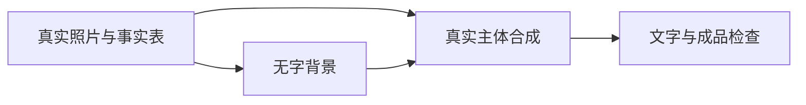

# 信息图、教学演示与UI，先让关系和数据正确

本节把“商品图制作流程”做成四步信息图，得到结构化文案、可编辑图形和导出预览。图像模型适合风格探索和插图，流程关系、准确数字和按钮文字尽量用矢量或真实界面工具完成。

## 1. 把四步写成数据

```text
1 输入：真实商品照片、事实表、用途
2 背景：无字环境、光线与留白
3 合成：商品原像素、蒙版、阴影、准确文字
4 检查：结构、颜色、数值、裁切、源文件
```

每个框只写一个动作，箭头表示实际顺序。想加“通过率90%”先提供真实统计；没有数据就不画效果数字。

## 2. 生成排版简报

```text
把以下四步流程整理为一张教学信息图。保持输入、背景、合成、检查的依赖顺序，不增加未提供的统计与结果。
输出每个框的短标题、两条以内说明、箭头关系和布局建议。背景浅色，深灰文字，橙色只强调关键动作。图形必须能编辑，准确文字单独保留；若做风格插图，不生成虚假软件界面。另列需要来源核对的数据。
```

## 3. 用Mermaid或画图工具完成关系

在支持Mermaid的编辑器或绘图工具里把四框连起来，检查有没有跳步和反向箭头。需要交给设计师时给节点文字与关系表；图像工具只做无字装饰或风格探索，不代替逻辑结构。[Mermaid官方文档](https://mermaid.js.org/intro/)。



本网站不把Mermaid代码冒充已生成图形，下载件中保留可复制源代码。UI概念稿也需要单独列导航、按钮行为和错误状态；漂亮屏幕不能证明交互已经实现。

完整任务词[P04](../prompts/P04.md)。真实数据图、可点击UI与导出案例尚待补。
