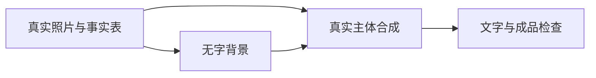

## 网站、图层、节点与API，按当前任务选择路线

原稿把制作分为网站版、工具版和API版。这一章保留分工，去掉计费内容和未经核实的模型排名。先看你手上有什么素材、要交什么文件，再选需要的工具，不用一开始把所有软件都装上。

### 一张图，先走网站与图层路线

有真实产品照片，要做场景副图，就用支持参考图的设计画布生成环境，再在PS/Photopea放回真实商品与准确文字。得到图片原文件、可编辑源文件和预览。这条路线的逐步操作、提示词与返工见[第一张图](https://wangge-dev.github.io/ai-visual-creation-handbook/#%E8%A1%A5%E5%85%85-first-image)。

Lovart从项目与素材开始，TapNow按图像节点接参考和任务。实际功能以当前界面为准，参考文件的身份和用途先说清楚。[Lovart项目文档](https://www.lovart.ai/docs/getting-started/design-your-first-project)、[TapNow图像文档](https://docs.tapnow.ai/en/docs/canvas/generate-and-edit-images)。

### 主图、参数与Logo，图层软件先接管

白底主图不一定需要生图，真实商品抠图、轻修、等比缩放和规范导出即可。尺寸、发货数量、Logo与准确文本优先保留可编辑层，方便多语言与SKU版本。操作见[Amazon主图](https://wangge-dev.github.io/ai-visual-creation-handbook/#%E8%A1%A5%E5%85%85-amazon-listing)和[套图](https://wangge-dev.github.io/ai-visual-creation-handbook/#%E8%A1%A5%E5%85%85-image-set)。

Photopea可在浏览器打开图像并保存PSD或导出JPG/PNG；PS与Krita按实际软件能力完成蒙版与排版。[Photopea打开与保存](https://www.photopea.com/learn/opening-saving)。保存PSD后重新打开检查，文件后缀不能证明文字和图层可编辑。

### 重复同一处理，再考虑节点

需要对多张图重复背景编辑时，可以用ComfyUI工作流保留模型、输入、蒙版、提示词与输出路径。先跑官方基础示例理解节点，再改为自己的任务；缺模型或节点先解决环境，不能靠一条提示词补齐。[ComfyUI基础inpaint](https://docs.comfy.org/tutorials/basic/inpaint)。

节点路线的蒙版、采样和保存步骤见[三类画布](https://wangge-dev.github.io/ai-visual-creation-handbook/#%E8%A1%A5%E5%85%85-canvases)。本项目没有实际运行节点，不把社区README的效果视为本项目已验证结果。

### 商品库与大量任务，API负责连接而非审核

API路线将商品事实、素材索引和任务表交给已选图像接口，再接收任务结果、下载原图、合成与核对。具体代码必须对应接口当前官方字段、身份配置和错误方式，不能把一个模型的参数套给另一个模型。

```text
商品事实与素材索引
  → 一行一项的任务表
  → 已配置的图像生成或编辑接口
  → 保存任务ID与状态
  → 下载原结果
  → 真实主体合成与准确文字
  → 逐图核对与交付清单
```

网络失败先判断请求是否已经提交，保留原任务ID；有结果但下载失败重试原下载。返回成功只说明接口过程，不证明商品、文字、SKU与渠道要求正确。文件与状态方法见[批量任务](https://wangge-dev.github.io/ai-visual-creation-handbook/#%E8%A1%A5%E5%85%85-batch)。本章没有调用接口、安装工具或建立生成服务。

### 下一步直接做一个任务

| 当前情况 | 下一篇 |
| --- | --- |
| 只有随手拍，需要第一张场景图 | [第一张图](https://wangge-dev.github.io/ai-visual-creation-handbook/#%E8%A1%A5%E5%85%85-first-image) |
| 已有清晰照片，需要六张商品图 | [完整套图](https://wangge-dev.github.io/ai-visual-creation-handbook/#%E8%A1%A5%E5%85%85-image-set) |
| 需要十屏详情页 | [逐屏详情页](https://wangge-dev.github.io/ai-visual-creation-handbook/#%E8%A1%A5%E5%85%85-detail-page) |
| 需要多个渠道与语言 | [跨境制作路径](https://wangge-dev.github.io/ai-visual-creation-handbook/#%E8%A1%A5%E5%85%85-cross-border) |
| 需要复用节点与图层 | [三类画布](https://wangge-dev.github.io/ai-visual-creation-handbook/#%E8%A1%A5%E5%85%85-canvases) |

## 第一张可用图，从产品照片做到带文字的成品

这篇带你完成一张厨房场景商品图，并保留可修改的文字层。准备一张自己的产品实拍，用支持上传参考图的画布生成背景，再用Photopea或PS把真实产品和文字合成进去。生成出来的候选图、可编辑源文件和最终JPG是三个不同产物，要分别保存。

沿用原稿的便携榨汁杯练习。奶油白和薄荷绿是示例颜色，你实际上传哪个SKU，就只做哪个颜色。本页没有提供实拍和实测成品，下面的文案与布局用于演示操作；功率、容量、充电方式和安全功能要用自己的资料填写。

### 1. 先拍一张能用的照片

把杯子放在浅色无纹理纸或桌面上，靠窗拍摄，光从侧前方进来。关掉美颜和滤镜，擦掉杯身指纹，镜头与商品保持正常距离，再裁掉多余背景。不要用超广角贴近拍，它会把杯口和底座拍成不同大小。正面或略带侧面的照片更适合作为第一张合成素材。

打开照片放到100%检查。杯口、杯盖、按钮和底座边缘能看清，反光没有把标识烧成白块，颜色与实物接近，就可继续。只有糊图时先补拍，提示词无法恢复看不见的真实结构。

为照片取名 `JB01_white_front.jpg`，另外保留原始照片。再写四行资料。

```text
商品：便携榨汁杯，SKU JB01-white（示例名称）
本次素材：JB01_white_front.jpg，商品外观和颜色仅以该照片为准
本次用途：商品页场景副图，厨房台面，后期加一句准确标题
不添加：未核实的容量、功率、充电方式、认证和配件
```

### 2. 先做背景，再决定是否采用整图生成

以TapNow当前官方文档中的画布为操作例子。新建项目，在Add菜单建立图像节点，把产品照片作为参考输入；填写参考图用途、构图和光线，再选择画幅、模型和结果数量。先做一个方向，完成后打开全尺寸查看。[TapNow图像操作文档](https://docs.tapnow.ai/en/docs/canvas/generate-and-edit-images)。

第一遍可以尝试保留参考商品的整图生成。

```text
制作一张便携榨汁杯的厨房场景副图。上传的JB01_white_front.jpg是唯一商品外观依据，保留杯盖、杯体、按钮、底座、标识位置和奶油白颜色，不改变比例，不增加部件。
场景是明亮厨房的浅木台面，柔和自然光从左前方照入，背景略虚化。产品在画面右侧，左侧约三分之一保持简洁，留给后期标题。草莓和香蕉只作背景道具，不遮住商品，不暗示随商品发货。
生成一张方形图片。不要文字、数字、图标、水印和认证标识。不要打开杯盖，不生成看不见的刀头，不改变产品颜色。
```

如果按钮变多、杯盖变形或包装文字被重画，停止在这张图上反复修商品。改成生成空背景，商品用原照片合成。

```text
生成一张方形商业摄影背景，只要场景，不出现榨汁杯或其他电器。明亮厨房，浅木台面，左前方自然窗光，背景墙为奶油白。右侧留出平整无遮挡的台面，供后期放入真实商品；左侧上方留白，供标题排版。少量草莓和香蕉放在远处，不占用右侧商品区域。不生成文字、标识、杯子、瓶子或虚构产品。
```

下载原图，保存成 `JB01_scene_background_v01.png`。不要把画布截图当原文件。可见结果应当是一张有空台面、有明确光向、没有假商品的背景。

### 3. 在Photopea里放回真实商品

1. 打开[Photopea](https://www.photopea.com/)，用File → Open打开背景。拖入产品照片到正在编辑的画面里，形成单独图层。
2. 给商品层命名 `PRODUCT_REAL`。选取商品，给选区添加图层蒙版，隐藏原照片背景。放大到100%修杯盖和底座边缘；操作的是蒙版，商品原像素保留。
3. 选商品层，用Edit → Free Transform调整大小和位置，保持长宽比例。商品底座落在台面上，避免悬空；画面透视不匹配时换背景，别把杯子拉扁来迁就台面。
4. 在商品层下面新增 `SHADOW`。用柔边低透明度黑色画笔画一块接触阴影，底座附近较紧，远处较淡。光从左侧来，阴影相应向右后方延伸。

第一次使用蒙版时，选中商品层，从Layer → Raster Mask → Add添加蒙版。商品图层旁会出现新的缩略图，点击蒙版缩略图再用画笔处理。黑色隐藏原拍摄背景，白色恢复误隐藏的商品；先处理大片背景，再放大处理边缘。画完切回商品缩略图移动主体，避免误把蒙版单独移动。

拖入图像、蒙版和变换的界面说明可见[打开与保存](https://www.photopea.com/learn/opening-saving)、[蒙版](https://www.photopea.com/learn/masks)、[自由变换](https://www.photopea.com/learn/free-transform)。透明杯体不能按不透明白盒处理，抠图后若出现黑边或失去透光，要保留合适的原背景局部或重新拍摄。

### 4. 加一句能读清的标题

选择文字工具，在左上留白拖出文本框，输入示例标题“把水果饮品带进日常”。这句话不声明未确认的性能；正式使用前确认商品适用性。标题和产品分层，副标题最多一行，颜色从产品或品牌已有颜色里选。

本练习可以用1600×1600像素工作画布，标题约90像素作为起始值。这是排版建议。把预览缩到约375像素宽，再看标题是否能读、商品是否清楚；太小就缩短标题和删文字，别继续加装饰。[Photopea文字工具](https://www.photopea.com/learn/text)。

### 5. 保存后重新打开

File → Save as PSD保存 `JB01_scene_v01.psd`，再用File → Export As → JPG导出预览。重新打开PSD，确认文字仍能编辑、商品蒙版存在；重新打开JPG，确认边缘、标题和颜色。Photoshop对应步骤也是商品层、蒙版、阴影层、文字层，具体入口参见[合成图像](https://helpx.adobe.com/photoshop/desktop/crop-resize-transform/transform-manipulate-reshape/combine-images-in-photoshop.html)。

| 看到的问题 | 本次该改哪一步 |
| --- | --- |
| 商品悬空 | 第3步把底座放回台面，重做接触阴影 |
| 杯子变宽 | 回原商品层，恢复等比变换 |
| 标识糊了 | 用实拍商品层，取消对商品的生成或过度锐化 |
| 标题被水果挡住 | 只调整背景道具或标题区，不重新画商品 |
| 手机预览字太小 | 缩短标题，扩大文字，移走次要说明 |

接着做[一套商品图](https://wangge-dev.github.io/ai-visual-creation-handbook/#%E8%A1%A5%E5%85%85-image-set)。需要改写同类场景时查[P01完整模板](https://wangge-dev.github.io/ai-visual-creation-handbook/#%E8%A1%A5%E5%85%85-P01)；本页的两条提示词已经可以直接复制，不必先跳到模板页才能开始。

## 参考图与文件角色，上传之前先分清

同一任务里可以同时上传产品图、构图图和风格图。先给它们分工，模型才知道哪个负责商品身份，哪个只借灯光。完成这节，你会有一份参考文件索引和一段可放在每次任务开头的说明。

### 1. 给文件命名并检查可用范围

| 文件 | 负责什么 | 不从它推测什么 |
| --- | --- | --- |
| product-front.jpg | 实际商品外观、部件、颜色 | 背面、尺寸、认证 |
| product-detail.jpg | 可见的局部结构 | 未拍到的内部结构 |
| layout-reference.jpg | 主体位置和留白方向 | 竞品包装、文字、标识 |
| lighting-reference.jpg | 光向与背景气氛 | 对方商品和材质 |
| approved-copy.txt | 准确标题、参数、说明 | 模型自行改写的数字 |

例如做榨汁杯厨房场景，产品照片决定杯盖和按钮，厨房图只负责台面和光线。竞品参考仅用于分析，独特图案和包装不直接移植。只有一张商品照片时，先保持相同角度，别要求“背面也完全一致”。

### 2. 复制这段参考图说明

```text
本任务参考文件分工如下。
product-front.jpg是唯一商品身份依据，保留外观、部件、颜色、标识位置和相对比例。
layout-reference.jpg只借用主体位置与留白，不能复制其中的产品、包装、文字或标识。
lighting-reference.jpg只参考光线方向与背景气氛，不改变商品实际材质和颜色。
approved-copy.txt是后期文字依据，数值与单位不得改写。本轮不生成文字，输出无字底图。
照片无法证明的结构和参数不推测；需要新的真实角度时列出补拍项。
```

在支持节点连接的画布中分别接入文件，或上传后在描述里逐个点名。如果工具支持图片标记，直接框出需要保留的商品和允许替换的背景。TapNow官方文档也要求说明各参考的用途；图片编辑可通过Redraw或Annotate指定区域。[官方操作说明](https://docs.tapnow.ai/en/docs/canvas/generate-and-edit-images)。

### 3. 看输出有没有混用角色

出现竞品Logo、商品变成参考图里的另一个型号、光影参考把白色商品染成金属色，就回到角色说明处理。先删掉不必要的参考，再尝试一个明确任务；无法保住商品时，只生成背景，把原商品层合成回去。修改词写在[P06](https://wangge-dev.github.io/ai-visual-creation-handbook/#%E8%A1%A5%E5%85%85-P06)中，操作示例见[第一张图](https://wangge-dev.github.io/ai-visual-creation-handbook/#%E8%A1%A5%E5%85%85-first-image)。

## 完整提示词怎么写，从模糊要求改到可操作任务

提示词应当让工具知道要改哪个文件、改哪里、最后交什么。先写商品身份和任务，再写构图与光线。多个用途拆开写，白底主图、场景副图、尺寸排版不能同时挤在一条“帮我做高级详情页”里。

### 1. 先把一句模糊要求补成六项

“做一张高级的榨汁杯图”缺少素材、用途、构图和限制。按下面六项补全。

| 项目 | 本次填写 |
| --- | --- |
| 输入 | JB01-white正面实拍，是唯一商品外观依据 |
| 任务 | 厨房场景副图，不是主图或参数图 |
| 保留 | 杯盖、按钮、底座、标识、颜色与比例 |
| 改动 | 背景与合理接触阴影 |
| 表达 | 左前方自然光，右侧商品，左上留白 |
| 输出 | 一张无字方图，下载原文件 |

### 2. 完整词可以这样写

```text
根据上传的JB01-white正面实拍，制作一张厨房场景商品副图。真实产品照片是唯一外观依据，保留杯盖、杯体、按钮、底座、标识位置、颜色和比例，只调整背景与合理的接触阴影。
场景是明亮厨房浅木台面，柔和自然光从左前方照入。商品在右侧，左上留简洁空间用于后期标题，少量水果在远处，不遮商品，不暗示随商品发货。真实产品摄影，材质不过度修饰。
输出一张方形无字底图，不生成文字、数字、徽章、图标、虚构配件、内部结构和水印。若无法保持商品外观，改为只生成空台面背景，并说明需要把原商品层合成回去。
```

### 3. 三类提示词要交给不同环节

规划词给文字助手，输出职责表、拍摄清单和准确文案。生图词给支持参考图的图像工具，输出候选图片。局部修图词给有选区或蒙版的编辑工具，明确修改区域。把参数表交给普通文生图模型，并不会得到可编辑文字层。

例如尺寸图先让文字助手整理数值、单位与线条位置，再在PS/Photopea排版；需要背景留白时只让图像工具做无字底图。模型支持文字生成时仍可尝试短标题，但商品参数、警示和多语言准确文本要逐字复核。

### 4. 一次只改一个可见问题

```text
以这张已经通过商品核对的图为输入，只调整左上背景，把水果移出标题留白区。保持商品像素、尺寸、角度、颜色、光向和接触阴影。不要重新设计全图，不改文字和商品结构。
```

若编辑工具没有局部区域控制，不能保证只改一处，回图层文件移动背景或裁切。记录本次问题、改动词和结果，避免每次都重写风格导致整套漂移。完整变体模板可查[P01](https://wangge-dev.github.io/ai-visual-creation-handbook/#%E8%A1%A5%E5%85%85-P01)和[P06](https://wangge-dev.github.io/ai-visual-creation-handbook/#%E8%A1%A5%E5%85%85-P06)，连续操作看[套图教程](https://wangge-dev.github.io/ai-visual-creation-handbook/#%E8%A1%A5%E5%85%85-image-set)。

## 商品事实与素材简报，做完才能开始套图

本节做出三份可直接使用的东西，一张商品事实表、一份照片索引和一张图片任务表。它们分别回答商品是什么、哪张图能证明、每张成品图要讲什么。后面的[套图教程](https://wangge-dev.github.io/ai-visual-creation-handbook/#%E8%A1%A5%E5%85%85-image-set)沿用原稿的便携榨汁杯，跨境专项则使用明确标为虚构的DN01收纳盒练习。

### 把“产品介绍”改成能核对的事实

拿商品说明书、规格表、实拍和实际发货清单逐项填写。卖点“易清洗”还不够，补充哪些部件能拆、哪部分可以水洗、操作依据在哪里。没有依据的“食品级”“无线充电”“安全锁”先留空，原稿出现过这些词也不能直接拿给自己的商品使用。

```text
SKU：JB01-white（练习ID）
产品：便携榨汁杯
商品颜色：以本SKU实拍为准
杯体、盖子、底座、按钮外观：见front和side照片
尺寸/容量/功率/充电方式：填写真实规格及来源，缺失留空
实际发货：逐项写商品、配件、数量；拍一张平铺照片
适用场景：经确认可使用的厨房/办公室等
使用与清洗：按说明书写动作，标出不能冲洗的部位
可使用的文字：产品名、已证实的功能和参数
本次不写：没有证明的认证、效率、健康功效与比较结论
```

### 按图片职责补拍

| 文件名示例 | 怎样拍 | 用在哪里 |
| --- | --- | --- |
| JB01_white_front.jpg | 完整正面，杯盖和底座不截断 | 白底图、场景合成 |
| JB01_white_side.jpg | 侧面光线均匀，避免广角 | 比例与结构核对 |
| JB01_white_lid.jpg | 杯盖局部有足够清晰度 | 真实细节展示 |
| JB01_white_parts.jpg | 实际发货物平铺 | 配件图 |
| JB01_white_dimensions.csv | 测量值、单位、测量对象、来源 | 尺寸图 |
| JB01_white_steps_01.jpg | 说明书允许的实际动作 | 使用步骤图 |

不要把一张正面图扩成背面、刀头和内部结构照片。原图不能证明的区域，任务表写“补拍”，先制作已有素材支持的图片。

### 让助手整理分工，别让它补事实

上传真实规格与照片索引后，可复制下面的整理提示词给文字助手。它的产物是表格和文案草稿，不是商品照片。

```text
根据我上传的商品资料，整理JB01的视觉制作简报。分别输出商品事实表、照片索引、六张商品图任务表。
事实表保留数值、单位和资料出处；图片只能作为可见外观依据。资料没有写的容量、材质等级、充电方式、安全结构、认证，写“未提供”，不要按同类产品推测。
任务表每张写用途、买家问题、所需照片、构图、准确文案、不得出现的内容。每张只解释一个主要问题。缺照片的任务标为待补拍，提供已有素材可做的替代任务。
竞品图只分析信息顺序和构图，不复制其文字、标识和独特包装。输出供我逐项核对的表格，不直接生图。
```

### 看一条卖点有没有写实

“随手清洗，告别烦恼”无法判断结构和方法。若说明书确认杯体可拆、底座不能入水，可改成“杯体拆下单独清洗”，配一张真实拆开后的照片，并把不能水洗的底座说明放在同屏。画面、短文案和操作要求对应同一个事实，读者才能照着做。

事实表确认后，再安排[六张套图](https://wangge-dev.github.io/ai-visual-creation-handbook/#%E8%A1%A5%E5%85%85-image-set)。有多个颜色时先各拍一张同角度商品照片，后续换商品层，不能把白色图片一键染成绿色就当作真实SKU。

## 从一张产品图做出六张商品图

这一篇把原稿的便携榨汁杯案例展开成实际制作顺序。你会得到白底商品图、厨房场景图、真实细节图、尺寸图、使用图和发货图，并保留独立图片与可编辑排版文件。这里的“1＋5”是练习分工，发布时按渠道和实际商品增删。

先完成[商品简报](https://wangge-dev.github.io/ai-visual-creation-handbook/#%E8%A1%A5%E5%85%85-product-brief)。至少有清晰正面照片，想展示杯盖、刀头或拆洗结构，还要提供对应实拍。原稿中的食品级、无线充电和安全锁没有跟随具体商品证明，本练习不把这些词直接写进成品。没有照片的角度不靠AI补成事实。

### 1. 先把六张图的任务定下来

| 顺序与文件名 | 买家想知道什么 | 画面和文字分别怎么做 |
| --- | --- | --- |
| 01-main | 买的商品长什么样 | 真实完整主体，干净底色；跨境主图另核规则 |
| 02-kitchen | 放在哪、怎么融入日常 | 厨房背景＋真实商品；一句场景标题 |
| 03-detail | 关键部位是什么样 | 对应局部实拍，标注实际部件 |
| 04-size | 放不放得下 | 正面/侧面实拍＋真实尺寸和测量线 |
| 05-use | 怎样开始使用 | 说明书允许的动作＋逐步实拍 |
| 06-in-box | 到手包含什么 | 商品与配件平铺，逐项写数量 |

新建六个工作文件。练习以1600×1600像素方图为母版；正式输出按渠道要求。共同使用奶油白背景、深灰文字、一个产品已有强调色，同一字体，同一标题位置。固定这些排版元素之后，每张图可以有不同构图，避免六张都像同一海报。

### 2. 第一张白底图，先做好真实主体

打开Photopea或PS，新建方形白色画布，拖入正面实拍，把商品等比放大。为商品添加蒙版，隐藏拍摄背景。100%看杯盖、杯身边缘和底座；把图层名改为 `PRODUCT_REAL`，下面放 `BACKGROUND` 和轻微 `SHADOW`。

透明杯体、细网纹和高反光金属不能用一键抠图后的结果直接交付。若边缘残灰，回蒙版处理；若内部透光变黑，保留原照片中合理的透光区域，或补拍白底。不要用生成工具重新做杯盖或内部结构。

这一张可以不调用生图。你应得到一张与原实拍外观相同、完整、清晰的商品图。后面的场景图都复用这个真实主体层。[Photopea蒙版操作](https://www.photopea.com/learn/masks)，[PS主体选择](https://helpx.adobe.com/photoshop/desktop/make-selections/automatic-color-based-selections/detect-subject-using-select-subject.html)。

### 3. 第二张厨房场景，提示词就在本页

在支持参考图的图像画布里上传商品图，说明它只负责商品外观。选择方形画幅，先生成一个方向；全尺寸查看后再下载。TapNow可从Add菜单建立图像节点，并把参考图接入；Lovart可上传素材后用任务描述开始项目。[TapNow操作说明](https://docs.tapnow.ai/en/docs/canvas/generate-and-edit-images)、[Lovart项目说明](https://www.lovart.ai/docs/getting-started/design-your-first-project)。

```text
为上传的便携榨汁杯制作厨房场景副图。产品照片是唯一外观依据，保持杯盖、杯体、按钮、底座、标识位置和颜色，保持原照片中的相对比例。
明亮厨房，浅木台面，奶油白背景墙，柔和窗光从左前方照入，真实商业产品摄影。商品在右侧偏下，底座稳稳放在台面上；左上留出简洁区域用于后期标题。草莓和香蕉少量放在远处，不遮挡商品，不增加发货配件。
方形构图，不生成文字、数字、图标、认证或水印。不打开杯盖，不添加刀头，不改变材质，不制造过强反光。
```

模型把商品改掉时，用下面这条只做空背景，然后把第一张的 `PRODUCT_REAL` 放上去。调整背景透视和商品位置，阴影方向跟窗光一致。

```text
只生成厨房台面背景，不生成产品。方形画面，浅木台面，奶油白墙面，左前方柔和自然光，远处少量草莓和香蕉。右侧留一片平整无遮挡的台面用于放入真实商品，左上留白用于标题。不要杯子、瓶子、电器、文字、数字、图标、标识和水印。
```

在文字层写示例标题“厨房里的水果饮品时刻”。产品与道具分开存层，标题不覆盖杯盖。缩到手机宽度看一眼，商品比水果更显眼、文字能读、底座没有悬空，这张才进入整套。

### 4. 第三张细节图，用对应实拍裁切

选择杯盖、杯口或按钮的真实局部照片，裁掉无关背景，每张只讲一个部位。原稿的“微距生成细节”要改为实拍优先，生成的纹理和刀头数量不能成为证据。

如果背景很脏，只编辑背景区域。下面的提示词适用于有局部编辑或蒙版工具的画布，上传局部实拍后圈背景，商品不在编辑区域里。

```text
这是便携榨汁杯的真实杯盖局部照片。只处理我标记的背景，替换为干净奶油白影棚背景，延续原照片的光线。保留杯盖边缘、接缝、按钮、文字和材质原像素，不改变任何结构，不增加内部零件。不要扩展成背面视角，不生成说明文字和图标。
```

后期标注只使用可见且已确认的部件名。想写“安全锁”但只有外壳照片时，先补说明书与对应实拍；不能在按钮旁加一个盾牌图标就当作已证明安全设计。

### 5. 第四张尺寸图，把真实数值单独排版

在白底母版上复制真实主体，缩小到画面中间，留四周空白。用形状工具画长宽高指引线，用文字工具填规格表里的数值和单位。示例不预填容量、高度和重量，正式商品用自己的测量记录。

```text
整理我提供的榨汁杯尺寸记录，输出尺寸图排版清单。分别列整体高度、最大外径、重量和容量；只保留资料里明确给出的项目，缺失项不要推测。
每个数值写测量对象和单位。告诉我该用正面、侧面还是顶部实拍，指引线从哪里到哪里。容量和外尺寸分开表述，不用外尺寸计算容积。输出准确文字供图层排版，不生成数字图片。
```

一张侧面照片不能准确表示所有三维方向。高度线放在正面或侧面；直径线需要有对应视角和测量依据。商品底图没有变，参数线和数字仍可编辑，是这一张的可见结果。

### 6. 第五张使用图，先确认动作顺序

从真实说明书写出3步以内的关键动作。先拍动作，再排小图，避免从“装入水果”直接跳到“已经打好”，缺少实际开机方法。清洗图单独制作时必须明确哪些部件不能入水。

```text
根据我上传的说明书整理便携榨汁杯使用图。只输出拍摄与排版计划，不编造动作。提取使用前检查、装入食材、启动及完成后的操作，保留说明书中的必要安全条件。
把流程缩成最多三组，每组给短标题、需要拍摄的动作、必须出现在画面的部位。遇到材料比例、启动方式或清洗限制没有依据时写待补充。不要生成手部动作、刀头结构或不在说明书中的功能。
```

三组动作图按阅读顺序排列，编号和文字在图层里做。手指有没有遮住关键操作位置、动作是否符合说明书，比画面是否“高级”更值得检查。

### 7. 第六张发货图，商品和道具不能混

把实际发货商品与配件平铺拍摄，数量全部看得见。在母版里排列真实商品和配件照片，再写“包装内含”与数量。场景水果、电脑、外购水杯不进入这张图。没有认证原件时，最后一张用发货与使用说明，不能生成“认证信任图”。

```text
为我提供的实际发货清单整理配件图文案。每项只写名称、数量、对应照片文件名；清单没有的东西不要添加。场景道具独立列为不随商品发货。
给出方形画面中的排列顺序，主体最大，配件分组，避免文字覆盖产品。不要生成配件图片、认证徽章、质检报告和物流承诺。输出可核对的文字表与图层命名。
```

### 8. 做一次整套检查，再导出

把六张预览同时打开或放到画布里，每张缩到约375像素宽。检查颜色是否跳变，标题位置是否一致，是否有两张在重复讲同一句话，商品是否越来越像另一个型号。返工时改具体层和具体步骤，别整套重新生成。

| 返工症状 | 具体处理 |
| --- | --- |
| 厨房图把按钮换了 | 第3步切换空背景，放回真实主体 |
| 细节图像塑料玩具 | 第4步换局部实拍，取消纹理生成 |
| 尺寸字在手机上太小 | 第5步删次要参数，放大数字和单位 |
| 使用图出现不真实动作 | 第6步回说明书与动作实拍 |
| 发货图多了充电器 | 第7步对照清单删除，别把道具算配件 |

先保存PSD，再分别导出 `JB01_white_01-main_zh_v01.jpg` 到 `06-in-box`。记录实际宽高、格式和文件体积，重新打开全部文件。需要Amazon版本时继续[主图与副图教程](https://wangge-dev.github.io/ai-visual-creation-handbook/#%E8%A1%A5%E5%85%85-amazon-listing)，不能把带标题的场景图直接当Amazon主图。

这篇完成的是操作教程和可复制任务词，尚未以真实商品执行生成或交付PSD。原稿的完整详情页延伸见[十屏详情页教程](https://wangge-dev.github.io/ai-visual-creation-handbook/#%E8%A1%A5%E5%85%85-detail-page)。

## 便携榨汁杯详情页，逐屏制作再拼接

沿用原稿的便携榨汁杯案例，把六张商品图扩展成详情页。做完应有逐屏文案、10个可单独导出的模块、整页预览和可编辑排版源文件。原稿的场景提示词保留，产品规格、无线充电、安全锁和食品接触声明改为有真实依据才展示。

先准备[商品简报](https://wangge-dev.github.io/ai-visual-creation-handbook/#%E8%A1%A5%E5%85%85-product-brief)与[套图母版](https://wangge-dev.github.io/ai-visual-creation-handbook/#%E8%A1%A5%E5%85%85-image-set)。产品照片、局部照片、使用说明、颜色实拍、规格与售后资料分别存放。详情页先确定各屏回答的问题，再作图，这样能发现哪些屏缺证据。

### 1. 给十屏写好文案和素材任务

| 屏 | 读者问题 | 图片怎么来 | 文案怎么写 |
| --- | --- | --- | --- |
| 01主视觉 | 这是什么、适合什么日常 | 厨房背景＋真实商品 | 产品名与一句场景价值 |
| 02卖点总览 | 最值得看哪几件事 | 真实商品＋三块留白 | 三条已核实卖点 |
| 03使用场景 | 家里、办公室怎么放 | 一个具体场景一张图 | 场景名，不虚构性能 |
| 04结构细节 | 杯盖、按钮、杯体是什么样 | 局部实拍 | 实际部件名称 |
| 05尺寸 | 放不放得下、带不带得走 | 正面/侧面实拍＋标注 | 真实外尺寸、重量 |
| 06使用 | 怎么启动和结束 | 真实动作照片 | 说明书步骤 |
| 07清洗/注意 | 哪些能洗、哪些不能洗 | 拆卸实拍或说明图 | 必要条件和限制 |
| 08颜色 | 两个颜色到底差在哪 | 同光线同角度SKU实拍 | 对应变体名称 |
| 09规格/发货 | 参数和配件是多少 | 表格＋真实平铺 | 有来源的数值与数量 |
| 10售后 | 怎么联系、能得到什么服务 | 准确文字为主 | 已确认的售后条款 |

先在文档里填全这张表。没有安全结构证明就把原稿的“安全锁设计”屏改为已知使用注意；没有售后政策就不编承诺。多屏缺素材时先发布有依据的模块，别靠背景海报凑长页。

### 2. 首屏主视觉，留出标题区

在图像画布上传真实商品图，选择竖向画幅，输入下面的任务词。首屏的职责是让读者认出商品，果昔和水果只做场景道具。

```text
上传照片中的便携榨汁杯是唯一商品依据，保留外观、颜色、按钮、杯盖、底座和标识。制作详情页首屏背景，产品放在明亮厨房浅木台面上，窗光从左前方进入，奶油白与少量浅绿色，真实生活方式摄影。
产品位于画面中下部，顶部约四分之一简洁留白，供后期排产品名和一句标题。远处少量草莓与香蕉，不遮商品，不表示随商品发货。不生成任何文字、数字、图标、认证或水印，不改变商品结构。
```

商品发生变化就只生成背景，在PS/Photopea放回真实主体。标题和副标题用文字层做。把首屏缩成手机宽度看，第一眼能辨认杯子，第二眼能读到产品名，就够进入下一屏。

### 3. 第二屏卖点总览，别把参数塞在背景里

先从事实表挑3条最相关的卖点，每条用“事实＋读者能理解的用途”写短句。便携不是一个自动成立的功能，需要尺寸与重量支持；易清洗要有拆洗方式支持。

```text
生成便携榨汁杯详情页卖点总览的无字底图。真实商品外观以上传照片为准，商品放在画面中间偏下，背景奶油白，少量浅绿色，柔和影棚光。
上方留标题空间，商品左右各留简洁空白，便于后期放三条已核实卖点。不要文字、数字、箭头、图标、夸张能量光效或认证标记，不添加不存在的零件和配件。
```

得到底图后，把三条卖点排成独立文本组。图标若使用，必须对应事实，不能用闪电图标暗示未核实的充电性能。手机上若三块文字拥挤，拆为两屏，比缩小字号更合适。

### 4. 第三屏做办公室场景

沿用同一产品和光线，避免厨房图是奶油白，办公室图变成纯白或绿色。选择实际适用的使用环境，不能通过画面暗示产品能够在不允许的场合工作。

```text
保持上传实拍中的便携榨汁杯外观、颜色、标识和比例。制作办公室桌面生活方式副图，浅木桌面，笔记本电脑在远处虚化，少量水果放在边缘，产品为主角。窗光从左侧照入，干净自然，不使用强烈霓虹或镜面反射。
留一处空白用于后期写场景标题，不生成文字、数字或图标，不增加产品功能，不添加不随商品出售的配件展示组合。
```

图中电脑应小于商品的视觉重点，道具不能遮杯盖。若商品悬空，修接触阴影；若视角不合，换背景或对应角度实拍，不能扭曲商品形状。

### 5. 第四到九屏，真实资料接管

结构屏用局部实拍裁切。尺寸屏用测量值和矢量线。使用与清洗屏按说明书拍动作。颜色屏用同光线同角度实拍并排。规格屏在文字层或表格里输入，不让整图模型猜数字。

```text
依据我提供的商品事实表、说明书、颜色照片和配件清单，输出便携榨汁杯详情页04至09屏的排版文案。
每屏写标题、最多三条短说明、需要使用的照片文件名、图层顺序。尺寸数值保留原单位和来源；颜色名称与SKU对应；使用和清洗必须符合说明书。缺失资料标待补，禁止推测功率、容量、刀头数量、充电方式、安全功能和认证。
输出一张逐屏表，另列尚缺的照片和参数。不生成商品图片，不以AI纹理替代实拍细节。
```

### 6. 在图层软件完成排版

本练习可用750像素宽的工作模块，模块高度按内容确定；这是设计起点，正式上传按平台当前要求。每个模块分别建商品、背景、文案、标注组，标题字体和边距一致。Photopea使用文字工具拖文本框，避免把一段话写成超长单行；准确文字保留文字层。[文字操作](https://www.photopea.com/learn/text)。

首屏可以更高，规格屏可短一些。不要机械地让十屏等高。图片上留白太多时裁掉无用区域，但不裁掉商品、数字和必要安全说明。完成一个模块后先导出，确认手机可读再复制排版样式到其他模块。

### 7. 拼接与返工

把模块按01到10排列成整页预览，同时保留分屏文件。连续看整页，出现三屏都在讲“便携”就合并或替换为真实信息；某屏全是水果而商品很小，就重新构图。导出后查看屏与屏的接缝、字体大小、颜色、数值和安全说明。

| 具体问题 | 修法 |
| --- | --- |
| 三屏文案重复 | 回第1步分配不同买家问题 |
| 产品在各屏颜色不同 | 换回同一真实商品层，统一背景色 |
| 手机参数字太小 | 拆规格组，删次要说明，放大数值 |
| 拼接有大段白缝 | 检查各模块底部留白，不靠负行距压缩 |
| 安全说明被裁掉 | 扩充模块高度，重新导出 |

交付时同时给分屏图、整页图、准确文案和PSD状态。平台上传与手机实际页面还要另检查。本项目本页未生图或实操排版。Amazon A+需要重新选择后台模块，接着读[A+模块制作](https://wangge-dev.github.io/ai-visual-creation-handbook/#%E8%A1%A5%E5%85%85-amazon-a-plus)，不能把这张长图直接套进去。

## 跨境出图，先选任务再进入逐步教程

这页负责导航与共同练习资料。实际制作步骤、可复制提示词、排版与返工在下面各篇展开。先做一个渠道的一款商品，走完真实主体、图片与文字、导出和检查，再扩到其他市场。

| 要交付什么 | 从哪里跟做 |
| --- | --- |
| 一张图还没有做过 | [第一张图](https://wangge-dev.github.io/ai-visual-creation-handbook/#%E8%A1%A5%E5%85%85-first-image)，先走上传、背景与图层 |
| 主图与一套商品图 | [六张套图](https://wangge-dev.github.io/ai-visual-creation-handbook/#%E8%A1%A5%E5%85%85-image-set)，逐图处理素材与信息 |
| Amazon商品页 | [主图/副图](https://wangge-dev.github.io/ai-visual-creation-handbook/#%E8%A1%A5%E5%85%85-amazon-listing) → [A+](https://wangge-dev.github.io/ai-visual-creation-handbook/#%E8%A1%A5%E5%85%85-amazon-a-plus) |
| Shopify产品页 | [媒体与变体](https://wangge-dev.github.io/ai-visual-creation-handbook/#%E8%A1%A5%E5%85%85-shopify-product) → [两端横幅](https://wangge-dev.github.io/ai-visual-creation-handbook/#%E8%A1%A5%E5%85%85-shopify-hero) |
| Shopee SG | [封面、规格、变体](https://wangge-dev.github.io/ai-visual-creation-handbook/#%E8%A1%A5%E5%85%85-shopee-localization) |
| 其他语言与多款商品 | [本地化](https://wangge-dev.github.io/ai-visual-creation-handbook/#%E8%A1%A5%E5%85%85-localization) → [SKU交付](https://wangge-dev.github.io/ai-visual-creation-handbook/#%E8%A1%A5%E5%85%85-cross-border-sku-delivery) |

一套跨境图片先固定商品事实，再按市场、图片位置和语言安排表达。Amazon主图负责真实识别，副图和A+负责解释；Shopify还要适配主题裁切，Shopee需要按市场整理封面、规格与变体。先完成一条商品链路，再扩大SKU。

### 这次练习准备什么

以下所有DN01、DN02名称和参数均为虚构练习数据，用来示范怎么填写任务；正式商品须替换为自己的真实记录。练习未附商品照片，也未执行生图。

| 字段 | DN01练习数据 |
| --- | --- |
| 商品 | 带盖桌面收纳盒，虚构练习名DeskNest |
| 外尺寸 | 长220 × 宽150 × 高120 mm |
| 颜色与材质 | 白色；ABS，练习设定 |
| 已知结构 | 一个可拆隔板、一个盖子 |
| 发货内容 | 盒体1、盖子1、隔板1；不包括场景道具 |
| 获准场景 | 书桌收纳文具 |
| 未知项 | 容积、耐温、承重、防水、食品接触、认证、回收属性均未知 |
| 实拍需求 | 正面、顶部、开盖、隔板、侧面；未提供的角度不凭空补 |

把真实素材按“对象照片、风格参考、准确文案、尺寸记录”四类整理。参考图只借用背景或布局；商品照片承担外观依据，规格来自记录。复制[P09跨境简报](https://wangge-dev.github.io/ai-visual-creation-handbook/#%E8%A1%A5%E5%85%85-P09)，先生成渠道任务表。

### 第1步：建立渠道矩阵

| 任务 | 母版职责 | 后续动作 |
| --- | --- | --- |
| Amazon US主图 | 只展示实际发货商品 | 检查类目规则、白底、占幅与实际像素 |
| Amazon US副图 | 场景、结构、尺寸、配件、使用 | 每张只解决一个买家问题 |
| Amazon A+ | 按实际模块组织图像与文字 | 用模块提示确定尺寸，手机预览 |
| Shopify商品媒体 | 多角度与细节解释 | 排顺序、写alt text、看主题裁切 |
| Shopify首页横幅 | 主题表达与商品引导 | 桌面和手机分别重排构图 |
| Shopee SG | 清晰封面、规格与变体 | 按当地后台检查上传参数 |

这张表是练习任务分配，不规定每个渠道必须上传固定张数。[平台资料卡](https://wangge-dev.github.io/ai-visual-creation-handbook/#%E8%B5%84%E6%BA%90%E8%B5%84%E6%96%99%E5%BA%93)集中保留官方来源与适用范围；1024、2048等数字要区分官方建议、当前限制和练习母版。

### 第2步：先做一张真实主体母版

选清晰正面或45度实拍，在图层软件抠出主体。原照片、蒙版和商品层保留，记录允许修改的是背景、接触阴影和文案层。没有实拍时可以继续准备简报与版式，不把概念图写成正式商品图。

先按[Amazon主图教程](https://wangge-dev.github.io/ai-visual-creation-handbook/#%E8%A1%A5%E5%85%85-amazon-listing)完成白底任务，再用同一真实主体建立场景图。模型容易改商品时，只生成背景，在PS／Krita里合成真实主体。检查商品颜色、盖子、隔板与数量后，再扩展其他图。

### 第3步：按位置组织信息

副图不要每张重复同一句卖点。DN01可分成桌面场景、开盖结构、外尺寸、发货内容和使用顺序；“耐高温”“大容量”等未知事实不填。使用[P11副图分工](https://wangge-dev.github.io/ai-visual-creation-handbook/#%E8%A1%A5%E5%85%85-P11)获得逐张构图和完整任务词。

[A+教程](https://wangge-dev.github.io/ai-visual-creation-handbook/#%E8%A1%A5%E5%85%85-amazon-a-plus)把结构、规格和使用拆模块；[Shopify产品页](https://wangge-dev.github.io/ai-visual-creation-handbook/#%E8%A1%A5%E5%85%85-shopify-product)把相同事实整理成媒体序列；[Shopee教程](https://wangge-dev.github.io/ai-visual-creation-handbook/#%E8%A1%A5%E5%85%85-shopee-localization)明确市场与变体。准确文字优先用可编辑图层，不反复让整图模型改小字。

### 第4步：本地化、SKU与交付

先做好一份事实母表，再制作英文或日文版本。场景和表达可调整，商品尺寸、配件和功能不能随市场变化。使用[本地化与单位教程](https://wangge-dev.github.io/ai-visual-creation-handbook/#%E8%A1%A5%E5%85%85-localization)，再按[SKU交付教程](https://wangge-dev.github.io/ai-visual-creation-handbook/#%E8%A1%A5%E5%85%85-cross-border-sku-delivery)建立文件清单。

最终交付包含：任务表、准确文案、图片、源文件状态、实际像素、检查结果和未完成项。网页上传成功、文字准确、源文件可编辑分别检查。完整流程还可以放进[三类画布](https://wangge-dev.github.io/ai-visual-creation-handbook/#%E8%A1%A5%E5%85%85-cross-border-canvas)。

### 完成时实际核对什么

一张图能对照真实商品核验；对应渠道位置明确；准确文字与单位无误；文件能打开且裁切适用。规划、生成、合成、源文件与后台上传各自记录完成状态。这份导航与教程文稿不表示真实商品案例已经完成。

## Amazon主图与副图，从实拍做到可交付文件

本篇带你完成一张白底主图和五张各有职责的副图。沿用跨境模板里的DN01收纳盒练习，白色ABS、外尺寸220×150×120mm、盒体1、盖子1、可拆隔板1。这些是虚构填写数据，正式使用前换成你的真实商品、实拍、尺寸和清单；此处没有生成结果，也没有Amazon上传实测。

### 1. 新建任务，先确定站点和图片位置

在任务表写“Amazon US、商品类目、主图或副图、SKU”。读取当前类目图片要求，再确定导出参数。Amazon公开摄影指南给出纯白底、完整真实商品和占幅指导；主图的广告字、场景道具与促销标签应移除。服装等特殊类目另核对应要求。[Amazon摄影指南](https://sell.amazon.com/blog/product-photos)。

本练习选2000×2000像素方形母版，作为制作建议。不是所有模型都直接输出该像素，下载后检查实际结果，需要时在图层软件裁切或缩放。放大不会把模糊的标签还原成真实信息。

准备正面、开盖、隔板、配件平铺照片和尺寸记录。把它们对应到下面的文件计划。

| 文件 | 展示内容 | 制作来源 |
| --- | --- | --- |
| 01-main | 本SKU完整商品 | 正面真实主体＋纯白底 |
| 02-desk | 桌面使用场景 | 桌面背景＋真实主体 |
| 03-divider | 开盖与隔板 | 结构实拍，不补内部细节 |
| 04-size | 外尺寸 | 实拍＋矢量线＋准确数字 |
| 05-in-box | 发货内容 | 实际商品、盖子、隔板平铺 |
| 06-use | 放入、收纳、合盖 | 对应动作实拍＋短标题 |

### 2. 白底主图，在PS或Photopea操作

1. 新建2000×2000白色画布，RGB模式，背景填 `#FFFFFF`。
2. 导入正面照片为独立商品层，选主体，添加蒙版，处理边缘。主体原像素保留，蒙版只隐藏拍摄背景。[PS选择主体](https://helpx.adobe.com/photoshop/desktop/make-selections/automatic-color-based-selections/detect-subject-using-select-subject.html)。
3. 等比缩放，让商品完整、清楚、四边不截断。按实际类目要求检查占幅；公开指南的85%指导可用于构图参考，不能替代当前后台标准。
4. 去掉文具、宣传贴纸、Logo装饰层、图标和标题。商品本身的真实印刷保留。用吸管检查背景角落，避免导出的是浅灰纹理底。
5. 100%查看白色商品边缘，有残灰就改蒙版，有缺口就恢复蒙版；不要直接刷白把商品边缘吃掉。

若希望用图像工具清理背景，输入下面的任务词。工具无法保持商品像素时回图层母版处理。

```text
输入是本SKU真实正面商品照片。用于Amazon商品主图，只把拍摄背景清理成纯白RGB255/255/255，保留商品原有形状、颜色、标识、盖子和可见结构。商品完整清楚，不裁切，不添加任何零件。
不生成标题、促销字、徽章、认证、道具或水印，不把白色ABS改成金属或陶瓷。不推测隐藏结构。若只能重绘商品而不能保留真实主体，请只输出背景处理建议，商品由原照片合成。
```

### 3. 场景副图，先解释用途

DN01的用途是书桌收纳文具，桌面、笔和本子只作场景背景。生成工具负责环境，盒子保不住就用真实商品层合成。不要让几支笔与收纳盒并排成“套装发货”画面。

```text
制作桌面收纳盒的场景副图。真实商品照片是唯一外观依据，保留白色盒体、盖子、比例和标识。明亮书桌，浅木台面，左前方柔和自然光，少量文具在背景，商品为视觉中心。
画面左上留简洁区域用于后期标题，不生成文字、数字、认证或水印，不改变商品材质，不添加新隔板，不画未提供的背面。场景道具不作为商品发货内容展示。如果无法保持商品身份，只生成没有盒子的空桌面背景。
```

合成后在独立文字层写练习标题 `A place for everyday stationery`。它描述用途，不暗示容量、承重或安全等级。缩成手机宽度，商品比装饰更显眼、标题能读，才保留这张。

### 4. 结构、尺寸与发货图分开做

结构图直接用开盖实拍。若一个隔板在照片中可拆，就用对应照片说明，不让模型凭空把内部分成六格。练习可用标题 `Removable divider`，正式文案需要真实结构依据。

尺寸图以外尺寸为准，排 `220 × 150 × 120 mm`；US版本需要英寸时，同时保留厘米或毫米，明确L×W×H与外尺寸。不要把透视角度的斜边当长度，使用能清楚看出测量方向的照片。[尺寸与本地化操作](https://wangge-dev.github.io/ai-visual-creation-handbook/#补充-localization)。

发货图用真实平铺，标题 `What's in the box`，列表 `1 box body / 1 lid / 1 divider`。文具不出现或写明不包含。没有官方认证与报告就不做认证图。

### 5. 使用图按实际动作排三组

第一组打开盒盖，第二组放入与商品用途一致的文具，第三组合盖。动作图用实拍或经逐项核对的结果，手和盒子的接触关系不能错。没有动作照片时，这张先用产品结构说明替代，别编一个“自动开盖”功能。

```text
根据本商品的真实使用说明和动作照片整理三组副图文案。每组输出准确短标题、对应照片、阅读顺序和必须看清的操作部位。只保留资料支持的打开、放入、合盖动作，缺失步骤标待补拍。不要生成产品结构、手部动作或未经确认的功能。文案供后期文字层排版。
```

### 6. 导出、排顺序与返工

每张保留PSD或等效源文件，另导出JPG。练习命名 `DN01_white_amazon-us_01-main_en_v01.jpg`，依次到06。重新打开检查像素、边缘、颜色和文字，按计划排序；实际上传后再看商品页缩略图、放大图、变体与手机裁切。

| 发现的问题 | 回到哪里改 |
| --- | --- |
| 主图背景发灰 | 第2步填纯白并检查导出 |
| 主图多了文具 | 第2步移除道具层，核发货清单 |
| 场景图变成另一个盒型 | 第3步只生成背景，放回真实主体 |
| 结构图多出隔板 | 第4步用开盖实拍重新排版 |
| 文字太长读不清 | 删次要句，拆两张副图，保持准确参数 |
| 变体白图对应灰色SKU | 修媒体对应和文件名，不能只换名字 |

完成后进入[A+模块](https://wangge-dev.github.io/ai-visual-creation-handbook/#补充-amazon-a-plus)。通用白底任务模板见[P10](https://wangge-dev.github.io/ai-visual-creation-handbook/#补充-P10)，副图职责模板见[P11](https://wangge-dev.github.io/ai-visual-creation-handbook/#补充-P11)，本篇已给直接可复制的制作词。

### 主图交付前的10项检查

这里采用Amazon公开摄影指导，具体类目仍以Seller Central为准。来源：[商品摄影官方指导](https://sell.amazon.com/blog/product-photos)，核对2026-10-15。以下是人工检查动作，不是平台审核通过证明。

| 检查项 | 具体怎么查 |
| --- | --- |
| 1 商品身份 | 原实拍与导出图并排，核对型号、颜色和变体 |
| 2 发货数量 | 数清盒体、盖子、配件；道具与多件陈列不能误导 |
| 3 完整外形 | 放大检查边角、接口、缝线；蒙版没削掉产品 |
| 4 背景 | 取样检查纯白背景RGB 255/255/255；不要把白色商品高光也抹掉 |
| 5 主体占比 | 对照指导中约85%或以上的占画面要求；不裁掉商品凑比例 |
| 6 附加图文 | 清除额外促销语、水印、徽章、边框；真实包装原有文字保留 |
| 7 真实照片 | 正式主图用实物照片；AI只用于允许范围内的辅助编辑 |
| 8 像素与格式 | 看实际导出属性；本教程可用2000方图工作稿，不能据此推导所有类目硬性规格 |
| 9 色彩与锐度 | RGB/sRGB导出，放大检查边缘；不过度锐化、漂白或改变材质 |
| 10 类目和后台反馈 | 记录站点、类目、规则入口与导出版本，逐项处理实际错误通知 |

示例返工：白色盒盖在白底上消失，先回原图恢复盖沿的灰阶层次，再修蒙版；不能给盖子画黑边。产品占比不足时先等比放大产品层；原片细节已不足就重拍，不用放大工具补造商标。

## Amazon A+，从模块草图做到配图与准确文字

本节完成一份模块表、两张无字背景/配图、结构与规格资料、逐模块文案和导出清单。沿用DN01收纳盒练习，数据是虚构填写示范。A+的图片和文本槽由当前账户可用模块决定，先选模块，再制作图片；不要把国内十屏长图缩成一张A+。

### 1. 在后台记录所选模块

打开当前账户的A+内容编辑入口，先确认自己能使用的内容类型和模块。给每个模块记录名称、图片槽位、实际像素要求、文本字段、可选手机素材和预览方式。不要统一填成旧文章常见的970像素宽。

练习先安排四块。实际模块名称不同，可按同样职责映射到当前编辑器。

| 模块职责 | 输入 | 图像与文本如何分工 |
| --- | --- | --- |
| 场景开头 | 书桌背景＋真实盒子 | 配图表达用途，标题写在文本槽 |
| 结构说明 | 开盖和隔板实拍 | 图看结构，短句写可拆隔板 |
| 尺寸与发货 | 尺寸表、清单 | 准确数字与数量，不让模型画 |
| 使用说明 | 真实动作照片 | 分步骤排，不虚构功能 |

品牌故事有真实品牌材料才加入。练习名DeskNest没有创始人经历，不能补一个“十年匠心团队”。A+内容形式与预览方法参考[官方设计指南](https://sell.amazon.com/blog/a-plus-content-design-guide)，提交限制按当前后台说明。

### 2. 做场景横图

以已经核对的真实商品层为主体。先生成空桌面环境，下载后按所选模块裁切。左边是否留白取决于文本叠加方式；模块有独立文本槽时，图片里无需塞长文。

```text
生成一张用于桌面收纳盒A+场景模块的无字横向背景，不生成收纳盒。明亮家庭书桌，浅木台面，奶油白墙面，窗光从左前方进入，背景少量笔记本和文具轻微虚化。
右侧台面平整无遮挡，供合成真实收纳盒，画面边缘避免放关键道具，预留不同模块裁切空间。不要人物、商品替代物、文字、数字、图标、认证、奖项、品牌标识和水印。
```

把真实盒子放进背景，底部加合理接触阴影。练习标题 `Keep everyday stationery in one place`，正文 `A lidded box with a removable divider for desk organization.`，它只描述练习已知的结构和用途。正式素材替换后逐项核对。

### 3. 做结构模块

开盖照、隔板照分别排，标识“盒体”“盖子”“隔板”。没有透视一致的照片时用独立小图，别硬拼成虚构爆炸图。可以让助手输出排版计划。

```text
根据真实开盖照、隔板照和结构说明，整理A+结构模块。每张照片仅说明它能证明的内容。给出短标题、最多两句正文、照片位置和准确标注词。
只写一个可拆隔板与一个盖子，不推测密封、防水、耐温、食品接触或承重。不要生成内部结构或认证图标。输出可编辑文本与排版顺序，图片由实拍提供。
```

### 4. 参数与比较表用数据做

DN01练习参数 `External dimensions: 220 × 150 × 120 mm (L × W × H)`。发货列表与副图保持一致。系列对比需要每个真实SKU的记录，同一行比较同一属性；只有一个SKU时不编另两款，也不凭空写“行业更强”。

选择后台文本/表格字段可放的内容，复杂参数拆行。数字、单位、符号和小数位分别检查。图里已烘焙的英文文字难以本地化，尽量把说明放在模块文本字段。

### 5. 逐模块导出和预览

在PS/Photopea为每个图片槽建相应尺寸的文件，保留真实商品与背景层，导出后记录宽高、体积和文件名。上传时按模块表一一对应，填入准确文字，再看桌面与手机预览。检查窄屏是否裁掉商品，结构标签是否仍可读，以及同一信息有没有在三块重复。

| 预览问题 | 修改方法 |
| --- | --- |
| 手机裁掉盒盖 | 移商品到安全区域，重排该模块 |
| 小字密集 | 移至文本槽或拆成两个模块 |
| 场景图有“配件全送”的感觉 | 减少道具，改发货说明 |
| 英寸和毫米不一致 | 回事实表重算，统一整套数据 |
| 模块上传失败 | 对照该槽格式、实际尺寸与体积处理 |

交付模块表、图片、准确文本、源文件状态和后台预览记录。当前没有后台预览记录，教程不宣称提交成功。完整规划模板见[P12](https://wangge-dev.github.io/ai-visual-creation-handbook/#补充-P12)，通用详情页思路见[逐屏教程](https://wangge-dev.github.io/ai-visual-creation-handbook/#补充-detail-page)。

### 模块尺寸怎么查，怎样做成可交付文件

下表核对于2026-10-15。尺寸来自Amazon公开的Standard模块PDF及2023-05-30版Premium手册；旧官方手册是制图参考，不能代替你账户里的当前槽位。先在A+编辑器添加模块，把实际要求抄到任务表，再建画板。宽×高，单位px。

| 模块准确名称 | 官方文档记录 | 制作动作与边界 |
| --- | --- | --- |
| Standard Single Left Image | 300×300 | 用方图细节；文字放右侧文本槽 |
| Standard Single Right Image | 300×300 | 同样用方图；勿把左图直接镜像商品 |
| Standard Three Images & Text | 每张300×300，共3张 | 分别回答结构、使用、配件三个问题 |
| Standard Four Images & Text | 旧PDF写200×200 | 交接中的220×220未由这份文档证实；核对当前槽位再导出 |
| Standard Image & Dark/Light Text Overlay | 970×300 | 横向背景；关键内容不要压在文字区 |
| Premium Full Image | 桌面至少1464×600；手机至少600×450 | 两个画板分别构图，不机械裁掉商品 |
| Premium Single Image with Text | 至少800×600 | 图文分开交；按实际模块选用 |
| Standard Company Logo | 本次一手资料未核实362×60 | 用原始Logo，记录后台尺寸；不把猜测写成规格 |
| Standard Image Header with Text | 本次一手资料未核实970×600 | 后台确认前只做可调整草图 |
| Brand Story Header | 本次一手资料未核实1464×620 | 与Basic/Premium区别记录；不要借用其他模块尺寸 |

来源：[Standard模块原始PDF](https://m.media-amazon.com/images/G/35/sp-marketing-toolkit/Sellerfacingguides/BO/Standard_A_Module_Templates.pdf)、[Premium模块原始PDF，2023版](https://m.media-amazon.com/images/G/01/BX_Marketing/2023/AMZ_Guide_Premium_A_Module_05b.pdf)。交接里的“Premium Panorma”不能作为精确模块名，以上采用来源中的名称。

### 跟做：把DN01收纳盒拆成四个模块

DN01是虚构练习，不是已上架案例。假设你已补齐三张实拍：合盖斜侧、开盖俯视、隔板特写；外尺寸220×150×120 mm，发货盒体/盖子/隔板各1件。承重、防水、食品接触属性没有证据。

1. 在A+编辑器先选左图模块、三图模块、图文模块与规格模块，记录每个图片槽和文字槽。若账户没有相应模块，按同一信息职责换模块，不假装功能可用。
2. 建一个任务表：模块A讲“桌面小物收纳”，B讲盖子/隔板/开口三个真实细节，C讲实际发货内容，D写外尺寸。每一行附对应实拍文件名和文案来源。
3. 在Photopea或PS打开实拍，保留背景原件；复制工作层并加蒙版。把产品层放进目标画板，按住等比缩放，不能把220:150的外观拉成另一比例。
4. 场景需要AI时，只让它生成空台面。将真实产品放回，先对齐底部接触线，再单独处理接触阴影；阴影方向跟随原实拍，不同时出现两个主光源。
5. 三张细节图只裁已有照片。隔板没拍清就补拍；“看起来像”不能替代细节证据。三张用同一背景、视角体系和边距。
6. 文字在模块文本槽输入。示例“Removable divider”只对应已确认隔板；“Waterproof”“Food-safe”因证据缺失不进入稿件。尺寸走P18换算流程，不从外尺寸推算容量。
7. 导出每个槽位的图片，再保留独立文案表和可编辑源文件。文件名示例`DN01_US_APLUS_M02_DETAIL_01_en-US_v01.jpg`；桌面/手机版写在文件名中。
8. 在编辑器桌面和手机预览逐个看：产品完整、三图顺序正确、没有跨模块接缝设计、文字不靠图片小字支撑。提交后记录真实审核状态。

预期产物是模块表、槽位图片、准确文案、源文件和预览记录。本文只给制作示范，未进行实际生图、后台上传或审核。

### 上传与预览问题：先找原因，再改局部

| 现象 | 先检查 | 处理 |
| --- | --- | --- |
| 找不到某模块 | 当前内容类型和账户可用模块 | 用已有模块承担同一信息职责，不伪造Premium权限 |
| 上传提示尺寸不足 | 真正导出的像素、槽位名称 | 从母版重新导出；改DPI不会增加像素 |
| 方图上传后被裁 | 槽位比例、裁切预览 | 改画板或留白，不能拉伸商品 |
| 手机看不清字 | 文字是否烧进图、实际显示宽度 | 核心文案移到文本槽，必要时拆小段 |
| 模块间有白缝 | 是否把一张长图硬切成模块 | 每块独立成图；不要靠接缝连接参数或商品 |
| 图像被拒或出现宣称问题 | 拒绝通知具体项、声明证据 | 修改对应图文；保留原因与版本，不承诺必过 |
| 改了素材前台没更新 | 保存、提交、审核、应用ASIN状态 | 区分处理阶段；不要反复提交相同内容掩盖问题 |

需要完整指令时使用[Amazon A+任务模板](https://wangge-dev.github.io/ai-visual-creation-handbook/#补充-P12)，不要只复制模块尺寸表。

## Shopify产品页，制作媒体序列并检查变体

本节把一套商品图放进Shopify产品页的制作流程，得到媒体顺序表、准确alt text、变体对应表与桌面/手机检查记录。练习使用虚构DN01收纳盒；实际后台操作需要你的店铺账户，本项目尚未上传。

### 1. 先定商品媒体顺序

打开同类产品页思考读者先需要什么。封面先认商品，第二张解释用途，第三张看结构，第四张读尺寸，第五张看发货。首页大横幅另有主题裁切逻辑，不能直接拿来当商品封面。

| 顺序 | 素材 | 文件/说明 |
| --- | --- | --- |
| 01 | 白色完整商品 | DN01_white_01-front_en.jpg |
| 02 | 桌面场景 | 无字背景＋真实商品 |
| 03 | 开盖/隔板 | 对应结构实拍 |
| 04 | 外尺寸 | 矢量数字，明确L×W×H |
| 05 | 发货平铺 | 盒体1、盖子1、隔板1 |

本练习用2048×2048方形母版便于统一媒体序列，它是常见制作选择，主题可能有不同显示比例。产品媒体支持范围和限制查[官方媒体类型](https://help.shopify.com/en/manual/products/product-media/product-media-types)，不要把普通主题图片限制混为产品媒体限制。

### 2. 制作场景媒体

已经做过[Amazon副图](https://wangge-dev.github.io/ai-visual-creation-handbook/#%E8%A1%A5%E5%85%85-amazon-listing)可复用真实商品和适用场景，但去掉不适合主题的烘焙文字。Shopify页面标题、价格、购买按钮由网页表达，媒体负责商品与使用环境。

```text
为白色桌面收纳盒制作Shopify产品页场景底图。真实商品照片是唯一外观依据，保留盒体、盖子、比例、颜色和标识。明亮书桌，浅木台面，奶油白背景，柔和左侧窗光，简洁日常摄影。
商品处于画面中央偏下，四周留合理裁切空间。文具只作少量场景道具，不暗示随商品发货。不生成标题、折扣、按钮、数字、认证或水印，不制造新隔板。商品被改变时只生成空桌面背景，真实主体后期合成。
```

导出原图后检查商品。不要让画布截图里的边框、节点线和选择框进入媒体。

### 3. 在产品后台上传并排顺序

进入Products，打开目标商品，在Media区域添加文件。上传后按任务表调整顺序；官方文档说明媒体可重新排列，具体界面按当前后台。[添加产品媒体](https://help.shopify.com/en/manual/products/product-media/add-media)。

先保存一款测试商品或当前授权的草稿，再查看前台。没有实际上传授权时，可以完成全部文件和媒体表，把后台步骤留给运营执行；不能用本地预览冒充上线。

### 4. 逐张填写alt text

打开一张媒体，找到编辑alt text的入口，描述画面实际内容。DN01例子可写如下，正式使用改真实商品名和颜色。[官方alt text说明](https://help.shopify.com/en/manual/products/product-media/add-alt-text)。

```text
01: White lidded desk organizer, front view.
02: White desk organizer on a wooden desk with stationery nearby.
03: Open desk organizer showing one removable divider.
04: External dimensions of the organizer: 220 x 150 x 120 mm.
05: Box body, lid and one divider included with the organizer.
```

alt text用于描述图片。不要每张重复堆“best cheap storage box”等关键词，也不要把同一段长广告塞进所有媒体。图中包含必要尺寸信息时，文字描述与事实表一致。

### 5. 关联变体并看三个位置

白色、灰色SKU分别使用真实颜色照片。按当前后台变体媒体入口指定对应图。切换变体时看主媒体有没有一起变化，颜色名称有没有与图片相反。再查看产品页、集合卡片和手机画廊，确认主题裁切没有切掉盒盖与参数。

| 现象 | 处理 |
| --- | --- |
| 集合页裁掉商品顶部 | 调主体位置或改主题媒体比例 |
| 变体切换仍是旧颜色图 | 查变体媒体关联与主题支持 |
| 方图里文字手机很小 | 移到网页文字区，保留图像说明 |
| 加载慢 | 保留清晰母版，另导出适当像素与压缩版本 |

最终交付媒体排序CSV、图片、alt text文本和变体映射。后台实际表现另记录。完整任务模板见[P13](https://wangge-dev.github.io/ai-visual-creation-handbook/#%E8%A1%A5%E5%85%85-P13)，首页横幅继续[桌面/手机排版](https://wangge-dev.github.io/ai-visual-creation-handbook/#%E8%A1%A5%E5%85%85-shopify-hero)。

## Shopify横幅，桌面和手机各做一版

本节完成桌面背景、手机背景、一份准确标题/按钮文字，以及主题预览检查。横幅背景里保留真实商品，标题和按钮优先由主题文字区表达，方便响应布局、翻译和编辑。

### 1. 先看主题的图片区域

在主题编辑器选当前横幅section，确认支持单图还是独立手机图，能否调图片高度、文本位置、焦点和遮罩。先用主题副本或预览做布局。不同主题选项不同，没有手机图槽位时不要编一个固定按钮名称。[Shopify图片说明](https://help.shopify.com/en/manual/online-store/images/theme-images)。

本练习用2400×1200桌面图和1200×1600手机图作为设计起点。它们不是Shopify统一规定。用主题实际预览决定最终构图，原图尺寸与显示裁切是两回事。

### 2. 桌面图，右侧商品左侧文字

DN01收纳盒练习沿用浅木桌面和奶油白背景。先生成背景，再放回真实商品层，避免一做大横幅就换了盒型。

```text
只生成桌面收纳品牌首页横幅背景，不生成收纳盒。横向2:1构图，浅木桌面、奶油白墙面，柔和左前方窗光，少量文具在远处。右半边留平整无遮挡台面供真实商品合成，左半边保持简洁，方便网页叠加标题与按钮。
画面边缘不要放关键物件，主体预定位置在右侧中部。不要文字、数字、按钮、Logo、徽章、认证和水印，不生成替代产品。
```

在图层软件放入真实盒子，留出头顶和底部裁切余量。标题练习 `Make room for everyday essentials`，按钮 `Explore the organizer`。标题是场景表达，不能变成无依据的“Largest capacity”。准确文本单独交给主题编辑器。

### 3. 手机图，重新组织画面

竖图里商品放在下半部，上半部留文字。不要只把桌面图从中间裁成竖图，它可能正好裁掉右侧商品。

```text
生成与桌面横幅同一视觉方向的手机背景，不生成产品。竖向3:4构图，奶油白墙面、浅木台面，柔和左前方窗光。上方留简洁文字区，下半部留平整台面用于合成真实收纳盒。道具少量且远离商品区域。
保持同一背景色与光线，不增加新的品牌风格，不生成文字、数字、按钮、认证、Logo或水印。
```

有独立手机槽位就分别上传。只有同一图槽位时，尝试主题焦点与高度设置，让主体处于可保留区域；仍无法同时满足时选支持相应布局的section，或改成图文分开的结构。

### 4. 在三个宽度看可见结果

用主题预览检查桌面、约390像素和约360像素宽的手机画面。看商品是否完整、文字是否压在盒盖上、按钮是否有对比度、标题是否超过三行。以实际页面为准，不凭下载原图推断。

| 问题 | 调整 |
| --- | --- |
| 商品被居中裁掉 | 手机独立图或调整焦点与主体位置 |
| 标题长到压住产品 | 缩短标题，换竖图，改变文本位置 |
| 字在背景上看不清 | 调背景留白或主题遮罩，别改商品颜色 |
| 两版风格差很大 | 回同一商品层与背景色，统一光线 |

交付两版原图、源文件、准确文字与预览结果。当前没有真实Shopify主题实测。完整规划可复制[P14](https://wangge-dev.github.io/ai-visual-creation-handbook/#补充-P14)。

### 先确认主题区块，再决定尺寸

Shopify没有一个适用于所有主题的“横幅标准尺寸”。同一张横图在不同区块高度下会裁成不同结果。官方文档的焦点兼容列表包含Dawn≥7、Craft≥5、Sense≥5、Refresh≥2、Studio≥4；安装版本低于此范围时不要假定具备相同设置。来源：[Shopify图片与焦点说明](https://help.shopify.com/en/manual/online-store/images/theme-images)，核对2026-10-15。

以下尺寸是**本教程的起稿建议**，不是五个主题的官方规格或已实测结果。

| 主题 | 先查哪个设置 | 练习起稿与检查动作 |
| --- | --- | --- |
| Dawn | Image banner高度/图像适配/文本位置 | 桌面2000×1000；先把商品放中间安全区，切手机检查左右裁切 |
| Craft | 实际使用的图文或横幅区块 | 图文配图先用1600×1600；留材质细节，不把参数烧进背景 |
| Sense | 实际区块的高度和文案叠加 | 横幅先用2000×1000；检查浅色商品是否融进浅背景 |
| Refresh | 商品图片区块比例、主题版本 | 商品媒体先用2000×2000；再检查首页缩略图是否切掉包装 |
| Studio | 图像区块与集合卡片的比例 | 竖图可先1600×2000；统一同一集合图片比例，避免卡片忽高忽低 |

### 一次完成桌面和手机两个版本

1. 在主题编辑器选择真实要用的页面和区块，抄下主题名/版本、区块名、高度设置与文字位置；优先在未发布主题副本里试。
2. 用空白测试图确认裁切：在测试图四角标记1—4，上传后切桌面/手机预览，记录哪些角被裁。测试图只用于自己检查，最终替换为正式素材。
3. 确定商品的安全区域。以桌面2000×1000练习稿为例，先把主体放中央偏右，左侧留主题文字区；不要将包装关键字贴近边缘。
4. 在支持焦点的版本里把焦点设在商品关键结构上。调整区块高度后再预览；单一焦点不能保护画面所有角落。
5. 如果主题支持独立手机图，另做1000×1250练习画板，用同一个真实商品层重新构图。如果只有一个图片字段，不把第二张图冒充手机专用设置：选择共同安全构图，或换适合的区块。
6. 标题和真实按钮放在主题字段里，保持文字可编辑、链接可点击。示例文案“Keep small essentials together”只说明用途，不增加耐水/承重声明。
7. 手机预览检查商品完整、文字不压产品、按钮未被遮挡；再看桌面首屏。两端冲突时调整区块或文案，不拉伸商品。
8. 记录实际导出大小与页面表现。本项目建议的检查宽度为360、390、1440px，用于发现裁切，不能替代自己店铺主题预览。

品牌统一用一张项目卡控制：主色/辅色、标题字体与正文回退字体、实拍白平衡、商品摆放方向、阴影方向、文字区边距。只换比例不换品牌卡；语言变长时先缩短准确文案，不改商品比例。

上传上限需看对应入口。官方Files页面列20MB和20MP；图片帮助页同时出现25MP建议及20MP上传限制，存在口径差异。不要只复制“5000×5000就一定可传”；练习图先保持在20MP以内并以实际入口反馈为准。[Files要求](https://help.shopify.com/en/manual/sell-online/online-store/file-uploads)。

## Shopee SG封面、规格与变体，逐张制作

本篇以新加坡站DN01收纳盒练习为例，完成封面、场景、结构、尺寸和发货图。SG官方广告学习页提供清晰商品、方形照片和简洁展示建议；这不是所有Shopee市场的统一硬性规格。[Shopee SG官方指导](https://ads.shopee.sg/learn/faq/520/172)。

### 1. 确定站点、用途和变体

任务表写站点SG、语言英文、商品类目、白色SKU、图片位置。查看当前卖家后台该位置允许的尺寸、格式和数量。练习采用1600×1600方形母版，实际导出按当前要求；其他市场重新核对，不能只换语言。

准备真实正面、开盖、隔板、配件照片和外尺寸。先做一个SKU，再复制排版给下一个真实颜色。

### 2. 封面先让商品清楚

用真实主体放入白色或非常浅的干净背景，保持完整。促销活动信息如果允许使用，也要先核对活动、站点和时间，不能随手写“官方最低价”。本练习封面不放活动字。

```text
将上传的白色桌面收纳盒照片用于Shopee SG商品封面。保留真实盒体、盖子、颜色、比例和可见标识，商品完整清楚，背景干净浅色，柔和自然阴影。只处理背景和拍摄瑕疵，不重画商品结构。
不添加文具、配件、促销文字、优惠券、认证、奖项和水印。不要把一个商品变成两件套，不添加原照片未见的隔板。无法保持外观时仅输出空背景供真实主体合成。
```

小尺寸预览时应先看见商品，再看见其他内容。主体太小就删装饰和扩大商品，不靠更艳的底色弥补。

### 3. 场景图说明用途

复用[Amazon场景副图](https://wangge-dev.github.io/ai-visual-creation-handbook/#补充-amazon-listing)中真实主体与浅木桌面，换成适用于本店的短句。练习 `For everyday desk organization`，商品用途清楚即可。道具与发货清单分开，整图生成改变盒子时回空背景合成。

### 4. 结构、尺寸与数量单独一张

结构图用开盖和隔板实拍，短句 `Removable divider`。尺寸图写 `External size: 220 × 150 × 120 mm (L × W × H)`。发货图写盒体、盖子、隔板数量，不能把场景文具算进去。

```text
依据商品结构实拍、真实外尺寸和发货清单，整理Shopee SG三张说明图。分别输出结构图、尺寸图、发货图的短标题、准确文字、对应照片和图层顺序。
每张只解释一个问题；尺寸保留L/W/H顺序和单位，发货逐项写数量。没有资料支持的防水、耐温、承重、食品接触与认证不写。不要生成数字、产品细节和配件图片，文本后期排版。
```

这一步的可见结果是三张信息不同、数字准确、手机能读的说明图，不是三张重复“高品质”的海报。

### 5. 复制到第二个颜色SKU

复制源文件，换成灰色真实商品层，保留文字位置、背景和图层结构。逐项核对灰色SKU是否同尺寸、同配件；有差异就更新文字，不能只做调色。导出 `DN01_gray_shopee-sg_01-cover_en_v01.jpg`，颜色名和实际图片一致。

### 6. 上传后看封面和变体

按当前后台界面排序图片，核对变体对应。看搜索结果小图、手机商品页和规格选择，检查文字是否被裁切、活动角标是否遮住商品、同一颜色是否串图。没有进行后台上传时，交付清单标“待上传”，不要把本地打开文件当作平台通过。

| 常见返工 | 修法 |
| --- | --- |
| 促销元素压住主体 | 删除非必要装饰，重排封面 |
| 文具像发货配件 | 移走道具，改发货图与说明 |
| 灰色SKU用白色图片 | 回商品层与变体关联检查 |
| 手机尺寸表太密 | 拆成外尺寸与发货两张 |

模板入口[P15](https://wangge-dev.github.io/ai-visual-creation-handbook/#补充-P15)，其他语言处理看[本地化](https://wangge-dev.github.io/ai-visual-creation-handbook/#补充-localization)。

### 多站点不要只改货币符号

交接文档列出的SG/MY/TH/PH/VN/TW全是800×800，既没有体现差异，也不是已经核实的统一规范。2026-10-15查到的[Shopee Ads Singapore商品页指导](https://ads.shopee.sg/learn/faq/520/172)建议至少1024×1024、1:1、封面白底、真实商品。它是SG广告优化指导，不能外推成所有站点的硬性上架门槛。

| 目标站点 | 本轮可用依据 | 制作时具体处理 |
| --- | --- | --- |
| SG | 上述官方图片建议已读 | 英文版；练习用1200方图母版再按后台导出 |
| MY | 本轮未核实当地像素硬性要求 | 单独核对当地字段；不要直接沿用SG政策或促销规则 |
| TH | 同上 | 泰文需当地审稿和字体检查；不把英文手动断词照搬 |
| PH | 同上 | 按目标受众确认语言、规格称呼与当地后台 |
| VN | 同上 | 检查越南语变音符号、字体回退和溢出 |
| TW | 同上 | 繁体、当地用语和单位核对；原大陆简体不机械转换 |

### 跟做：一套母版生成封面、规格、变体和活动素材

1. 准备同一SKU的正面、侧面和配件实拍，建立图文事实表。DN01练习只确认白色ABS、220×150×120 mm和三件发货内容。
2. 做干净商品封面：白底、真实商品、充足边距。先检查商品是否清楚，再决定有无使用场景，不能把促销版默认用作所有站点封面。
3. 另建规格图：用实拍加可编辑尺寸线；先核对长宽高方向，再排准确单位。缺内尺寸就不写“能放多少”。
4. 每个颜色/SKU用各自实拍，不给同一照片随意换色当真实库存。对照变体字段，保证点选变体与展示图片一致。
5. 活动图单独建画板，只有平台和活动位允许时才添加批准的文案。价格、有效期与条件来自活动资料，禁止模型补优惠。
6. 在手机宽度预览：先看商品，再看一个主要信息。字体缩小才能放下时先删次要字，颜色用深浅对比，避免只靠红绿区别规格。
7. 当地审核人核对语言和实际活动条件，保留反馈；再按当前上传提示导出。封面、详情信息图、活动素材分别命名和交付。

这里没有采用“文字必须小于某百分比”或“必须画CTA按钮”的虚构全站规则。自己的活动横幅可测试一句明确行动文案；商品图上不要画会被误认为可点击的假按钮或平台官方标识。缺当地规则时，优先交干净实拍版和待确认清单。

活动文案表可直接填：

```text
站点：
图位：商品封面 / 详情信息图 / 经确认的活动横幅
SKU及变体：
活动依据与有效期：
允许出现的准确文案：
优惠条件与例外：
素材中的道具是否随货：
当地语言审核人和意见：
后台像素/格式/大小要求：
实际导出文件与预览问题：
```

## 跨境本地化，实际改一次英文、日文和尺寸图

这节得到事实对应词表、英文和日文短文案、单位换算记录，以及两份可编辑排版稿。翻译调整表达和阅读顺序，商品参数与发货内容保持一致。沿用DN01虚构收纳盒数据演示，正式商品替换真实记录。

### 1. 给词表保留事实来源

| 中文 | 英文练习 | 日文练习 |
| --- | --- | --- |
| 带盖桌面收纳盒 | Lidded desk organizer | ふた付きデスク収納ボックス |
| 可拆隔板 | Removable divider | 取り外し可能な仕切り |
| 外尺寸 | External dimensions | 外寸 |
| 场景文具不随商品发货 | Stationery is not included | 文房具は付属しません |

每个词旁边记录规格表或照片依据。日文例句是编辑草稿，正式面向客户的版本仍需熟悉当地表达的人复核；语言流畅不能证明功能真实。

### 2. 先翻事实，再缩短标题

```text
请把下面的收纳盒事实与短文案分别整理成英文和日文。产品为带盖桌面收纳盒，白色ABS，外尺寸220×150×120mm，一个可拆隔板，发货含盒体1、盖子1、隔板1，文具不包含。这些是练习设定，正式发布会替换。
输出三列对照表，事实字段保留数值、数量和单位；营销标题可以简短自然，但不得添加防水、耐温、食品接触、认证、环保或容量声明。给每条短标题一个更短版本，供手机排版。尺寸写L×W×H，外尺寸与内尺寸分开。
指出可能需要当地语言复核的词，不把翻译草稿称为已通过平台审核。
```

先看事实列有没有被改，再挑短标题。中文两字变成英文长词时，扩文本框或拆行；不能删掉关键限制来适应版面。英语 `Removable divider` 比加上未经证实的 `Flexible large-capacity storage system` 更准确。

### 3. 单位换算，算完再排版

英寸与毫米按1in＝25.4mm换算，DN01示例得到如下值。[NIST长度单位](https://www.nist.gov/pml/owm/si-units-length)。

| 方向 | 原值 | 英寸，保留两位小数 |
| --- | --- | --- |
| L | 220 mm | 8.66 in |
| W | 150 mm | 5.91 in |
| H | 120 mm | 4.72 in |

排版文字可以是 `External dimensions: 8.66 × 5.91 × 4.72 in / 220 × 150 × 120 mm (L × W × H)`。毫米仍保留原测量值，英寸是转换结果，小数位不代表实物精度提高。没有容积记录就不从外尺寸乘积计算容量。

### 4. 在源文件里替换语言

复制中文PSD为英文版，保留真实商品与尺寸线，逐个替换文字层。再复制日文版，选支持日文字形的字体，检查缺字、符号和换行。标题变长时先用短标题版本，再调整文本框宽度，最后考虑拆图。

练习里尺寸说明可单独放在商品下方。L/W/H指引必须对应同一顺序，英文与日文数值完全一致。特殊警示、使用限制和发货例外不能放成几乎看不见的小字。

### 5. 对照检查三件事

| 检查 | 怎样实际做 |
| --- | --- |
| 数字 | 把三语言文案并排，逐个核220/150/120与1/1/1 |
| 表达 | 看是否新增“防水”“食品级”或无依据比较 |
| 版面 | 各版缩到手机宽度，看标题、单位和例外说明 |

单位错就回换算记录，文本错就改文字层，背景错就改背景。准确文字不通过整图重新生成来修。最终交付词表、审定文本、PSD状态与语言版本文件；当前没有当地语言审校或平台实际导入。英文完整模板[P16](https://wangge-dev.github.io/ai-visual-creation-handbook/#补充-P16)，日文[P17](https://wangge-dev.github.io/ai-visual-creation-handbook/#补充-P17)，尺寸[P18](https://wangge-dev.github.io/ai-visual-creation-handbook/#补充-P18)。

### 从一条商品事实到英文、日文和回译

练习事实：DN01为白色ABS收纳盒，有可拆隔板；外尺寸长220×宽150×高120 mm。以下只是编辑示例，不是经母语市场测试的文案。

| 原始事实 | 英文候选 | 日文候选 | 回译与检查 |
| --- | --- | --- | --- |
| 可拆隔板1个 | Includes one removable divider | 取り外し可能な仕切り板1枚付き | 均应回到“含1个可拆隔板”，不能变成多种分隔套装 |
| 外尺寸220×150×120 mm | External dimensions: L 220 × W 150 × H 120 mm | 外寸：長さ220 × 幅150 × 高さ120 mm | 长/宽/高分别对应实测方向；日文命名再由目标市场人员确认 |
| 场景文具不随货 | Stationery shown is not included | 撮影用の文房具は付属しません | 只解释场景道具；主图仍按平台要求处理 |

1. 建术语表：中文事实、准许英文/日文、禁用说法、证据文件；同一SKU在图片、标题和说明里用同一名称。
2. 翻译时锁住数字、部件数量、材质和未知项。将“防尘”译成“防水”属于新增功效，必须退回。
3. 单位换算单独计算：mm除以25.4得in，220/25.4≈8.66，150/25.4≈5.91，120/25.4≈4.72。原值保留，英寸用约值；不能由外尺寸推导容量、内径或服装尺码。
4. 让另一轮检查从译文回译，比较事实字段，而非比较句子是否漂亮。母语审核人继续检查自然度、搭配与当地用语。
5. 排版时英语按词换行；日语检查行首标点、括号和断行，不拆开数字与单位。换字体后重新看实际换行，不能只看字符数。
6. 逐张检查颜色词、件数、规格图箭头、文件语言标签。外语无误但图片上仍是旧SKU，也算交付失败。

可复制给语言检查工具：

```text
请检查商品图片文案，不做营销扩写。
目标市场和语言：[填写，例如US/en-US或JP/ja-JP]。
原始事实：[粘贴经确认的材质、尺寸、数量、使用方式]。
禁止补充：[未知认证、承重、耐温、防水、功效]。
中文原文：[粘贴]；译文：[粘贴]；术语表：[粘贴]。
逐条输出：原事实、译文含义、回译、数字/单位/件数是否一致、是否新增声明、建议修订。
不要自动把毫米换成服装尺码，不改品牌名，不把“约”改成精确保证。
排版再列：不可分开的数字和单位、英语断词问题、日文行首行尾问题、待母语审稿项。
保留无法确认的内容；翻译完成不代表平台审核通过。
```

最终交付：术语表、双语逐条对照、准确文字源文件、排版图、审稿意见。完整英文/日文任务模板分别见[P16](https://wangge-dev.github.io/ai-visual-creation-handbook/#补充-P16)与[P17](https://wangge-dev.github.io/ai-visual-creation-handbook/#补充-P17)。

## 跨境SKU批量，从两款商品做到交付清单

这一篇做出两款SKU、两个渠道的任务清单与文件目录。先做一款能交付的母版，再扩到多款。DN01白色、DN02灰色仅为虚构练习ID，正式商品各用真实照片与参数，不能靠改色生成不同SKU。

### 1. 把任务展开成一行一张图

一项任务用SKU、市场、语言、图片位置和版本确定。比如Amazon US主图和Shopify场景图，虽然都展示同一商品，背景、文字和裁切职责不同。

```csv
task_id,sku,market,language,position,source_photo,output_file,status
DN01-AMZ-MAIN-v01,DN01-white,amazon-us,en,main,DN01_white_front.jpg,DN01_white_amazon-us_01-main_en_v01.jpg,planned
DN01-SHP-SCENE-v01,DN01-white,shopify,en,scene,DN01_white_front.jpg,DN01_white_shopify_02-scene_en_v01.jpg,planned
DN02-AMZ-MAIN-v01,DN02-gray,amazon-us,en,main,DN02_gray_front.jpg,DN02_gray_amazon-us_01-main_en_v01.jpg,planned
DN02-SHP-SCENE-v01,DN02-gray,shopify,en,scene,DN02_gray_front.jpg,DN02_gray_shopify_02-scene_en_v01.jpg,planned
```

每行还应有准确文案、真实尺寸、目标像素和源文件位置。正式使用增加渠道需要的字段，先别把未安排的十几个位置全部复制成待办。

### 2. 建目录，保留输入和源文件

```text
project/
  facts/              商品事实、尺寸、配件、准确文案
  input/DN01-white/    原照片
  input/DN02-gray/     原照片
  backgrounds/        通过的无字环境
  working/            PSD、蒙版、文字层
  output/amazon-us/en/
  output/shopify/en/
  tasks.csv           一行一项的状态与文件名
  corrections.csv     问题、修改位置和新版本
```

输入原照片保留不覆盖，工作文件与输出分开。文件名中的颜色是实际SKU颜色，不只是运营希望显示的颜色。

### 3. 先跑DN01的两项任务

按[Amazon主图](https://wangge-dev.github.io/ai-visual-creation-handbook/#%E8%A1%A5%E5%85%85-amazon-listing)做纯白图，按[Shopify商品媒体](https://wangge-dev.github.io/ai-visual-creation-handbook/#%E8%A1%A5%E5%85%85-shopify-product)做场景图。记录实际照片、提示词、模型或软件、结果文件、裁切与人工核对结果。

主图不需要生成时直接图层处理；场景商品被改掉就只生成背景。只有两张文件真实保存、能重新打开、对应位置正确，才开始第二款。画布显示“完成”但本地没下载的任务仍是待下载。

### 4. 换第二款真实主体，不重画整套

复制DN01源文件为DN02，换成灰色实拍商品层，核对尺寸与配件是否相同。相同的背景、光线、字体和标题位置可复用；差异字段需要更新。灰色实拍与白色照片光向不同，就先调背景，不能靠把商品涂成另一种材质统一。

```text
根据tasks.csv、两款商品事实表和照片索引，整理跨境图片批量制作清单。保留每行任务ID、真实SKU、市场、语言、位置、输入照片、准确文案和输出文件名。
先检查是否有缺照片、颜色串错、尺寸来源缺失和文件名重复。然后说明哪些背景和排版可以复用，哪些商品层、参数和发货内容必须分别替换。不要生成图片，不把规划行标为完成，不覆盖原照片。
给出逐行执行顺序和返工列，失败行保留原任务ID，只更新实际状态与错误原因。
```

### 5. 状态跟实际产物走

可以用planned、generated、downloaded、composited、checked、uploaded几个状态，按实际流程选择。不是所有任务都经过生成，有的直接合成。checked只表示已经核对成品，uploaded需要实际后台记录。

| 状态问题 | 处理 |
| --- | --- |
| 已生成但下载失败 | 保留原任务，重试原下载，别重新提交生图 |
| 图片已存但颜色错误 | 标返工，改真实商品层，生成新版本文件 |
| 两行输出同名 | 改文件映射，避免覆盖另一款 |
| 主图带了场景标题 | 回位置要求，删除文字与道具层 |

### 6. 交付时抽清文件并核每一行

导出目录按渠道与语言划分，工作PSD另给位置。逐行确认文件存在、能打开、像素与图片位置正确，再把交付清单里的文件名与实际目录核对。检查的是整个矩阵，不能只看第一款的第一张图。

本项目尚未执行这四项图像任务或后台上传。完整批量模板[P19](https://wangge-dev.github.io/ai-visual-creation-handbook/#%E8%A1%A5%E5%85%85-P19)，交付检查[P20](https://wangge-dev.github.io/ai-visual-creation-handbook/#%E8%A1%A5%E5%85%85-P20)；同一方法也适用于鞋类、服装和多规格产品，具体商品字段另改。

## 跨境画布，把一个项目交接到三个渠道

本节把DN01跨境练习放进一个可复用项目，做出画布分区、图层结构与渠道导出表。具体生成与蒙版入口见[三类画布操作](https://wangge-dev.github.io/ai-visual-creation-handbook/#%E8%A1%A5%E5%85%85-canvases)，这里重点讲跨渠道交接时怎样避免串图。

### 1. 在设计画布放四组资料

第一组是事实表与真实照片，按SKU分开；第二组是渠道任务表，列Amazon主图/副图/A+、Shopify媒体/横幅、Shopee SG封面/规格；第三组放候选背景；第四组只放已完成商品核对的图片。别让候选和交付图混在一个区域里。

```text
整理DN01跨境视觉项目，不生成图片。将商品事实、真实照片、准确文案和渠道任务分区。每张图标记SKU、市场、语言、用途和版本。
Amazon主图只用真实主体与纯白底；副图解释用途和结构；A+按实际模块尺寸；Shopify横幅区分桌面和手机；Shopee SG单独核站点与变体。
列出可复用背景、必须替换的商品层和文字层、尚缺的照片与参数。候选图不进入交付清单，规划任务不标为完成。
```

### 2. 候选背景只核场景与留白

同一桌面背景可以用于不同商品页场景，但要检查用途、尺寸关系和裁切。背景里如果已经生成了假收纳盒，不能继续放真实盒子叠在旁边；先擦除或重新生成空背景。

用TapNow局部Redraw时只标假商品或多余道具，保留真实主体之外的范围；图层文件里则直接换背景。生成结果下载原文件，命名包括用途，例如 `desk_scene_no-product_v01.png`，不要写“主图已通过”。

### 3. 图层文件按职责建组

```text
DN01_scene_master.psd
  COPY_EN          审定英文标题
  PRODUCT_REAL     DN01真实主体＋蒙版
  SHADOW           接触阴影
  BACKGROUND       无字桌面环境

DN01_main_master.psd
  PRODUCT_REAL     真实主体＋蒙版
  BACKGROUND       纯白底
```

主图文件和场景文件分开，避免误把COPY层留在Amazon主图。多个语言复制文案组，保留同一商品像素；多SKU替换真实照片，不能只改图层名称。

### 4. 建渠道输出表，再裁切

| 渠道位置 | 使用哪份源文件 | 要调整什么 |
| --- | --- | --- |
| Amazon主图 | main_master | 占幅与当前类目要求，无场景文案 |
| Amazon副图 | scene/detail/size | 逐图职责与准确英文 |
| Amazon A+ | 独立模块文件 | 该模块像素与文本槽 |
| Shopify产品媒体 | 商品图序列 | 顺序、alt text、主题裁切 |
| Shopify横幅 | hero-desktop/mobile | 文字安全区与两端构图 |
| Shopee SG | cover/spec/in-box | 站点、变体、封面清晰度 |

不是每行都从一张背景裁出来。A+结构图需要真实细节，尺寸图需要参数层，主图需要纯白底。源文件适合哪项任务就复用哪部分。

### 5. 返工写到具体文件和层

“不好看”先拆成可处理的问题。DN01盒盖被裁，改商品位置与裁切；灰色SKU用了白色主体，换PRODUCT_REAL；日文缺字，换支持字体并重排COPY；主图多了文具，换纯白母版。

每次修改给新版本，保留问题和处理。交付目录只放当前选用版本，旧候选继续保留在工作区。此教程尚未实际操作画布、节点或PS；完整交接模板见[P08](https://wangge-dev.github.io/ai-visual-creation-handbook/#%E8%A1%A5%E5%85%85-P08)，批量文件操作见[SKU交付](https://wangge-dev.github.io/ai-visual-creation-handbook/#%E8%A1%A5%E5%85%85-cross-border-sku-delivery)。

## SKU系列与导出，复制母版时检查差异

这节以榨汁杯奶油白与薄荷绿练习说明怎样复用套图。两个颜色都需要真实实拍，不从原稿名称推断实际存在。完成后应有SKU差异表、各SKU源文件、逐张图片与交付清单。

### 1. 先列差异，不急着批量出图

| 字段 | 白色款 | 绿色款 | 能否共用 |
| --- | --- | --- | --- |
| 真实商品照片 | white-front | green-front | 必须分别使用 |
| 尺寸/容量/功率 | 按真实资料 | 按真实资料 | 相同且有依据才共用 |
| 发货配件 | 实际清单 | 实际清单 | 核对后决定 |
| 背景与字体 | 已通过母版 | 复用风格 | 可以复用 |
| 颜色文案 | 奶油白 | 薄荷绿 | 分别替换 |

### 2. 复制源文件并换真实主体

从已完成的白色套图PSD另存绿色版，逐个替换商品层及相关局部照片。背景、标题位置和文字样式可保留，颜色名、数值和配件说明逐项更新。第一张换好后放大检查边缘与光线，缩成手机宽度看识别，再做其他五张。

```text
请根据两个SKU的真实事实表与素材索引，生成套图差异清单。逐项比较外观、颜色、规格、配件、使用步骤和准确文案，给出每张图要替换的商品照片、文字层和参数。
可共用背景与版式，但不得通过改色代替真实SKU照片。未确认相同的字段不要直接沿用。输出修改清单与文件命名，不生成图片，不把计划记成已经完成。
```

### 3. 整套并排看，再导出

把两套预览按同一顺序并排。商品比例、标题位置、背景光线应协调，产品颜色仍以各自实拍为准。尺寸不同的SKU不能沿用相同尺寸图。文件名包含SKU、颜色、用途、语言和版本，重新打开每张图片后核清单。

完整多渠道交付表见[跨境SKU教程](https://wangge-dev.github.io/ai-visual-creation-handbook/#%E8%A1%A5%E5%85%85-cross-border-sku-delivery)，六张图具体操作见[套图教程](https://wangge-dev.github.io/ai-visual-creation-handbook/#%E8%A1%A5%E5%85%85-image-set)。本项目尚未以真实两款商品生成或排版。

## 食品、家居、美妆、3C与服装，怎样改商品场景词

原稿除了通用套图，还给食品、家居、美妆、3C、服装和科技场景的独立提示词。这篇保留这些任务差异，每种都说明上传什么、复制哪条、结果要检查什么。先使用自己的真实商品照片，生成场景候选；商品保不住时，只生成背景再合成。具体画布和排版操作见[第一张图](https://wangge-dev.github.io/ai-visual-creation-handbook/#%E8%A1%A5%E5%85%85-first-image)。

### 1. 食品，先区分包装与可食部分

准备真实包装、真实食品形态、实际配料和发货清单。包装里的饼干不能生成成另一个口味；配料场景不能让读者误以为实物包含更多水果。

```text
为上传的食品制作商品页场景副图。商品包装与食品外观分别以提供的真实照片为准，保留包装结构、标签位置、食品颜色和形状。明亮干净餐桌，浅色背景，柔和侧光，少量与实际配料一致的食材放在远处，突出真实食物质感。
产品是画面主角，左上留标题区，不生成文字、数字、认证、功效图标或水印。不添加未在配料和发货清单中的食物，不改变份量或口味。包装被改写时只生成空餐桌背景，用真实包装与食品照片合成。
```

下载后先核食品颜色、数量、包装标签和配料。保留真实食品的自然纹理，不用“无限拉丝”“爆汁”去强化产品不具备的口感。营养、成分和食品相关声明用实际材料排版。

### 2. 家居，检查比例与落地

准备正面/侧面实拍和真实外尺寸。椅子、灯具和家具的场景视角要匹配商品，不从房间效果图推测尺寸。

```text
为上传的家居商品制作明亮住宅场景副图。商品照片是唯一外观依据，保留形状、颜色、材质、支撑结构、标识和比例。奶油白墙面、浅木地面、柔和自然光，镜头视角接近商品实拍，环境简洁。
商品完整展示，底部与地面接触，阴影方向符合窗光；留一处简洁区域用于后期标题。不要把商品拉伸，不增加储物空间或配件，不生成文字、尺寸、认证和水印。透视不匹配时只生成空环境背景。
```

看支撑点是否都落地，门、椅背或灯杆有没有被改，室内大小关系是否明显不合理。尺寸图单独做，安装条件与实际使用空间来自测量。

### 3. 美妆，标签与瓶体不能靠猜

准备瓶身正面、盖子与标签清晰照片。材质是玻璃、塑料还是金属以事实为准；精华瓶不能被模型改成别的瓶型，场景不暗示无依据的效果。

```text
为上传的美妆产品制作干净浅色场景图。保留真实瓶型、盖子、泵头、标签位置、容量外观和产品颜色，标识仅以实拍为准。浅色台面、柔和影棚侧光，适度真实反射，少量清水视觉元素作环境，不接触或改变产品包装。
竖向构图，上方留标题空间。不生成文字、认证、前后功效对比、医学符号、夸张发光效果或水印，不把塑料做成玻璃，不添加不存在的配件。产品文字被重画时只生成背景并放回真实商品层。
```

核盖子与泵头结构、瓶体颜色、包装文字与反射。功效前后对比需要真实合适依据，不能用AI改皮肤来做产品效果证明。

### 4. 3C，接口和屏幕来自实物

准备接口、按钮、线缆与发货清单实拍，参数与兼容范围有真实记录。屏幕显示内容单独设计或使用授权素材，不让模型画一组似是而非的参数。

```text
为上传的3C产品制作简洁桌面场景副图。保持真实外壳、按钮、接口数量与位置、线缆连接方式、颜色和标识。干净办公桌，浅色背景，柔和侧光，少量环境反射，真实商业摄影。
商品完整清楚，留白用于后期短标题。不生成文字、参数、认证、虚构接口、附加灯效和水印，不增加不随商品发货的配件，不暗示未确认的兼容设备。无法保留接口时只生成空桌面背景，实物主体后期合成。
```

逐个数接口、按钮和线缆，检查孔位有没有被阴影遮掉或补成新孔。功率、速率与协议名称直接从已核实文本排版。

### 5. 服装，先保款式再探索展示

准备平铺/挂拍、领口、袖口、纽扣、图案与真实上身照片。工具有专门服装与人物输入时按当前界面使用；没有可核对的服装控制路径，先做静物与场景，不把通用文生图当成真实尺码试穿。

```text
基于上传的真实服装照片制作服装展示候选。保留领型、袖长、纽扣数量、缝线、图案位置、颜色与面料表现，服装照片是商品依据，获授权人物素材仅作人物参考。
自然站姿、简洁浅色环境、柔和光线，服装主要部位无遮挡。不生成文字、Logo和水印，不改版型，不添加口袋或扣件，不改变图案。看不见的背面不补成真实设计。结果只作候选，需与实拍逐项核对，不表示真实尺码适配或穿着效果已验证。
```

先数扣件、看花纹，再看人物脸与手。服装生成对了正面不等于背面、垂感和尺寸也对。缺实拍角度就补拍，实际款式与版型展示另核。

### 6. 科技氛围图，光效别改商品事实

产品已有品牌方向适合科技场景时，可加入简洁环境光，先控制强度和反射，不把普通商品做成发光装置。

```text
为上传的真实商品制作科技氛围副图，保留商品形状、接口、按钮、颜色、材质和标识。深浅适中的简洁背景，低强度冷色环境光，柔和边缘照明，主体清晰，真实商业摄影。
留出后期标题空间。光效只影响环境，不让产品发出不存在的光，不改变外壳材质，不制造能量线、性能数字、认证、文字和水印。商品必须与原实拍一致，不能用气氛掩盖结构。
```

背景气氛变化较大时把真实主体层保留，单独调环境和阴影。若材质变得像镜面或产品颜色被染掉，减弱光效，回实际照片校色。

### 7. 改词与返工

先选一类，填自己的素材、用途和画幅，做一个候选，核商品后再延展。每次只改一个可见问题。准确标签、参数和多语言文字在图层或网页文本里处理，生成出来的字也需要逐字复核。以上任务词均未执行本项目生图，不是效果案例。

## 品牌KV、包装与广告，先做一张有明确用途的视觉稿

本节以果汁饮品上新KV为练习，做出无字视觉底图、可编辑标题和横竖两个版式。商品包装使用真实已确认素材；新包装概念可单独推演，不能当作已生产实物。完整包装结构、印刷和真实广告发布案例仍待补。

### 1. 先确定一个传播任务

在简报写品牌已有颜色、真实商品、目标受众、渠道、画幅和一句主信息。比如“办公室水果饮品”，主视觉可以是商品和水果场景，避免同时堆“健康、减脂、美容、提神”等没有商品依据的功效。

把Logo、包装、字体与图片素材的可用范围写清楚。产品图负责身份，参考广告只借构图与光线。包装上的实际字与结构不交给模型自由重画。

### 2. 做无字底图

```text
制作果汁饮品上新视觉底图。上传商品包装是唯一商品外观依据，保留瓶型、盖子、标签位置、颜色和比例。明亮浅色办公桌，柔和左侧窗光，少量真实水果作为场景元素，商品是主角。
竖向构图，顶部留简洁标题区，下方留小块行动信息区域。不生成文字、Logo、按钮、认证、功效符号和水印，不添加虚构配件。包装被改写时只生成空场景，真实商品和Logo后期合成。
```

用支持参考图的设计画布输入任务，先做一个方向，再检查商品与包装。具体工具入口见[三类画布](https://wangge-dev.github.io/ai-visual-creation-handbook/#%E8%A1%A5%E5%85%85-canvases)。结果只负责场景和布局，准确品牌文字用图层排版。

### 3. 排主标题与行动信息

在PS/Photopea分商品、背景、Logo、标题和行动信息五组。标题只保留一个主信息，行动信息写真实活动或链接用途。商品标签原文字模糊时换清晰实拍，别在模糊像素上补看起来像字的纹理。

竖版用于相应社交或展示位置；横版重新摆主体和标题，不能直接裁掉瓶盖。缩到手机宽度检查商品辨认、标题和行动信息。这个过程可复用[P02品牌KV模板](https://wangge-dev.github.io/ai-visual-creation-handbook/#%E8%A1%A5%E5%85%85-P02)。

### 4. 包装概念与实物展示分别交付

新包装设计推演可探索配色、标签排布和使用场景，文件标“概念稿”。印刷刀模、出血、专色、条码、材料和工艺需要设计与供应商真实确认。营销图里呈现的发货包装必须来自实际版本，不能用概念稿替代。

本节是任务入门与操作方案，未生成KV、制作印刷文件或发布广告。

## 封面、知识卡与出版配图，先分文字与画面

本节把一段“产品照片换场景”的说明改成封面和三张知识卡。做完应有准确文案、无字插图、可编辑排版和独立图片。真实案例正文缺证据时，先做方法说明，不能配一张假效果图当亲测结果。

### 1. 从正文提取四张卡的职责

封面写读者任务“产品照片换场景”。卡1讲输入，需要真实商品照片；卡2讲做法，背景生成与主体合成；卡3讲检查，边缘、结构、文字和裁切。每张只留一句主标题和两三条必要说明。

```text
把我提供的教程正文整理成一张封面和三张知识卡。保持原文的事实和执行状态，不增加成功率、效率、亲测经历或未提供的效果。
每张输出短标题、最多三条准确说明、需要的配图和布局。封面突出读者任务，三张分别讲输入、处理、检查。没有真实结果的地方标示方法示意，不伪装操作截图。文字输出为可编辑文案，不直接生成文字图片。
```

### 2. 让图像工具只做需要的插图

商品图类知识卡尽量用授权实拍和真实操作截图。需要示意插图时可用下面的词，画面明确是教学插图。

```text
绘制一张浅色教学插图，表达商品照片被放到新的厨房背景。使用简洁纸片与图层示意，产品只作为通用杯子轮廓，不表示某品牌真实效果。左侧输入、右侧环境，中间有合成动作的视觉关系，留出标题和说明文字区域。
画面简洁，奶油白、深灰和少量橙色，不生成文字、数字、Logo、水印或假软件界面。不制作虚假的前后实测对比。
```

### 3. 排版后读一次正文

用文字层加入标题与说明。三个步骤不要被装饰元素隔开，阅读顺序从上到下。出处、示意标签和执行状态放在能读的位置。缩到手机宽度逐字读，长句删到保留动作与结果；数字和方法不能为了好看而改。

出版配图另核实际版心、分辨率、颜色与许可，不把社交卡像素当印刷规定。完整词见[P03](https://wangge-dev.github.io/ai-visual-creation-handbook/#%E8%A1%A5%E5%85%85-P03)，本节尚未制作和发布卡片。

## 人物、服装与IP，一次做一个角色的三张图

本节以虚构角色设计练习讲一致性，交付角色设定、基准图任务和三张镜头计划。真实人物使用获授权素材；服装商品的试穿展示另核真实版型与结构。多角度一致性与真实服装试穿结果尚未实测。

### 1. 把固定特征写出来

练习角色可以设为短发成年人、圆框眼镜、米白衬衫、深蓝围裙，职业是咖啡店店员。固定面部特点、发型、服装颜色、配饰与画风；允许变化的是表情、动作、镜头和环境。虚构设定不写成真人经历。

```text
设计一位虚构咖啡店店员角色，用作插画系列。短发成年人，圆框眼镜，米白衬衫，深蓝围裙，温和自然表情。画风为简洁写实插画，柔和暖光，浅色背景。
先制作一张正面半身基准图，双手自然不遮面部，角色轮廓清楚。不要文字、Logo、水印、夸张身体比例或未经授权的真人面部。后续将以这张通过的基准图保持人物特征。
```

### 2. 基准图通过后再延展

检查眼镜形状、发型、脸部比例、围裙和衬衫。通过后上传同一基准图作为身份参考，分别做“手持杯子”“整理柜台”“面对镜头介绍”三个任务。每次只变化一个主要动作，完整描述固定特征与画风。

```text
以通过的角色基准图保持同一虚构咖啡店店员。保持面部、发型、圆框眼镜、米白衬衫、深蓝围裙与插画画风。只改变动作，角色在柜台后手持一只普通咖啡杯，杯子不遮脸，双手结构自然，暖色柔光。
不要增加新的配饰、改变服装颜色或生成文字、Logo与水印。输出一张竖向半身画面。
```

### 3. 服装商品要增加结构核对

服装平铺、挂拍、细节与实际上身照片分别作为依据，检查领型、袖口、纽扣、图案、长度、面料表现。AI生成模特图不能证明尺码适配、真实垂感或舒适度。看不见的背面不从单张正面推测；复杂花纹和紧身结构需要更多实拍。

真人身份、商品事实与虚构角色设定分别管理。系列结果脸型漂移就回基准参考，服装被改就回商品实拍；不要靠加长“完全一致”来替代检查。完整模板[P05](https://wangge-dev.github.io/ai-visual-creation-handbook/#%E8%A1%A5%E5%85%85-P05)。

## 摄影、场景与空间，保持透视再换环境

本节以真实椅子放进书房为练习，交付空场景、商品合成和尺寸说明。商品使用真实照片，空间概念另标推演。设计效果图不能证明房间结构、承重或实际安装条件。

### 1. 先看照片视角

椅子是平视、俯视还是低角度，地面方向与阴影怎样？选同类视角背景，商品才能站在地上。椅子宽高来自真实记录，桌子与房间只是场景元素，避免误导实际尺寸关系。

```text
生成一张明亮书房空背景，不生成椅子。浅木地板、奶油白墙面，左侧窗户柔和自然光，右侧简洁书桌。镜头为正常视角，接近上传商品照片的高度，不使用广角夸张透视。
中央偏右留一片无遮挡地面供真实椅子合成，背景简洁，前景不要挡主体。不要文字、标识、水印、人物或虚构商品。
```

### 2. 合成时先解决“落地”

按[第一张图](https://wangge-dev.github.io/ai-visual-creation-handbook/#%E8%A1%A5%E5%85%85-first-image)把真实商品放进背景，保持等比缩放。椅脚都接触地面，阴影对应窗光。若椅子像倾倒或地板斜穿椅脚，先换背景透视，不拉伸商品腿。

尺寸图与场景图分开，准确标注真实宽高深；不要按房间墙面比例估算商品尺寸。需要展示安装或摆放间距时，用实际测量与图层示意。

### 3. 房间改造单独处理

真实空间改造需要原空间照片、尺寸与不能改变的墙体/门窗/设施清单。只探索软装时明确保持墙体、门窗和通道。新家具、材料和灯光方案标设计概念，实际施工另核。

完整场景生成与局部修改词可由[P01](https://wangge-dev.github.io/ai-visual-creation-handbook/#%E8%A1%A5%E5%85%85-P01)和[P06](https://wangge-dev.github.io/ai-visual-creation-handbook/#%E8%A1%A5%E5%85%85-P06)改写。本节未生成椅子场景或空间方案。

## 信息图、教学演示与UI，先让关系和数据正确

本节把“商品图制作流程”做成四步信息图，得到结构化文案、可编辑图形和导出预览。图像模型适合风格探索和插图，流程关系、准确数字和按钮文字尽量用矢量或真实界面工具完成。

### 1. 把四步写成数据

```text
1 输入：真实商品照片、事实表、用途
2 背景：无字环境、光线与留白
3 合成：商品原像素、蒙版、阴影、准确文字
4 检查：结构、颜色、数值、裁切、源文件
```

每个框只写一个动作，箭头表示实际顺序。想加“通过率90%”先提供真实统计；没有数据就不画效果数字。

### 2. 生成排版简报

```text
把以下四步流程整理为一张教学信息图。保持输入、背景、合成、检查的依赖顺序，不增加未提供的统计与结果。
输出每个框的短标题、两条以内说明、箭头关系和布局建议。背景浅色，深灰文字，橙色只强调关键动作。图形必须能编辑，准确文字单独保留；若做风格插图，不生成虚假软件界面。另列需要来源核对的数据。
```

### 3. 用Mermaid或画图工具完成关系

在支持Mermaid的编辑器或绘图工具里把四框连起来，检查有没有跳步和反向箭头。需要交给设计师时给节点文字与关系表；图像工具只做无字装饰或风格探索，不代替逻辑结构。[Mermaid官方文档](https://mermaid.js.org/intro/)。



本网站不把Mermaid代码冒充已生成图形，下载件中保留可复制源代码。UI概念稿也需要单独列导航、按钮行为和错误状态；漂亮屏幕不能证明交互已经实现。

完整任务词[P04](https://wangge-dev.github.io/ai-visual-creation-handbook/#%E8%A1%A5%E5%85%85-P04)。真实数据图、可点击UI与导出案例尚待补。

## 插画、漫画与创意项目，先做一页再扩系列

本节做一页三格“咖啡店开门准备”漫画的制作计划，得到角色设定、分格脚本、单格任务词和排版文案。角色为虚构，系列实测图尚未生成。

### 1. 每格写一个可见动作

第一格打开店门，第二格摆杯子，第三格擦柜台。固定同一短发店员、圆框眼镜、米白衬衫和深蓝围裙，环境是同一家浅色咖啡店。对白在文字层加入，避免三格模型每格换脸或写错字。

```text
为一页三格咖啡店准备漫画整理脚本。主角为虚构店员，短发、圆框眼镜、米白衬衫、深蓝围裙，环境为同一家浅色咖啡店。
三格分别是打开店门、摆杯子、擦柜台。逐格输出镜头远近、人物位置、可见动作、必要道具、留给对白的空白和短文案。不要增加背景故事、人物经历和广告内容。角色与画风保持一致，单格图片与文字分别制作。
```

### 2. 单格图逐张做

先生成角色基准，再以基准做每格，参考[人物一致性](https://wangge-dev.github.io/ai-visual-creation-handbook/#%E8%A1%A5%E5%85%85-people)。动作要能看见，例如擦柜台时抹布与手接触台面，不能只让人物站着。门、柜台、杯子位置前后对应。

### 3. 拼页与返工

用图层文件排三格，统一边距和对白样式。检查阅读顺序、人物服饰、道具数量、动作连续性。某格画面不对只返工该格，准确对白改文字层。系列扩展保留角色设定和场景清单，不能用一页看起来相似证明长期一致。

实际图片、可编辑拼页与阅读验证尚未制作；本页是任务入门。

## 从图像到短片，先做可拍的三镜头分镜

本节以收纳盒使用过程为练习，写出镜头表、关键帧任务与剪辑顺序。先有真实商品和动作依据，再做关键帧。图片好看不能证明视频里商品、手部和动作稳定。

### 1. 先写镜头，不先写“大气宣传片”

| 镜头 | 可见动作 | 素材与检查 |
| --- | --- | --- |
| 01 | 书桌上的盒子，手准备开盖 | 完整商品，盖子结构正确 |
| 02 | 把文具放进盒子 | 真实容量与隔板，手不穿模 |
| 03 | 合盖，桌面变简洁 | 同一商品、位置与文具 |

是否适用这些动作按真实商品确认。没有能放下的文具实拍，就不要用视频暗示大容量。时长按具体平台与内容调整，本节不承诺固定秒数能提高转化。

### 2. 给助手一份完整分镜任务

```text
根据商品实拍、使用说明和三镜头动作表，整理一条收纳盒使用短片的分镜。每镜输出构图、动作起点与终点、必要道具、字幕、声音需求和关键帧素材。
保持同一商品、颜色、盖子和隔板结构，不增加功能、配件、性能数字或虚构用户评价。动作必须由说明或实拍支持。缺真实动作素材时列补拍项，不把生成关键帧当作视频成功结果。
字幕为独立准确文案，关键帧不生成文字。给出镜头连接时要核对的商品位置、手部关系和道具连续性。
```

### 3. 再做关键帧与视频

关键帧用真实商品和相同背景，通过商品核对后才交给图生视频工具。每镜只要求一个明确动作，避免同时开盖、旋转、换颜色和变换机位。生成后完整观看，逐帧查接触关系、物体数量和结构，不只挑一个好看的截图。

剪辑时按动作连接，加准确字幕与合适声音，重新连续播放检查节奏和信息。输出原镜头、剪辑工程状态、成片与未完成项。完整模板[P07](https://wangge-dev.github.io/ai-visual-creation-handbook/#%E8%A1%A5%E5%85%85-P07)，本项目尚未生成或连续审看片。

## 三类画布，用同一张商品场景图说明分工

本节分别说明设计画布、节点工作流和图层软件怎样处理“商品放到新背景”这个任务。先选择自己需要的路径，一张图可以直接在设计画布与图层软件完成；重复同样处理时再加入节点。

准备真实商品照片、一张能用的无字背景、准确短文案和目标画幅。以榨汁杯厨房图为例，生成环境、保留商品、加文字是三个动作，尽量保留独立产物。

### 1. Lovart或TapNow，组织资料并迭代构图

Lovart新项目上传真实商品照片，写明参考文件角色与任务，先要求一个无字场景方向。选中通过的图再做局部编辑或进一步任务；不要一次要求六张完全不同用途的图并指望模型自行核商品。[Lovart项目入门](https://www.lovart.ai/docs/getting-started/design-your-first-project)。

TapNow官方文档的操作路径更明确。Add建立图像节点，接入产品或风格参考，填写每个参考的用途，选择画幅与模型，生成后打开全尺寸。选中图像会出现工具栏，Crop做裁切，Redraw圈出局部再描述修改，更多菜单中可做Outpainting等任务。实际可用工具按当前账号界面。[TapNow图像操作](https://docs.tapnow.ai/en/docs/canvas/generate-and-edit-images)。

```text
本项目制作榨汁杯厨房场景图。上传产品照片只用于保留商品外观；场景参考只借光线和台面，不借其中的商品或文字。先做一张方形无字底图，产品在右侧，左上留标题区域，光从左前方照入。
保留真实杯盖、按钮、底座、颜色、比例和标识，不添加内部结构、配件、认证和文字。商品被改变时，改为只生成空厨房背景，下载后用真实主体合成。
```

得到可用方向后再修具体问题。例如左上有水果妨碍标题，在Redraw里只标水果和附近背景，输入“移除这处水果，延续浅木台面与光线，保持商品不变”。没有局部工具时回图层文件，不把“只改一处”的文字承诺当作像素保证。

画布保留输入、候选、选用图、返工图四个区域，给图写用途与问题。下载的是原图文件，画布截图只作过程记录。

### 2. ComfyUI，理解一次局部修背景的节点

先按当前官方安装说明准备可以运行的ComfyUI。本节使用官方基础inpaint示例理解输入和蒙版，不把SD1.5教学示例称为最新商拍最佳模型，也不要求额外下载不明节点。[官方inpaint教程](https://docs.comfy.org/tutorials/basic/inpaint)。

1. 从官方教程取得工作流示例，用Workflows → Open载入工作流JSON或带工作流信息的图像。
2. 观察Load Checkpoint，确认加载的模型与该工作流匹配；模型缺失先按官方说明处理。不同模型家族不能随手交换同名文件。
3. 在Load Image放入场景图，用Mask Editor标记需要修改的背景。看清蒙版预览与该工作流的含义，商品不进入重绘区域。
4. 正向词写新背景，负向词写本次要避免的背景元素。检查VAE Encode (for Inpainting)、KSampler、VAE Decode与Save Image的连接。
5. Queue运行一个候选，比较结果的背景、边界和商品，保存工作流与结果，再决定是否复用。

基础流程可以这样读，图像与蒙版进入编码，提示词和模型进入采样，解码后输出图片。主体保护还需要最终图层合成核对，工作流加载成功不能证明商品像素未变。

```text
正向描述示例
bright clean kitchen countertop, pale wood, cream wall, soft daylight from the left, empty space for a product, realistic photographic background

负向描述示例
text, watermark, extra appliances, cluttered background, harsh neon light

编辑范围
只覆盖需要替换的背景；杯盖、杯体、按钮、底座不进入重绘区域。
```

如果输入尺寸与输出不同，先定位缩放或裁切节点；如果背景边缘有明显接缝，调整蒙版边界和环境匹配；如果商品被改，回真实主体层合成。固定seed可以减少某些变化，不能保证所有SKU商品一致。

### 3. PS/Photopea/Krita，完成真实主体与准确文字

建立四层 `BACKGROUND`、`SHADOW`、`PRODUCT_REAL`、`COPY`。商品层来自实拍，蒙版修边；阴影层在下面；文字层输入审定文案。放大看边缘，缩小看手机阅读，再保存可编辑文件与JPG。PS步骤参考[合成图像](https://helpx.adobe.com/photoshop/desktop/crop-resize-transform/transform-manipulate-reshape/combine-images-in-photoshop.html)。

PNG可以保留透明背景，但不会自动保留可编辑文字和蒙版。PSD或KRA要重新打开检查结构，工具声称“导出PSD”也可能只导出一张平面层。实操按[第一张可用图](https://wangge-dev.github.io/ai-visual-creation-handbook/#%E8%A1%A5%E5%85%85-first-image)逐步完成。

### 4. 三段怎样衔接

| 前一段产物 | 下一段用法 | 交接时检查 |
| --- | --- | --- |
| 设计画布无字背景 | 放进图层文件 | 原图像素、光向、留白 |
| 节点生成结果 | 用真实主体遮回需要保护的区域 | 输出尺寸、结构与颜色 |
| 图层工作文件 | 导出各用途图片 | 文字可编辑、蒙版存在、文件能打开 |

三类软件的官方文档已读，本项目没有实际生成、运行节点或交付PSD。跨境例子继续[画布交接教程](https://wangge-dev.github.io/ai-visual-creation-handbook/#%E8%A1%A5%E5%85%85-cross-border-canvas)，Codex参与文件和PS工作的具体任务见[Codex协作PS](https://wangge-dev.github.io/ai-visual-creation-handbook/#%E8%A1%A5%E5%85%85-codex-ps)。

## 用Codex协作PS，从任务描述到可编辑图层

本篇做一张榨汁杯厨房场景图的PS工作文件。Codex整理素材、写脚本和检查文件，PS负责图层与像素操作。是否能直接控制PS取决于本机可用连接、脚本入口或UI工具，不能因助手会写JavaScript就宣称已经运行Photoshop。

### 1. 先确定这台电脑的执行路径

已配置可靠PS连接时，读取它实际提供的操作再使用。没有连接但有桌面版PS时，可以让Codex写脚本，由你在PS中运行。Adobe当前文档仍说明File → Scripts → Browse可运行JS/JSX；现代扩展另有UXP接口，两套API不能混写。[Adobe脚本操作](https://helpx.adobe.com/photoshop/desktop/automate-tasks/automation-settings-and-presets/automate-photoshop-with-scripts.html)、[UXP接口](https://developer.adobe.com/photoshop/uxp/ps_reference)。

只有文件读写能力时，Codex可以先交任务清单、脚本与排版计划，实际PS执行需要在相应环境完成。不要安装来源不清的“万能PS Skill”来补一个不存在的连接。

### 2. 把素材和任务给清楚

准备商品正面实拍、已核对的厨房空背景、准确标题和目标像素。商品层必须来自实拍，不能拿AI相似杯子替代。任务可以这样交给Codex。

```text
使用我提供的真实商品照片、无字厨房背景与准确标题，协作制作一张1600×1600像素场景副图。
先说明当前能用的PS执行方式与软件版本。新建工作文档，不覆盖输入。图层按BACKGROUND、SHADOW、PRODUCT_REAL、COPY命名；商品使用真实照片与蒙版，保持杯盖、按钮、底座、标识、颜色和比例。标题为“把水果饮品带进日常”，放在左上留白。
只调整背景、位置、接触阴影和文案层。不生成商品结构、认证、容量或配件。保存可编辑PSD并导出JPG，重新打开检查文字层、蒙版、宽高与成品。没有执行入口或某步失败时记录未完成，不把脚本写好说成PS已完成。
```

1600方图和标题是练习选择，正式按图片位置与商品事实改。把准确文案放在文本文件里，避免助手每次自由改写标题和数值。

### 3. 先运行一个小脚本确认入口

把下面内容保存为 `create-practice-document.jsx`。它只新建练习文档和图层，不读取、修改或保存已有商品文件，也不会生图。通过PS的File → Scripts → Browse选择该文件运行。当前示例做过JavaScript语法检查，尚未在本项目PS环境运行。

```js
#target photoshop
(function () {
  var oldUnits = app.preferences.rulerUnits;
  var oldTypeUnits = app.preferences.typeUnits;
  try {
    app.preferences.rulerUnits = Units.PIXELS;
    app.preferences.typeUnits = TypeUnits.POINTS;
    var doc = app.documents.add(1600, 1600, 72,
      "JB01_scene_practice", NewDocumentMode.RGB, DocumentFill.WHITE);
    doc.activeLayer.name = "BACKGROUND";
    var shadow = doc.artLayers.add();
    shadow.name = "SHADOW";
    var product = doc.layerSets.add();
    product.name = "PRODUCT_REAL";
    var copy = doc.artLayers.add();
    copy.name = "COPY";
    copy.kind = LayerKind.TEXT;
    copy.textItem.contents = "Product headline";
    copy.textItem.size = 90;
    copy.textItem.position = [100, 190];
  } finally {
    app.preferences.rulerUnits = oldUnits;
    app.preferences.typeUnits = oldTypeUnits;
  }
}());
```

可见结果应是1600方形新文档、白色背景、SHADOW空层、PRODUCT_REAL组和可编辑文字层。若脚本报API或入口错误，保留报错，按实际版本改；不能把Node里语法通过当作PS运行成功。

### 4. 导入并保护真实商品

在新文档置入背景，再置入商品照片。把商品层放进PRODUCT_REAL组，选主体并添加蒙版，100%处理边缘；等比变换放到厨房台面上。背景透视不合就换背景，不把杯子拉扁。SHADOW层画底部接触阴影，光向与背景一致。[PS合成操作](https://helpx.adobe.com/photoshop/desktop/crop-resize-transform/transform-manipulate-reshape/combine-images-in-photoshop.html)。

双击COPY文字层，换成准确标题；有中文缺字时选支持中文的字体。参数、标注和Logo分别建层，保留编辑性。需要改局部背景时圈选允许区域，商品组不参与重绘。

### 5. 改图任务具体到区域与图层

```text
当前版本商品外观已核对。只修改BACKGROUND左上区域，去掉遮挡标题的水果，延续原背景台面和光线。保持PRODUCT_REAL、尺寸、颜色、标识、SHADOW和COPY不变。另存v02，不覆盖v01。完成后比较商品、标题区和接触阴影，报告实际修改与未完成项。
```

没有可控局部编辑入口时，由PS蒙版、图层移动或手工背景处理完成。精准文字修正直接改文字层，别重新生成整张图。

### 6. 保存与交付

另存PSD，导出JPG。重新打开PSD检查PRODUCT_REAL照片、蒙版、阴影与文字层；再打开JPG看边缘、颜色、手机字号和实际像素。报告文件位置、软件版本和操作状态。只有PSD文件后缀但里面是一张平面图，不算可编辑图层交付。

本项目尚未运行PS或交付该PSD。完整手工过程见[第一张图](https://wangge-dev.github.io/ai-visual-creation-handbook/#%E8%A1%A5%E5%85%85-first-image)，六张商品图延伸见[套图教程](https://wangge-dev.github.io/ai-visual-creation-handbook/#%E8%A1%A5%E5%85%85-image-set)。

## 批量任务与返工，先让状态对应实际文件

批量前先做完一个真实任务，再扩大清单。本节做出任务表与返工记录，适用于商品图、品牌KV、内容卡和语言版本。生成服务的任务回执、已经下载的图片、已核对的成品、已上传平台的内容分别记录。

### 1. 一行一项任务

用task_id关联素材和结果，每行列输入文件、提示词版本、用途、输出文件、实际状态与问题。图片制作不一定调用生成，有的直接在图层软件处理。失败时保持原任务ID，别因为生成慢就重复提交。

```csv
task_id,input,position,output,status,issue
JB01-01-main,JB01_white_front.jpg,main,JB01_white_01-main_zh_v01.jpg,planned,
JB01-02-scene,JB01_white_front.jpg,scene,JB01_white_02-scene_zh_v01.jpg,planned,
```

### 2. 记录一次具体返工

假设场景图左上水果遮住标题，返工写“02-scene，背景层左上区域，移水果，保持商品和光向”。然后做v02，查看标题区域和真实商品有没有一起变。若整图模型改了产品，回真实商品层合成。

```text
根据任务表和当前文件清单整理返工。只处理有具体问题的行，每行给问题、要修改的区域或图层、保持内容、修改后的文件名和复核项目。
没有实际文件的任务不标完成。下载失败优先重试原结果下载，不重新生成。产品结构错误回真实素材，参数错误改文字层，裁切错误改输出尺寸。保留原任务ID与旧版本，避免重复执行成功任务。
```

### 3. 检查输出而非只看任务数

逐行核文件存在、能打开、宽高、颜色/变体、文字和图片位置。输出文件名不同不代表图像内容不同，五张重复背景也不算五种用途。交付选用版本和清单，源文件缺失明确写未交付。

跨境例子与目录操作见[SKU交付教程](https://wangge-dev.github.io/ai-visual-creation-handbook/#%E8%A1%A5%E5%85%85-cross-border-sku-delivery)，真实商品逐图制作见[套图教程](https://wangge-dev.github.io/ai-visual-creation-handbook/#%E8%A1%A5%E5%85%85-image-set)。本节是文件与状态方法，没有提交真实图像任务。

## TikTok Shop US商品图：从实拍到图组交付

本节只讨论商品图与图片封面的准备，不扩展到直播、投流或店铺运营。规则范围是US站，核对日2026-10-15。其他站点需另外核对。

### 先分清商品图片和内容封面

US《Product Listing Policy》要求商品图至少600×600，最多9张方图，主图白底且展示正面实物；禁止用占位图或数字渲染替代商品。图片不能额外叠加文字、Logo、水印或图形。保留实物上真实已有的包装标识，和后期叠加营销标识是两回事。[US商品刊登政策](https://seller-us.tiktok.com/university/essay?knowledge_id=3196690250417921&role=1)。

US上传教程当前写单图最大10MB；旧WooCommerce接口教程为5MB。二者入口不同，不能混成全球统一限制。本节按原生Seller Center教程准备，实际后台提示优先。[原生商品上传教程](https://seller-us.tiktok.com/university/essay?identity=1&knowledge_id=6581713858676522&role=1)、[旧WooCommerce说明](https://seller-us.tiktok.com/university/essay?default_language=en&knowledge_id=5496161836844846)。

1080×1920可以作为竖版内容封面的制作画布，但这里没有将它认定为所有TikTok Shop商品视频封面的强制规格。商品图与视频/内容封面分别建任务、分别核对要求。

### 跟做：DN01收纳盒五张图

使用虚构DN01练习计划，正式执行时换成自己的商品照片。最低素材是正面、侧面、背面、开盖、随货组件五张实拍；没有背面图就先补拍。

| 图位 | 使用的实拍 | 编辑动作 | 判断是否可进入下一步 |
| --- | --- | --- | --- |
| 1 正面主图 | 合盖正面 | 校正曝光、背景、裁切；保留真实轮廓 | 白底、完整实物、没有促销字 |
| 2 侧面 | 左或右侧实拍 | 统一白平衡，保留侧面真实结构 | 不是把正面图旋转或AI补侧面 |
| 3 背面 | 实际背面 | 清理背景杂物，不修掉结构 | 能与原图一一对应 |
| 4 开盖细节 | 开盖俯视 | 适度裁切，呈现真实隔板 | 不凭外尺寸生成内部容量 |
| 5 随货内容 | 盒体/盖子/隔板同框实拍 | 保持数量，不放未随货道具 | 对应清单各1件 |

### 具体操作

1. 把五张原片放在“原件”文件夹，复制到“工作稿”。先删选模糊、遮挡、颜色不一致的候选，保留原件。
2. 在Photopea/PS打开主图，复制商品层。用选择工具加蒙版，背景下面放白色层；放大到100%沿轮廓检查透白、毛边和盖沿。
3. 新建1200×1200练习画板，将商品层等比缩放，四周留出边距。1200是本教程工作尺寸，600是本次US政策查到的最低像素，二者不要混写。
4. 调整曝光与白平衡到接近实物。如果AI背景辅助改变了包装、部件或商品颜色，退回实拍与蒙版操作，不用更多提示词掩盖商品变化。
5. 其余四张用相同颜色处理和画幅。保留不同视角，不用同一张主图重复裁出五个版本；图里不烧入规格文字，准确描述放到对应商品字段。
6. 导出JPG/PNG，记录真实尺寸与文件大小；检查导出图而不只看编辑画布。超限时先适度压缩或重新导出，不连续保存低质量JPEG。
7. 在目标商品草稿里按顺序上传，核对封面、变体与预览。后台若提示不符，记录原文，改对应文件；没有真实后台权限时停在文件包交付，不虚构上传结果。

预期交付是五个真实图像文件、源文件和检查清单。当前文稿没有附实拍、未执行修图或上架，因此是跟做教程，不是平台通过案例。

### 返工怎么说才具体

| 问题 | 可执行返工 |
| --- | --- |
| 白盒边缘融掉 | 恢复实拍灰阶，收回过度曝光和蒙版；不画粗描边 |
| 商品有新接口 | 回到原片，禁用该生成版本；未拍结构不能补画 |
| 附带文具引起误解 | 商品图片只呈现实发内容，另核场景用途 |
| 变体与颜色不一致 | 用对应SKU实拍重导出，不能仅修改文件名 |
| 上传失败 | 对照入口的像素/格式/大小提示；记录失败项后重导出 |

集中指令见[TikTok Shop US任务模板](https://wangge-dev.github.io/ai-visual-creation-handbook/#template-T01)。

## 一张商品图的作图方法与提示词练习

本节把“通用作图方法”和“提示词方法论”放在同一个操作例子里：用真实收纳盒照片，做一张无字书桌场景图，再做准确尺寸说明。选择支持参考图的编辑工具；准确文字和商品保真需要时回PS、Photopea或Krita处理。这里提供步骤与判断，不声称已经生成了案例图片。

### 先把参考图分成三种角色

图1是商品正面，决定轮廓、颜色、Logo；图2是侧面和隔板细节，只补充确实拍到的结构；图3是书桌环境，仅借场景和光线，不借它的商品、参数与品牌。素材不足就先补拍。把三张都写成“参考图”容易让工具把外观与风格混在一起。

### 十一种操作，各在什么地方用

| 操作 | 这次具体做什么 | 怎样判断和返工 |
| --- | --- | --- |
| 文生图 | 先生成无商品的浅色书桌环境 | 场景没有落脚处就先改台面，不急着放商品 |
| 图生图 | 用真实产品图换背景 | 轮廓变了就退回“背景生成+真实商品合成” |
| 多参考图 | 给商品、细节、背景分别命名 | 出现图3的商品属性时，删掉混淆参考并重新约束 |
| 草图控制 | 在草图画出产品区、标题区、桌面线 | 位置对但比例错时固定实拍商品层 |
| 换背景与合成 | 把抠出的实拍放到新台面 | 查看接触点、透视、阴影方向是否统一 |
| 局部修改 | 蒙版只盖桌面脏点，避开商品边缘 | 修改扩散到盖子就缩小区域并恢复原商品层 |
| 抠图/消除/扩图/修瑕/降噪/放大 | 先修原片，扩图只扩环境，放大放在最终输出前 | 放大后的假纹理不算新增细节；模糊商标须重拍 |
| 文字与Logo | 文案独立排版，Logo用授权原文件 | 逐字与原件核对；字体描摹不能替代商标原件 |
| 系列一致性 | 同一商品层、光向、背景色与边距延展方/横/竖图 | 逐张切换比对，不只看单张好看 |
| 失败排查 | 每轮只改一个变量，记录失败原因 | 改词不解决结构问题时切换合成方案 |
| 交付检查 | 重新打开导出文件，核对像素、内容和颜色 | 有源文件还要查图层是否真可编辑，不按扩展名猜 |

### 十个提示词动作，串成一轮工作

1. **写完整任务结构。** 用“做什么—输入是什么—不能改什么—画面怎样—交什么”五句，先写目标交付，避免只堆高级感、8K等形容词。
2. **选对任务种类。** 分析负责读事实，策划负责图位，生图负责视觉，修图负责局部，排版负责准确文字，批量流程负责复用。不要一句话同时要求六件事而不说明先后。
3. **决定语言。** 中文讲清需求即可；需要英文工具提示或外语面向消费者时再改写，不假定英文必然更好。商品文案本地化走单独审稿流程。
4. **给参考图分工。** 写“图1是商品事实；图2是细节；图3只借光线”。若图3颜色污染商品，移除该参考，改用文字描述光线。
5. **锁定关键项。** 列出轮廓、数量、颜色、标签、比例，不能用“保持一致”代替具体对象检查。模板约束不保证模型做到，仍要实物对照。
6. **拆复杂任务。** 先读事实表，再做一张背景，合成商品，排版文字，最后导出。某步不合格就在该步修，不让错误流入整套图。
7. **把短词变成完整指令。** “高级收纳盒海报”补成下方示例，替换变量，并说明没有照片时如何处理。
8. **适配工具。** 通用自然语言不要混入另一模型的seed、denoise或JSON框字段。只有当前接口文档和节点确实支持时才设置参数；否则写普通描述。
9. **对比迭代。** 两个版本共用原图和商品层，只改变台面颜色。比较主体辨识、接触阴影和文案空间，记录选择原因，不虚构转化率提升。
10. **入库。** 保存完整指令、素材角色、工具和实际参数、结果路径、失败与修改；未生成的只标模板，不能填成功率或费用“实测”。

```text
任务：制作一张收纳盒的无字桌面场景图，用于详情页；不是正式白底主图。
输入：图1真实商品斜侧照片；图2真实隔板细节；图3仅参考桌面环境，不借其商品。
商品事实：[填写材质、外尺寸、颜色、部件、发货数量]；未知项：[填写]。
画面：浅木桌面，柔和左上方日光，产品放右侧；左侧留约三分之一空白用于后期文字。
必须保持：图1轮廓、盖子形状、颜色、Logo、标签、部件数量与比例。禁止新增接口、配件或功效。
执行：先核对素材是否足够；先出一张候选。不能可靠保留商品时只生成空背景，并说明需把实拍商品合成回去。
检查：与原片并排核对盖沿、隔板、标签、颜色和接触阴影；发现问题指出具体区域，不重画整套。
输出：实际图像、像素/格式和需要返工处；不具备图像能力时交方案并明确未生成。
```

### 修一次错误，而不是重跑整张

假设结果中书桌正确，但盖沿被多画了一圈。先保留当前背景；在图层软件放回原始商品层，蒙版只处理原片背景，重建脚底接触阴影。若直接再生图，模型可能连桌面和光线一起改变。修好后只再比较盖沿、接触线与主体颜色。

用同样方法做尺寸图：先核真实长宽高和方向，再排线与文字。尺寸箭头、文本、商品、阴影分别成层。最终同时交准确文案与可编辑文件，尺寸文案不能只藏在一张压扁的图片里。

## 作图常见术语：什么时候需要知道

| 术语 | 用普通话理解 | 在电商作图中的用法 |
| --- | --- | --- |
| API | 软件之间提交任务和取结果的接口 | 需要批量任务时再考虑，不是模型名称 |
| API Key | 调用接口的凭证 | 只放凭证配置，不能写进提示词或公开仓库 |
| 模型与网站 | 模型提供生成能力，网站提供操作入口 | 同一模型在不同入口可用参数可能不同 |
| 图生图 | 将已有图作为生成或编辑的输入 | 有商品实拍时用；不等于承诺完全还原 |
| 蒙版/选择区 | 指定允许修改或显示的区域 | 改背景时保护产品；黑白含义看具体工具 |
| 图层 | 可分别修改的图像、文字或效果 | 商品、文字、阴影分层，返工只改对应层 |
| LoRA | 对模型做较小范围适配的一种方法 | 可能用于风格或对象；须匹配基础模型及许可 |
| ControlNet | 用姿态、边缘等条件控制生成的方法 | 控制构图结构，不保证商品身份或尺寸真实 |
| IP-Adapter | 将参考图信息注入生成过程的适配方法 | 参考风格/外观，效果依赖具体实现与模型 |
| Seed | 伪随机生成过程的种子 | 记录有助复现；工具版本改变后未必相同 |
| Denoise | 一些图生图工作流中的噪声/重绘强度 | 具体范围依节点，不把一套数字抄给所有工具 |
| 像素与DPI | 像素是数字图像网格，DPI描述输出密度 | 网页图片查像素；只改DPI不会修复分辨率不足 |
| RGB/sRGB | 色彩模式与常见显示色彩空间 | 网页导出注意颜色；不用CMYK印刷文件直接当网页图 |
| PSD | 可保存图层的文件格式 | 重新打开检查文字、图层；不能只看扩展名 |
| A+ | Amazon的模块化商品内容 | 先选模块槽位，再做图片和准确文字 |
| SKU/ASIN | 商家库存标识/Amazon商品标识 | 图片文件与实际商品、颜色和语言对应 |

这些解释用于识别工作流中的角色；安装或调用前再查对应项目文档和当前接口，不在本页复制一套跨工具通用参数。

## 公众号AI作图文章：按任务补充阅读

检索范围：2026年8月1日至10月15日。使用红狐完成22组关键词搜索，去重保留810条候选，取得22篇正文响应，选出8篇优先阅读。候选中包含无关新闻，810不代表810篇可用教程。

以下是外部文章的阅读指引，保留作者与原文链接。日期按红狐搜索和正文响应交叉核对；已阅读重点文字，尚未逐图核验或复跑作者工具。型号、限免、价格、效率与平台资格不因收录而成为本项目验证结论。

### 先按你的任务选择

详情页从R338的商品分析与模块规划开始，再看R340的顾客反馈如何影响页面；画布与套图看R021、R310；Amazon A+看R606；公众号封面和修图查R217；生活照片创作查R177；活动版本管理看R070。

### 优先阅读

#### R021 · 画布与电商套图

[人人都要学！Agent 视觉创作全流程～【小白教程】](https://mp.weixin.qq.com/s?__biz=MzkzMDU2Nzg3MQ==&mid=2247493244&idx=1&sn=598cffa438081eee008f6d9fb651ad58&chksm=c3754eba207403ddb33165c8d6ef3010f32c451a1f899a3b32fa818da7a1dac86783e729a7b6#rd)<br>秋芝2046 · 2026-10-14

**值得学：**用同一个产品项目串起资料读取、视觉偏好、主体库、商品图和单图修改；正文有分步指令。

**提示词情况：**正文有多段可读指令。**对应手册：**三类画布、商品套图、参考图与文件角色。

**阅读边界：**视频、应用接入和模型能力是作者演示，本项目未复跑；没有逐张核验70个图片链接。

#### R338 · 详情页制作与Skill沉淀

[我用 WorkBuddy 搭一套电商详情页工作流，并把整个流程做成 Skill（完整教程）](https://mp.weixin.qq.com/s?__biz=MzkyMjMzMzc1Mg==&mid=2247487635&idx=1&sn=43300767fadf7a67eec3b0fcad755bf3#rd)<br>晓来在进化 · 2026-08-15

**值得学：**桌面氛围灯案例按资料、定位、页面结构、逐模块生成和复盘走五步；可借鉴每步先确认再继续的教学结构。

**提示词情况：**正文有分析、页面规划、生图和复盘指令。**对应手册：**前置准备、详情页、团队复用。

**阅读边界：**作者明确提到未接生图插件时效果一般；不能把创建Skill等同于已验证稳定出图。

#### R340 · 从用户反馈到详情页

[我用豆包工作扒了200条差评，重做详情页，老板看完沉默了…](https://mp.weixin.qq.com/s?__biz=MzA3NDA5NzMyNg==&mid=2654942600&idx=1&sn=ab5dc09ca9a07b6201c579f35208d7e6#rd)<br>超级美工 · 2026-10-12

**值得学：**把电饭煲差评分类与购买顾虑连接到详情页策划，适合补充出图之前的内容依据。

**提示词情况：**正文有采集及分析示例。**对应手册：**商品简报、详情页卖点策划。

**阅读边界：**评论采集与样本比例是作者记录，不能当作我们商品的证据；涉及登录，未复跑采集。

#### R606 · Amazon高级A+官方流程

[连提示词都不用！输入一个ASIN，AI帮你搭出一整套亚马逊高级A+页面](https://mp.weixin.qq.com/s?__biz=Mzg5ODA4MDgzNQ==&mid=2247895939&idx=1&sn=c5c76d2a8f378e4244d84a0ba9cf440e&chksm=c1e1aee621b0dc4eb30016f8b0c435524997fbbdf495a0efa0363d6922d13ec3604c9ce0bdf9#rd)<br>亚马逊全球开店 · 2026-09-18

**值得学：**以背包ASIN示范选择语言、审阅创意简报、生成模块、修改图文、预览和应用ASIN；优先补充跨境实操路径。

**提示词情况：**后台引导式流程，非提示词合集。**对应手册：**Amazon A+、跨境交付。

**阅读边界：**据2026-09-18文章说明有站点与品牌范围；本项目未登录卖家后台，具体账户入口与资格仍需核对，草稿不等于发布。

#### R217 · 封面、产品图与修图指令

[豆包作图强到可怕的50个指令，建议收藏！](https://mp.weixin.qq.com/s?__biz=MzcwMzM5NTUzNA==&mid=2247483934&idx=1&sn=fa43e3f7d2f93682d0875822dee51cac#rd)<br>用好AI研究社 · 2026-09-24

**值得学：**按人物、内容配图、生活照片、产品品牌和修复分组；重点学习修改项、保留项与检查标准的写法。

**提示词情况：**正文公开编号指令，非仅领取引导。**对应手册：**提示词方法、公众号封面、局部修图。

**阅读边界：**取得长篇文字并重点读了封面、产品与修复部分；没有逐条生成或验证50条效果。平台尺寸仍需按发布端核对。

#### R177 · 旅行照片二创

[假期旅游照怎么玩？我试了11种AI修图玩法](https://mp.weixin.qq.com/s?__biz=Mzk0NDM3NzU0NQ==&mid=2247486281&idx=1&sn=919e82bd0ef60ed285aa0fd39f5c974a#rd)<br>AI产品阿序 · 2026-10-04

**值得学：**将真实照片转成票根、手账、三联画、微缩场景等；适合补充电商之外的照片创作任务。

**提示词情况：**正文有多条完整创意指令。**对应手册：**人物、内容配图、创意图。

**阅读边界：**正文中直接提示词与Skill演示是两种获取方式；创意重绘不能当作现场纪实照片。

#### R310 · Lovart到后期交付

[做一人公司第四年，我终于用Lovart跑通了AI设计全流程（附4组实测）](https://mp.weixin.qq.com/s?__biz=MzI4NDY0NzE4OA==&mid=2247493073&idx=1&sn=d72a28f3de1f9489c764e5ce383eb089#rd)<br>管三 · 2026-08-31

**值得学：**从影子创意商品图到包装系统和SVG后期，能补上参考图、制作、复用与设计软件衔接。

**提示词情况：**有操作叙述，部分指令依赖图片。**对应手册：**三类画布、包装、图层与文件交付。

**阅读边界：**作者演示与官方Skill展示混合，需分别阅读；包装展开图未证实可直接生产，SVG也需检查可编辑结构。

#### R070 · 活动多版本素材

[用上豆包工作后，最让电商美工头疼的双11大促宣传解决了](https://mp.weixin.qq.com/s?__biz=MzAxOTQxNTU1Mg==&mid=2650124105&idx=1&sn=20050e98bf4017f2042f94a3023fe1b9#rd)<br>老电 · 2026-10-12

**值得学：**同一款加湿器按预热、预售、开售组织主图、详情页与横幅，突出风格继承和活动信息更新。

**提示词情况：**以任务叙述和文案例子为主。**对应手册：**批量SKU、版本管理、活动海报。

**阅读边界：**活动权益与效率描述不纳入指南事实；商品参数、价格、赠品都只是该案例输入。

### 补充案例

#### R122 · 电商详情页与画布修改

[用Image2.5无限生图！一个Skill搞定电商详情页，人物风格全统一！](https://mp.weixin.qq.com/s?__biz=MzA3NDA5NzMyNg==&mid=2654942599&idx=1&sn=32d859a932868d880d38585fbe1130db#rd)<br>超级美工 · 2026-10-09

**值得学：**上传商品及参考图，复杂结构补多视角，再围绕单一卖点追加图片，随后进入画布修改。

**提示词情况：**关键指令依赖截图。**对应手册：**详情页、产品保真、局部返工。

**阅读边界：**关键提示词部分在图片中，接口文字未完整取得；标题中的无限生图与收费条件未核实，不作为推荐依据。

#### R239 · 大促跨画幅素材

[36个「双11电商」Skill，搞定全品类物料！Lovart品牌设计月，真的夯爆了](https://mp.weixin.qq.com/s?__biz=MzA4NzMyNzU5Mg==&mid=2453082561&idx=1&sn=bbc5dee20992488cf1cbd4e3c7a7d0da#rd)<br>可爱的小Cherry · 2026-09-19

**值得学：**服装、食品和护肤案例展示同一活动信息如何分配到直播、社媒、横幅和主图。

**提示词情况：**正文有部分商品及促销输入。**对应手册：**活动海报、不同渠道交付。

**阅读边界：**文章含虚构装备创意及活动促销信息；不能把示例尺寸当所有平台通用要求，也不能照搬优惠数字。

#### R291 · 封面与设计Skill

[会用 AI 做图，已经不够了（分享 3 个牛逼设计 skill）](https://mp.weixin.qq.com/s?__biz=MzU4NTE1Mjg4MA==&mid=2247499748&idx=1&sn=661b0d5bf39ad8a016f55abe167f7edc&chksm=fc2630b26bfb4e451e2b92ceb5eacea58709e595bd55e1bfa26e49844b7a2810b771e1446abb#rd)<br>苍何 · 2026-08-31

**值得学：**把封面、手账配图和Logo等设计方法沉淀为可复用Skill，并将SVG交给后续设计软件。

**提示词情况：**有短指令，非完整Skill文件。**对应手册：**公众号配图、Skill与交付。

**阅读边界：**以经验分享和工具能力介绍为主，不是三套完整Skill源码；所述软件限制具有日期范围。

#### R300 · Lovart使用介绍

[设计类Agent天花板Lovart，终于推出中文版了！附使用教程。](https://mp.weixin.qq.com/s?__biz=MzUzOTAzMDA2MQ==&mid=2247495267&idx=1&sn=02082a0510d0c09506d2531643177f0a#rd)<br>水哥AIGC · 2026-08-31

**值得学：**保留为同类画布操作补充材料，与已有Lovart深度案例去重阅读。

**提示词情况：**未逐项核对。**对应手册：**三类画布。

**阅读边界：**本轮仅获取正文及初筛，未完成关键步骤精读，不进入优先跟做名单。

#### R344 · 电商图片到营销素材

[OiiOii做电商素材太狠了！ 只用1张产品图，主图详情页广告视频全搞定了](https://mp.weixin.qq.com/s?__biz=MjM5NTA0NjY4MA==&mid=2659215962&idx=1&sn=b31419594abb688e1ee0f52674f472a9&chksm=bcbf0d2562ff9fac3d3b0cb4d569bccbda27a39470826ea9d323adce66790ebf2c0059fca5c6#rd)<br>优设AIGC · 2026-10-13

**值得学：**无线耳机案例先检查任务规划、提示词和参数，再生成多种素材，适合学习批量生成前的确认环节。

**提示词情况：**依赖工具模板，文字版不含全部指令。**对应手册：**商品套图、图片任务规划。

**阅读边界：**正文兼有视频和工具推广；模板默认词未全部公开为文字，不将效果展示视为完整可复制教程。

### 官方动态

#### R077 · 图像生成与编辑接口

[Qwen-Image-2.1 Pro、Turbo API 正式上线，让图像生成与编辑走进你的应用](https://mp.weixin.qq.com/s?__biz=MzIzOTU0NTQ0MA==&mid=2247562479&idx=1&sn=98a5d92db5270a9cabb048cb8a99f0e0#rd)<br>千问AI平台 · 2026-10-11

**值得学：**千问AI平台的模型接入与编辑能力介绍，用于定位一手说明和后续测试项目。

**提示词情况：**非提示词合集。**对应手册：**模型资料核查。

**阅读边界：**属于官方发布说明，不是跟做教程；未实际调用API，不把作者能力描述当本项目实测。

### 工具动态

#### R157 · 海报生成与模型更新

[NanoBanana 2.1终于发布！设计4K海报一步到位，等了7个月的谷歌大香蕉半夜突袭](https://mp.weixin.qq.com/s?__biz=MjM5NTA0NjY4MA==&mid=2659215679&idx=1&sn=bed804b3b72b5f6d2e04793ffc0b2f7a&chksm=bcb7d18f4d60fd29409e7afec711297a51935c3069431ce76a0bd7169912aa0be7c18a5e06c9#rd)<br>优设AIGC · 2026-10-07

**值得学：**文章带海报样例词，可用于观察构图、文字与风格约束的表达。

**提示词情况：**正文含英文海报样例词。**对应手册：**模型资料核查、海报。

**阅读边界：**本轮仅重点阅读，模型版本、价格及效果需对照官方来源，不据此更新工具排名。

### 视频延伸

#### R555 · 产品分镜预演

[AI视频总是穿帮？我用TapNow先排了一遍戏](https://mp.weixin.qq.com/s?__biz=MzkyMDIwMzcyMQ==&mid=2247519290&idx=1&sn=3a580d74b5553f4d389e65da416f1d9c#rd)<br>软件目录 · 2026-10-10

**值得学：**手表案例先在白模中调整道具、手部、机位和遮挡，再进入视频生成，适合补充产品一致性预演。

**提示词情况：**以操作过程为主。**对应手册：**分镜与视频延伸。

**阅读边界：**是视频前期流程，不替代静态电商出图教程；3D资产和关键帧未实际复跑。

#### R557 · 画布与3D片场

[TapNow联动6astra新玩法，3D片场又上一个台阶！](https://mp.weixin.qq.com/s?__biz=MzU2OTg5MzA1MQ==&mid=2247487070&idx=1&sn=1547eb378f27c2f2d59b6c34e8bc71e5#rd)<br>勒享科技 · 2026-09-24

**值得学：**人物、占位道具和摄影机先做低精度排演，再细化外观与动作。

**提示词情况：**有操作描述，非节点工作流文件。**对应手册：**分镜与视频延伸。

**阅读边界：**属于视频调度补充，不能拿来填充ComfyUI静态商品修图章节。

### 资料线索

#### R017 · 外部提示词网站

[一键Get爆款提示词！这套高级AI审美灵感库里有你需要的万能公式](https://mp.weixin.qq.com/s?__biz=MjM5NTA0NjY4MA==&mid=2659216027&idx=1&sn=cdc05c76af6f126fa4bb4757442b3714&chksm=bcaa1a748fef2c50e8d3f90dc25e91929110d700e6fcaabb739db0eaa6f085b033493e5a28ea#rd)<br>优设AIGC · 2026-10-14

**值得学：**作者介绍按商业设计场景组织的视觉提示词网站，可作为后续资料库候选。

**提示词情况：**正文未公开完整模板。**对应手册：**外部提示词库候选。

**阅读边界：**正文通过评论领取地址，未获取公开可用网站入口及完整模板；不收录成已验证开源仓库。

#### R661 · 跨境商品一致性

[今年跨境电商旺季，AI已成救命“刚需”？](https://mp.weixin.qq.com/s?__biz=MzU2NzgwNjM1MQ==&mid=2247524069&idx=1&sn=302969f351fac8f060f90c3a2d320c59#rd)<br>蓝海亿观 · 2026-09-16

**值得学：**可据此整理套装件数、机械结构、语言和多渠道改版的失败检查项。

**提示词情况：**正文未提供完整可复用工作流。**对应手册：**产品质检、跨境本地化。

**阅读边界：**属于带工具推广的行业文章；样本比例、平台偏好、收益与商标风险没有独立核验，不作规则依据。

### 待进一步核对

#### R335 · ComfyUI视频部署

[ComfyUI + MiniMax H3 视频生成完整教程：从零到出片，一篇搞定！](https://mp.weixin.qq.com/s?__biz=MzA5OTA5NDQyOQ==&mid=2648513926&idx=1&sn=d451882b540bee5ec078538c1c75a87a#rd)<br>GC随笔 · 2026-08-04

**值得学：**保存为节点路线的候选来源。

**提示词情况：**部署与视频流程为主。**对应手册：**节点来源待核。

**阅读边界：**主题是视频，版本和依赖组合尚未核对，未运行文中下载与更新命令；不作为静态商品图工作流推荐。

#### R385 · 图像编辑长篇方法

[GPT Image 2.5 提示词与图像编辑完全指南及核心实战案例全景解析](https://mp.weixin.qq.com/s?__biz=MzYzMjk0NTU5Mw==&mid=2247507244&idx=1&sn=e580b825b3f49a62409696cda36489fe#rd)<br>小互AI · 2026-09-10

**值得学：**可继续核读参考图角色、局部编辑、保留约束和逐次检查等章节。

**提示词情况：**已取得长篇正文，完整性与适用参数待核。**对应手册：**提示词方法、局部修图。

**阅读边界：**正文约5.5万字，本轮只读重点，不能称全文审校；型号、参数、API示例与成本需回官方文档逐项核验。

### 不作为教程推荐

#### R076 · 作图指令合集

[AI作图神器！100+指令直接抄作业](https://mp.weixin.qq.com/s?__biz=MzAxNzc3NDA3OA==&mid=2651318212&idx=1&sn=0fe12e2b1b192a26c23f47073dc9e76e#rd)<br>浩彬谈AI · 2026-10-11

**值得学：**记录为标题初筛的反例。

**提示词情况：**当前取得内容不含完整合集。**对应手册：**不进入教程正文。

**阅读边界：**接口取得329字简介、没有100条指令；这不能证明原文全部缺失，但不足以作为已读完整教程推荐。

### 这次搜索仍未补齐什么

尚未筛到适合直接纳入的近期Shopee、Shopify和Krita逐步操作文章；ComfyUI命中以视频为主，不能充当静态电商图工作流。正文中的图片、视频和依赖截图的提示词未全部核验，未公开的模板不猜写。

### 下一步应补成怎样的教程

1. 商品资料到详情页：真实输入、逐屏目标、完整指令、首版结果、具体返工。
2. Amazon高级A+：账户适用条件、创意简报、模块图文核对、预览和草稿／审核状态。
3. 公众号封面与正文图：文章主旨、缩略图识别、准确文字、同文多图统一。
4. 局部修图与照片创作：明确修改区、保留项、前后对照和失败判断。

这些是本轮资料支持的补写方向，不表示已完成本项目的实际案例。外部全文只作研究资料，本页不复制整篇文章或第三方整套提示词。
